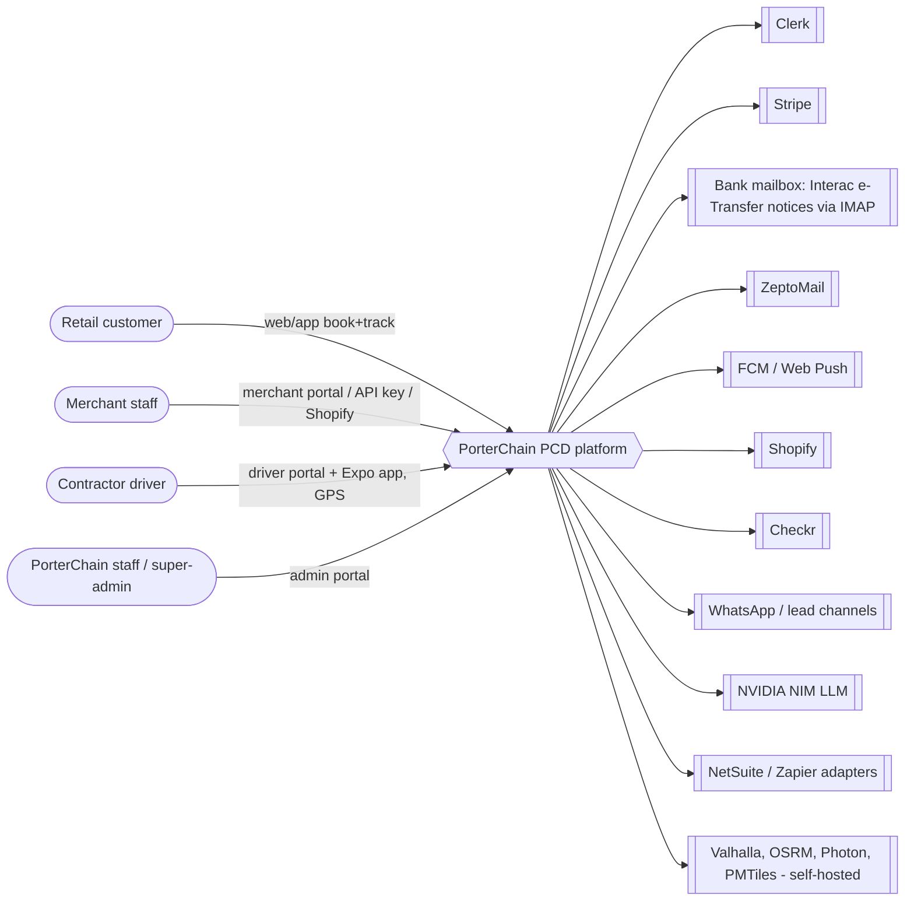

# 01 — System context (AS-BUILT)

| Element                                       | Evidence                                                                                         |
| --------------------------------------------- | ------------------------------------------------------------------------------------------------ |
| Clerk (merchant/driver/customer)              | `auth/dependencies.py` (`get_clerk_claims`), `apps/*/src/middleware.ts`                          |
| Staff IdP (passkey/magic link, Redis session) | `routers/auth_staff.py`, table `staff_webauthn_credentials`                                      |
| Stripe                                        | `billing_engine/stripe_money.py`                                                                 |
| Interac IMAP                                  | worker sweep `interac_inbox` (`apps/worker/run.py:695-721`)                                      |
| ZeptoMail                                     | route `POST /v1/public/mail/zeptomail` (06)                                                      |
| FCM / web-push                                | `notification_engine/*`, queue `porterchain:queue:push`                                          |
| Shopify                                       | `routers/shopify.py`, `integrations/shopify_orders.py:96`                                        |
| Checkr                                        | `routers/webhooks.py`, `routers/drivers_admin.py`                                                |
| WhatsApp                                      | `collaboration_engine/lead_channel_adapters.py:46-56` (lead intake only)                         |
| NIM                                           | `intelligence_engine/` client                                                                    |
| Geo                                           | `infrastructure/deploy/docker-compose.prod.yml` services valhalla/osrm/photon; Caddyfile PMTiles |
