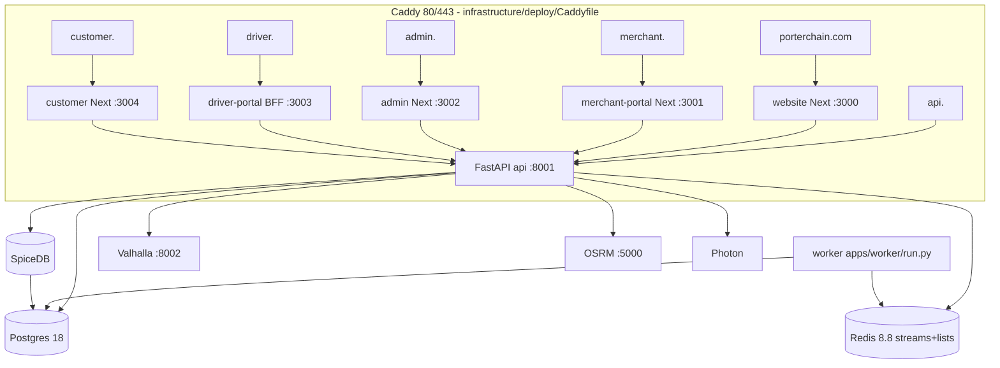

# 02 — Containers and deployment (AS-BUILT)

| Environment                           | Where                                                                                                                                                                                                   | Ports                                                                     |
| ------------------------------------- | ------------------------------------------------------------------------------------------------------------------------------------------------------------------------------------------------------- | ------------------------------------------------------------------------- |
| Prod compose                          | `infrastructure/deploy/docker-compose.prod.yml` (postgres, redis, spicedb-db-init/migrate, spicedb, valhalla, photon, osrm, api, worker, web, admin, merchant, driver, customer, caddy, autoheal, edge) | 80/443                                                                    |
| Dev compose                           | `infrastructure/docker/docker-compose.yml`                                                                                                                                                              | cache, postgres, spicedb, mailpit, valhalla, osrm, nginx                  |
| Ubuntu "main" stack (live; untouched) | docker ps                                                                                                                                                                                               | 5432, 6379, 50051/8443, mailpit 1025/8025, 8002, 5000                     |
| Local rehearsal stack                 | `/home/pcd/pcd-local/compose.yml`                                                                                                                                                                       | pg 55632, redis 56679, spicedb 55251, mailpit 51125, UI **0.0.0.0:58125** |
| Tests                                 | `apps/api/tests/conftest.py:14-27`                                                                                                                                                                      | 55432/56379/55051                                                         |
| Mobile                                | `apps/mobile-driver`, `apps/mobile-customer` (Expo)                                                                                                                                                     | —                                                                         |
| Retired hosts                         | Caddyfile: `fleetbase.`, `console.`                                                                                                                                                                     | —                                                                         |
| Unrelated containers on host          | pch-keycloak 0.0.0.0:8180/8543, pch-infra-garage 3900, crm-postgres 5433, pch-dev-postgres 55433 (0 refs in PCD)                                                                                        | —                                                                         |
