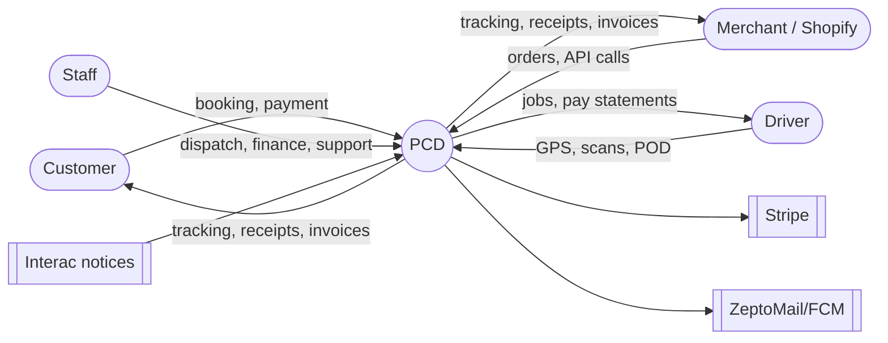
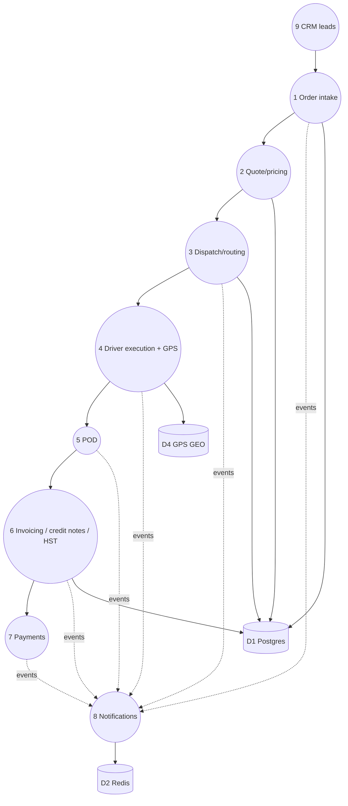

# 03 — Data-flow diagrams (AS-BUILT)

Datastores: D1 Postgres (131 tables, see 04), D2 Redis Streams `porterchain:events` + list queues `porterchain:queue:*`, D3 SpiceDB, D4 Redis GEO `porterchain:gps:geo`.

## Level 0

## Level 1

## Level 2 per process

| #   | Process                        | Inputs → steps → outputs                                                                                                                                                                                                                                                                                                                                                                                                                                                                                 | Evidence                                      |
| --- | ------------------------------ | -------------------------------------------------------------------------------------------------------------------------------------------------------------------------------------------------------------------------------------------------------------------------------------------------------------------------------------------------------------------------------------------------------------------------------------------------------------------------------------------------------- | --------------------------------------------- |
| 1   | Order intake (incl. Shopify)   | merchant portal `routers/merchant/dashboard_booking.py`, public/customer `routers/booking_drafts.py`, API key `routers/merchant_api.py`, Shopify `routers/shopify.py` + `integrations/shopify_orders.py:96` (COD detection) → `merchant_engine/booking_validation.py:115` (DG approval, prohibited refused), `merchant_engine/service_area.py:68,84,100` (FSA/Ontario check), no-COD `merchant_engine/booking_service.py:320-323` → tables `orders`, `packages`, `booking_drafts`; event `order.created` | 06, 04                                        |
| 2   | Quote/pricing                  | `routers/quotes.py`, `pricing_engine/`, `shared/python/porterchain_pricing/gta150_fsa.py`, `routers/fsa_rate_card.py`, `routers/pricing_admin.py` → `quotes`; tax `billing_engine/tax.py:99`                                                                                                                                                                                                                                                                                                             | margin-floor enforcement **not found** (U-03) |
| 3   | Dispatch/routing               | `routers/admin/dispatch.py`, `dispatch_plan.py`, `dispatch_engine/` (OR-Tools), Valhalla/OSRM; queues `dispatch`,`routing`; sweep `job_offer_sweep`; key `porterchain:optimize:fleet_open`                                                                                                                                                                                                                                                                                                               | 05                                            |
| 4   | Driver execution + GPS         | `routers/driver/{jobs,assignment,shift,delivery_leg,scan,gps}.py`; GPS policy `platform/gps_policy.py`; Redis GEO `porterchain:gps:geo`, live `porterchain:ops:live`; transitions only via `booking_engine/order_transitions.py:48,75`                                                                                                                                                                                                                                                                   | 08                                            |
| 5   | POD                            | `routers/driver/navigation_pod.py:91` (photo), `:112` (signature), OTP gate (`otp_required`/`invalid_otp`, line 30); `packages.signature_required`                                                                                                                                                                                                                                                                                                                                                       | 04                                            |
| 6   | Invoicing / credit notes / HST | sweep `billing_cycle`; `billing_engine/models.py:140,177` (`invoices.status` default draft); status computed `billing_engine/merchant_service.py:41-80`; adjustments `billing_engine/invoice_adjustments.py:59` (approval threshold), `:85` (credit-note numbering); tax `billing_engine/tax.py`; GST34 `reporting/tax_report.py`; registration `platform/tax_registration.py`                                                                                                                           | 08, 11                                        |
| 7   | Payments                       | Stripe `billing_engine/stripe_money.py`; Interac sweep `interac_inbox` + `routers/admin/finance_interac.py`; retention `finance_ops/retention.py:16` (MIN_YEARS 6)                                                                                                                                                                                                                                                                                                                                       | 05                                            |
| 8   | Notifications                  | `notification_engine/event_router.py:537-548` subscriptions → queues `emails,sms,push,notify_fast,notify_slow`; CASL `notification_engine/unsubscribe.py`, `crm_suppression.py`; sweep `notification_retries`                                                                                                                                                                                                                                                                                            | 10                                            |
| 9   | CRM leads                      | `routers/lead_webhooks.py`, `collaboration_engine/lead_channel_adapters.py:46-56` (WhatsApp etc.), `lead_consent.py:70`; sweeps `lead_nurture, lead_agent, lead_sla_escalation, lead_inbound_email, lead_soft_archive`; tables `crm_*`                                                                                                                                                                                                                                                                   | 05                                            |
