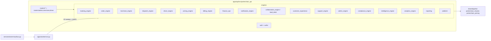

# 05 — Backend module map, workers, queues, schedulers (AS-BUILT)

## Worker (apps/worker/run.py)

`sweep_table()` lines 695-721 — **22 polling sweeps**: draft_reconciliation, standing_orders, interac_inbox, billing_cycle, finance_daily, notification_retries, merchant_webhook_retries, shopify_fulfillment_retries, driver_compliance_expiry, lead_nurture, lead_agent, lead_sla_escalation, lead_inbound_email, delivery_sla, lead_soft_archive, deleted_items_purge, shopify_buyer_retention, blog_scheduled_publish, merchant_ops, job_offer_sweep, retention, stop_time_learning. Plus event-bus drain and list-queue drain; processors: billing, dispatch, merchant_ops, notifications, webhooks.

## Queues and keys

| Kind   | Key                                                                                                                                  | Evidence                       |
| ------ | ------------------------------------------------------------------------------------------------------------------------------------ | ------------------------------ |
| Stream | `porterchain:events`, group `porterchain-workers`, maxlen 100k                                                                       | `services/event-bus/bus.py:26` |
| DLQ    | `porterchain:events:dlq`                                                                                                             | bus.py                         |
| Lists  | `porterchain:queue:{emails,sms,push,dispatch,routing,billing,reports,webhooks,notify_fast,notify_slow}`                              | worker                         |
| Other  | `porterchain:gps:geo`, `:ops:live`, `:notifications:realtime`, `:optimize:fleet_open`, `:worker:heartbeat`, `:staff`, `:lead:rr:idx` | rg                             |

## Dead / shim code

| File                                                                                                                             | Status                                            |
| -------------------------------------------------------------------------------------------------------------------------------- | ------------------------------------------------- |
| `schema_extras.py`, `integrations/base_adapter.py`, `analytics_engine/etl_service.py`, `intelligence_engine/forecast_service.py` | 0 importers                                       |
| `driver_engine/last_known.py`                                                                                                    | re-export of `platform/last_known.py`             |
| `order_engine/platform_legacy.py`                                                                                                | legacy mixin                                      |
| `routers/admin/{monopoly_metrics,investor_metrics,data_moat,visitor_intelligence}.py`                                            | non-operational analytics in the ops API (see 11) |
