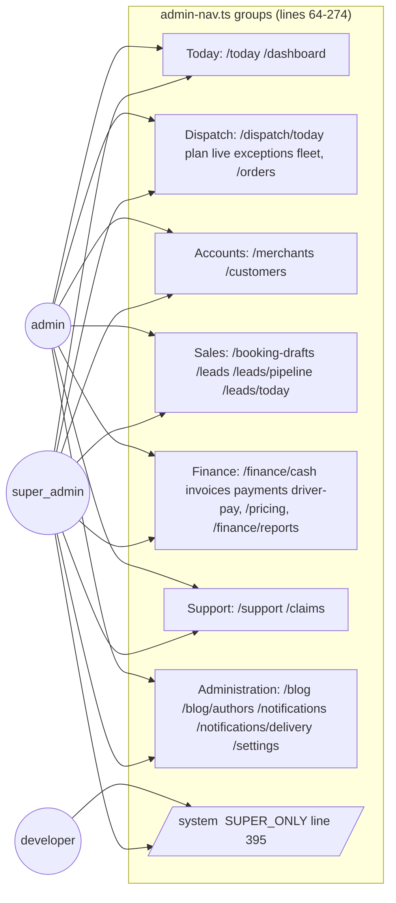

# 07 — Interface layer: every screen per app (AS-BUILT)

**Evidence:** every `page.tsx` under `apps/*/src/app/**` (Next.js App Router; route groups like `(ops)`/`(portal)` do not appear in the URL), `website/` pages, Expo screens under `apps/mobile-*/src/screens/*.tsx` and `apps/mobile-driver/App.tsx:2` ("Five screens: Sign in, Location consent, and three tabs (Today, Job, Me)"). Redirect stubs detected as pages < 15 lines that call `redirect(...)`. Admin navigation from `apps/admin/src/lib/admin-nav.ts` (groups at lines 64–274; `SUPER_ONLY = new Set(["/system"])` at line 395; extra search entries at 420–426).

## admin (`apps/admin`) — 54 page files

| URL                         | Kind                                          | In top nav (admin-nav.ts) | File                                                         |
| --------------------------- | --------------------------------------------- | ------------------------- | ------------------------------------------------------------ |
| `/account/security`         | screen                                        | no                        | `apps/admin/src/app/(ops)/account/security/page.tsx`         |
| `/blog/[id]`                | screen                                        | no                        | `apps/admin/src/app/(ops)/blog/[id]/page.tsx`                |
| `/blog/authors`             | screen                                        | yes                       | `apps/admin/src/app/(ops)/blog/authors/page.tsx`             |
| `/blog/new`                 | screen                                        | no                        | `apps/admin/src/app/(ops)/blog/new/page.tsx`                 |
| `/blog`                     | screen                                        | yes                       | `apps/admin/src/app/(ops)/blog/page.tsx`                     |
| `/booking-drafts/[id]`      | screen                                        | no                        | `apps/admin/src/app/(ops)/booking-drafts/[id]/page.tsx`      |
| `/booking-drafts`           | screen                                        | yes                       | `apps/admin/src/app/(ops)/booking-drafts/page.tsx`           |
| `/claims/[id]`              | screen                                        | no                        | `apps/admin/src/app/(ops)/claims/[id]/page.tsx`              |
| `/claims`                   | screen                                        | yes                       | `apps/admin/src/app/(ops)/claims/page.tsx`                   |
| `/customers/[id]`           | screen                                        | no                        | `apps/admin/src/app/(ops)/customers/[id]/page.tsx`           |
| `/customers`                | screen                                        | yes                       | `apps/admin/src/app/(ops)/customers/page.tsx`                |
| `/dashboard`                | screen                                        | yes                       | `apps/admin/src/app/(ops)/dashboard/page.tsx`                |
| `/dispatch/[view]`          | screen                                        | no                        | `apps/admin/src/app/(ops)/dispatch/[view]/page.tsx`          |
| `/dispatch`                 | redirect → "/dispatch/today"                  | no                        | `apps/admin/src/app/(ops)/dispatch/page.tsx`                 |
| `/drivers/[id]`             | screen                                        | no                        | `apps/admin/src/app/(ops)/drivers/[id]/page.tsx`             |
| `/drivers`                  | redirect → "/dispatch/fleet"                  | no                        | `apps/admin/src/app/(ops)/drivers/page.tsx`                  |
| `/finance/analytics`        | screen                                        | no                        | `apps/admin/src/app/(ops)/finance/analytics/page.tsx`        |
| `/finance/cash`             | screen                                        | yes                       | `apps/admin/src/app/(ops)/finance/cash/page.tsx`             |
| `/finance/driver-pay`       | screen                                        | yes                       | `apps/admin/src/app/(ops)/finance/driver-pay/page.tsx`       |
| `/finance/invoices/[id]`    | screen                                        | no                        | `apps/admin/src/app/(ops)/finance/invoices/[id]/page.tsx`    |
| `/finance/invoices`         | screen                                        | yes                       | `apps/admin/src/app/(ops)/finance/invoices/page.tsx`         |
| `/finance`                  | screen                                        | no                        | `apps/admin/src/app/(ops)/finance/page.tsx`                  |
| `/finance/payments`         | screen                                        | yes                       | `apps/admin/src/app/(ops)/finance/payments/page.tsx`         |
| `/finance/reports`          | screen                                        | yes                       | `apps/admin/src/app/(ops)/finance/reports/page.tsx`          |
| `/finance/tax-registration` | screen                                        | no                        | `apps/admin/src/app/(ops)/finance/tax-registration/page.tsx` |
| `/inbox`                    | redirect → "/notifications?tab=inbox"         | yes                       | `apps/admin/src/app/(ops)/inbox/page.tsx`                    |
| `/leads/[id]`               | screen                                        | no                        | `apps/admin/src/app/(ops)/leads/[id]/page.tsx`               |
| `/leads/agent`              | screen                                        | yes                       | `apps/admin/src/app/(ops)/leads/agent/page.tsx`              |
| `/leads/attribution`        | screen                                        | yes                       | `apps/admin/src/app/(ops)/leads/attribution/page.tsx`        |
| `/leads/calendar`           | screen                                        | yes                       | `apps/admin/src/app/(ops)/leads/calendar/page.tsx`           |
| `/leads`                    | screen                                        | yes                       | `apps/admin/src/app/(ops)/leads/page.tsx`                    |
| `/leads/pipeline`           | screen                                        | yes                       | `apps/admin/src/app/(ops)/leads/pipeline/page.tsx`           |
| `/leads/today`              | screen                                        | yes                       | `apps/admin/src/app/(ops)/leads/today/page.tsx`              |
| `/merchants/[id]`           | screen                                        | no                        | `apps/admin/src/app/(ops)/merchants/[id]/page.tsx`           |
| `/merchants/duplicates`     | screen                                        | no                        | `apps/admin/src/app/(ops)/merchants/duplicates/page.tsx`     |
| `/merchants`                | screen                                        | yes                       | `apps/admin/src/app/(ops)/merchants/page.tsx`                |
| `/notifications/delivery`   | screen                                        | yes                       | `apps/admin/src/app/(ops)/notifications/delivery/page.tsx`   |
| `/notifications`            | screen                                        | yes                       | `apps/admin/src/app/(ops)/notifications/page.tsx`            |
| `/operations`               | redirect → legacyOperationsTarget(one(sp.view | no                        | `apps/admin/src/app/(ops)/operations/page.tsx`               |
| `/orders/[id]`              | screen                                        | no                        | `apps/admin/src/app/(ops)/orders/[id]/page.tsx`              |
| `/orders`                   | screen                                        | yes                       | `apps/admin/src/app/(ops)/orders/page.tsx`                   |
| `/pricing`                  | screen                                        | yes                       | `apps/admin/src/app/(ops)/pricing/page.tsx`                  |
| `/settings`                 | screen                                        | yes                       | `apps/admin/src/app/(ops)/settings/page.tsx`                 |
| `/support/[id]`             | screen                                        | no                        | `apps/admin/src/app/(ops)/support/[id]/page.tsx`             |
| `/support`                  | screen                                        | yes                       | `apps/admin/src/app/(ops)/support/page.tsx`                  |
| `/system`                   | screen                                        | yes                       | `apps/admin/src/app/(ops)/system/page.tsx`                   |
| `/system-health`            | redirect → "/system"                          | yes                       | `apps/admin/src/app/(ops)/system-health/page.tsx`            |
| `/system-tests`             | redirect → "/system?tab=tests"                | yes                       | `apps/admin/src/app/(ops)/system-tests/page.tsx`             |
| `/today`                    | screen                                        | yes                       | `apps/admin/src/app/(ops)/today/page.tsx`                    |
| `/activate-staff`           | screen                                        | no                        | `apps/admin/src/app/activate-staff/page.tsx`                 |
| `/admin/system-health`      | redirect → "/system"                          | no                        | `apps/admin/src/app/admin/system-health/page.tsx`            |
| `/admin/system-tests`       | redirect → "/system?tab=tests"                | no                        | `apps/admin/src/app/admin/system-tests/page.tsx`             |
| `/`                         | redirect → "/today"                           | no                        | `apps/admin/src/app/page.tsx`                                |
| `/sign-in/[[...sign-in]]`   | screen                                        | no                        | `apps/admin/src/app/sign-in/[[...sign-in]]/page.tsx`         |

## merchant-portal (`apps/merchant-portal`) — 24 page files

| URL                              | Kind                         | In top nav (admin-nav.ts) | File                                                                           |
| -------------------------------- | ---------------------------- | ------------------------- | ------------------------------------------------------------------------------ |
| `/api`                           | screen                       | —                         | `apps/merchant-portal/src/app/(portal)/api/page.tsx`                           |
| `/billing/invoices/[invoice_id]` | screen                       | —                         | `apps/merchant-portal/src/app/(portal)/billing/invoices/[invoice_id]/page.tsx` |
| `/billing`                       | screen                       | —                         | `apps/merchant-portal/src/app/(portal)/billing/page.tsx`                       |
| `/book`                          | screen                       | —                         | `apps/merchant-portal/src/app/(portal)/book/page.tsx`                          |
| `/bulk`                          | redirect → "/routes?tab=csv" | —                         | `apps/merchant-portal/src/app/(portal)/bulk/page.tsx`                          |
| `/dashboard`                     | screen                       | —                         | `apps/merchant-portal/src/app/(portal)/dashboard/page.tsx`                     |
| `/help`                          | screen                       | —                         | `apps/merchant-portal/src/app/(portal)/help/page.tsx`                          |
| `/notifications`                 | screen                       | —                         | `apps/merchant-portal/src/app/(portal)/notifications/page.tsx`                 |
| `/orders/[order_id]`             | screen                       | —                         | `apps/merchant-portal/src/app/(portal)/orders/[order_id]/page.tsx`             |
| `/orders`                        | screen                       | —                         | `apps/merchant-portal/src/app/(portal)/orders/page.tsx`                        |
| `/pricing/how-we-price`          | screen                       | —                         | `apps/merchant-portal/src/app/(portal)/pricing/how-we-price/page.tsx`          |
| `/referrals`                     | screen                       | —                         | `apps/merchant-portal/src/app/(portal)/referrals/page.tsx`                     |
| `/reports`                       | screen                       | —                         | `apps/merchant-portal/src/app/(portal)/reports/page.tsx`                       |
| `/routes/[job_id]`               | screen                       | —                         | `apps/merchant-portal/src/app/(portal)/routes/[job_id]/page.tsx`               |
| `/routes`                        | screen                       | —                         | `apps/merchant-portal/src/app/(portal)/routes/page.tsx`                        |
| `/settings`                      | screen                       | —                         | `apps/merchant-portal/src/app/(portal)/settings/page.tsx`                      |
| `/shopify`                       | screen                       | —                         | `apps/merchant-portal/src/app/(portal)/shopify/page.tsx`                       |
| `/team`                          | screen                       | —                         | `apps/merchant-portal/src/app/(portal)/team/page.tsx`                          |
| `/track`                         | screen                       | —                         | `apps/merchant-portal/src/app/(portal)/track/page.tsx`                         |
| `/impersonate`                   | screen                       | —                         | `apps/merchant-portal/src/app/impersonate/page.tsx`                            |
| `/onboarding`                    | screen                       | —                         | `apps/merchant-portal/src/app/onboarding/page.tsx`                             |
| `/`                              | screen                       | —                         | `apps/merchant-portal/src/app/page.tsx`                                        |
| `/sign-in/[[...sign-in]]`        | screen                       | —                         | `apps/merchant-portal/src/app/sign-in/[[...sign-in]]/page.tsx`                 |
| `/sign-up/[[...sign-up]]`        | screen                       | —                         | `apps/merchant-portal/src/app/sign-up/[[...sign-up]]/page.tsx`                 |

## customer (`apps/customer`) — 17 page files

| URL                       | Kind                                                          | In top nav (admin-nav.ts) | File                                                    |
| ------------------------- | ------------------------------------------------------------- | ------------------------- | ------------------------------------------------------- |
| `/account`                | screen                                                        | —                         | `apps/customer/src/app/account/page.tsx`                |
| `/book`                   | redirect → quote_id ? `/send?quote_id=${encodeURIComponent(qu | —                         | `apps/customer/src/app/book/page.tsx`                   |
| `/book/success`           | screen                                                        | —                         | `apps/customer/src/app/book/success/page.tsx`           |
| `/dashboard`              | redirect → "/orders"                                          | —                         | `apps/customer/src/app/dashboard/page.tsx`              |
| `/impersonate`            | screen                                                        | —                         | `apps/customer/src/app/impersonate/page.tsx`            |
| `/invoices/[invoice_id]`  | screen                                                        | —                         | `apps/customer/src/app/invoices/[invoice_id]/page.tsx`  |
| `/invoices`               | screen                                                        | —                         | `apps/customer/src/app/invoices/page.tsx`               |
| `/notifications`          | screen                                                        | —                         | `apps/customer/src/app/notifications/page.tsx`          |
| `/onboarding`             | redirect → "/send"                                            | —                         | `apps/customer/src/app/onboarding/page.tsx`             |
| `/orders`                 | screen                                                        | —                         | `apps/customer/src/app/orders/page.tsx`                 |
| `/`                       | redirect → "/send"                                            | —                         | `apps/customer/src/app/page.tsx`                        |
| `/send`                   | screen                                                        | —                         | `apps/customer/src/app/send/page.tsx`                   |
| `/sign-in/[[...sign-in]]` | screen                                                        | —                         | `apps/customer/src/app/sign-in/[[...sign-in]]/page.tsx` |
| `/sign-up/[[...sign-up]]` | screen                                                        | —                         | `apps/customer/src/app/sign-up/[[...sign-up]]/page.tsx` |
| `/track/[trackingNumber]` | screen                                                        | —                         | `apps/customer/src/app/track/[trackingNumber]/page.tsx` |
| `/track`                  | redirect → `${publicEnv.websiteUrl}/en/track`                 | —                         | `apps/customer/src/app/track/page.tsx`                  |
| `/welcome`                | screen                                                        | —                         | `apps/customer/src/app/welcome/page.tsx`                |

## driver-portal (`apps/driver-portal`) — 25 page files

| URL                     | Kind                            | In top nav (admin-nav.ts) | File                                                       |
| ----------------------- | ------------------------------- | ------------------------- | ---------------------------------------------------------- |
| `/account`              | screen                          | —                         | `apps/driver-portal/src/app/account/page.tsx`              |
| `/communications`       | screen                          | —                         | `apps/driver-portal/src/app/communications/page.tsx`       |
| `/dashboard`            | screen                          | —                         | `apps/driver-portal/src/app/dashboard/page.tsx`            |
| `/documents`            | redirect → "/profile#documents" | —                         | `apps/driver-portal/src/app/documents/page.tsx`            |
| `/earnings`             | screen                          | —                         | `apps/driver-portal/src/app/earnings/page.tsx`             |
| `/emergency`            | screen                          | —                         | `apps/driver-portal/src/app/emergency/page.tsx`            |
| `/impersonate`          | screen                          | —                         | `apps/driver-portal/src/app/impersonate/page.tsx`          |
| `/insurance`            | redirect → "/profile#insurance" | —                         | `apps/driver-portal/src/app/insurance/page.tsx`            |
| `/jobs/[orderId]`       | screen                          | —                         | `apps/driver-portal/src/app/jobs/[orderId]/page.tsx`       |
| `/jobs`                 | screen                          | —                         | `apps/driver-portal/src/app/jobs/page.tsx`                 |
| `/login/[[...sign-in]]` | screen                          | —                         | `apps/driver-portal/src/app/login/[[...sign-in]]/page.tsx` |
| `/monitoring-policy`    | screen                          | —                         | `apps/driver-portal/src/app/monitoring-policy/page.tsx`    |
| `/navigation`           | screen                          | —                         | `apps/driver-portal/src/app/navigation/page.tsx`           |
| `/onboarding`           | screen                          | —                         | `apps/driver-portal/src/app/onboarding/page.tsx`           |
| `/`                     | redirect → "/onboarding"        | —                         | `apps/driver-portal/src/app/page.tsx`                      |
| `/performance`          | screen                          | —                         | `apps/driver-portal/src/app/performance/page.tsx`          |
| `/profile`              | screen                          | —                         | `apps/driver-portal/src/app/profile/page.tsx`              |
| `/route`                | screen                          | —                         | `apps/driver-portal/src/app/route/page.tsx`                |
| `/shift`                | screen                          | —                         | `apps/driver-portal/src/app/shift/page.tsx`                |
| `/stops`                | redirect → "/jobs"              | —                         | `apps/driver-portal/src/app/stops/page.tsx`                |
| `/support`              | screen                          | —                         | `apps/driver-portal/src/app/support/page.tsx`              |
| `/timesheets`           | screen                          | —                         | `apps/driver-portal/src/app/timesheets/page.tsx`           |
| `/training`             | screen                          | —                         | `apps/driver-portal/src/app/training/page.tsx`             |
| `/vehicle`              | redirect → "/profile#vehicle"   | —                         | `apps/driver-portal/src/app/vehicle/page.tsx`              |
| `/wallet`               | screen                          | —                         | `apps/driver-portal/src/app/wallet/page.tsx`               |

## website (`website/`) — 72 page files

All website pages

- `website/src/app/[locale]/[...rest]/page.tsx`
- `website/src/app/[locale]/[city]/[industrySlug]/page.tsx`
- `website/src/app/[locale]/accessibility/page.tsx`
- `website/src/app/[locale]/authors/[id]/page.tsx`
- `website/src/app/[locale]/authors/page.tsx`
- `website/src/app/[locale]/blog/[slug]/page.tsx`
- `website/src/app/[locale]/blog/category/[category]/page.tsx`
- `website/src/app/[locale]/blog/page.tsx`
- `website/src/app/[locale]/blog/preview/[slug]/page.tsx`
- `website/src/app/[locale]/book/continue/page.tsx`
- `website/src/app/[locale]/book/page.tsx`
- `website/src/app/[locale]/book/success/page.tsx`
- `website/src/app/[locale]/box-truck-delivery/page.tsx`
- `website/src/app/[locale]/business/page.tsx`
- `website/src/app/[locale]/campaigns/[slug]/page.tsx`
- `website/src/app/[locale]/campaigns/page.tsx`
- `website/src/app/[locale]/careers/page.tsx`
- `website/src/app/[locale]/cargo-van-delivery/page.tsx`
- `website/src/app/[locale]/company/page.tsx`
- `website/src/app/[locale]/compare/[slug]/page.tsx`
- `website/src/app/[locale]/compare/page.tsx`
- `website/src/app/[locale]/contact/page.tsx`
- `website/src/app/[locale]/cookies/page.tsx`
- `website/src/app/[locale]/delivery/[industry]/[area]/page.tsx`
- `website/src/app/[locale]/delivery/[industry]/page.tsx`
- `website/src/app/[locale]/delivery/page.tsx`
- `website/src/app/[locale]/delivery-cost-calculator/page.tsx`
- `website/src/app/[locale]/developers/docs/[slug]/page.tsx`
- `website/src/app/[locale]/developers/docs/page.tsx`
- `website/src/app/[locale]/developers/page.tsx`
- `website/src/app/[locale]/email-preferences/page.tsx`
- `website/src/app/[locale]/enterprise/page.tsx`
- `website/src/app/[locale]/facts/page.tsx`
- `website/src/app/[locale]/faq/page.tsx`
- `website/src/app/[locale]/guides/[slug]/page.tsx`
- `website/src/app/[locale]/guides/page.tsx`
- `website/src/app/[locale]/industry/[slug]/page.tsx`
- `website/src/app/[locale]/integrations/page.tsx`
- `website/src/app/[locale]/login/[[...sign-in]]/page.tsx`
- `website/src/app/[locale]/login/continue/page.tsx`
- `website/src/app/[locale]/newsletter/confirm/page.tsx`
- `website/src/app/[locale]/onboarding-education/[slug]/page.tsx`
- `website/src/app/[locale]/page-not-found/page.tsx`
- `website/src/app/[locale]/page.tsx`
- `website/src/app/[locale]/pickup-truck-delivery/page.tsx`
- `website/src/app/[locale]/platform/page.tsx`
- `website/src/app/[locale]/privacy/page.tsx`
- `website/src/app/[locale]/quote/page.tsx`
- `website/src/app/[locale]/rates/page.tsx`
- `website/src/app/[locale]/research/page.tsx`
- `website/src/app/[locale]/sedan-delivery/page.tsx`
- `website/src/app/[locale]/service-areas/[slug]/page.tsx`
- `website/src/app/[locale]/service-areas/page.tsx`
- `website/src/app/[locale]/sign-up/[[...sign-up]]/page.tsx`
- `website/src/app/[locale]/terms/page.tsx`
- `website/src/app/[locale]/track/[tracking]/manage/page.tsx`
- `website/src/app/[locale]/track/[tracking]/page.tsx`
- `website/src/app/[locale]/track/page.tsx`
- `website/src/app/[locale]/trade-van-delivery/page.tsx`
- `website/src/app/[locale]/trust/claims/page.tsx`
- `website/src/app/[locale]/trust/corrections/page.tsx`
- `website/src/app/[locale]/trust/editorial-policy/page.tsx`
- `website/src/app/[locale]/trust/founder/page.tsx`
- `website/src/app/[locale]/trust/page.tsx`
- `website/src/app/[locale]/trust/research-methodology/page.tsx`
- `website/src/app/[locale]/trust/security/page.tsx`
- `website/src/app/[locale]/trust/service-standards/page.tsx`
- `website/src/app/[locale]/unsubscribe/page.tsx`
- `website/src/app/[locale]/vehicle-partner/page.tsx`
- `website/src/app/[locale]/vehicles/page.tsx`
- `website/src/app/proof-of-resolution/page.tsx`
- `website/src/app/ravi/page.tsx`

## mobile-driver (Expo, `apps/mobile-driver`) — 12 screen files

- `apps/mobile-driver/src/screens/AvailabilityPage.tsx`
- `apps/mobile-driver/src/screens/ConsentScreen.tsx`
- `apps/mobile-driver/src/screens/DocumentsPage.tsx`
- `apps/mobile-driver/src/screens/HelpPage.tsx`
- `apps/mobile-driver/src/screens/InboxPage.tsx`
- `apps/mobile-driver/src/screens/JobScreen.tsx`
- `apps/mobile-driver/src/screens/MeScreen.tsx`
- `apps/mobile-driver/src/screens/PayPage.tsx`
- `apps/mobile-driver/src/screens/ProfilePage.tsx`
- `apps/mobile-driver/src/screens/SettingsPage.tsx`
- `apps/mobile-driver/src/screens/SignInScreen.tsx`
- `apps/mobile-driver/src/screens/TodayScreen.tsx`

## mobile-customer (Expo, `apps/mobile-customer`) — 8 screen files

- `apps/mobile-customer/src/screens/AccountScreen.tsx`
- `apps/mobile-customer/src/screens/ActivityScreen.tsx`
- `apps/mobile-customer/src/screens/AlertsScreen.tsx`
- `apps/mobile-customer/src/screens/BookScreen.tsx`
- `apps/mobile-customer/src/screens/HomeScreen.tsx`
- `apps/mobile-customer/src/screens/OnboardingScreen.tsx`
- `apps/mobile-customer/src/screens/SignInScreen.tsx`
- `apps/mobile-customer/src/screens/TrackScreen.tsx`

## Shopify embedded app

- Config: `integrations/shopify/app.toml`, `integrations/shopify/shopify.app.custom.toml`; listing mock-ups `integrations/shopify/listing/*.html`.
- API side: `apps/api/src/porterchain_api/routers/shopify.py` (`/v1/integrations/shopify/session`, `/webhooks`, `/fs/fulfillment_order_notification`, legacy browser entry at line 221).
- UI of the embedded app inside Shopify admin: see Unknowns (U-07).

## Admin vs super-admin (as built)

Server side the API still checks each SpiceDB permission (see 09); nav hiding is UX only (`admin-nav.ts:405`).

Redirect stubs (legacy aliases kept as pages): **20** across the four Next portals.
