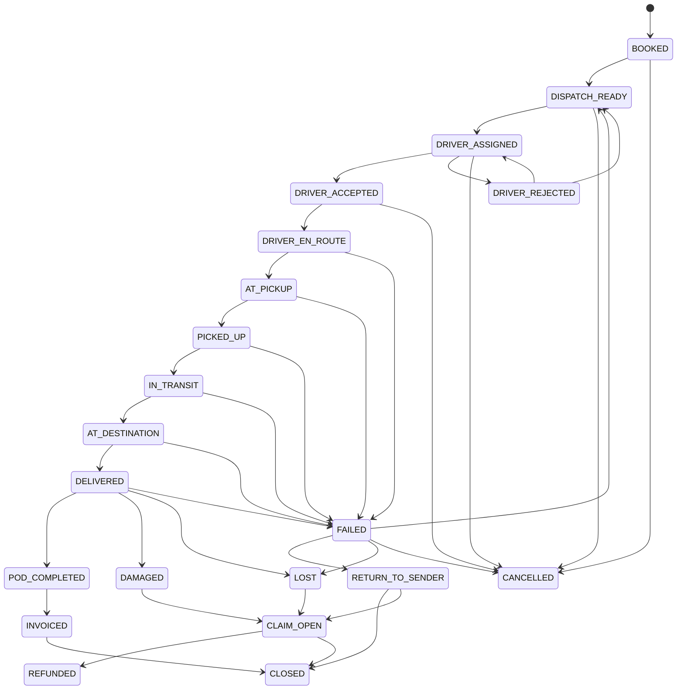
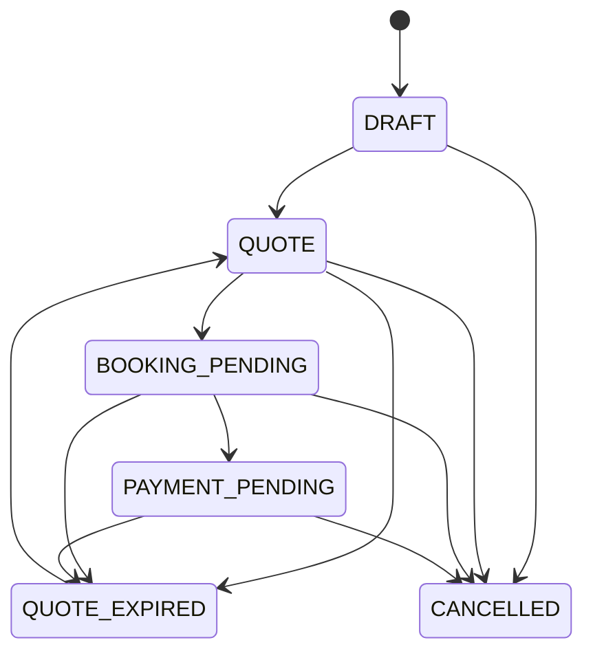
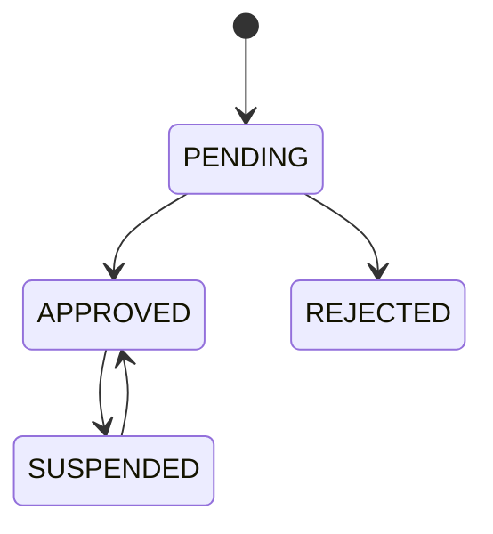

# 08 — State machines (AS-BUILT)

## Order — `domain/states.py:21` (`OrderState`), `ORDER_TRANSITIONS` line 105; only writer `booking_engine/order_transitions.py:48` (`transition_order_state`, check at :75)

Observations: `DELIVERED → FAILED` is allowed; damage found in transit (`IN_TRANSIT`) can only go via FAILED; claims after `CLOSED` (O. Reg. 643/05 allows 60-day notice after delivery) have no path.

## Quote — `QUOTE_TRANSITIONS` line 143

Gap: `PAYMENT_PENDING` has **no success exit** (no ACCEPTED/BOOKED state).

## Booking draft — `BOOKING_DRAFT_TRANSITIONS` line 162

DRAFT → QUOTE_GENERATED → (CUSTOMER_IDENTIFIED | AUTHENTICATED) → PAYMENT_PENDING → PAYMENT_COMPLETED → BOOKING_CONFIRMED; PAYMENT_FAILED ↔ PAYMENT_PENDING; any → CANCELLED/EXPIRED; **EXPIRED → DRAFT/QUOTE_GENERATED/PAYMENT_PENDING/PAYMENT_FAILED/PAYMENT_COMPLETED** (late Stripe webhook, comment at line ~200).

## Package — `PACKAGE_TRANSITIONS` line 229

MANIFESTED → PICKED_UP | MISSING_AT_PICKUP; MISSING_AT_PICKUP → PICKED_UP; PICKED_UP → LOADED | OUT_FOR_DELIVERY | DELIVERED; LOADED → OUT_FOR_DELIVERY | DELIVERED; OUT_FOR_DELIVERY → DELIVERED. No failure/return state for packages.

## Job (dispatch offer) — `dispatch_engine/models.py:20` `DispatchJobOffer.status` String(16) default `"pending"`

Literals found: pending → accepted | declined | expired (sweep `job_offer_sweep`). **No enum/transition table** (hand-rolled strings). `dispatch_routes.status`, `dispatch_plans.status`, `stops.status` are also free varchar (04).

## Invoice — two sources of truth

- Column `invoices.status` default `'draft'` (`billing_engine/models.py:140,177`).
- Computed `invoice_status()` in `billing_engine/merchant_service.py:41-80`: void, credited, cancelled, paid, pending, overdue, partial, partially_credited, sent. Façade `platform/invoice_status.py`.

## Credit note — `billing_engine/invoice_adjustments.py`

kinds void/lines/partial; status `pending_approval → issued | rejected` (approval above `approval_threshold_cents`, line 59); numbering line 85. A second, older issuer remains in `billing_engine/credit_notes.py`.

## Driver — `domain/admin_states.py:40` `DriverStatus`

Transitions are implied by handlers `routers/drivers_admin.py:158` (suspend) and `:165` (deactivate); **no transition table** — exact allowed edges are U-05. Also ClaimStatus (open/investigating/resolved/closed, line 47) and TicketStatus (line 54).
