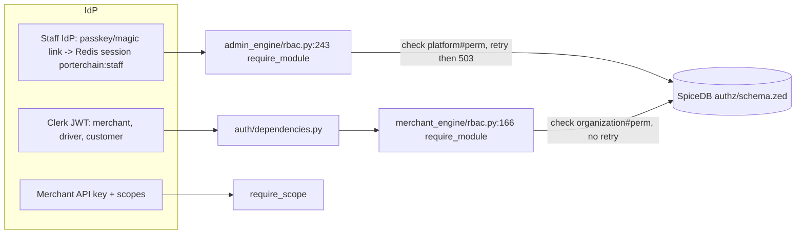

# 09 — Authorization model (AS-BUILT)

## schema.zed (authz/schema.zed)

| Definition                                                   | Relations                                                                                                                                             | Example permissions                                                                                                                  |
| ------------------------------------------------------------ | ----------------------------------------------------------------------------------------------------------------------------------------------------- | ------------------------------------------------------------------------------------------------------------------------------------ |
| user                                                         | —                                                                                                                                                     | —                                                                                                                                    |
| platform                                                     | super_admin, admin, dispatcher, support, support_lead, sales, sales_manager, finance, compliance, developer, marketing, read_only, fleet_manager (13) | system_all = super_admin; impersonation = super_admin; diagnostics = super_admin + admin + developer; settings = super_admin + admin |
| organization                                                 | owner, admin, ops, finance, readonly, member                                                                                                          | portal, manage, book, bulk, routes, api_keys, orders, invoices, claims                                                               |
| driver_profile, customer_profile, order (parent org, viewer) | —                                                                                                                                                     | —                                                                                                                                    |

## Admin UI vs authz

`apps/admin/src/lib/admin-nav.ts:378-405`: super_admin sees everything; `SUPER_ONLY={"/system"}` with developer also allowed. SpiceDB `diagnostics` also grants **admin** → UI hides what the API allows (conflict, see 11).

## Duplicates

- `routers/merchant/_deps.py:230` re-wraps `require_module` (second wrapper).
- Python `MODULE_PERMISSIONS` matrix + `schema.zed` = two sources of truth.
- Unguarded non-public routes: `/internal/health`, `/internal/services` (`gateway/router.py:11,16`).
