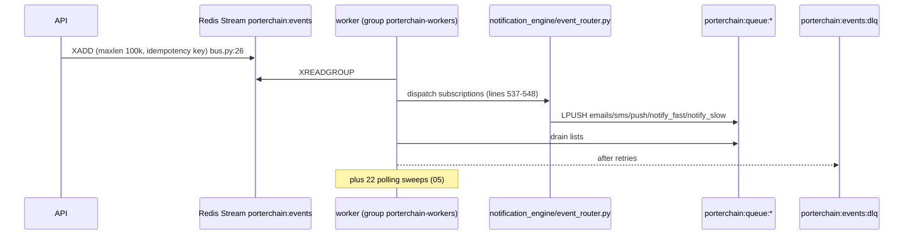

# 10 — Event and async flows (AS-BUILT)



Catalog: `shared/python/porterchain_shared/events/catalog.py` — **66 events**; **4 never emitted**: `merchant.lead_created`, `route.optimized`, `dispatch.recommendation`, `eta.predicted`. Full usage table in `/tmp` scan reproduced below.

Async mechanisms in use simultaneously: Redis Stream (events), Redis lists (work queues), DB polling sweeps (22), webhook retry tables (`merchant_webhook_deliveries`, `shopify_ingress_dlq`). No outbox table: event emit and DB commit are not atomic (U-06 to confirm).

## Event usage scan

```
VISITOR_CREATED|visitor.created|1
VISITOR_SESSION_STARTED|visitor.session_started|3
SESSION_MERGED|visitor.session_merged|3
QUOTE_CREATED|quote.created|5
QUOTE_ACCEPTED|quote.accepted|3
QUOTE_EXPIRED|quote.expired|6
BOOKING_STARTED|booking.started|3
BOOKING_CONFIRMED|booking.confirmed|12
CHECKOUT_STARTED|checkout.started|5
CHECKOUT_ABANDONED|checkout.abandoned|6
CUSTOMER_REGISTERED|customer.registered|4
CUSTOMER_AUTHENTICATED|customer.authenticated|5
CUSTOMER_REORDER_NUDGE|customer.reorder_nudge|2
MERCHANT_LEAD_CREATED|merchant.lead_created|0
MERCHANT_APPROVED|merchant.approved|7
MERCHANT_ACTIVATED|merchant.activated|4
MERCHANT_SUSPENDED|merchant.suspended|4
MERCHANT_BILLED|merchant.billed|4
PAYMENT_STARTED|payment.started|3
PAYMENT_SUCCEEDED|payment.succeeded|7
PAYMENT_FAILED|payment.failed|9
ORDER_CREATED|order.created|9
ORDER_BOOKED|order.booked|7
ORDER_DISPATCH_READY|order.dispatch_ready|12
DISPATCH_REQUESTED|order.dispatch_requested|3
DRIVER_ASSIGNED|order.driver_assigned|48
DRIVER_ACCEPTED|order.driver_accepted|39
DRIVER_ARRIVED_PICKUP|order.arrived_pickup|10
PARCEL_PICKED_UP|order.pickup_completed|12
DELIVERY_STARTED|order.in_transit|10
PARCEL_DELIVERED|order.delivered|22
PROOF_COMPLETED|order.pod_completed|10
INVOICE_GENERATED|order.invoiced|5
ORDER_CLOSED|order.closed|1
ORDER_CANCELLED|order.cancelled|8
DRIVER_REJECTED|order.driver_rejected|19
DRIVER_JOB_REMOVED|order.driver_job_removed|2
DRIVER_HANDOFF|order.driver_handoff|4
ORDER_NEAR_DELIVERY|order.near_delivery|9
ORDER_LOCATION_UPDATED|order.tracking_updated|6
ORDER_TEMP_EXCURSION|order.temp_excursion|2
EXCEPTION_OPENED|exception.opened|4
EXCEPTION_RESOLVED|exception.resolved|2
ORDER_DELAYED|order.delayed|5
SLA_BREACHED|sla.breached|3
ROUTE_OPTIMIZED|route.optimized|0
DISPATCH_RECOMMENDATION|dispatch.recommendation|0
ETA_PREDICTED|eta.predicted|0
OPTIMIZE_ENQUEUED|optimize.enqueued|1
OPTIMIZE_READY|optimize.ready|1
OPTIMIZE_APPLIED|optimize.applied|1
OPTIMIZE_REJECTED|optimize.rejected|1
OPTIMIZE_ROLLED_BACK|optimize.rolled_back|1
REFUND_REQUESTED|refund.requested|4
REFUND_ISSUED|refund.issued|5
DRIVER_PAYOUT_CREATED|driver.payout_created|1
CLAIM_OPENED|claim.opened|10
CLAIM_RESOLVED|claim.resolved|5
SUPPORT_TICKET_CREATED|support.ticket_created|6
PRIVACY_DELETE_REQUESTED|privacy.delete_requested|3
BOOKING_DRAFT_CREATED|booking_draft.draft_created|2
NOTIFICATION_QUEUED|notification.queued|5
NOTIFICATION_SENT|notification.sent|6
WEBHOOK_RECEIVED|webhook.received|3
LEAD_CREATED|lead.created|5
NEWSLETTER_CONFIRM_REQUESTED|newsletter.confirm_requested|2
```
