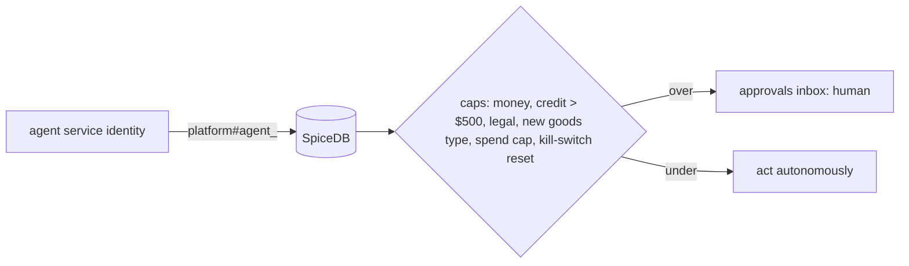

# 17 — PLANNED state machines + authz

- Order: same 21 states, plus `CLOSED → CLAIM_OPEN` (≤ 60 d after delivery, O. Reg. 643/05 Sch.1 art.12), remove `DELIVERED → FAILED`; all transitions executed inside the durable workflow.
- Quote: add `ACCEPTED` exit from `PAYMENT_PENDING`; price ≥ cost ÷ 0.50 check before `QUOTE`.
- Job offer, route, stop, plan, driver: enums + transition maps in `domain/states.py`.
- Invoice: single computed status; credit note `pending_approval` when > $500 (L15) — replaces configurable threshold default.
- Approval: `requested → approved | rejected | expired`.
- Agent run: `queued → running → waiting_approval → done | failed | killed`.

schema.zed additions: `platform` relations `agent_sales, agent_dispatch, agent_cooler, agent_billing, agent_support, agent_driver_mgmt, agent_platform`; permission `approve_<case>` for humans only.
