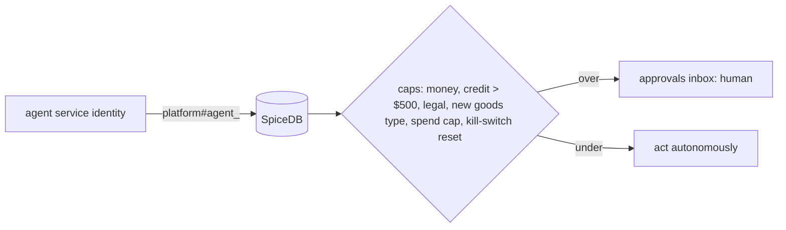

# 17 — PLANNED state machines + authz

- Order: same 21 states, plus `CLOSED → CLAIM_OPEN` (≤ 60 d after delivery, O. Reg. 643/05 Sch.1 art.12), remove `DELIVERED → FAILED`; all transitions executed inside the durable workflow.
- Quote: add `ACCEPTED` exit from `PAYMENT_PENDING`; margin band computed before `QUOTE` and stored on the quote; margin band (L2 as amended by Ravi 2026-10-28): never blocks; ≥ 50 % green, < 50 % yellow warning, ≤ 35 % red (admin alert). Red writes a `margin.red` alert to admin (Today, admin pricing, quote view) and an audit log row. Margin never moves a quote to `REFUSED`.
- Job offer, route, stop, plan, driver: enums + transition maps in `domain/states.py`.
- Invoice: single computed status; credit note `pending_approval` when > $500 (L17, approval case 2, strict plan §2) — replaces configurable threshold default.
- Approval: `requested → approved | rejected | expired`.
- Agent run: `queued → running → waiting_approval → done | failed | killed`.

schema.zed additions: `platform` relations `agent_sales, agent_dispatch, agent_cooler, agent_billing, agent_support, agent_driver_mgmt, agent_platform`; permission `approve_<case>` for humans only.

## Impersonation (kept, guarded)

As-built: `routers/admin/impersonation.py:26,54`, `/impersonate` in merchant, customer and driver portals. Planned: super-admin humans only; SpiceDB `impersonate` permission never granted to agent identities; every session audit-logged with reason and expiry; agents cannot act while an impersonation token is active; no approvals (six cases) can be decided under impersonation.
