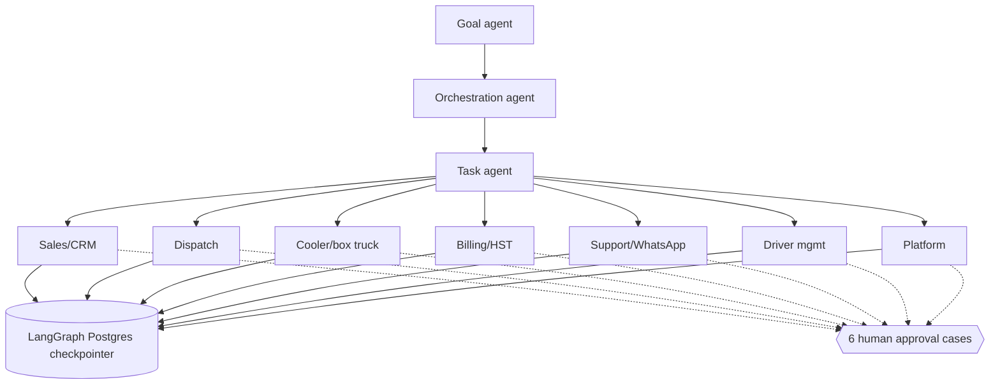

# 18 — PLANNED agents and autonomy ladder (L7, L14–L17)

21 department agents under the 3 core agents; names per plan canvas table. Model tiers T0–T3. Promotion up the autonomy ladder requires ≥ 99 % agreement with human decisions over 500 jobs; demotion and kill switch are super-admin. Every agent action is logged (`ai_usage_logs` exists today; `agent_runs` planned).
