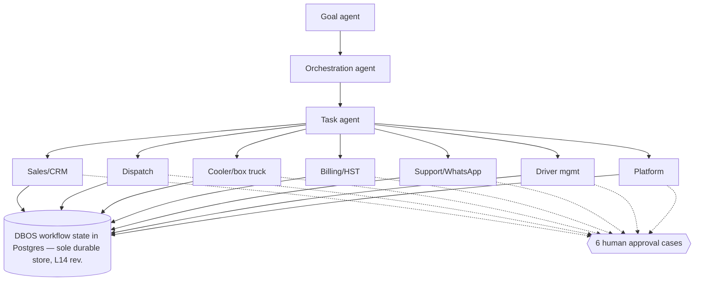

# 18 — PLANNED agents and autonomy ladder (L7, L14–L17)

21 department agents under the 3 core agents; names per plan canvas table. Model tiers T0 code, T1 router Qwen3.5-0.8B, T2 main Qwen3.5-4B + PorterChain LoRA, T2v second check Phi-4-mini, ML on CPU — all self-hosted (L25: no paid AI; T3 paid tier removed). See file 27. Promotion up the autonomy ladder requires ≥ 99 % agreement with human decisions over 500 jobs; demotion and kill switch are super-admin. Every agent action is logged (`ai_usage_logs` exists today; `agent_runs` planned).

## Agent → model mapping (L25, all local)

| Agent                                                                                             | Model path                              | Verifier                                 |
| ------------------------------------------------------------------------------------------------- | --------------------------------------- | ---------------------------------------- |
| Goal                                                                                              | T0 KPI code + 4B summary                | rule checks                              |
| Orchestration                                                                                     | 4B + LoRA (planning, thinking on)       | plan schema + six-case check             |
| Task                                                                                              | 4B + LoRA                               | goal check, Phi-4-mini on money          |
| 1 Growth                                                                                          | 4B drafts                               | Phi-4-mini + CASL consent rule           |
| 2 Intake                                                                                          | 0.8B classify + 4B extract              | schema + zone/goods rules                |
| 3 Dispatch advisor                                                                                | T0 OR-Tools; 4B explains                | plan from code only                      |
| 4 Reassign                                                                                        | T0 + 0.8B                               | rule checks                              |
| 5 ETA                                                                                             | ML (CPU)                                | backtest                                 |
| 6 Cold-chain monitor                                                                              | T0 rules + 0.8B                         | threshold code                           |
| 7 Box-truck scheduler                                                                             | T0 + 4B                                 | BOL/CVOR gate                            |
| 8 Restricted goods                                                                                | 0.8B + 4B + RAG rulebook                | deny-list code, Phi-4-mini               |
| 9 Quote                                                                                           | T0 price; 4B explains                   | amount == code                           |
| 10 Margin guard                                                                                   | T0 band                                 | code only                                |
| 11 Finance                                                                                        | 0.8B match + 4B                         | amounts == code, caps, Phi-4-mini        |
| 12 Tax and records                                                                                | T0 HST + 4B RAG                         | HST calc, BN regex                       |
| 13 WhatsApp intake + reply drafter (L27: free app, human sends)                                   | 0.8B intent + 4B extract/draft          | schema + T0 rules + Phi-4-mini + consent |
| 14 Customer care                                                                                  | 0.8B triage + 4B                        | Phi-4-mini                               |
| 15 Exceptions                                                                                     | 0.8B + 4B                               | rules                                    |
| 16 Claims                                                                                         | 4B + RAG                                | caps, Phi-4-mini                         |
| 17 Driver onboarding                                                                              | 4B (doc text)                           | doc rules, DPWRA                         |
| 18 Driver support                                                                                 | 0.8B + 4B RAG                           | rules                                    |
| 19 Proof checker                                                                                  | T0 GPS/scan; Qwen3.5-4B vision on photo | code rules                               |
| 20 Ops brief                                                                                      | 4B                                      | numbers from T0                          |
| 21 Tech/QA                                                                                        | 4B (Qwen2.5-Coder-3B option)            | CI tests                                 |
| GPU queue concurrency 1–2 on the 6 GB card; upgrade to 24 GB before week 9 recommended (file 27). |
