# 19 — Compliance layer (Ontario / Canada) — diagram + checklist

✔ = official page fetched/confirmed 2026-10-28 · ○ = official link, not re-opened this run (verify before relying). No section numbers are given unless read on the fetched page. Not legal advice; `docs/legal/compliance-matrix.md` is marked "DRAFT for lawyer review".

```mermaid
flowchart LR
  subgraph EDGE[Intake]
    G1[Goods gate: TDG / prohibited / cooler]
    G2[Service area + Ontario]
    G3[Consent capture CASL / PIPEDA]
  end
  subgraph CORE[Core]
    C1[Tax engine: HST, BN RT]
    C2[Carrier docs: BOL, liability, cargo insurance]
    C3[Driver rules: DPWRA, contractor status, licence, CVOR]
    C4[Cooler GDP: temp log, excursion]
    C5[E-sign + POD record]
  end
  subgraph REC[Records]
    R1[Retention 6 y tax / 3 y platform-worker / POD]
    R2[Privacy requests + breach log]
  end
  EDGE --> CORE --> REC
  UI[Portals: AODA/WCAG] --- EDGE
```

| #   | Rule area                                                                                     | Official source                                                                                                                                                                                                                                                                                                                                     | PCD status                                                                                                    | Evidence                                                                                                                                                | Remediation                                                                                                                                                   |
| --- | --------------------------------------------------------------------------------------------- | --------------------------------------------------------------------------------------------------------------------------------------------------------------------------------------------------------------------------------------------------------------------------------------------------------------------------------------------------- | ------------------------------------------------------------------------------------------------------------- | ------------------------------------------------------------------------------------------------------------------------------------------------------- | ------------------------------------------------------------------------------------------------------------------------------------------------------------- |
| 1   | GST/HST charge, registration number on invoices, ITC documentary requirements                 | ○ ETA https://laws-lois.justice.gc.ca/eng/acts/E-15/ · ✔ CRA GST/HST Memo 8-4 https://www.canada.ca/en/revenue-agency/services/forms-publications/publications/8-4.html                                                                                                                                                                             | **partial**                                                                                                   | `billing_engine/tax.py`; `reporting/order_documents.py`; `reporting/tax_report.py`; `platform/tax_registration.py`; BN regex `organization_sync.py:132` | A07 (RT + check digit); fill supplier GST/HST number (matrix: operational)                                                                                    |
| 2   | Ontario consumer protection (retail customers: internet agreements, disclosure, cancellation) | ○ CPA 2002 https://www.ontario.ca/laws/statute/02c30                                                                                                                                                                                                                                                                                                | **partial**                                                                                                   | `website/src/app/[locale]/terms/page.tsx`; no stored copy of accepted terms version per order found                                                     | Store terms version + timestamp per booking; email copy of agreement                                                                                          |
| 3   | PIPEDA privacy, access/erasure, breach records; data residency                                | ○ https://laws-lois.justice.gc.ca/eng/acts/P-8.6/ · ○ OPC https://www.priv.gc.ca/en/privacy-topics/privacy-laws-in-canada/the-personal-information-protection-and-electronic-documents-act-pipeda/                                                                                                                                                  | **partial**                                                                                                   | `platform/privacy_access.py`, `platform/privacy_erasure.py`, `breach_log`, `privacy_requests`; residency = setting only (`platform/compliance.py`)      | Publish privacy policy (DRAFT); list subprocessors + their regions (Clerk, Stripe, NIM, ZeptoMail); PIPEDA does not mandate CA residency — disclose transfers |
| 4   | CASL: consent, sender ID, unsubscribe for email; WhatsApp and push                            | ○ https://laws-lois.justice.gc.ca/eng/acts/E-1.6/ · ○ CRTC https://crtc.gc.ca/eng/internet/anti.htm                                                                                                                                                                                                                                                 | **partial**                                                                                                   | `notification_engine/unsubscribe.py`, `casl_footer()`, `collaboration_engine/lead_suppression.py`, `collaboration_engine/lead_consent.py`               | Extend consent + suppression to WhatsApp templates and push (P); one `consent_records` check before any commercial send                                       |
| 5   | ESA electronic monitoring policy; contractor vs employee; platform workers                    | ○ ESA https://www.ontario.ca/laws/statute/00e41 · ✔ CRA Employment status (replaces RC4110, cancelled 2026-01-30) https://www.canada.ca/en/revenue-agency/services/tax/canada-pension-plan-cpp-employment-insurance-ei-rulings/employee-self-employed.html · ✔ Digital Platform Workers' Rights Act, 2022 https://www.ontario.ca/laws/statute/22d07 | **partial / missing**                                                                                         | Monitoring policy DRAFT `docs/legal/electronic-monitoring-policy.md`; GPS consent `platform/gps_policy.py`; DPWRA: 0 hits                               | A10, A30                                                                                                                                                      |
| 6   | HTA / CVOR for box truck; carriage of goods                                                   | ○ HTA https://www.ontario.ca/laws/statute/90h08 · ✔ CVOR https://www.ontario.ca/page/commercial-vehicle-operators-registration-cvor · ✔ O. Reg. 643/05 https://www.ontario.ca/laws/regulation/050643                                                                                                                                                | **missing**                                                                                                   | CVOR 0 hits; no BOL generator; cargo insurance not modelled (only driver insurance expiry `control_tower/scoring.py:102`)                               | `vehicle_compliance_docs`; BOL PDF; cargo-insurance certificate in vehicle (s.3(3))                                                                           |
| 7   | Cooler runs — temperature control during transport                                            | ○ Health Canada GUI-0069 (search "GUI-0069" on canada.ca; exact URL not verified)                                                                                                                                                                                                                                                                   | **partial**                                                                                                   | manual `POST /v1/admin/orders/{id}/temperature` `routers/admin/orders.py:210`; event `order.temp_excursion`; no reading series table                    | `temp_readings` + logger ingest; excursion → hold + approval; calibration records                                                                             |
| 8   | TDG exclusion (no DG incl. UN3373)                                                            | ○ https://tc.canada.ca/en/dangerous-goods · ○ TDG Regs https://laws-lois.justice.gc.ca/eng/regulations/SOR-2001-286/                                                                                                                                                                                                                                | **partial**                                                                                                   | `booking_validation.py:115` (DG needs approval — conflicts with L3 "excluded"); `dangerous_goods_confirmed` `lead_consent.py:70`                        | Change DG path to hard refuse in Phase 1                                                                                                                      |
| 9   | AODA accessibility for portals                                                                | ○ AODA https://www.ontario.ca/laws/statute/05a11 · ○ IASR O. Reg. 191/11 https://www.ontario.ca/laws/regulation/110191                                                                                                                                                                                                                              | **missing (audit)**                                                                                           | `website/.../accessibility/page.tsx` exists; matrix "❌ not audited"                                                                                    | A23                                                                                                                                                           |
| 10  | Electronic signatures / POD records                                                           | ○ Electronic Commerce Act, 2000 https://www.ontario.ca/laws/statute/00e17                                                                                                                                                                                                                                                                           | **partial**                                                                                                   | `navigation_pod.py:91,112` photo/signature, OTP gate; integrity: `forensics_models.py`                                                                  | Bind signature to order hash + timestamp + device in audit chain                                                                                              |
| 11  | Record retention (books and records, 6 years)                                                 | ○ CRA Keeping records https://www.canada.ca/en/revenue-agency/services/tax/businesses/topics/keeping-records.html · ○ ITA https://laws-lois.justice.gc.ca/eng/acts/I-3.3/                                                                                                                                                                           | **partial**                                                                                                   | `finance_ops/retention.py:16` MIN_YEARS 6 (Interac); POD default 365 d (`dispatch_engine/retention.py`)                                                 | A01                                                                                                                                                           |
| 12  | FINTRAC MSB relevance                                                                         | ✔ https://fintrac-canafe.canada.ca/msb-esm/msb-eng                                                                                                                                                                                                                                                                                                  | **not applicable today** (no COD; PorterChain only accepts payment for services it supplies — page exception) | `schemas_merchant.py:81-83` (COD retired, 422 `cash_on_delivery_not_supported`)                                                                         | Re-assess before collecting or remitting funds on behalf of merchants                                                                                         |
| 13  | PCI DSS scope                                                                                 | ○ PCI SSC https://www.pcisecuritystandards.org/ (industry standard, not law)                                                                                                                                                                                                                                                                        | **partial**                                                                                                   | Stripe-hosted card entry assumed (`stripe_money.py`); SAQ type unverified (U-10)                                                                        | Confirm no PAN touches PCD; file SAQ A                                                                                                                        |
