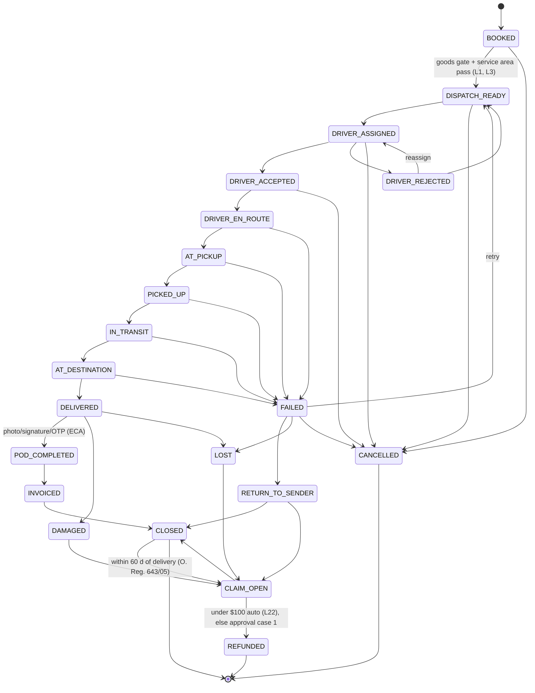
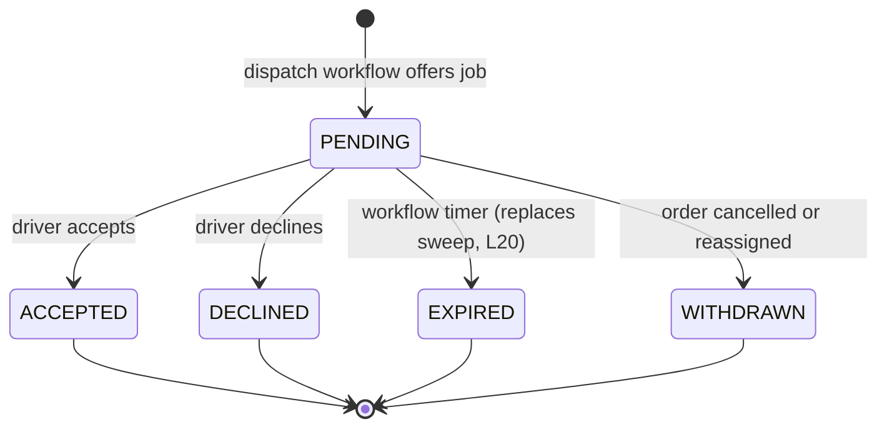
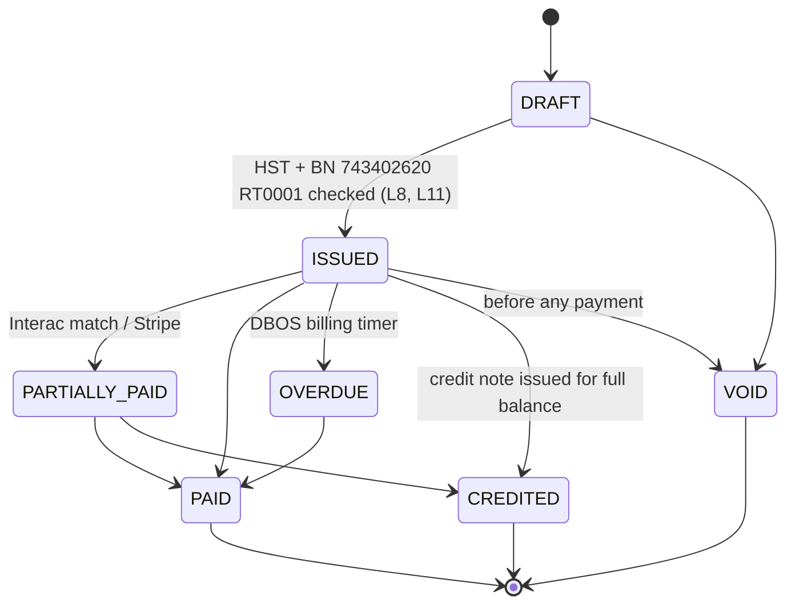
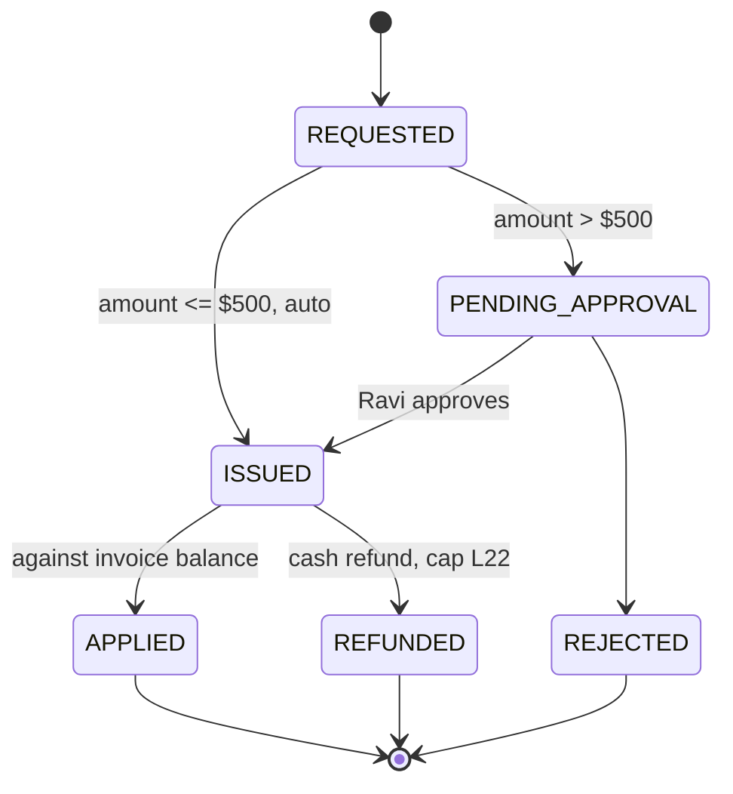
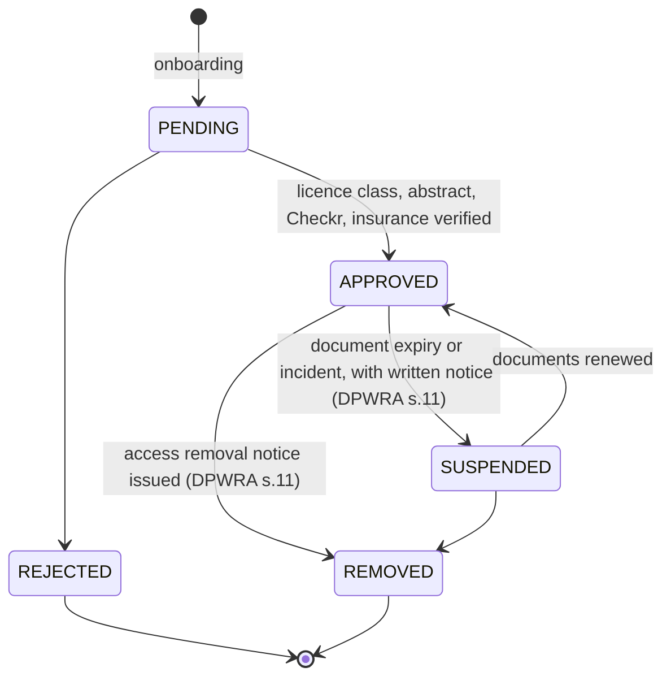
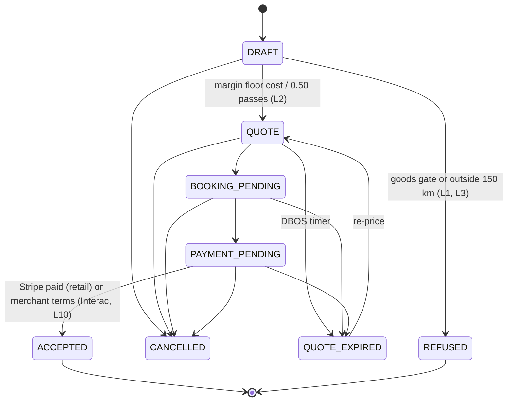
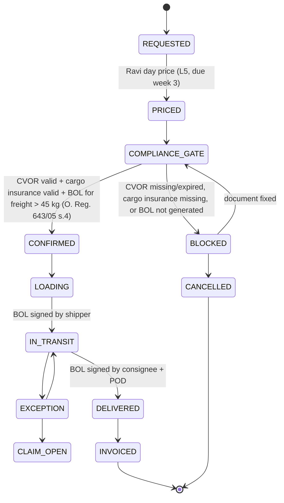
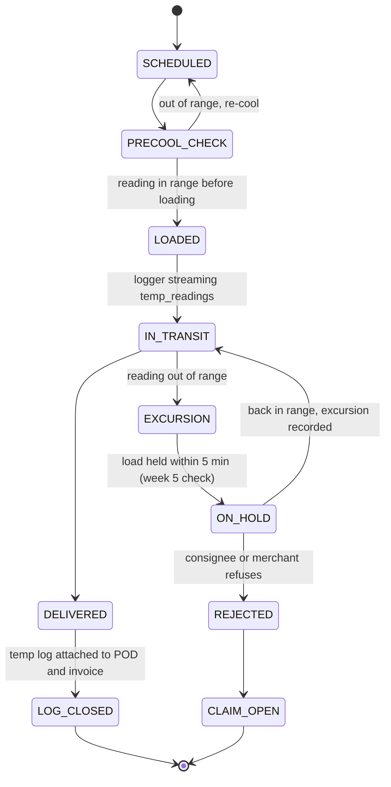
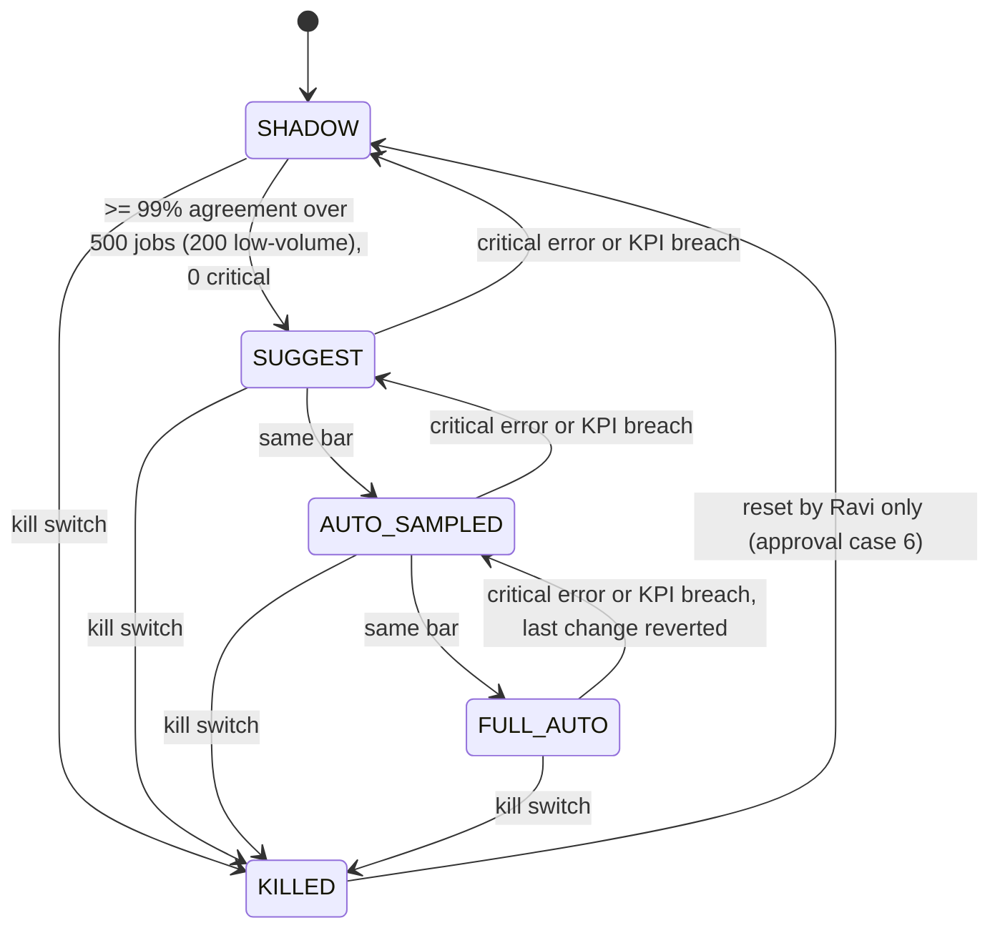
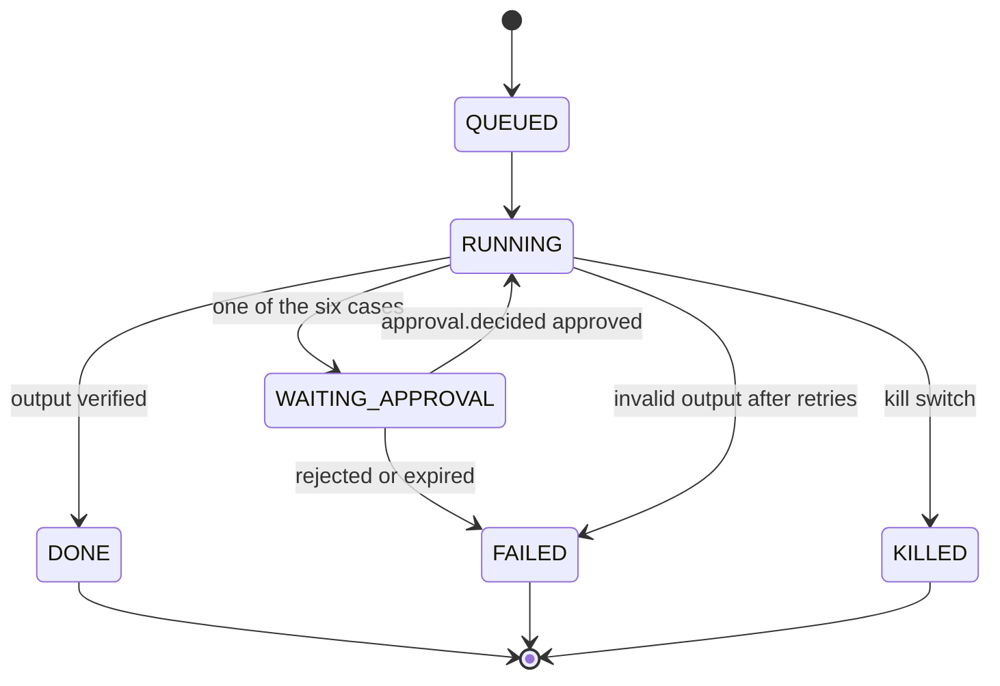

# 22 — PLANNED state machines (Phase 1)

Sources: 17 (planned states), 12/15/21, strict plan locked decisions L1–L24. **(P)** = not in code today. All transitions run inside DBOS workflows (L18); agents (LangGraph, L14) may only request transitions, never write status columns. Enums + transition maps live in `domain/states.py` (21 step 3).

## 22.1 Order (17: remove `DELIVERED → FAILED`; add `CLOSED → CLAIM_OPEN` ≤ 60 d)

## 22.2 Job offer (P; as-built is a free string, default `pending`, `dispatch_engine/models.py:30`)

## 22.3 Invoice (single computed status, A02 fix; values seen in `billing_engine`, `merchant_engine/billing_*`)

## 22.4 Credit note (one issuer, A03 fix; `pending_approval` when > $500, L15/L17 case 2)

## 22.5 Driver (contractor, L4; DPWRA notices, A10)

## 22.6 Quote (17: price >= cost / 0.50 before QUOTE; ACCEPTED exit)

## 22.7 Box truck booking (L5, L23: runs only after BOL, CVOR and cargo insurance)

## 22.8 Cooler run with temperature log (L3; GUI-0069; `temp_readings`, `pc.cooler.temp.v1`)

## 22.9 Agent autonomy ladder (L17, L23; strict plan section 3)

## 22.10 Agent run and approval (17)

