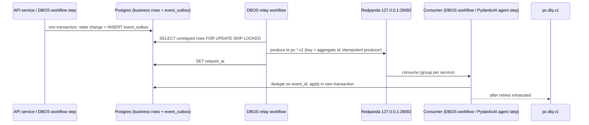
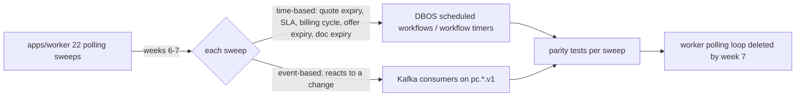
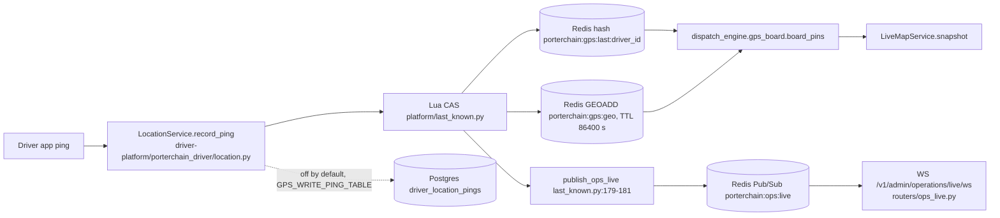

# 23 — PLANNED events: outbox → DBOS relay → Redpanda (L18, L19, L20)

Sources: 12 (topics, ports), 15 (infra row), 21 step 2/4, L18–L20. **(P)** = not in code today. Producer/consumer assignment per topic is the Phase 1 plan derived from 12/15/18; confirm when each workflow is built. Delivery is at-least-once; consumers dedupe on `event_id`; topic retention 7 days; Postgres is the system of record. Redis Streams `porterchain:events` and the list queues are retired.

## 23.1 Outbox path (atomic write, then relay)



## 23.2 Topics, producers and consumers (12 topics)

```mermaid
flowchart LR
  OB[(event_outbox in Postgres)] -->|DBOS relay| RP{{Redpanda single node, Kafka API, schema registry 28081}}
  subgraph Producers
    OWF[Order workflow DBOS]
    QSV[Quote service + margin band (warn-only)]
    BWF[Billing workflow DBOS]
    DWF[Dispatch workflow + Dispatch agent]
    DMG[Driver mgmt service + agent]
    TMP[POST /v1/driver/temp-readings]
    PODP[Driver POD capture]
    WAH[POST /v1/webhooks/whatsapp]
    NEN[notification_engine after CASL check]
    APV[GET/POST /v1/admin/approvals]
    LGR[PydanticAI agents in DBOS]
    ANY[Any consumer after retries]
  end
  OWF --> T1[pc.orders.v1]
  QSV --> T2[pc.quotes.v1]
  BWF --> T3[pc.billing.v1]
  DWF --> T4[pc.dispatch.v1]
  DMG --> T5[pc.drivers.v1]
  TMP --> T6[pc.cooler.temp.v1]
  PODP --> T7[pc.pod.v1]
  WAH --> T8[pc.whatsapp.inbound.v1]
  NEN --> T9[pc.notifications.out.v1]
  APV --> T10[pc.approvals.v1]
  LGR --> T11[pc.agent.runs.v1]
  ANY --> T12[pc.dlq.v1]
  subgraph Consumers
    CDS[Dispatch agent + workflow]
    CNT[Notification sender: email, push, WhatsApp]
    CMW[Merchant webhook fanout + Shopify fulfillment]
    CSL[Sales/CRM agent]
    CBL[Billing/HST agent + billing workflow]
    CCL[Cooler/box truck agent + order workflow hold]
    CSP[Support/WhatsApp intake agent]
    COR[Orchestration agent + paused workflows]
    CAD[Admin Agents page + eval harness]
    CPL[Platform agent + admin DLQ view]
    CORD[Order workflow]
  end
  T1 --> CDS & CNT & CMW
  T2 --> CSL & CORD
  T3 --> CBL & CNT
  T4 --> CORD & CNT
  T5 --> CDS
  T6 --> CCL
  T7 --> CBL & CNT & CMW
  T8 --> CSP
  T9 --> CNT
  T10 --> COR
  T11 --> CAD
  T12 --> CPL
```

New event types (15): `approval.requested/decided` (pc.approvals.v1), `agent.run.*` (pc.agent.runs.v1), `order.temp_reading` (pc.cooler.temp.v1), `driver.access_removed_notice` (pc.drivers.v1); the 4 unused as-built events are emitted or deleted.

## 23.3 Former sweeps (L20)



## 23.4 Live GPS stays on Redis (verified as-built, unchanged; see 12)


