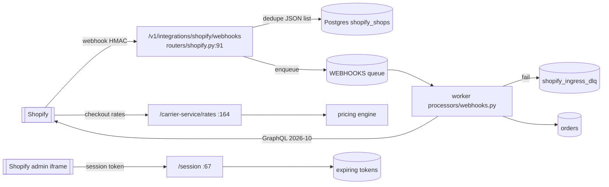
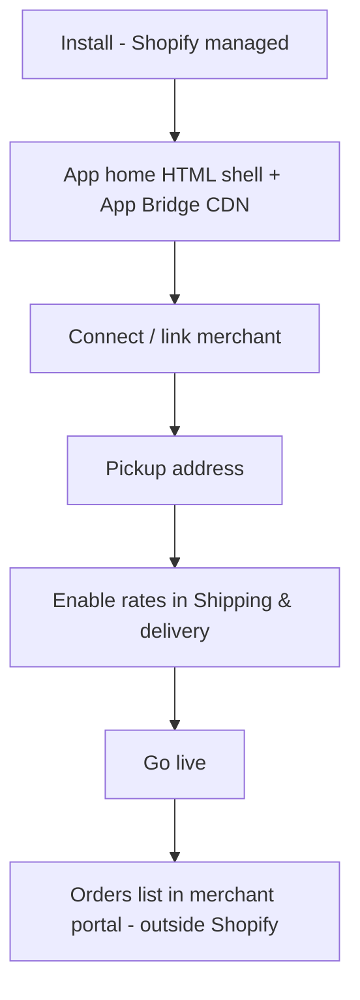
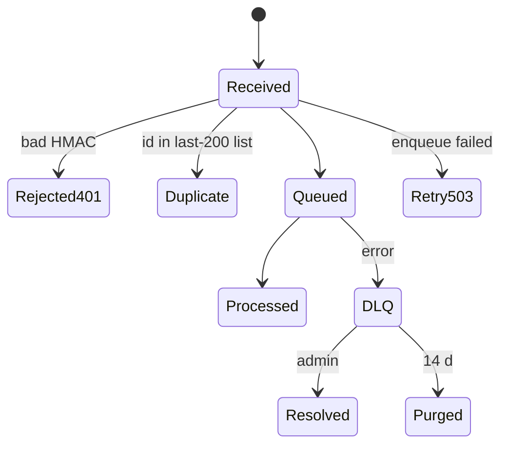
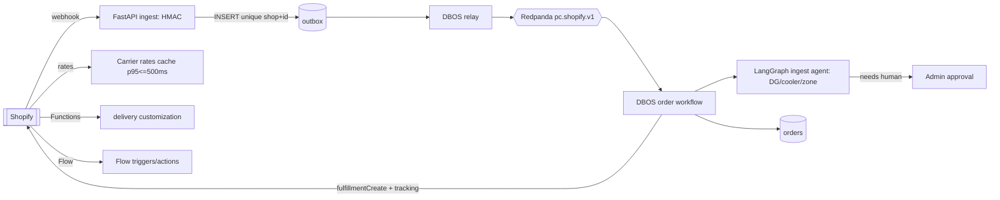
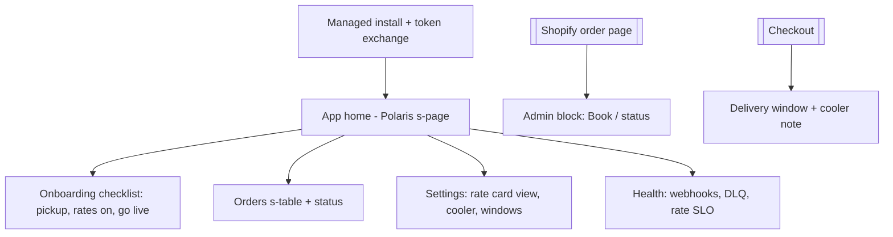
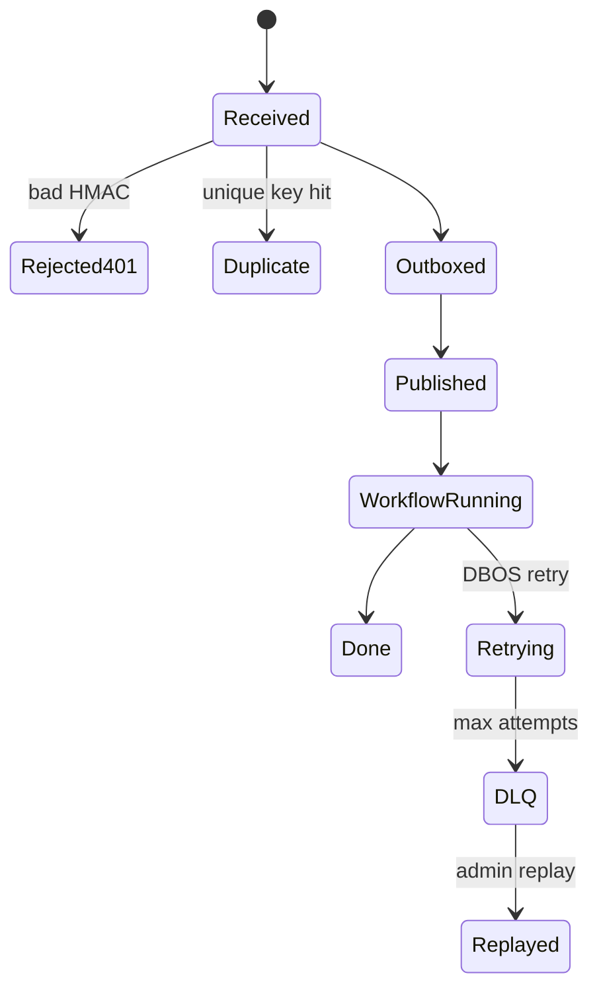

# 24 — Shopify app: AS-BUILT vs PLANNED

Evidence: repo `/home/pcd/PCD` at `d98dffff`, read-only scan Oct 28, 2026. Paths shortened: `api/` = `apps/api/src/porterchain_api/`, `mp/` = `apps/merchant-portal/src/`.
Versions verified Oct 28, 2026 against shopify.dev (✔ = page opened this run).

## 1. AS-BUILT (NOW)

| Area                        | Status                                                                                                                               | Evidence                                                                                                                                                          |
| --------------------------- | ------------------------------------------------------------------------------------------------------------------------------------ | ----------------------------------------------------------------------------------------------------------------------------------------------------------------- |
| App type                    | built — embedded, Shopify-managed install, free listing                                                                              | `integrations/shopify/app.toml` (`embedded = true`, `use_legacy_install_flow = false`, header "Billing: none")                                                    |
| Admin API version           | built — **2026-10** (current stable ✔)                                                                                               | `app.toml` `[webhooks] api_version`; `api/config.py:550` default `2026-10`                                                                                        |
| Scopes                      | built — orders read, fulfillments, shipping, merchant-managed + assigned FO                                                          | `app.toml [access_scopes]`                                                                                                                                        |
| Embedded UI                 | partial — server-rendered HTML shell + App Bridge CDN script; **no Polaris web components**                                          | `mp/lib/shopifyEmbed.ts:13,62`; `mp/app/shopify-app/route.ts`; `mp/components/integrations/ShopifyAppClient.tsx`                                                  |
| Auth                        | built — session token → token exchange; expiring offline tokens                                                                      | `api/routers/shopify.py:67` `POST /session`; `api/merchant_engine/shopify_session.py`, `shopify_tokens.py`; migration `sx0shoptok1a2b_shopify_expiring_tokens.py` |
| Legacy OAuth                | still present                                                                                                                        | `api/routers/shopify.py:219-220` `/install`, `/callback`                                                                                                          |
| Webhooks                    | built — 8 topics, HMAC, rate limit, enqueue to WEBHOOKS queue, 503 on enqueue failure so Shopify retries                             | `app.toml`; `api/routers/shopify.py:91-128`; `api/merchant_engine/shopify_webhooks.py:91,172-186`; `apps/worker/processors/webhooks.py`                           |
| Webhook dedupe              | partial — last 200 ids in a JSON column per shop (read-modify-write, no unique key)                                                  | `shopify_webhooks.py:49-62`                                                                                                                                       |
| DLQ                         | built — `shopify_ingress_dlq` table, admin list/resolve, bodies purged after 14 d                                                    | `api/merchant_engine/shopify_ingress_dlq.py:59,68,133,146`                                                                                                        |
| GDPR (mandatory compliance) | built — 3 topics, 30-day due date, 730-day retention sweep                                                                           | `app.toml compliance_topics`; `shopify_privacy.py:27-28,93,230`                                                                                                   |
| Order sync                  | built — GraphQL Admin read + payload ops                                                                                             | `shopify_admin_graphql.py` (1124 lines), `shopify_payload_ops.py`, `integrations/shopify_orders.py`                                                               |
| CarrierService rates        | built — checkout rates endpoint; 2026-10 profile change handled (merchant must enable rates)                                         | `api/routers/shopify.py:164`; `integrations/shopify_carrier_rates.py` (943 lines); `shopify_one_click.py:106-108`                                                 |
| Fulfillment                 | built (merchant-managed) / flagged off (fulfillment service FO requests)                                                             | `shopify_fulfillment_ops.py`; `api/routers/shopify.py:131-132`; `SHOPIFY_FULFILLMENT_SERVICE_ENABLED` default off (`app.toml` header)                             |
| Billing                     | none — app free; deliveries invoiced by Interac e-Transfer                                                                           | `app.toml` header                                                                                                                                                 |
| Merchant portal mgmt        | built — connect, link, go-live, pickup, disconnect, route pricing                                                                    | `api/routers/merchant/shopify.py:28-138`; `api/routers/shopify_route_pricing.py:33,44`                                                                            |
| Admin control plane         | built                                                                                                                                | `api/admin_engine/shopify_control_service.py`; `docs/ops/SHOPIFY_ADMIN_CONTROL_PLANE.md`                                                                          |
| Tests                       | 24 API test files (`apps/api/tests/test_shopify_*.py`), 2 portal unit tests (`mp/lib/shopifyEmbed.test.ts`, `shopifyStatus.test.ts`) | —                                                                                                                                                                 |

### Gaps / bugs (ranked)

1. **No Polaris web components / app home is a hand-rolled HTML page** → fails Built for Shopify (BFS) design + Web Vitals tracking only partly possible. `mp/lib/shopifyEmbed.ts`.
2. **Webhook dedupe is a 200-item JSON list** — two concurrent deliveries can both pass `_webhook_seen` (race), and bursts > 200 lose history. Needs a unique `(shop_id, webhook_id)` row / outbox key. `shopify_webhooks.py:49-62`.
3. **Off-platform charging risk**: app listed free while merchants pay PorterChain by Interac. Shopify says apps that charge outside Shopify are not "free". Delivery fees for a real-world courier service are likely acceptable, but this is **not verified** → ask Shopify Partner support before BFS submission.
4. **Legacy `/install` + `/callback` OAuth routes** remain beside managed install — dead/alternate path (`routers/shopify.py:219-220`).
5. **Fulfillment-service mode off** → PorterChain can't receive FO requests natively; merchants mark fulfilment manually.
6. **Shopify DSR retention 730 d** vs PCD 6-year record rule (doc 19) — need to confirm which data is tax record (keep) vs personal data (redact).
7. No **Shopify Flow** triggers/actions, no **checkout UI extension** (delivery-date / cooler note), no **Shopify Functions** (delivery customization).
8. Queue is the legacy list queue, not the locked outbox → Redpanda path (L19/L20).

### Mermaid — NOW data flow

### Mermaid — NOW screen map

### Mermaid — NOW webhook state

## 2. PLANNED (Phase 1, latest tech)

Verified ✔: Admin API **2026-10** is latest stable (to Oct 16, 2027), **2027-01** is release candidate; **Polaris web components 2.0** stable; **App Bridge** latest via CDN (10.28 adds Sidekick); **expiring offline tokens required before Jan 1, 2027**; BFS: LCP ≤ 2.5 s, CLS ≤ 0.1, INP ≤ 200 ms (p75, 28 d), carrier-rate p95 ≤ 500 ms with ≤ 0.1 % failures; GDPR topics with 30-day completion; Shopify App Pricing is default for paid public apps (Billing API legacy). Sources: shopify.dev/changelog/release-notes/2026-10, /docs/apps/launch/built-for-shopify/requirements, /docs/apps/build/compliance/privacy-law-compliance, /docs/apps/launch/billing.

| #   | Feature                                                                                                                          | Benefit                                                     | Effort       | Week | Risk     | Locked-decision check                                                                            |
| --- | -------------------------------------------------------------------------------------------------------------------------------- | ----------------------------------------------------------- | ------------ | ---- | -------- | ------------------------------------------------------------------------------------------------ |
| S1  | App home rebuilt with **Polaris web components** (`s-page`, `s-section`, `s-table`) in Next 16 route, App Bridge in `<head>`     | BFS eligible, ~60 % less custom CSS/JS, native mobile admin | M            | 3–4  | Low      | ok (one design system L, week 2)                                                                 |
| S2  | Webhooks → **outbox row with unique `(shop, webhook_id)`** → DBOS relay → Redpanda `pc.shopify.v1`                               | exactly-once ingest, no race, replay from topic             | M            | 2–3  | Med      | implements L19/L20                                                                               |
| S3  | Delete legacy `/install` `/callback`                                                                                             | less code, one install path                                 | S            | 2    | Low      | ok                                                                                               |
| S4  | **Fulfillment service + FO requests on** (accept/reject, tracking push, `fulfillmentCreate`)                                     | orders auto-fulfil, tracking link in Shopify                | M            | 5–6  | Med      | ok                                                                                               |
| S5  | **Carrier-rate cache + p95 ≤ 500 ms SLO** (precomputed zone grid from rate card)                                                 | BFS checkout criterion, faster checkout                     | S            | 4    | Low      | uses new rate card                                                                               |
| S6  | **Shopify Functions** delivery customization (hide cooler/box truck when cart ineligible, outside 150 km)                        | refuses bad orders before payment                           | M            | 7    | Med      | matches 150 km + DG ban                                                                          |
| S7  | **Checkout UI extension**: delivery window picker + cooler note, metafields with `owner_type` (required 2027-01)                 | fewer support calls, correct cooler runs                    | M            | 8    | Med      | ok                                                                                               |
| S8  | **Shopify Flow** triggers (`Delivery completed`, `Delivery exception`) + action (`Book PorterChain pickup`)                      | merchants automate without us                               | S            | 9    | Low      | ok                                                                                               |
| S9  | **Admin action/block extension** on order page ("Book delivery", live status)                                                    | primary workflow inside Shopify (BFS 3.1.2)                 | S            | 6    | Low      | ok                                                                                               |
| S10 | App Events + Web Vitals dashboard; `shopify app security check` in CI                                                            | BFS evidence, security                                      | S            | 3    | Low      | ok                                                                                               |
| S11 | Billing decision: stay "free to install" with off-platform delivery invoices, or Shopify App Pricing usage charge                | store-policy compliance                                     | S (decision) | 2    | **High** | **conflicts** with L (Interac-only merchant pay) if Shopify requires on-platform — flag to owner |
| S12 | Pin 2027-01 upgrade test in week 12                                                                                              | avoid forced upgrade                                        | S            | 12   | Low      | ok                                                                                               |
| S13 | AI: order-ingest agent node (LangGraph) classifies DG/cooler/out-of-zone lines from product data, human approval below threshold | fewer bad bookings                                          | M            | 8–9  | Med      | ok (LangGraph decisions)                                                                         |

### Mermaid — PLANNED data flow

### Mermaid — PLANNED screen map

### Mermaid — PLANNED webhook state

