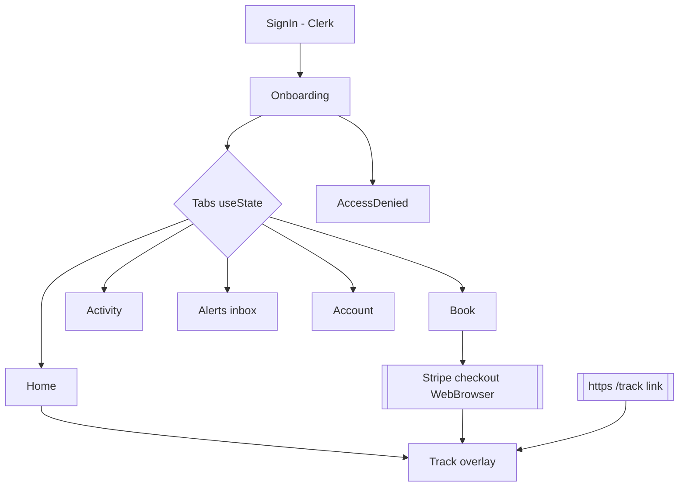
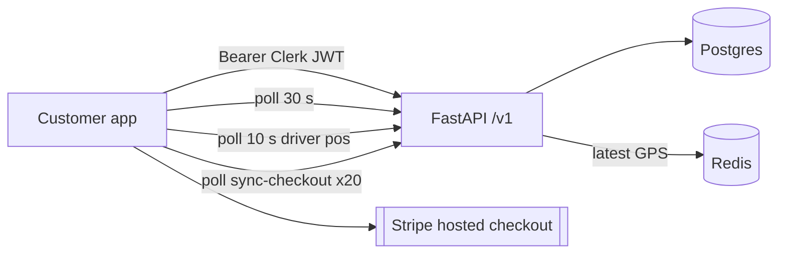
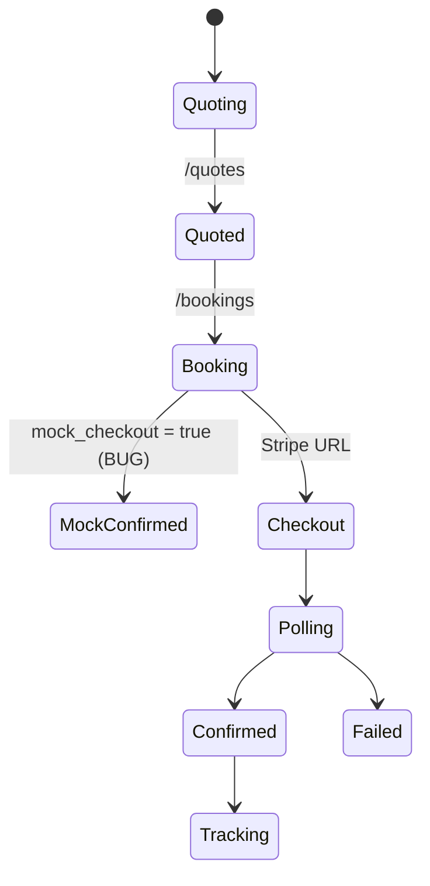
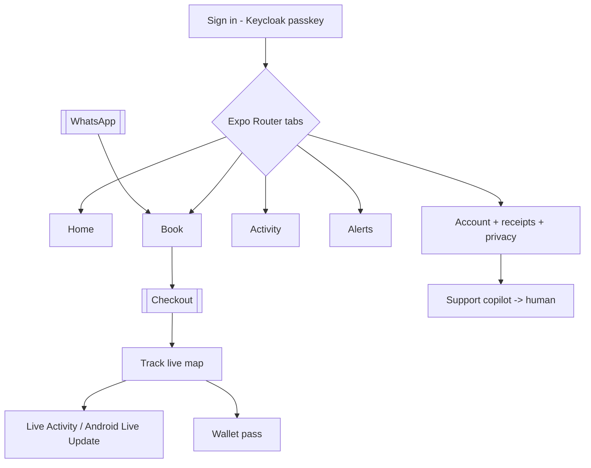
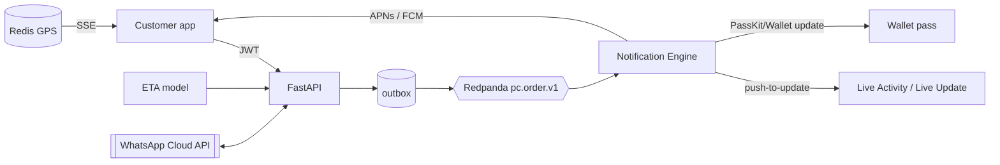
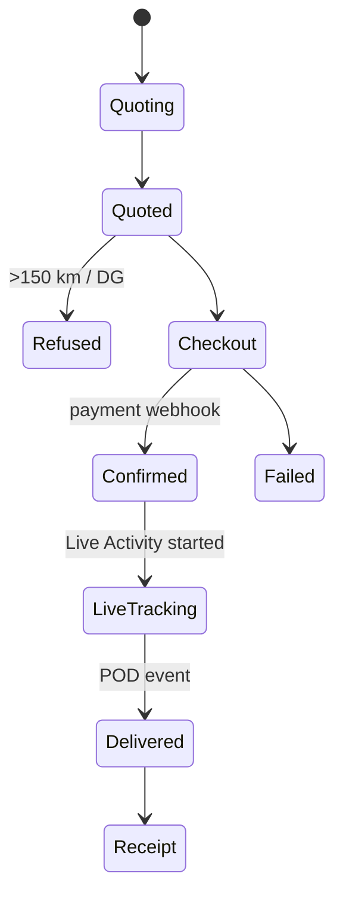

# 25 — Customer mobile app (apps/mobile-customer): AS-BUILT vs PLANNED

Evidence: `/home/pcd/PCD` at `d98dffff`, read-only, Oct 28, 2026. `mc/` = `apps/mobile-customer/`.

## 1. AS-BUILT (NOW)

| Area        | Status                                                                                                                                                                                                                                                                                                                                                                  | Evidence                                                                |
| ----------- | ----------------------------------------------------------------------------------------------------------------------------------------------------------------------------------------------------------------------------------------------------------------------------------------------------------------------------------------------------------------------- | ----------------------------------------------------------------------- |
| Stack       | Expo **SDK 57** (`expo ~57.0.27`), RN **0.86.3** (New Architecture only — legacy arch removed in RN 0.82+), React 19.2.3, TS 6.0                                                                                                                                                                                                                                        | `mc/package.json`                                                       |
| Screens (8) | SignIn, Onboarding/AccessDenied, Home, Book, Activity, Alerts, Account, Track                                                                                                                                                                                                                                                                                           | `mc/src/screens/*`; `mc/App.tsx:18-25`                                  |
| Navigation  | hand-rolled `useState` tabs + overlay Track (no router)                                                                                                                                                                                                                                                                                                                 | `mc/App.tsx:39,137,213-244`; `mc/src/ui/Tabs.tsx`                       |
| Auth        | Clerk `@clerk/expo 4.14.0`, Face ID unlock via `expo-local-authentication`                                                                                                                                                                                                                                                                                              | `mc/package.json`; `mc/app.json` plugins; `mc/src/auth/SessionGate.tsx` |
| API calls   | `/v1/orders/{tn}` (+`/experience`, `/tracking`), `/v1/auth/customer/onboarding`, `/v1/auth/session-context`, `/v1/customers/me/{dashboard,support,privacy/export,privacy/delete-request}`, `/v1/booking-catalog`, `/v1/quotes{,/preview,/{id}}`, `/v1/bookings`, `/v1/bookings/sync-checkout`, `/v1/bookings/mock-complete`, `/v1/notifications/inbox{,/mark-all-read}` | `mc/src/api.ts:296-513`                                                 |
| Payment     | Stripe hosted checkout in `WebBrowser`, then poll `sync-checkout` 20×                                                                                                                                                                                                                                                                                                   | `mc/src/screens/BookScreen.tsx:486-491`; `mc/src/api.ts:462-470`        |
| Tracking    | **polling**: order every 30 s, driver coarse position every 10 s; `react-native-maps 1.27.2`                                                                                                                                                                                                                                                                            | `mc/src/screens/TrackScreen.tsx:104,109,128`; `mc/src/ui/LiveMap.tsx`   |
| Push        | **missing** — `expo-notifications` installed + `UIBackgroundModes remote-notification`, but **0 imports in src**; Alerts = in-app inbox poll                                                                                                                                                                                                                            | `mc/package.json`; `mc/app.json`; `rg expo-notifications mc/src` → 0    |
| Offline     | partial — offline banner detection + cached dashboard peek; no persisted query cache                                                                                                                                                                                                                                                                                    | `mc/src/format.ts:148-150`; `mc/App.tsx:22` `peekCachedDashboard`       |
| Permissions | iOS notifications only; Android `POST_NOTIFICATIONS`; storage/overlay blocked                                                                                                                                                                                                                                                                                           | `mc/app.json`                                                           |
| Deep links  | `/track`, `/en/track`, `/fr/track`, `/login` App Links; scheme `porterchain-customer`                                                                                                                                                                                                                                                                                   | `mc/app.json` intentFilters; `mc/src/linking.ts`                        |
| Build       | EAS; iOS build 6, Android versionCode 1; App Store listing assets present; **no Android submit profile**                                                                                                                                                                                                                                                                | `mc/app.json`; `mc/eas.json`; `mc/store/ios/*`                          |
| Tests       | 3 vitest files (`config`, `format`, `palette`) + 1 Maestro flow                                                                                                                                                                                                                                                                                                         | `mc/src/*.test.ts`; `mc/maestro/login-and-track.yaml`                   |

### Gaps / bugs (ranked)

1. **`mock-complete` booking path shipped in the app**: if the API returns `mock_checkout` (`settings.allow_stripe_mock`), the app confirms a booking with **no payment** (`BookScreen.tsx:486`, `api/customer_fast/service.py:273`). Must be impossible in production builds.
2. **No push notifications** despite dependency and entitlement — customers learn status only by opening the app.
3. **iOS `webcredentials:clerk.admin.porterchain.com`** — customer app points passkey/password autofill at the _admin_ Clerk domain (`mc/app.json` associatedDomains). Wrong-tenant risk; should be the customer Clerk domain.
4. **Polling tracking** (10 s / 30 s) — battery + server load; no Live Activity / Android Live Update.
5. No router → no typed deep-link stack, back handling is manual.
6. Card checkout for retail customers via Stripe while plan says Interac for merchants only — consistent, but CASL/receipts in-app missing.
7. Thin tests (3 unit, 1 E2E).
8. No Android store submission config.

### Mermaid — NOW screen map

### Mermaid — NOW data flow

### Mermaid — NOW booking state (client)

## 2. PLANNED (latest tech, verified Oct 28, 2026)

Versions ✔: **Expo SDK 58** (RN **0.88**, React **19.3**, built for iOS 27, scene lifecycle default; latest `expo@58.0.21` Oct 28, 2026) — expo.dev/changelog/sdk-58. **Expo Widgets** (iOS Live Activities + widgets, alpha) — docs.expo.dev/versions/latest/sdk/widgets. **Android 16 Live Updates / `ProgressStyle`** (API 36.1) — developer.android.com/develop/ui/views/notifications/live-update.

**Native Swift/Kotlin vs Expo:** stay on Expo. New Architecture is already default; Expo modules give native SwiftUI/Compose (`@expo/ui`) where needed; one TS codebase for two small apps. Native rewrite would double the code — against the lean rule. Exception: a small Swift ActivityKit / Kotlin ProgressStyle module via config plugin if Expo Widgets alpha is not stable enough.

| #   | Feature                                                                                                                             | Benefit                               | Effort | Week  | Risk                                  | Locked check                  |
| --- | ----------------------------------------------------------------------------------------------------------------------------------- | ------------------------------------- | ------ | ----- | ------------------------------------- | ----------------------------- |
| C1  | **Remove mock-complete** from app + API guard (prod build refuses)                                                                  | no unpaid bookings                    | S      | 1     | Low                                   | audit fix                     |
| C2  | Fix associated domain → customer Keycloak realm; **passkeys** + Sign in with Apple + Google (Keycloak, L36; Clerk removed)          | phishing-proof login, faster sign-in  | S      | 1 / 4 | Low (resolved by L36: Keycloak, free) | matches latest-tech review    |
| C3  | Upgrade **Expo SDK 58 / RN 0.88 / React 19.3**, Expo Router, React Compiler                                                         | typed deep links, fewer re-renders    | M      | 3     | Med (Strict TS API)                   | ok                            |
| C4  | **Push** via FCM/APNs from Notification Engine, CASL consent per channel                                                            | status without opening app            | S      | 4     | Low                                   | CASL rule (doc 19)            |
| C5  | **Live Activities / Dynamic Island** (iOS) + **Android Live Updates** (ProgressStyle) driven by server push on `pc.order.v1` events | glanceable ETA, replaces 10 s polling | M      | 9–10  | Med (alpha libs)                      | events from Redpanda (L19)    |
| C6  | Tracking over **SSE/WebSocket** fed from Redis GPS                                                                                  | live map, less load                   | S      | 8     | Low                                   | GPS stays on Redis (locked)   |
| C7  | **ML ETA prediction** (gradient-boosted on history + Valhalla time) shown with confidence band                                      | trustworthy ETA                       | M      | 10–11 | Med (needs data)                      | agent suggests, code computes |
| C8  | **Apple Wallet / Google Wallet** delivery pass (tracking number, window, OTP) updated by push                                       | one-tap handoff code                  | M      | 11    | Low                                   | ok                            |
| C9  | **WhatsApp** booking + status flow (Cloud API, template messages, opt-in)                                                           | book without app                      | M      | 9     | Med (Meta templates; $50 cap)         | spend cap L                   |
| C10 | Offline-first: TanStack Query persisted cache + **op-sqlite**                                                                       | Activity/receipts readable offline    | S      | 6     | Low                                   | ok                            |
| C11 | Customer support copilot (PydanticAI, local model) with human handoff                                                               | instant answers, 99 % bar measured    | M      | 12    | Med                                   | LangGraph + autonomy bar      |
| C12 | **Accessibility**: Dynamic Type, VoiceOver/TalkBack labels, contrast, FR/EN                                                         | AODA + Ontario French customers       | S      | 5     | Low                                   | AODA (doc 19)                 |
| C13 | Receipts with HST line, PIPEDA export/delete already present → surface in Account                                                   | tax + privacy                         | S      | 5     | Low                                   | ok                            |
| C14 | Tests: Maestro P0 suite (book, pay, track, deep link) + vitest ≥ 60 %                                                               | release safety                        | S      | 6     | Low                                   | ok                            |

### Mermaid — PLANNED screen map

### Mermaid — PLANNED data flow

### Mermaid — PLANNED booking + tracking state

## 3. Reconciled with L25–L27 (committed f1cb078f, same evening)

- **L25 no paid AI**: every AI feature here runs on the self-hosted tiers in file 27 (T1 Qwen3.5-0.8B router, T2 Qwen3.5-4B + LoRA, T2v Phi-4-mini, CPU ML). References to a "$100 model cap" are void.
- **L26 no paid services**: C2 passkeys: Clerk passkeys may need a paid Clerk plan → mark `mandatory?` or use self-hosted WebAuthn on the API (free). C5 Live Activities via APNs/FCM are free. Google Play fee is allowed only if Android ships. _(Superseded by L36: Keycloak passkeys are free; see 74 §2.)_
- **L27 free WhatsApp only**: C9 changes from WhatsApp Cloud API templates to **click-to-chat on the free WhatsApp Business app**; the agent drafts, a human sends. Status updates go by push/email (ZeptoMail), not WhatsApp templates.
