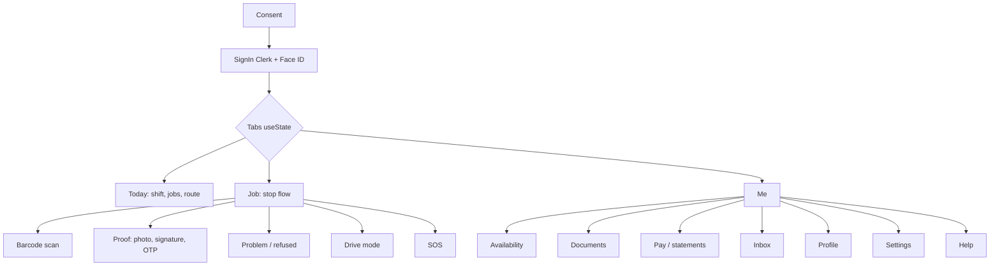
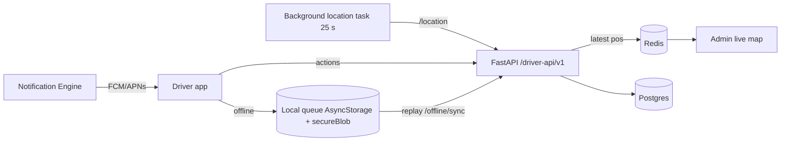
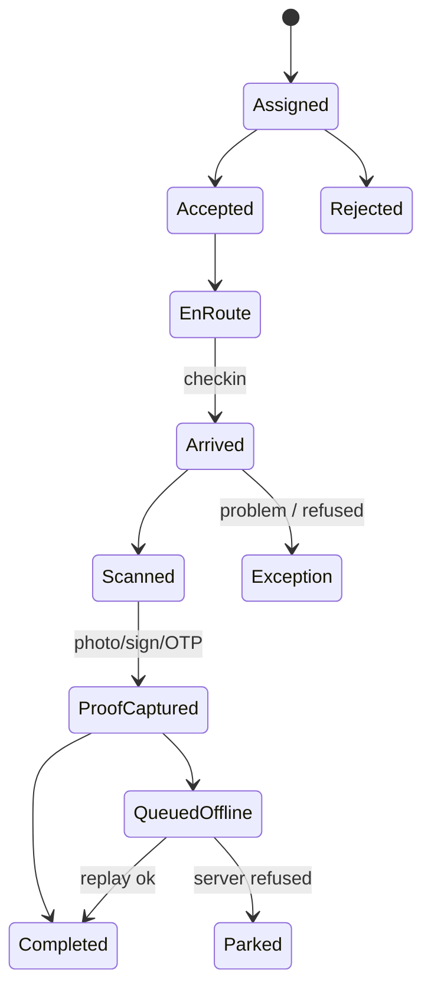
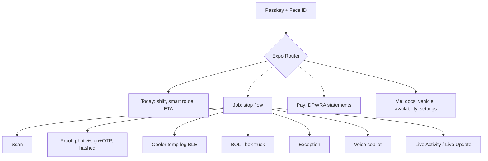
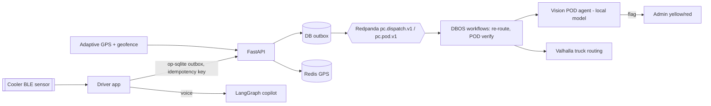
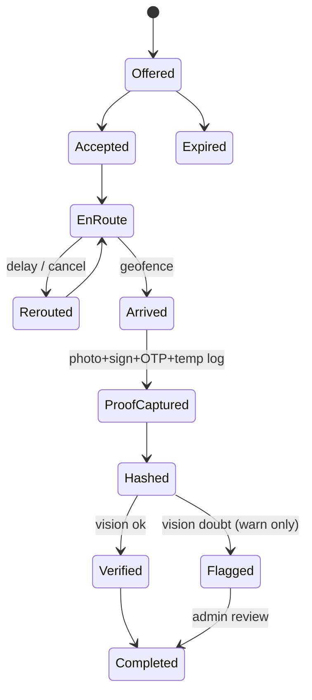

# 26 — Driver mobile app (apps/mobile-driver): AS-BUILT vs PLANNED

Evidence: `/home/pcd/PCD` at `d98dffff`, read-only, Oct 28, 2026. `md/` = `apps/mobile-driver/`.

## 1. AS-BUILT (NOW)

| Area                   | Status                                                                                                                                                                                                                                                                                                                                                                                         | Evidence                                                                                                                     |
| ---------------------- | ---------------------------------------------------------------------------------------------------------------------------------------------------------------------------------------------------------------------------------------------------------------------------------------------------------------------------------------------------------------------------------------------- | ---------------------------------------------------------------------------------------------------------------------------- |
| Stack                  | Expo **SDK 57** (`~57.0.27`), RN **0.86.3** (New Arch), React 19.2.3, Reanimated 4.5.1, TanStack Query + AsyncStorage persister                                                                                                                                                                                                                                                                | `md/package.json`                                                                                                            |
| Screens                | SignIn, Consent, Today, Job, Me + pages Availability, Documents, Help, Inbox, Pay, Profile, Settings; sheets Proof, Problem, Refused review, Barcode scanner, Drive mode, SOS                                                                                                                                                                                                                  | `md/App.tsx:31-35`; `md/src/screens/*`; `md/src/ui/*`                                                                        |
| Navigation             | `useState` tab bar (today / job / me), auto-switch to Job on current order                                                                                                                                                                                                                                                                                                                     | `md/App.tsx:69,145,295-341`                                                                                                  |
| Auth                   | Clerk `@clerk/expo 4.14.0` + Face ID device unlock; Bearer + `X-Porterchain-Portal: driver`; dev auth only outside prod                                                                                                                                                                                                                                                                        | `md/src/api.ts:58-70`; `md/src/auth/deviceUnlock.ts`; `md/app.config.js`                                                     |
| API (`/driver-api/v1`) | me, profile, onboarding, dashboard, jobs, orders, dispatch route/stops checkin, navigation session, scan lookup, location, gps-consent/status, monitoring-policy(+ack), shift start/end, availability(+schedule), earnings(+today, statements), timesheets, documents, attachments, vehicle, emergency, support(+hub), push register/unregister, offline queue/sync, privacy request, settings | `md/src/api.ts` (762 lines)                                                                                                  |
| GPS                    | foreground + **background** task `expo-location` Balanced, every 25 s / 40 m; iOS `UIBackgroundModes location`, Android FG service location                                                                                                                                                                                                                                                    | `md/src/location.ts:230-233`; `md/src/config.ts:26`; `md/src/locationTask.ts:8-44`; `md/app.json`                            |
| Offline                | built — local action queue (AsyncStorage, PII encrypted via secureBlob), single-writer chain, replay policy, parked rejections shown to driver, GPS buffer                                                                                                                                                                                                                                     | `md/src/offline.ts:9-138`; `md/src/replayPolicy.ts`; `md/src/secureBlob.ts`                                                  |
| POD                    | camera photo (EXIF stripped for PIPEDA), SVG signature pad, OTP handshake, barcode scan                                                                                                                                                                                                                                                                                                        | `md/src/pod.ts:67-70`; `md/src/ui/SignaturePad.tsx:13-21`; `md/src/handshake.ts:59,133`; `md/src/ui/BarcodeScannerModal.tsx` |
| Push                   | FCM/APNs device token → Notification Engine; accept/reject job from notification                                                                                                                                                                                                                                                                                                               | `md/src/push.ts:3,156-168`                                                                                                   |
| Voice                  | text-to-speech only (`expo-speech`); **microphone blocked** on Android                                                                                                                                                                                                                                                                                                                         | `md/src/smart/voice.ts:15-18`; `md/app.json` `blockedPermissions RECORD_AUDIO`                                               |
| Smart                  | local route ordering, battery hook, live fix                                                                                                                                                                                                                                                                                                                                                   | `md/src/smart/route.ts`, `useBattery.ts`, `useLiveFix.ts`                                                                    |
| Safety                 | SOS button + `/emergency`, pre-trip check                                                                                                                                                                                                                                                                                                                                                      | `md/src/sos.ts`; `md/src/pretrip.ts`                                                                                         |
| Build                  | EAS dev/preview/production, iOS build 22 (TestFlight script), Android versionCode 1, **no Android submit profile**                                                                                                                                                                                                                                                                             | `md/app.json`; `md/eas.json`; `md/scripts/archive-ios-testflight.sh`                                                         |
| Tests                  | 21 vitest files + 9 Maestro flows (P0 suite, POD capture, offline scan, push register)                                                                                                                                                                                                                                                                                                         | `md/src/__tests__/*`; `md/maestro/*`                                                                                         |

### Gaps / bugs (ranked)

1. **POD integrity**: no hash/signature of photo+signature+GPS+time on device → weak for claims (6-year record rule). No server-side image check.
2. **Signature is an SVG data URL** with no signer name/time binding → e-signature evidence weak (doc 19 e-sign rule).
3. **No DPWRA pay statement view per job** (only earnings/statements list) — Ontario Digital Platform Workers' Rights Act needs per-period pay info, how pay is calculated, tips (doc 20).
4. **Background GPS 25 s / Balanced** fixed — no adaptive rate (battery vs accuracy), no geofence arrival auto check-in.
5. **No cooler temperature logging** (BLE) — required for cooler service plan.
6. **No Live Activity / Android Live Update** for current stop; no CarPlay/Android Auto.
7. Box truck: no BOL screen / CVOR pre-trip variant (box truck gated, doc 22).
8. Android store submit not configured; versionCode 1.
9. Voice is speak-only; mic blocked → hands-free copilot impossible today.

### Mermaid — NOW screen map

### Mermaid — NOW data flow

### Mermaid — NOW stop state

## 2. PLANNED (latest tech, verified Oct 28, 2026)

Versions ✔: **Expo SDK 58 / RN 0.88 / React 19.3** (expo.dev/changelog/sdk-58); **Expo Widgets** Live Activities (alpha); **Android 16 Live Updates** need API 36.1 + `POST_PROMOTED_NOTIFICATIONS` (developer.android.com). Decision: **stay Expo + small native modules** (BLE, ActivityKit/ProgressStyle) — native Swift/Kotlin rewrite rejected (doubles code, no gain on New Arch).

| #   | Feature                                                                                                                                         | Benefit                        | Effort | Week  | Risk                                                                                                     | Locked check                          |
| --- | ----------------------------------------------------------------------------------------------------------------------------------------------- | ------------------------------ | ------ | ----- | -------------------------------------------------------------------------------------------------------- | ------------------------------------- |
| D1  | **Tamper-evident POD**: SHA-256 over photo+signature+GPS+time+device, signed, stored 6 y                                                        | claims-proof evidence          | S      | 2     | Low                                                                                                      | 6-year rule (audit fix)               |
| D2  | **Auto POD verification via vision** (local model: parcel visible, doorway, not blurry, label OCR matches) → yellow flag to admin, never blocks | fewer disputes                 | M      | 9–10  | Med (model accuracy)                                                                                     | LangGraph node; local model, $100 cap |
| D3  | **DPWRA pay statement** per period + per job (distance, time, rate, tips, deductions)                                                           | Ontario law                    | S      | 4     | Low (lawyer review wk 6)                                                                                 | doc 20                                |
| D4  | **Driver copilot voice** (push-to-talk → local STT → LangGraph tools: "next stop", "report damage", "call customer")                            | hands-free, safer              | L      | 11–12 | **Med–High**: needs mic (now blocked), HTA distracted-driving rules — voice only, no screen while moving | LangGraph; unblock `RECORD_AUDIO`     |
| D5  | **Smart re-routing**: Valhalla 3.9.1 (truck costing for box truck) + live traffic, DBOS workflow re-sequences on delay/cancel                   | fewer late stops               | M      | 8     | Med                                                                                                      | Valhalla week 4 (tech review)         |
| D6  | **ETA prediction** shared model with customer app                                                                                               | accurate customer ETA          | M      | 10–11 | Med                                                                                                      | —                                     |
| D7  | Adaptive GPS (moving/idle/stop-near), **geofence auto-arrive**                                                                                  | battery + exact arrival time   | S      | 5     | Low                                                                                                      | GPS stays Redis                       |
| D8  | **Offline-first v2**: op-sqlite outbox with idempotency keys; server dedupes into DB outbox → Redpanda                                          | zero lost actions              | M      | 6–7   | Med                                                                                                      | outbox (L19)                          |
| D9  | **Live Activity / Android Live Update** for current stop + shift timer                                                                          | glanceable without unlocking   | M      | 10    | Med (alpha)                                                                                              | —                                     |
| D10 | **Passkeys** (Keycloak, L26; Clerk removed) + Face ID                                                                                           | no passwords on shared phones  | S      | 4     | Med (Clerk plan)                                                                                         | open decision                         |
| D11 | **Cooler BLE temp logger** (react-native-ble-plx; 1-min samples, out-of-range alert, log attached to POD)                                       | Health Canada cold-chain proof | M      | 9     | Med (hardware pick)                                                                                      | cooler state machine (doc 22)         |
| D12 | **Box truck**: BOL capture + CVOR pre-trip variant                                                                                              | legal go-live gate             | M      | 7–8   | Med                                                                                                      | box truck after BOL/CVOR              |
| D13 | Driver **Wallet pass** (ID/badge, shift)                                                                                                        | quick ID at docks              | S      | 13    | Low                                                                                                      | —                                     |
| D14 | WhatsApp job offers fallback when push fails                                                                                                    | fewer missed offers            | S      | 9     | Med (cost cap $50)                                                                                       | spend cap                             |
| D15 | Accessibility + FR/EN, large tap targets, colour-blind safe                                                                                     | AODA                           | S      | 5     | Low                                                                                                      | —                                     |
| D16 | Expo Router + SDK 58 upgrade, Android Play submit profile, EAS Update channels                                                                  | faster safe releases           | M      | 3     | Med                                                                                                      | —                                     |

### Mermaid — PLANNED screen map

### Mermaid — PLANNED data flow

### Mermaid — PLANNED stop state

## 3. Reconciled with L25–L27 (committed f1cb078f, same evening)

- **L25 no paid AI**: every AI feature here runs on the self-hosted tiers in file 27 (T1 Qwen3.5-0.8B router, T2 Qwen3.5-4B + LoRA, T2v Phi-4-mini, CPU ML). References to a "$100 model cap" are void.
- **L26 no paid services**: D10 passkeys: same Clerk caveat as 25 (C2). D11 needs a BLE sensor (hardware, one-off) → flag `mandatory?`. Valhalla, op-sqlite, ble-plx, Expo Widgets are free/open source.
- **L27 free WhatsApp only**: D14 job offers via WhatsApp is **dropped** (would need the paid Cloud API); fallback is SMS-free push retry + in-app inbox, and a dispatcher can message from the free WhatsApp Business app by hand.
