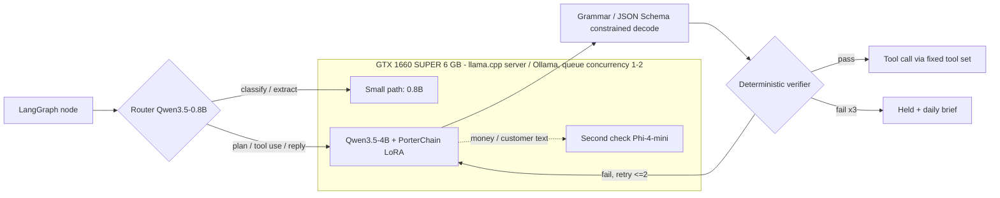
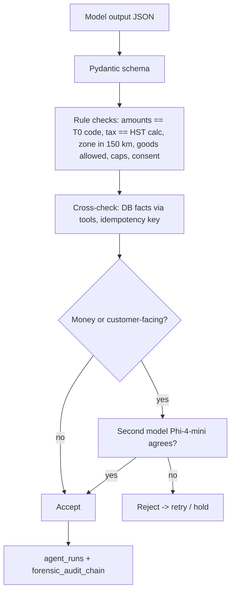
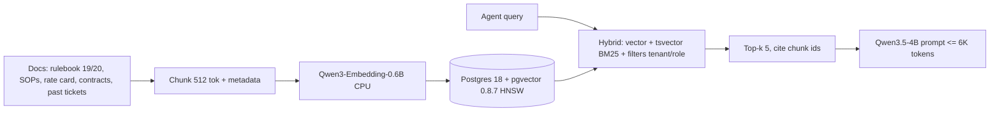
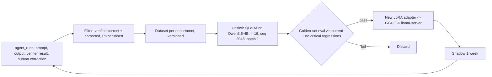

# 27 — In-house LLM reasoning (L25) and no-paid-services rule (L26)

Status: PLANNED. Researched 28 Oct 2026 (America/Toronto). Supersedes the T3 paid-model tier and the $100/month model cap in L22.

## Locked decisions

- **L25 — No paid AI anywhere.** All LLM reasoning runs on self-hosted open-weight models with commercial-use licences (Apache-2.0 / MIT). No API model, no "gated paid tier". L22 model cap removed (GPU time is the only model cost).
- **L27 — Free WhatsApp only, no paid Meta services** (Ravi, 28 Oct 2026). See section below.
- **L26 — Nothing paid except:** Apple Developer Program, DigitalOcean hosting, ZeptoMail, Shopify, and truly mandatory items (Stripe/Interac processor fees, government/legal registrations, Google Play fee if Android ships, domain names). Every other paid service is replaced by a free/self-hosted option, or flagged `mandatory?` for Ravi.

## What "our own LLM reasoning" means (no training from scratch)

`our reasoning = open base model + PorterChain LoRA adapter + RAG over our docs/data + fixed tools + deterministic verifier + eval gate`.
The model only proposes; T0 code computes money, tax, routing; a verifier accepts or rejects every output.

## Hardware truth (measured on Ubuntu box)

GPU: NVIDIA GTX 1660 SUPER, 6 GB, Turing TU116 (CUDA 7.5, no tensor cores, no bf16). RAM 15 GB, 8 CPU threads. Ollama 0.40.11 installed.

| Limit on 6 GB    | Reality                                                                                                |
| ---------------- | ------------------------------------------------------------------------------------------------------ |
| Models           | one 4B-class at Q4 resident (about 3.4 GB) + a 0.8B router; 9B only at IQ4_XS/Q3 with ~4K context      |
| Context          | 8–16K practical for 4B (KV q8_0 + flash attention); not 262K                                           |
| Speed (estimate) | roughly 30–60 tok/s decode for 4B Q4 on 336 GB/s; prefill is the bottleneck on long prompts            |
| Concurrency      | 1–2 parallel requests; 24 agents share one queue (concurrency 1–2, priority by department)             |
| Fine-tune        | QLoRA up to 3–4B at seq 1024–2048, batch 1, fp16; slow (no tensor cores). 7–9B QLoRA will OOM or crawl |
| Serving engines  | vLLM / SGLang are wrong tools for this card (need more VRAM to batch). Use llama.cpp server / Ollama   |

Verdict: 6 GB is enough for shadow/suggest-rung agents and classification in Phase 1. It is NOT enough for 24 agents at auto rung with planning + second checks at pilot volume. Upgrade before week 9 (core agents).

## Model picks (all verified licences)

| Role                                                                                                                                             | Model                                       | Licence    | Fits 6 GB                 | Notes                                        |
| ------------------------------------------------------------------------------------------------------------------------------------------------ | ------------------------------------------- | ---------- | ------------------------- | -------------------------------------------- |
| Router / classifier                                                                                                                              | Qwen3.5-0.8B (Q8)                           | Apache-2.0 | yes (~1 GB)               | intent, department, risk class, language     |
| Main reasoning + tools                                                                                                                           | Qwen3.5-4B (Q4_K_M)                         | Apache-2.0 | yes (~3.4 GB)             | tool calling, thinking mode, best 6 GB pick  |
| Second check (different family)                                                                                                                  | Phi-4-mini (Q4)                             | MIT        | yes (~2.5 GB), swapped in | independent verifier for money/customer text |
| Alt / fallback                                                                                                                                   | Gemma 4 E2B QAT; Granite 4.1 3B             | Apache-2.0 | yes                       | keep as eval challengers                     |
| Embeddings                                                                                                                                       | Qwen3-Embedding-0.6B (CPU)                  | Apache-2.0 | CPU                       | pgvector 0.8.7, HNSW                         |
| After 24 GB upgrade                                                                                                                              | Qwen3.6-35B-A3B (Q4, ~21 GB) or Qwen3.6-27B | Apache-2.0 | 24 GB                     | ~110+ tok/s reported on RTX 3090             |
| Avoid: Llama (community licence, not Apache/MIT; weaker quantized tool-call validity), DeepSeek R1 distills for tools (reasoning-only, verbose). |

## Serving

- Engine: `llama.cpp` `llama-server` (OpenAI-compatible, GBNF grammars, JSON Schema → grammar, LoRA hot-swap) behind Ollama-compatible API; one GPU queue in DBOS.
- Structured output: every call carries the Pydantic/SQLModel JSON Schema → constrained decoding; invalid output cannot be emitted, then Pydantic validates again.
- Settings: `OLLAMA_FLASH_ATTENTION=1`, `OLLAMA_KV_CACHE_TYPE=q8_0`, context 8192, `keep_alive` pinned for 4B, 0.8B always resident.

## Verifier (the precision core)

## RAG with pgvector

Row-level filters keep merchant data per tenant (PIPEDA). Live numbers come from tools, never from RAG.

## Fine-tune / distillation loop

- Distillation without paid AI: teacher = larger open model run offline (Qwen3.6-27B/35B-A3B on CPU RAM overnight now, or on the 24 GB card after upgrade) labels hard cases; student = 4B adapter. Also self-distill from verifier-accepted outputs.
- Training runs nightly/weekends only (GPU is shared with serving): serving paused or moved to CPU fallback during training.
- Evals: golden sets per agent (≥ 200 cases from anonymized PCD history), metrics = schema validity, tool-call accuracy, verifier pass, agreement with human, latency. Self-hosted Langfuse v3 + promptfoo/pytest in CI. Release blocked below bar.

## Hardware upgrade path (CAD, Oct 2026, used market)

| Option                                                                                                                                                                                                                            | Price (CAD)                                        | VRAM        | Gets you                                                                          | Verdict                   |
| --------------------------------------------------------------------------------------------------------------------------------------------------------------------------------------------------------------------------------- | -------------------------------------------------- | ----------- | --------------------------------------------------------------------------------- | ------------------------- |
| Stay GTX 1660 SUPER                                                                                                                                                                                                               | $0                                                 | 6 GB        | 4B + router, 1–2 concurrent, QLoRA ≤ 4B, slow                                     | OK weeks 1–8 only         |
| Used RTX 3060 12 GB                                                                                                                                                                                                               | ~$250–$450 (Kijiji/eBay median ~$440)              | 12 GB       | 9B Q4 with 16K ctx, 4B with 4 parallel, QLoRA 7–9B                                | cheap stop-gap            |
| Used RTX 3090 24 GB                                                                                                                                                                                                               | ~$1,450–$1,900 local (eBay typical ~$2,000–$2,350) | 24 GB       | Qwen3.6-35B-A3B ~110 tok/s, vLLM batching for 24 agents, QLoRA 27B-class, LoRA 7B | RECOMMENDED before week 9 |
| 2x 3090 / RTX 4090/5090                                                                                                                                                                                                           | $4,000–$5,000+                                     | 48/24–32 GB | 70B-class, headroom                                                               | not needed Phase 1        |
| Needs: PSU ≥ 850 W, 2x 8-pin, case clearance, and the box RAM to 32–64 GB (~$100–$200). Power: 3090 ~350 W under load; idle low.                                                                                                  |
| Cost/benefit: a one-time ~$1,700 vs the removed $100/month paid-model cap = pays back in ~17 months, with no per-token cost, no cross-border data disclosure (PIPEDA), and capacity for all 24 agents at auto. **Ravi decision.** |

## Paid non-AI services (L26) — found in PCD code

| Service                                                                                                         | In PCD                                     | Allowed by L26?         | Free / self-hosted replacement                                                   | Week                                    |
| --------------------------------------------------------------------------------------------------------------- | ------------------------------------------ | ----------------------- | -------------------------------------------------------------------------------- | --------------------------------------- |
| Clerk (584 files)                                                                                               | auth all portals; passkeys need Pro $25/mo | NO                      | Keycloak 26 (self-hosted, passkeys/WebAuthn, MFA free) or Authentik              | 2–5 migration; supersedes L9 Clerk part |
| WhatsApp Business Platform (96 files)                                                                           | per-message fees                           | NO — L27                | free WhatsApp Business app + wa.me links/QR; agents draft, human sends (see L27) | 8                                       |
| Twilio (13 files)                                                                                               | SMS                                        | NO                      | Web push (free) + email (ZeptoMail) + OTP via email/TOTP; SMS only if mandatory? | 6                                       |
| Sentry (54 files)                                                                                               | error tracking                             | NO                      | GlitchTip (self-hosted, Sentry SDK compatible)                                   | 3                                       |
| OpenAI (17 files)                                                                                               | AI calls                                   | NO (L25)                | local llama-server, same OpenAI-compatible client                                | 1–3                                     |
| Google Maps (maps.googleapis)                                                                                   | display + Places                           | NO beyond free          | PMTiles self-hosted + MapLibre, Photon geocoder (already), Pelias/Nominatim      | 4                                       |
| Protomaps hosted (8 files)                                                                                      | tiles API                                  | NO                      | self-hosted PMTiles file served by Caddy                                         | 4                                       |
| Mapbox (1 file)                                                                                                 | leftover                                   | NO                      | remove                                                                           | 1                                       |
| Cloudflare (15 files)                                                                                           | DNS/CDN, likely free tier                  | yes if free plan        | keep free plan; no paid add-ons                                                  | —                                       |
| Expo EAS                                                                                                        | builds/updates                             | free tier OK            | local `eas build --local` / self-hosted expo-updates if limits hit               | —                                       |
| Langfuse cloud                                                                                                  | (planned)                                  | NO                      | self-hosted Langfuse v3                                                          | 3                                       |
| Stripe / Interac fees, ZeptoMail, DigitalOcean, Apple, Shopify, Google Play, domains, CRA/Ontario registrations | —                                          | YES (allowed/mandatory) | —                                                                                | —                                       |
| Lawyer review, cargo insurance, CVOR                                                                            | legal                                      | mandatory?              | none                                                                             | —                                       |

## L27 WhatsApp: free only (verified 28 Oct 2026)

- Channel: free **WhatsApp Business app** on one company phone (no API, no Meta billing). `wa.me/<number>?text=<prefilled order template>` links and QR codes on website, customer/merchant portals, Shopify app, invoices and labels.
- Agents: WhatsApp concierge (13) becomes **WhatsApp intake + reply drafter**. Staff copy/forward a chat (or export chat .txt) into the admin "WhatsApp inbox" paste box / share sheet; 0.8B classifies, 4B extracts an order draft (schema-validated, zone/goods/price rules from T0). Agent drafts the reply; **a human sends it from the app**. Booking is created only after the verifier passes and staff confirm.
- Status updates go by free channels: web push, email (ZeptoMail), live tracking link. No outbound WhatsApp automation.
- Meta rules checked (developers.facebook.com WhatsApp pricing): since **1 Oct 2026** Cloud API service messages are no longer unlimited-free: **1,000 free service messages per business number per month**, only inside the 24-hour customer service window opened by the customer; user→business messages are free; templates are charged; free entry-point window only from click-to-WhatsApp ads. With **no payment method**, Meta stops delivering after the free 1,000. => Listed as an optional **free-capped option** (Cloud API, customer-initiated, 24 h window, max 1,000/month, no card on file) — Ravi decision, not in the plan by default.
- **Not allowed:** whatsapp-web.js, Baileys, WAHA, Evolution (Baileys mode), Green API, Whapi — unofficial clients break WhatsApp Terms (no automated/bulk/non-personal use without authorization) and the number can be banned. Never used.
- CASL/PIPEDA: customer-initiated chat = implied consent for that transaction's replies only; no promotional messages without express consent recorded in `lead_consent` (source `whatsapp`, timestamp, staff id, wording); unsubscribe honoured; pasted chats are personal info: stored only as the extracted order + hash of the source, raw paste deleted after 30 days, access by role.
