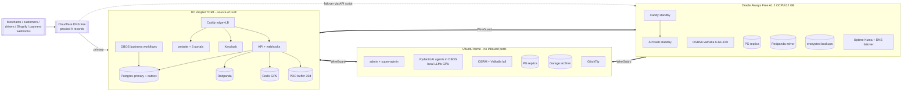
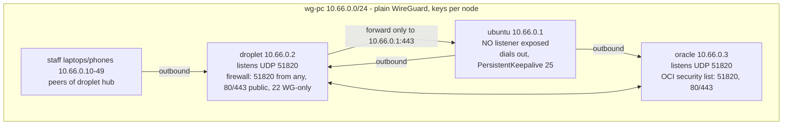
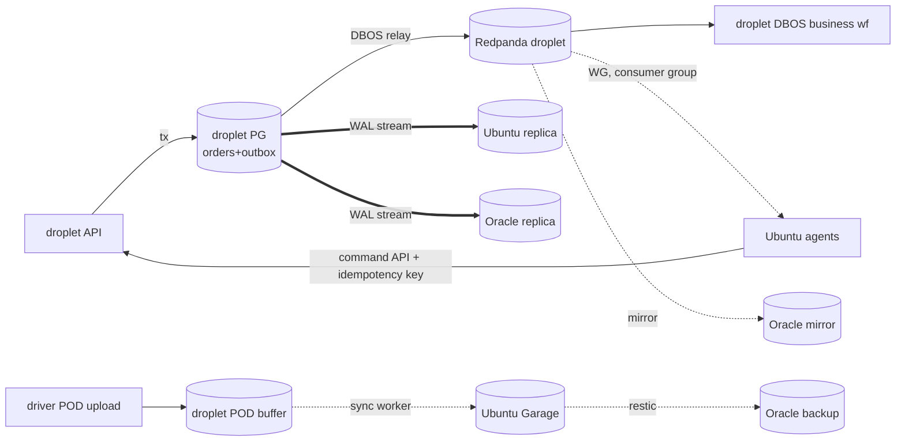
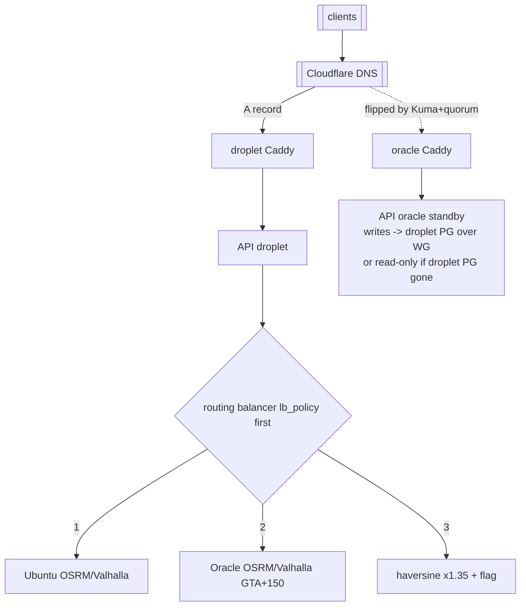
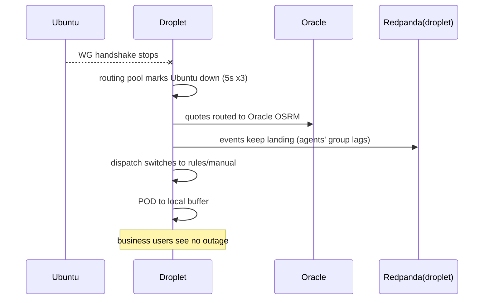
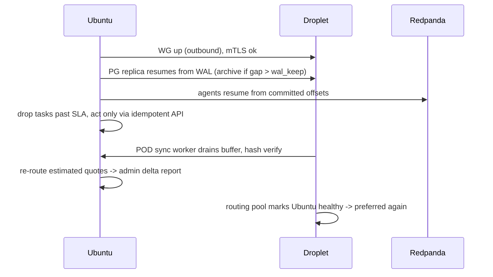

# 28 — Hybrid deployment: DigitalOcean droplet + Ubuntu home server + Oracle Always Free (PLANNED, L28)

Written 2026-10-28 (America/Toronto). Docs only. No deploy, no droplet change, live 5432/6379/50051 untouched.
Locked: **L28** hybrid deployment, plus L25 local AI only, L26 no paid services (except Apple, DigitalOcean, ZeptoMail, Shopify, mandatory), Redpanda, DBOS, Keycloak.

**The single rule:** the **droplet is the source of truth for every business-critical flow**. Losing Ubuntu or Oracle (or both) never stops a merchant, customer or driver. Ubuntu = brains + heavy compute + archive. Oracle = free spare capacity and standby, never required.

## 1. What runs where TODAY (evidence)

| Where              | What                                                                                                                                                                                           | Evidence                                                                                                                                                                  |
| ------------------ | ---------------------------------------------------------------------------------------------------------------------------------------------------------------------------------------------- | ------------------------------------------------------------------------------------------------------------------------------------------------------------------------- |
| Droplet (DO, 4 GB) | Everything prod: postgres 16.10, redis, spicedb, valhalla, photon (`mem_limit 700m`), osrm (`gta-150km.osrm`, MLD), api, worker, web, **admin**, merchant, driver, customer, caddy, autoheal   | `infrastructure/deploy/docker-compose.prod.yml:22-670`; "4GB droplet OOM insurance" `bootstrap-droplet.sh:34`; "full Ontario OOMs a 4GB droplet" compose valhalla comment |
| Droplet edge       | Caddy publishes 80/443; `admin.porterchain.com` is **public** (only app-level login)                                                                                                           | `infrastructure/deploy/Caddyfile`                                                                                                                                         |
| Droplet deploy     | GHCR images → droplet compose + migrate + smoke; rollback script                                                                                                                               | `RUNBOOK.md:54-62`, `infrastructure/deploy/README.md`                                                                                                                     |
| Ubuntu             | dev/local stacks (porterchain-* on 127.0.0.1 5432/6379/50051/8002/5000; pcd-local-*), `pch-keycloak` 0.0.0.0:8180/8543, Garage 3900 (bound 127.0.0.1, 10.66.0.1, LAN), Syncthing, crm-postgres | `docker ps` this run                                                                                                                                                      |
| Ubuntu network     | `wg0` 10.66.0.1/24 already up (peer config not readable: `/etc/wireguard` permission denied → 98_unknowns)                                                                                     | `ip -br a`                                                                                                                                                                |
| Ubuntu hardware    | 15 GB RAM, 8 cores, GTX 1660 Super 6 GB                                                                                                                                                        | `free -g`, `nproc`, file 27                                                                                                                                               |
| Oracle             | nothing today                                                                                                                                                                                  | —                                                                                                                                                                         |

## 2. Placement (planned)

| Service                                                  | Droplet (TOR1)                                    | Ubuntu (home)                                     | Oracle Always Free (A1 ARM)                               | Mode                                          |
| -------------------------------------------------------- | ------------------------------------------------- | ------------------------------------------------- | --------------------------------------------------------- | --------------------------------------------- |
| Caddy edge / LB                                          | ✔ primary public edge                             | ✔ internal only (WG)                              | ✔ standby public edge                                     | active-passive public                         |
| Website (Next)                                           | ✔                                                 | —                                                 | ✔                                                         | active-active (stateless)                     |
| Merchant / customer / driver portals                     | ✔                                                 | —                                                 | ✔ (warm, read-mostly fail-over)                           | active-passive (cookies via Keycloak; see §6) |
| API (FastAPI) + webhooks (Shopify, payments, Interac)    | ✔ primary                                         | —                                                 | ✔ standby, points at droplet PG                           | active-passive writes                         |
| Mobile app backend (same API), push                      | ✔                                                 | —                                                 | standby                                                   | as API                                        |
| Keycloak (business + staff realms)                       | ✔ primary (DB in droplet PG)                      | —                                                 | ✔ cold standby (same DB via replica, start on promote)    | active-passive                                |
| Postgres 18 **primary** (+ outbox)                       | ✔                                                 | ✔ streaming replica (analytics, RAG, agents read) | ✔ streaming replica (failover target)                     | active-passive                                |
| SpiceDB                                                  | ✔                                                 | —                                                 | standby                                                   | as PG                                         |
| Redis (sessions cache, live GPS latest-position)         | ✔                                                 | —                                                 | —                                                         | single; GPS is ephemeral (L19)                |
| Redpanda                                                 | ✔ broker (1 core, 1 GB)                           | consumer only                                     | ✔ MirrorMaker2-style mirror (Redpanda Connect)            | primary + async mirror                        |
| DBOS workflows (business: order, billing, notifications) | ✔                                                 | —                                                 | —                                                         | DBOS state lives in PG                        |
| DBOS + PydanticAI agent workflows, local LLMs (GPU)      | —                                                 | ✔                                                 | —                                                         | queue when off                                |
| OSRM + Valhalla full (Ontario / truck)                   | —                                                 | ✔ preferred                                       | ✔ GTA+150 km (ARM build)                                  | active-active routing pool                    |
| Routing last-resort                                      | haversine × 1.35 + `distance_estimated=true` flag | —                                                 | —                                                         | fallback only                                 |
| Photon geocoder                                          | ✔ (small, existing 700m)                          | ✔ full                                            | —                                                         | —                                             |
| Admin + super-admin portals                              | —                                                 | ✔ (WG only)                                       | —                                                         | Ubuntu only                                   |
| POD/photo hot storage                                    | ✔ 30-day buffer on droplet volume                 | ✔ Garage archive (6-year retention, L-audit)      | ✔ encrypted offsite copy (≤ 20 GB object or 150 GB block) | write droplet, sync                           |
| Backups                                                  | pgBackRest WAL+full → Ubuntu & Oracle             | restic of Garage → Oracle                         | holds encrypted copies                                    | both ways                                     |
| Monitoring (GlitchTip, Uptime Kuma, health prober)       | —                                                 | GlitchTip                                         | ✔ Uptime Kuma + DNS failover script                       | Oracle watches the others                     |
| Email                                                    | ZeptoMail (paid, allowed)                         | —                                                 | —                                                         | —                                             |

## 3. Deployment diagram

## 4. Network (WireGuard mesh, self-hosted, no Tailscale)

- Home router: **zero port-forwards**. Ubuntu initiates both tunnels.
- Service-to-service on top of WG: mTLS (Caddy internal CA / step-ca, free) for PG replication (`hostssl` + client cert), Redpanda, routing API.
- Admin: `admin.internal.porterchain` resolves only inside WG; Caddy on Ubuntu requires Keycloak staff realm (passkey + MFA) **and** WG source IP. The public `admin.` block is removed from the droplet Caddyfile.
- Existing Ubuntu `wg0 10.66.0.1/24` is reused if its peers match; otherwise new interface `wg-pc` (unknown U28-1).

## 5. Data ownership and flow

- **One writer**: droplet PG. Ubuntu admin and agents never write to a replica; they call the droplet API (commands) over WG. Agent outputs go back as API calls with idempotency keys.
- **Outbox direction**: droplet PG `outbox` → DBOS relay (droplet) → Redpanda (droplet) → consumers: droplet business workflows + Ubuntu agents (consumer groups keep offsets) + Oracle mirror.
- Redpanda retention 14 days / 10 GB cap so Ubuntu can be off up to 14 days and replay.
- GPS stays Redis latest-position on droplet (L19); never Kafka.

## 6. Load balancing (all free/self-hosted)

**Honest limit:** Cloudflare free has **no** health-checked load balancer (that is the paid Load Balancing add-on, against L26). So: Cloudflare free DNS-only (D-PR1; proxy optional later), and **Uptime Kuma on Oracle + a small script** that flips the A record (TTL 60 s) via the free Cloudflare API after 3 failed checks of 30 s (≈90 s detection + 1–5 min DNS propagation, DNS-only). A second checker on Ubuntu must agree (2-of-2 quorum) before any flip → avoids flapping when only Oracle's network is bad.

| Layer        | Tool                                                                                                                 | Health check                                                |
| ------------ | -------------------------------------------------------------------------------------------------------------------- | ----------------------------------------------------------- |
| Public DNS   | Cloudflare free, proxied, TTL auto                                                                                   | Kuma + script, quorum Oracle+Ubuntu                         |
| Node edge    | Caddy `reverse_proxy` with `health_uri`, `health_interval 5s`, `lb_policy first`                                     | per upstream                                                |
| Routing pool | Caddy on droplet: upstreams Ubuntu OSRM/Valhalla (WG) → Oracle (WG) → local stub returning 503 so API uses haversine | `/health` of osrm (`/nearest` probe) and valhalla `/status` |
| DB           | no proxy; app DSN points at droplet primary; failover is manual promote                                              | `pg_isready`, replica lag                                   |

Health endpoints (planned): `GET /healthz` (process alive), `GET /readyz` (PG write + Redpanda produce + Keycloak JWKS), `GET /routing/health` (which routing tier is active). Kept off public via existing `@ops` 404 rule; probes come over WG.

Active-active: website, routing (Ubuntu+Oracle, droplet fallback), static tiles. Active-passive: API writes, portals, Keycloak, PG, Redpanda, SpiceDB.
Sessions: Keycloak tokens are JWT; portals hold OIDC cookies signed with a shared key stored on both nodes, so no sticky sessions needed. Keycloak's own sessions are in its DB (replicated), so on promotion users at worst sign in again.

**Split-brain prevention:** (1) only one PG primary; Oracle replica promotes **only by a human command** (`promote.sh` asks for typed confirmation) after the droplet is confirmed dead from two vantage points; (2) on promote, the script first **fences** the droplet (DO API power-off of the droplet or Cloudflare record removal + WG peer removal) so it cannot accept writes; (3) Redpanda mirror is read-only until promoted; (4) DNS flip without DB promotion keeps Oracle API writing to droplet PG over WG — this is the normal case (droplet edge down, DB up is rare; commonly the whole droplet is down, so Oracle serves **read-only mode** banner until a human promotes).

**Failover / failback steps**

1. Kuma quorum fails droplet → script flips DNS to Oracle → Oracle serves website + portals read-only (merchants still see orders from replica) and shows a clear "please retry" message on booking and quote screens; no bookings are queued (D-LB1).
2. If droplet is gone > 30 min: human runs `promote.sh` on Oracle (fence droplet, `pg_promote`, start Keycloak + Redpanda from mirror, API to read-write).
3. Failback: rebuild droplet from latest image, make it a replica of Oracle, catch up, short write freeze (≤ 2 min), switchover back, flip DNS, Oracle returns to replica.

## 7. Ubuntu-off behaviour

| Feature                                 | When Ubuntu is off                                                                                                            | Catch-up when back                                                             |
| --------------------------------------- | ----------------------------------------------------------------------------------------------------------------------------- | ------------------------------------------------------------------------------ |
| Logins (merchant/customer/driver)       | ✔ Keycloak on droplet                                                                                                         | —                                                                              |
| Quotes / pricing                        | ✔ routing → Oracle GTA+150; if Oracle also off → haversine × 1.35, `distance_estimated=true`, price locked, admin review flag | re-route flagged quotes, show delta to admin (no customer re-price after lock) |
| Order create, tracking, live GPS        | ✔ droplet                                                                                                                     | —                                                                              |
| Dispatch                                | rules-based auto-assign on droplet (nearest available, capacity) or manual queue; agent dispatch paused                       | agents consume backlog, only advise on still-open jobs                         |
| Agents (all 24)                         | queued in Redpanda (14 d)                                                                                                     | replay from offset; stale tasks (> SLA) auto-closed with note                  |
| Notifications / email (ZeptoMail), push | ✔ droplet templates; agent-drafted replies skipped                                                                            | —                                                                              |
| WhatsApp free-tier replies              | click-to-chat still works; drafts paused                                                                                      | drafts generated for open threads < 24 h                                       |
| POD photos/signatures                   | ✔ stored in droplet buffer (hashed, L-POD tamper-evident)                                                                     | sync to Garage, verify hash, then mark archived                                |
| Vision POD check                        | skipped, flagged `pending_check`                                                                                              | run on backlog                                                                 |
| Invoices/credit notes/payments webhooks | ✔ droplet DBOS                                                                                                                | —                                                                              |
| Shopify app + webhooks                  | ✔ droplet                                                                                                                     | —                                                                              |
| Admin / super-admin                     | ✖ unavailable (by design); emergency: read-only Grafana-less status page on droplet behind Keycloak super-admin + WG          | —                                                                              |
| Analytics / RAG / fine-tune             | ✖                                                                                                                             | replica catches up via WAL                                                     |
| Backups                                 | droplet → Oracle continues                                                                                                    | droplet → Ubuntu resumes, WAL archive gap filled                               |

## 8. Oracle-off behaviour

| Feature                               | Effect                                                                    |
| ------------------------------------- | ------------------------------------------------------------------------- |
| All business flows                    | none — droplet unaffected                                                 |
| Routing                               | Ubuntu primary; if both off → haversine flag                              |
| DNS failover target                   | none until back (Kuma down too → alert from Ubuntu checker to ZeptoMail)  |
| Offsite backups                       | Ubuntu copy still exists; gap alert after 24 h                            |
| Replica / mirror                      | resync from WAL archive / Redpanda offsets                                |
| Oracle reclaim or account termination | rebuild from IaC script in < 1 h; nothing lost that matters (only copies) |

## 9. Failover and recovery sequences

## 10. Backups and DR

| What                     | Method                                                                        | Targets                                                 | RPO / RTO                                             |
| ------------------------ | ----------------------------------------------------------------------------- | ------------------------------------------------------- | ----------------------------------------------------- |
| Droplet PG               | pgBackRest full weekly + diff daily + continuous WAL, encrypted (repo cipher) | Ubuntu (Garage S3) **and** Oracle block volume          | RPO ≤ 1 min (streaming replicas) / RTO 30 min promote |
| POD/photos               | droplet buffer → Garage; restic encrypted                                     | Oracle block (≤ 150 GB)                                 | 0 after sync                                          |
| Garage archive (6 years) | restic nightly                                                                | Oracle; second offline copy on USB disk monthly (D-BK1) | 24 h                                                  |
| Configs/IaC              | git + age-encrypted env                                                       | all three                                               | —                                                     |
| Droplet total loss       | promote Oracle (§6)                                                           | —                                                       | 30–60 min                                             |
| Ubuntu total loss        | business unaffected; rebuild Ubuntu from backups                              | —                                                       | days acceptable                                       |

DO droplet backups (+20%) are optional; pgBackRest already covers data (D-BK2).

## 11. Sizing and cost

**Droplet RAM budget (target 4 GB, honest estimates):**

| Service                                          | MiB                                                                     |
| ------------------------------------------------ | ----------------------------------------------------------------------- |
| OS + Docker + WireGuard                          | 400                                                                     |
| Postgres 18 (shared_buffers 512M)                | 800                                                                     |
| API (2 uvicorn workers)                          | 400                                                                     |
| DBOS business workflows/worker                   | 300                                                                     |
| Keycloak (Quarkus, `-Xmx 512m`)                  | 600                                                                     |
| Redpanda (`--smp 1 --memory 512M`, dev mode)     | 600                                                                     |
| Redis (maxmemory 128M)                           | 150                                                                     |
| SpiceDB                                          | 120                                                                     |
| website + 3 portals (Next standalone, ~120 each) | 480                                                                     |
| Caddy                                            | 50                                                                      |
| Photon                                           | 0 — **moved off** (geocode on Ubuntu/Oracle, cached results on droplet) |
| OSRM / Valhalla                                  | 0 — **moved off** to Ubuntu + Oracle                                    |
| admin                                            | 0 — **moved** to Ubuntu                                                 |
| **Total**                                        | **≈ 3.9 GB** → 4 GB + 2 GB swap is tight; **recommend 8 GB**            |

| Option        | Spec                                           | Price (DO list, TOR1, not re-verified this run) |
| ------------- | ---------------------------------------------- | ----------------------------------------------- |
| A minimal     | Basic 2 vCPU / 4 GB / 80 GB                    | ~$24/mo                                         |
| B recommended | Basic 4 vCPU / 8 GB / 160 GB                   | ~$48/mo                                         |
| DO backups    | not used (D-BK2)                               | $0                                              |
| Oracle        | A1 2 OCPU / 12 GB / 200 GB block, 10 TB egress | $0                                              |

Option A works only if Redpanda and Keycloak stay at the limits above; any spike OOMs. Option B is the honest pick.

**Oracle RAM plan (12 GB):** OSRM GTA+150 MLD ~1.5 GB, Valhalla GTA+150 ~1.5 GB, PG replica 1.5 GB, Redpanda mirror 1 GB, API/web standby 1.2 GB, Keycloak cold standby 0 (starts on promote, 0.6), Kuma 0.2, restic/WG/OS 1 GB → ~8 GB used, steady load keeps it above Oracle's idle thresholds.

**Ubuntu RAM target:** OSRM Ontario 5 GB + Valhalla Ontario/truck 4 GB + Photon 2 GB + PG replica 2 GB + Garage 1 GB + agents/PydanticAI/DBOS + Langfuse 2 GB 3 GB + LLM host side (CPU offload, embeddings) 6 GB + admin 1 GB + OS/dev 4 GB ≈ 28 GB → **32 GB minimum, 64 GB recommended** (fine-tuning + full Canada extracts). Today: 15 GB.

## 12. Oracle Always Free — verified limits (✔ fetched 2026-10-28, docs.oracle.com freetier_topic-Always_Free_Resources)

- A1 Flex: **2 OCPUs + 12 GB total** for Always Free tenancies (1,500 OCPU-h / 9,000 GB-h). Older 4/24 figures are outdated.
- Block: 200 GB total (boot + block), 5 backups. Object: 20 GB, 50k requests/month. Egress 10 TB/month.
- Resources only free in the **home region**, chosen once at signup → choose **ca-toronto-1** (Montreal ca-montreal-1 as alternative). Region availability for A1 capacity: "out of host capacity" errors are common (U28-3).
- **Idle reclaim:** instance may be reclaimed if over 7 days p95 CPU < 20%, network < 20%, and memory < 20% (A1). Our steady replica + routing + mirror keeps memory > 20%.
- No SLA for Always Free; accounts can be suspended/terminated — therefore Oracle is never a single point of anything. Do **not** upgrade to Pay-As-You-Go (L26).
- Free 1 Flexible LB (10 Mbps) exists but is not used (too small, Oracle-only).

## 13. Security

- Admin never public; WG + Keycloak staff realm + passkey; SpiceDB checks unchanged.
- No inbound ports at home. Droplet and Oracle expose only 80/443 + UDP 51820; SSH over WG only (`harden-droplet.sh` extended).
- mTLS for PG replication, Redpanda, routing calls; secrets age-encrypted per node; WG keys rotated quarterly.
- Webhooks (Shopify HMAC, payment) verified on droplet only; Oracle standby has the same secrets but is read-only until promoted.

## 14. PIPEDA notes

- Personal data stays in Canada: DO **TOR1**, Oracle **ca-toronto-1/ca-montreal-1**, Ubuntu in Ontario. Cloudflare proxies traffic (TLS termination outside Canada possible) → disclose as a service provider in the privacy policy, or use DNS-only (grey cloud) to avoid it (D-PR1).
- Oracle and DO are processors: list both in the privacy notice and keep their DPAs on file.
- Backups encrypted before leaving each node; keys held by PorterChain only.
- Retention: POD 6 years (audit fix); droplet buffer purged after verified sync.
- Breach-of-security safeguards: the WG mesh, mTLS and audit logs support PIPEDA Principle 4.7.

## 15. Rehearsal (L13) — failover drill

1. Local rehearsal with 3 containers/VMs named droplet/ubuntu/oracle on `pcd-local` network (never live ports).
2. Drill A: stop "ubuntu" → quote must still price (Oracle route), POD buffer grows, agents lag; restart → backlog drains, delta report.
3. Drill B: stop "oracle" → nothing visible to business users.
4. Drill C: stop "droplet" → Kuma quorum flips DNS (mock), read-only banner; run `promote.sh`; verify fence; failback.
5. Drill D: split network (droplet ↔ oracle cut, both alive) → no DNS flip (quorum fails), no promotion.
6. Pass bar: zero lost orders, zero double primaries, RTO within table §10. Repeat quarterly on prod after pilot.

## 16. Decisions (Ravi, 28 Oct 2026)

| ID    | Decision                                                                                                | Effect                                                                                                                                                            |
| ----- | ------------------------------------------------------------------------------------------------------- | ----------------------------------------------------------------------------------------------------------------------------------------------------------------- |
| D-SZ1 | **Droplet 8 GB** (Basic 4 vCPU / 8 GB / 160 GB, about $48/mo)                                           | Option B in §11; 4 GB is dropped                                                                                                                                  |
| D-LB1 | **"Please retry" during failover; no queued bookings**                                                  | Oracle read-only mode shows a clear bilingual message ("Booking is paused for a few minutes, please retry") on booking/quote screens; no `pending_primary` outbox |
| D-PR1 | **Cloudflare DNS-only (grey cloud)**, final for now; the proxy can be enabled later for DDoS protection | Failover = DNS flip with TTL 60 s, so allow about 1–5 min for resolvers; Caddy on each node terminates TLS                                                        |
| D-BK1 | **Monthly offline USB copy** of the encrypted archive                                                   | Added to the backup calendar (§10, doc 35)                                                                                                                        |
| D-BK2 | **No paid DigitalOcean backups**                                                                        | pgBackRest + restic to Ubuntu/Oracle + USB cover it; the "+20%" line in §11 is dropped                                                                            |
| D-RAM | **Ubuntu 32 GB now, 64 GB before fine-tuning** (week 10 QLoRA)                                          | §11 Ubuntu budget planned at 32 GB                                                                                                                                |
| D-OCI | Oracle signup with home region Toronto (ca-toronto-1)                                                   | **Still Ravi's action** (card verification by Oracle, not charged)                                                                                                |

## Unknowns (also in 98)

- U28-1 current `wg0` peers on Ubuntu (permission denied).
- U28-2 actual droplet size and memory use today (no droplet access this run; only the 4 GB comment).
- U28-3 A1 capacity in ca-toronto-1 at signup time.
- U28-4 Valhalla ARM image availability (OSRM builds on arm64; Valhalla needs a verified arm64 tag).
