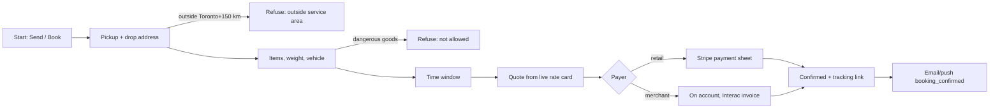
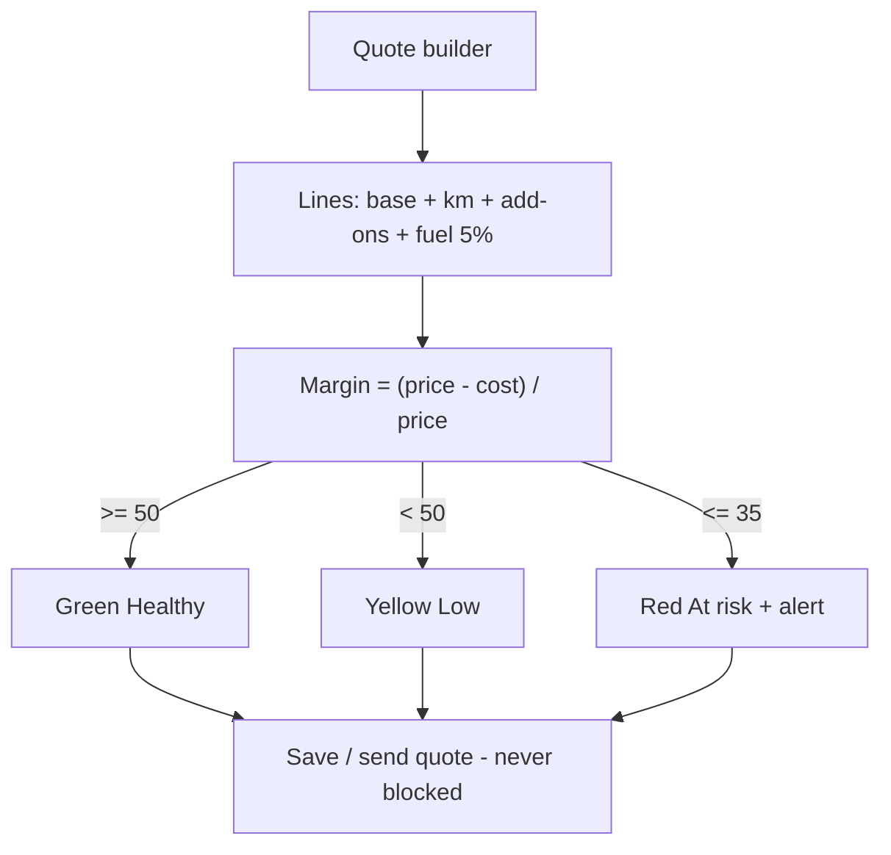
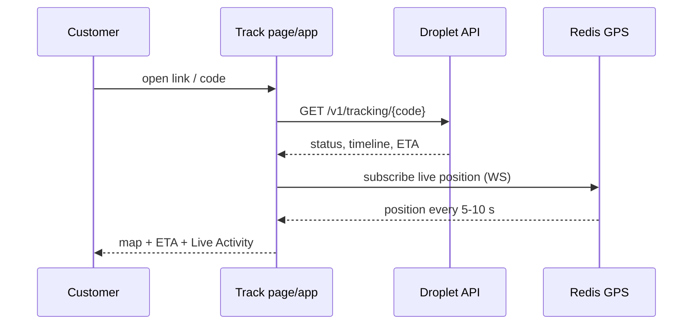
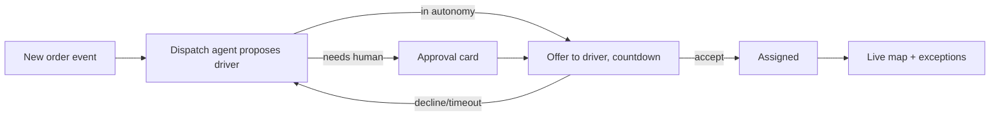
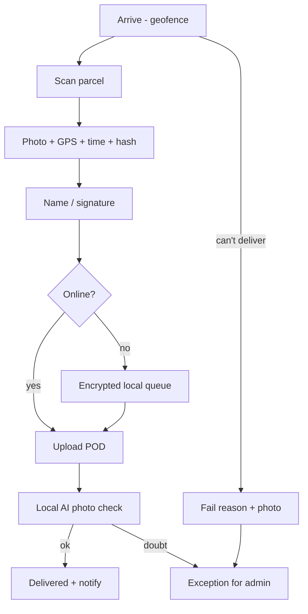
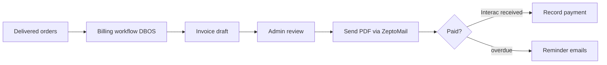
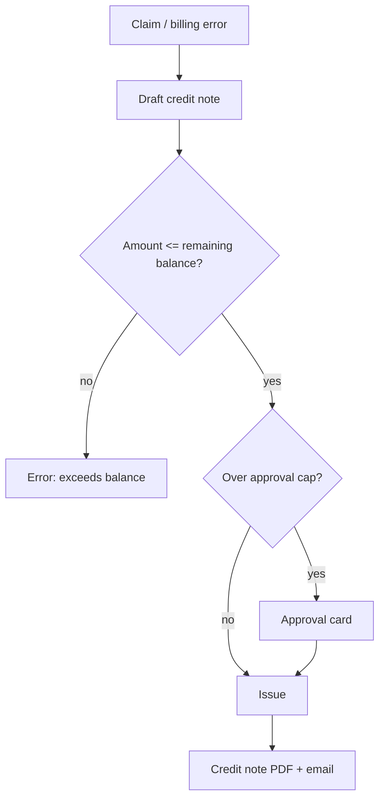
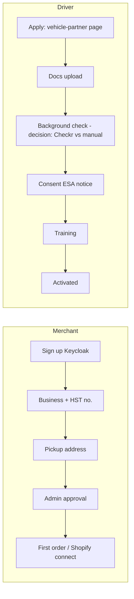
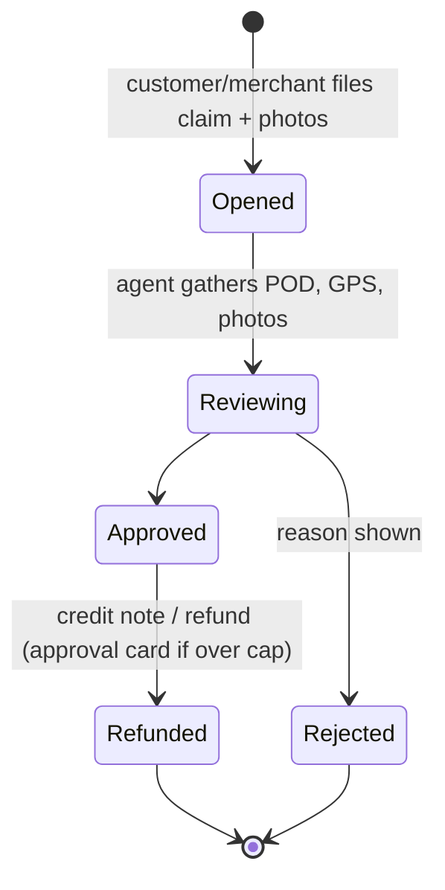
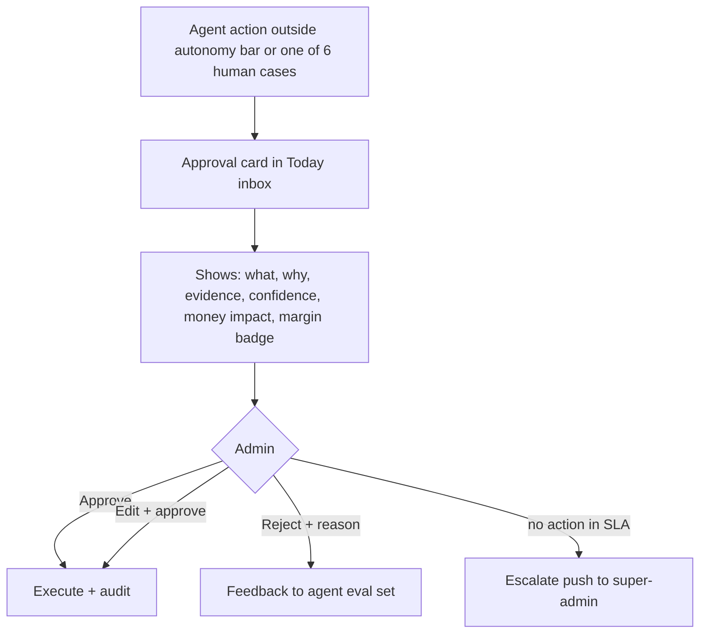

# 42 · UX flows (PLANNED)

Screens referenced are in 41_*; components in 40. All flows: EN/FR, offline-tolerant where marked, agent steps go through approval cards for the six human cases.

## 1. Booking (customer web/app, merchant portal, Shopify)

## 2. Quote with margin band (admin)

## 3. Tracking

## 4. Dispatch

## 5. Proof of delivery (driver app, offline-first)

## 6. Invoicing

## 7. Credit notes

## 8. Onboarding (merchant, driver)

## 9. Claims

## 10. Agent approval card

