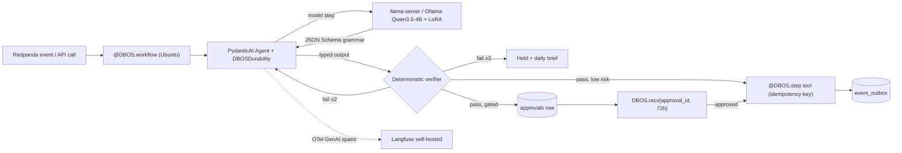
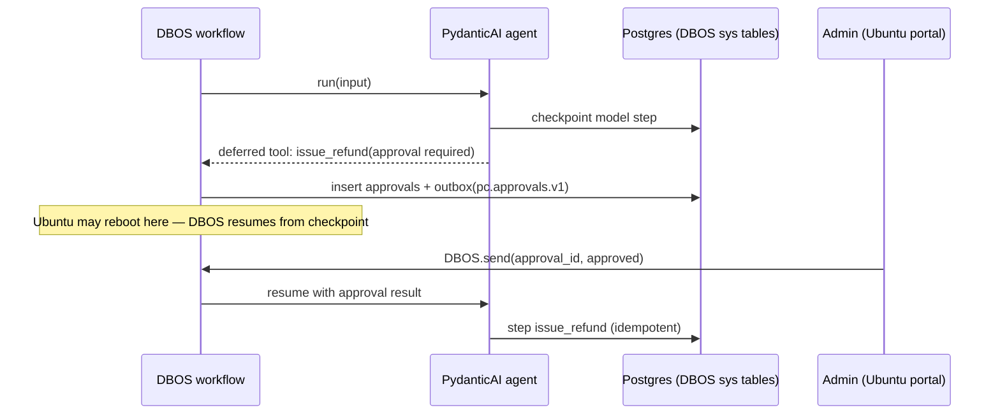

# 43 — Agent framework decision (late-2026, local-only models)

Status: **DECIDED by Ravi 28 Oct 2026: L14 revised to PydanticAI inside DBOS (DBOS sole durable store); DSPy offline only; self-hosted Langfuse on Ubuntu (~2 GB).**
Rules applied: L25 (no paid AI), L26 (free only), DBOS locked, Redpanda locked, verifier-first (doc 27).
Versions verified 28 Oct 2026 (PyPI / GitHub releases / vendor docs). Rows marked † are from a third-party tracker (agentatlas.dev, followagents.com), not the vendor page.

## 43.1 Versions and maturity

| Framework                                          | Latest (date)                                           | Licence                               | Maturity                                           | Local Ollama / llama.cpp                            | Notes                                                                                                                   |
| -------------------------------------------------- | ------------------------------------------------------- | ------------------------------------- | -------------------------------------------------- | --------------------------------------------------- | ----------------------------------------------------------------------------------------------------------------------- |
| LangGraph                                          | 1.2.18 (2026-10-26, PyPI)                               | MIT                                   | Stable 1.x since 2025-10-22, no breaking until 2.0 | via langchain-openai / langchain-ollama             | Own checkpointer + interrupts; OTel dep bumped to 1.45                                                                  |
| PydanticAI                                         | 2.63.0 (2026-10-27, GitHub)                             | MIT                                   | 2.x, very fast cadence                             | first-party `OllamaModel` (OpenAI-compatible `/v1`) | **First-party `DBOSDurability`** (pydantic-ai[dbos]), deferred tools for approvals, Logfire/OTel native, pydantic-evals |
| CrewAI                                             | 1.15.32 (2026-10-27)                                    | MIT                                   | Stable 1.x                                         | via LiteLLM                                         | Role/crew abstraction; weak typed control with 4B models                                                                |
| Microsoft Agent Framework (AutoGen + SK successor) | Python 1.0.0 GA 2026-04-02; 1.23.0† (2026-10-22)        | MIT                                   | GA                                                 | `agent-framework-ollama` (beta pkg)                 | Workflows, checkpointing, HITL; Azure-centric; AutoGen itself in maintenance                                            |
| OpenAI Agents SDK                                  | 0.24.0† (2026-10-15)                                    | MIT                                   | pre-1.0                                            | via any OpenAI-compatible endpoint (llama-server)   | Handoffs/guardrails; tracing defaults to OpenAI (must disable)                                                          |
| Google ADK                                         | 2.13.0† (2026-10-23); 2.12 added `require_confirmation` | Apache-2.0                            | 2.x                                                | via LiteLLM                                         | Gemini/Vertex-first                                                                                                     |
| smolagents                                         | 1.26.0† (2026-05-29)                                    | Apache-2.0                            | slowing (no release in 5 months)                   | yes                                                 | Code-agents executing Python — unsafe for money paths                                                                   |
| DSPy                                               | 3.4.1† (2026-10-12)                                     | MIT                                   | 3.x                                                | yes                                                 | Not a runtime: **prompt/program optimizer** — useful offline                                                            |
| Agno                                               | 3.1.11† (2026-10-27)                                    | Apache-2.0                            | 3.x                                                | yes                                                 | Fast, but own platform/UI is the commercial upsell                                                                      |
| Mastra                                             | 1.79.0† (2026-10-21)                                    | Elastic-style (NOASSERTION on GitHub) | 1.x                                                | yes                                                 | **TypeScript** — wrong language for our Python backend                                                                  |
| Letta                                              | conflicting trackers (0.8.55 vs 0.16.8) — unverified    | Apache-2.0                            | server-style memory agent                          | yes                                                 | Memory server, not an orchestrator; overlaps pgvector RAG                                                               |

## 43.2 Scoring for PorterChain (1–5)

| Criterion                                          | LangGraph                                       | PydanticAI                                       | CrewAI | MS AF | OpenAI SDK                 | ADK | Agno |
| -------------------------------------------------- | ----------------------------------------------- | ------------------------------------------------ | ------ | ----- | -------------------------- | --- | ---- |
| Python, typed I/O (SQLModel/Pydantic)              | 4                                               | **5**                                            | 3      | 4     | 4                          | 3   | 4    |
| Structured output with 4B model (schema → grammar) | 3                                               | **5** (output types, retries on validation)      | 2      | 3     | 3                          | 3   | 3    |
| Tool calling with small models                     | 3                                               | **5**                                            | 2      | 3     | 3                          | 3   | 4    |
| DBOS durability                                    | 2 (two persistence layers: checkpointer + DBOS) | **5** (first-party)                              | 1      | 2     | 2                          | 2   | 2    |
| Human approval gates                               | 5 (interrupt)                                   | 4 (deferred tools / approval-required tools)     | 3      | 5     | 3                          | 4   | 4    |
| OTel / self-hosted Langfuse                        | 4                                               | **5** (OTel GenAI semconv native)                | 3      | 4     | 3 (disable OpenAI tracing) | 4   | 3    |
| Testing / evals                                    | 3                                               | **5** (TestModel/FunctionModel + pydantic-evals) | 2      | 3     | 3                          | 4   | 3    |
| Free / no vendor pull                              | 4 (LangSmith is paid; skip it)                  | 5 (Logfire paid; use Langfuse)                   | 3      | 3     | 3                          | 3   | 3    |
| Community                                          | 5                                               | 4                                                | 5      | 4     | 4                          | 4   | 4    |
| **Total /45**                                      | 33                                              | **43**                                           | 24     | 31    | 28                         | 30  | 30   |

## 43.3 Recommendation

**DBOS orchestrates, PydanticAI is the agent layer, DSPy optional offline. LangGraph dropped from the runtime.**

- DBOS (locked) already owns durability, queues (GPU queue concurrency 1–2), retries, schedules (L20 sweeps) and outbox relay. LangGraph's checkpointer would be a **second, competing durable state store**; on crash recovery the two can disagree.
- PydanticAI runs inside `@DBOS.workflow`; `DBOSDurability` turns every model call / MCP call into a DBOS step. Tools that touch money are `@DBOS.step` and idempotent (doc 44 §44.6).
- Every agent output type = the SQLModel/Pydantic schema → llama-server JSON-Schema grammar → Pydantic validate → deterministic verifier (doc 27). PydanticAI's validation-retry loop maps 1:1 to "retry ≤2, then hold".
- Approval gates: tool marked approval-required → workflow writes `approvals` row, emits `pc.approvals.v1`, then `DBOS.recv(topic=approval_id, timeout=72h)`. Admin decision → `DBOS.send`. Survives Ubuntu off-days (doc 28).
- Multi-step agent "graphs" (dispatch plan → check → re-plan): plain Python control flow in the DBOS workflow, or `pydantic-graph` where a visual state graph helps. Each agent graph also has a Mermaid state machine in doc 22.
- Observability: OTel GenAI spans → self-hosted Langfuse (MIT, Postgres+ClickHouse on Ubuntu) + GlitchTip for errors. No LangSmith, no Logfire (paid SaaS).
- Evals: pydantic-evals datasets per department agent in CI; the L-autonomy bar (99% over 500 jobs) is computed from these + shadow-mode logs.
- DSPy 3.4: offline only, to optimize prompts/few-shots for Qwen3.5-4B against the eval sets; outputs are frozen prompts committed to git.
- Rejected: CrewAI (loose role prompts, poor typed control on 4B), smolagents (executes generated code), Mastra (TypeScript), Letta (duplicates pgvector memory), OpenAI SDK/ADK (cloud-default tracing/models), MS AF (Azure gravity, Ollama connector still beta).

## 43.4 Migration from L14 (if D43-1 = yes)

No LangGraph code exists in production yet (plan-only), so cost is docs only: replace "LangGraph node/runtime" in 18, 22, 23 (`pc.agent.runs.v1` producer = "agent runtime (PydanticAI in DBOS)"), 27. Those docs are owned by other jobs — **not edited here**; listed for the next reconcile pass.

## 43.5 Decisions for Ravi

- **D43-1:** Replace L14 LangGraph with **PydanticAI inside DBOS** (recommended). Alternative: keep LangGraph for reasoning only, with checkpointer disabled (`durability="exit"`) and DBOS as sole durable store — workable but two frameworks to learn.
- **D43-2:** Use DSPy offline for prompt optimisation (recommended yes, zero runtime cost).
- **D43-3:** Langfuse self-hosted on Ubuntu (needs ~2 GB RAM for ClickHouse) vs plain OTel → Grafana Tempo (lighter). Recommend Langfuse.
