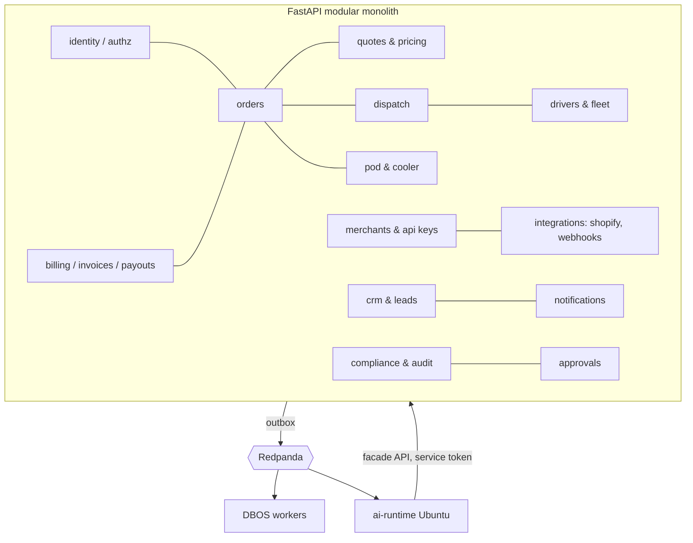
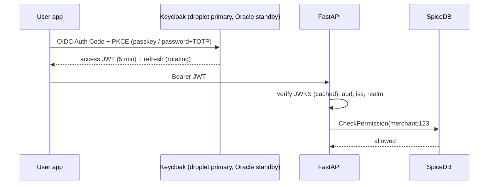

# 44 — Backend, API and data: complete coverage (Phase 1)

Scope: Python backend `apps/api` (FastAPI, SQLAlchemy/SQLModel, Alembic at `apps/api/alembic`), `services/python/porterchain_services`, Redpanda events, DBOS workflows, LLM layer (doc 27, framework doc 43). Placement per doc 28 (droplet = business-facing, Ubuntu = admin/agents/heavy, Oracle = standby/routing fallback).

## 44.1 Service boundaries — recommendation: **modular monolith + 3 satellite processes**

Not microservices. Reasons: one developer team, one Postgres, DBOS is in-process, droplet RAM must stay minimal (L-low-RAM), cross-module transactions (order + quote + outbox) must be atomic. Microservices would multiply deploys, auth hops and RAM with no scaling need at pilot volume.

| Process                                                        | Runs on                              | Contains                                                      |
| -------------------------------------------------------------- | ------------------------------------ | ------------------------------------------------------------- |
| `api-public` (FastAPI monolith, modules below)                 | droplet (+ Oracle standby)           | merchant, customer, driver, public, webhooks, Shopify, quotes |
| `api-admin` (same codebase, admin routers enabled)             | Ubuntu                               | admin, super-admin, approvals, reports                        |
| `workers` (DBOS workflows + Redpanda consumers + outbox relay) | droplet (critical) + Ubuntu (agents) | order/billing/dispatch workflows, 22 former sweeps            |
| `ai-runtime` (PydanticAI agents, llama-server)                 | Ubuntu only                          | 24 agents, verifier, RAG                                      |
| routing (OSRM, Valhalla)                                       | Ubuntu; Oracle fallback              | separate binaries, HTTP                                       |

Module boundaries are enforced in code: `import-linter` contracts (module may only import another module's `api.py` facade), one schema-owner per table, cross-module communication via facade call (sync) or outbox event (async).



## 44.2 API inventory (REST) — all under `/v1`

| Group                | Prefix                                                                                                                | Auth                                                 | Host                   |
| -------------------- | --------------------------------------------------------------------------------------------------------------------- | ---------------------------------------------------- | ---------------------- |
| Public               | `/v1/public/*` (quote estimate, rates, leads, tracking by number)                                                     | none + rate limit + Turnstile                        | droplet                |
| Merchant             | `/v1/merchant/*` (orders, bulk CSV, recipients, templates, invoices, team, api-keys, webhooks, reports, referrals)    | Keycloak OIDC (realm `business`) or API key          | droplet                |
| Merchant machine API | `/v1/api/*` (create order, quote, label, track)                                                                       | API key (`pk_live_…` hashed, scoped) + HMAC optional | droplet                |
| Customer             | `/v1/customer/*` (bookings, addresses, payments, ratings, consents)                                                   | OIDC                                                 | droplet                |
| Driver               | `/v1/driver/*` (offers, shifts, stops, POD, temp-readings, wallet, statements DPWRA, timesheets, training, emergency) | OIDC + device binding                                | droplet                |
| Admin                | `/v1/admin/*` (everything, approvals, impersonation super-admin only)                                                 | OIDC realm `staff` + passkey + SpiceDB               | Ubuntu (via WireGuard) |
| Integrations         | `/v1/integrations/shopify/*`                                                                                          | Shopify session token                                | droplet                |
| Webhooks in          | `/v1/webhooks/{shopify,stripe,interac,zeptomail,keycloak,whatsapp}`                                                   | provider signature                                   | droplet                |
| Internal             | `/internal/*` (ai-runtime → monolith tools)                                                                           | mTLS over WireGuard + service token                  | Ubuntu↔droplet         |

As-built merchant webhook management routes are kept: `/v1/merchant/webhooks`, `/{merchant_id}/webhooks/{webhook_id}/{test,enable,deliveries}`, `/deliveries/{id}/retry`, `/replay-failed`, `/integrations/webhooks/{id}/rotate-secret`. Lead webhooks `/v1/public/leads/webhooks/{google,linkedin,meta,x,youtube}` kept.

Contract: OpenAPI 3.1 generated from FastAPI → TS client generated (`openapi-typescript`) for 5 portals + 2 Expo apps; CI fails on breaking diff (`oasdiff`).

## 44.3 Webhooks

| Provider                                      | Endpoint                                            | Verify                                                                    | Dedup table                                                                       | Notes                                                                                        |
| --------------------------------------------- | --------------------------------------------------- | ------------------------------------------------------------------------- | --------------------------------------------------------------------------------- | -------------------------------------------------------------------------------------------- |
| Shopify                                       | `/v1/webhooks/shopify`                              | HMAC-SHA256 `X-Shopify-Hmac-Sha256`                                       | `shopify_webhook_events(webhook_id UNIQUE)` (fixes duplicate-webhook gap, doc 24) | orders/create, fulfillment, app/uninstalled, GDPR 3 topics → `shopify_data_subject_requests` |
| Stripe                                        | `/v1/webhooks/stripe`                               | `Stripe-Signature` t+v1, 5-min tolerance                                  | `stripe_webhook_events(event_id UNIQUE)` (as-built)                               | customer card payments only (merchants Interac)                                              |
| Interac                                       | `/v1/webhooks/interac` or bank-email parse          | bank/aggregator signature; else manual reconcile                          | `interac_transfers(reference UNIQUE)`                                             | **D44-1:** free path = admin reconcile from bank notification emails                         |
| ZeptoMail                                     | `/v1/webhooks/zeptomail`                            | shared secret header                                                      | `notification_delivery_logs(provider_msg_id UNIQUE)`                              | bounce/complaint → `notification_email_suppressions`                                         |
| Push (APNs/FCM)                               | outbound only; receipts polled (Expo push receipts) | —                                                                         | `notification_devices`                                                            | invalid token → disable device                                                               |
| Keycloak                                      | `/v1/webhooks/keycloak` (event listener SPI)        | HMAC                                                                      | `identity_events`                                                                 | replaces `clerk_webhook_events`                                                              |
| WhatsApp (Cloud API free service window, L27) | `/v1/webhooks/whatsapp`                             | `X-Hub-Signature-256`                                                     | `whatsapp_messages(wamid UNIQUE)`                                                 |                                                                                              |
| Outbound merchant webhooks                    | from `merchant_webhooks`                            | HMAC `X-PorterChain-Signature` (t, v1), secret rotation with 24 h overlap | `merchant_webhook_deliveries`                                                     | retries exp. backoff 1m→24h, 12 attempts, then DLQ + alert                                   |

All inbound: verify → insert dedup row (ON CONFLICT DO NOTHING) → outbox → 200 within 2 s; processing async in DBOS.

## 44.4 Versioning, idempotency, rate limits

- **Versioning:** URL major (`/v1`), additive changes only within v1; deprecations via `Deprecation` + `Sunset` headers, 6-month window; event topics versioned in name (`pc.orders.v1`) and schema (Avro/JSON-Schema compatibility = BACKWARD).
- **Idempotency:** `Idempotency-Key` header required on every POST that creates money/orders (merchant, customer, driver POD, admin refunds). Table `idempotency_keys(principal_id, key, request_hash, response_code, response_body, created_at, PK(principal_id,key))`, 24 h TTL; mismatched body → 422. Internal DBOS steps use `workflow_id` = deterministic key (e.g. `invoice:{merchant}:{period}`).
- **Rate limits** (Redis token bucket on droplet, header `RateLimit-*` RFC draft): public 30/min/IP; merchant UI 300/min/user; merchant API key 600/min (tier-based); driver 120/min/device; webhooks unlimited but signature-checked; login 10/min/IP (Keycloak brute-force on). 429 with `Retry-After`.

## 44.5 Auth and authz



Realms: `business` (merchants, customers, drivers), `staff` (admin, super-admin; passkey mandatory). Clerk → Keycloak migration via `identity_migration_runs/records` (as-built tables kept). SpiceDB schema: `merchant{member,admin}`, `order{merchant,driver,customer}`, `approval{approver}`, `platform{super_admin}`. Agents get service accounts with scoped SpiceDB relations, never impersonation.

## 44.6 Keys strategy

- **Surrogate PK:** `uuid` generated by Postgres 18 `uuidv7()` (time-ordered, index-friendly) on every new table; existing int/uuid4 PKs kept, new rows get v7.
- **Natural / business keys (UNIQUE, never PK):** `orders.tracking_number` format `PC-YYMM-XXXXXX` (Crockford base32, check digit, generated in DB sequence + encode), `invoices.number` from `invoice_number_sequences` (per year, gapless, CRA), `merchants.slug`, `merchant_api_keys.prefix`, `tax_registrations.hst_number`, `vehicles.plate+province`, `shopify_shops.shop_domain`, `packages.barcode` (= label QR payload).
- **FK rules:** `ON DELETE RESTRICT` on money/legal tables; `CASCADE` only for child detail rows (invoice_lines, order_legs, stops); soft delete `deleted_at` + partial unique indexes `WHERE deleted_at IS NULL`.
- **Postgres 18 constraints:** `EXCLUDE USING gist (driver_id WITH =, tstzrange(start,end) WITH &&)` on `driver_shifts`; same on `merchant_contracts` price periods (WITHOUT OVERLAPS).
- **Indexes:** every FK; `(merchant_id, created_at DESC)` on orders/invoices; `(status) WHERE status IN active` partial; GIN on jsonb payloads queried; HNSW on embeddings; BRIN on `driver_location_pings.at`, `temp_readings.at`.

## 44.7 Full data model — table catalogue

As-built tables found by scan of `__tablename__` (≈150 incl. junk test tables). Grouped; **(K)** keep, **(N)** new in plan, **(D)** drop.

| Domain              | Tables                                                                                                                                                                                                                                                                                                                                                                                                                    |
| ------------------- | ------------------------------------------------------------------------------------------------------------------------------------------------------------------------------------------------------------------------------------------------------------------------------------------------------------------------------------------------------------------------------------------------------------------------- |
| Identity            | users, porterchain_users, admin_users, merchant_users, user_emails, user_invitations, identity_links, identity_migration_runs, identity_migration_records, staff_webauthn_credentials (K); clerk_webhook_events (D after cutover); identity_events (N)                                                                                                                                                                    |
| Merchants           | merchants, merchant_contracts, merchant_documents, merchant_recipients, merchant_booking_templates, merchant_api_keys, merchant_api_usage_logs, merchant_webhooks, merchant_webhook_deliveries, merchant_alerts, merchant_audit_logs, merchant_merges, tax_registrations, standing_orders, reorder_nudges (K)                                                                                                             |
| Customers           | customers, customer_addresses, saved_addresses, addresses, customer_consents, customer_credits, customer_notes (K)                                                                                                                                                                                                                                                                                                        |
| Orders              | orders, order_legs, order_events, order_exceptions, order_ratings, stops, packages, package_external_identifiers, bookings, booking_drafts, booking_draft_audits, booking_attachments, booking_attachment_events, abandoned_checkouts, bulk_import_jobs, claims (K); contract_of_carriage (N, BOL)                                                                                                                        |
| Pricing             | quotes, pricing_zones, pricing_fsa_rates, promotions (K); pricing_tariffs (D: 20 test rows); rate_card_versions, rate_card_items, addon_prices, merchant_tiers (N)                                                                                                                                                                                                                                                        |
| Dispatch            | dispatch_plans, dispatch_routes, dispatch_job_offers, dispatch_stop_events, dispatch_stop_times, dispatch_fix_actions, route_center_templates (K)                                                                                                                                                                                                                                                                         |
| Drivers & fleet     | drivers, driver_documents, driver_incidents, driver_shifts, driver_shift_activities, driver_stop_meta, driver_offline_actions, driver_location_pings, driver_bonuses, driver_wallet_transactions, driver_payouts, driver_payout_runs, vehicles, logistics_partners (K); driver_pay_statements, driver_access_notices, vehicle_compliance_docs, devices, telematics_readings (N)                                           |
| POD & cooler        | (POD in stops/booking_attachments K); pod_records (N, hash-chained), temp_readings, sensors (N)                                                                                                                                                                                                                                                                                                                           |
| Billing             | invoices, invoice_lines, invoice_number_sequences, credit_notes, billing_ledger_entries, payments, interac_transfers, stripe_payouts, stripe_webhook_events (K)                                                                                                                                                                                                                                                           |
| CRM & sales         | crm_leads, crm_lead_identities, crm_lead_ingest_events, crm_contacts, crm_companies, crm_deals, crm_activities, crm_contracts, crm_documents, crm_invoices, crm_quotations, crm_referral_credits, crm_sales_tasks, crm_suppressions, crm_conversations, crm_conversation_messages, leads, marketing_subscribers (K); consent_records (N), whatsapp_threads, whatsapp_messages (N)                                         |
| Notifications       | notification_records, notification_delivery_logs, notification_devices, notification_preferences, notification_user_settings, notification_admin_settings, notification_template_copy, notification_email_suppressions, finance_reminder_drafts (K)                                                                                                                                                                       |
| Shopify             | shopify_shops, shopify_rate_quotes, shopify_ingress_dlq, shopify_data_subject_requests (K); shopify_webhook_events (N)                                                                                                                                                                                                                                                                                                    |
| Audit & compliance  | admin_audit_logs, access_audit_logs, forensic_audit_chain, forensic_checkpoints, privacy_deletion_jobs, deleted_batches, fk_orphan_quarantine, legacy_external_refs, system_config, domain_events (K→ merged into event_outbox)                                                                                                                                                                                           |
| Content & analytics | blog_posts, blog_authors, support_tickets, visitor_sessions, ai_usage_logs (K)                                                                                                                                                                                                                                                                                                                                            |
| Agents (N)          | agent_runs, agent_steps, approvals, agent_evals, rag_documents, rag_chunks(embedding vector), event_outbox, idempotency_keys                                                                                                                                                                                                                                                                                              |
| Junk (D)            | a, b, account, address(dup), bullet, company, data_table, employee, engineer, interval, location, manager, my_data, my_table, mytable, myothertable, some_table, table_b, temp_test, test, test_frame, thing, part, person, product, relationships, searchword, slide, unit_price, user, venue, vertices, yetanothertable — verify these are fixture/vendored models (likely from site-packages or tests) before any drop |

Core relations:

```mermaid
erDiagram
  merchants ||--o{ merchant_users : has
  merchants ||--o{ orders : places
  merchants ||--o{ merchant_contracts : "priced by"
  merchants ||--o{ invoices : billed
  customers ||--o{ orders : books
  orders ||--o{ order_legs : has
  orders ||--o{ stops : has
  orders ||--o{ packages : carries
  orders ||--|| quotes : "priced by"
  quotes }o--|| rate_card_versions : uses
  orders ||--o{ order_events : logs
  orders ||--o{ pod_records : proves
  orders ||--o{ temp_readings : "cooler run"
  dispatch_plans ||--o{ dispatch_routes : has
  dispatch_routes ||--o{ dispatch_job_offers : offers
  drivers ||--o{ dispatch_job_offers : receives
  drivers ||--o{ driver_shifts : works
  drivers }o--o{ vehicles : drives
  drivers ||--o{ devices : enrolls
  invoices ||--o{ invoice_lines : has
  invoices ||--o{ credit_notes : adjusts
  invoices ||--o{ payments : settled
  agent_runs ||--o{ agent_steps : has
  agent_runs ||--o{ approvals : requests
  orders { uuid id PK "uuidv7"; text tracking_number UK; uuid merchant_id FK; uuid quote_id FK; text status "enum"; timestamptz created_at }
  invoices { uuid id PK; text number UK; uuid merchant_id FK; date period_start; numeric total_cad }
  event_outbox { uuid id PK; text topic; text key; jsonb payload; int schema_version; timestamptz relayed_at }
```

## 44.8 Data flow (order to cash)

```mermaid
flowchart LR
  S[Shopify / merchant API / portal] -->|Idempotency-Key| API[api-public]
  API --> Q[quote: rate card + OSRM/Valhalla (Ubuntu) or Oracle fallback]
  Q --> TX[(single Tx: orders + quotes + outbox)]
  TX -->|relay| T1[pc.orders.v1]
  T1 --> DWF[dispatch workflow] --> T4[pc.dispatch.v1] --> DRV[driver app offer]
  DRV --> POD[POD + temp] --> T7[pc.pod.v1]
  T7 --> BWF[billing workflow] --> INV[invoice + HST] --> T3[pc.billing.v1]
  T3 --> NOT[ZeptoMail / push]
  T3 --> MW[merchant webhooks + Shopify fulfillment]
  T1 & T7 & T3 --> AI[agents Ubuntu: shadow/autonomy] --> APV[approvals]
```

## 44.9 Event schema registry (Redpanda built-in registry, port 28081)

- Format: **JSON Schema** generated from the Pydantic event models (same source as API) — subject = `<topic>-value`; compatibility BACKWARD; CI registers + checks before deploy.
- Envelope (CloudEvents 1.0 fields): `id (uuidv7)`, `source`, `type` (e.g. `order.created`), `subject` (entity id), `time`, `schema_version`, `trace_parent` (W3C), `idempotency_key`, `data`.
- Keys: partition key = aggregate id (order_id, driver_id, merchant_id) → ordering per entity.
- Topics (12, doc 23): pc.orders.v1, pc.quotes.v1, pc.billing.v1, pc.dispatch.v1, pc.drivers.v1, pc.cooler.temp.v1, pc.pod.v1, pc.whatsapp.inbound.v1, pc.notifications.out.v1, pc.approvals.v1, pc.agent.runs.v1, pc.dlq.v1. Retention ≥ 7 days (covers 24 h Ubuntu-off), DLQ 30 days.
- Consumers are idempotent: `processed_events(consumer, event_id PK)`.

## 44.10 Model layer and migrations

- **SQLModel** for new tables (one class = table + API schema base); separate `Create/Read/Update` Pydantic models so internal columns never leak. As-built SQLAlchemy models stay; no big-bang rewrite.
- Enums: Postgres native enums + transition map tested (no hand-rolled state).
- Money: `numeric(12,2)` CAD + `currency` column; never float.
- Time: `timestamptz` UTC; display America/Toronto.
- **Alembic** (`apps/api/alembic`): one linear head, autogenerate + human review, expand→migrate→contract for zero-downtime, every migration reversible and tested in CI against a prod-shaped snapshot; data migrations as DBOS workflows (resumable), not in Alembic.

## 44.11 LLM / LM layer (see doc 27, framework doc 43)

Qwen3.5-0.8B router, Qwen3.5-4B + PorterChain LoRA main, Phi-4-mini second check, Qwen3-Embedding-0.6B on CPU; llama-server with JSON-Schema grammar; PydanticAI agents inside DBOS (D43-1); deterministic verifier; RAG in pgvector 0.8.7 HNSW (`rag_chunks`); all on Ubuntu; when Ubuntu off, agents pause and rule fallbacks run on droplet (doc 28).

## 44.12 Decisions for Ravi

- **D44-1:** Interac confirmation: free manual/email-parse reconciliation (recommended) vs paid bank API.
- **D44-2:** Modular monolith (recommended) vs microservices.
- **D44-3:** Drop junk/test tables after verification (recommended yes).
- **D44-4:** Tracking number format `PC-YYMM-XXXXXX` with check digit (recommended).
