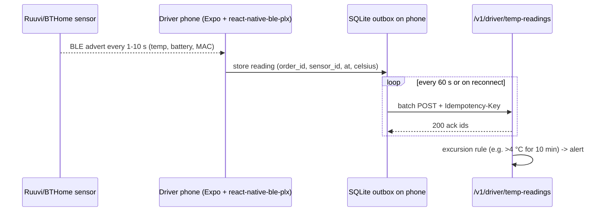
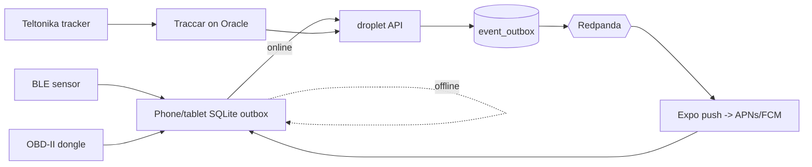

# 45 — IoT and devices (Phase 1)

Rules: free/open software only (L26); hardware purchases are flagged for Ravi. **Hardware prices below are rough CAD estimates, not verified this session — confirm before buying.**

## 45.1 Device classes

| Class                       | Who                    | OS                       | App                                     | Placement                          |
| --------------------------- | ---------------------- | ------------------------ | --------------------------------------- | ---------------------------------- |
| Driver phone (BYOD)         | contractors            | iOS 18+/Android 13+      | Expo driver app (doc 26)                | droplet API                        |
| Dispatch / warehouse tablet | dispatch, loading dock | Android tablet (or iPad) | Expo driver app "dock mode" + admin PWA | droplet API; admin via WireGuard   |
| Admin laptop / desktop      | admin, super-admin     | Ubuntu / Windows / macOS | admin portal (Next.js) in browser       | Ubuntu, WireGuard only             |
| Merchant / customer devices | external               | any                      | portals, customer Expo app, Shopify     | droplet                            |
| Sensors                     | cooler runs            | BLE                      | via driver phone                        | droplet `/v1/driver/temp-readings` |

## 45.2 BLE cooler temperature sensors

- Protocol: **BLE advertisements, open formats** — BTHome v2 (open spec) or Ruuvi RAWv2 (documented). Phone scans passively (no pairing), app decodes, buffers offline, uploads batches → `temp_readings` → `pc.cooler.temp.v1`; excursion → alert + approval for cooler claim.
- Hardware options (estimates): Ruuvi Tag Pro (~~$60–80, IP67, documented format); Xiaomi LYWSD03MMC with pvvx open firmware → BTHome (~$5–10, not waterproof, indoor coolers only); Shelly BLU H&T (~~$25, BTHome native).
- Recommendation: Ruuvi Tag Pro for cooler boxes (rugged, accurate ±0.2 °C), 1 per cooler.
- **Mandatory?** Only if Ravi accepts temperature-controlled (cooler) orders. Food safety/pharma customers will ask for a log. Flag: **D45-1**.

## 45.3 Vehicle telematics / OBD-II

| Option                                                          | Cost                            | Notes                                                                            |
| --------------------------------------------------------------- | ------------------------------- | -------------------------------------------------------------------------------- |
| Phone GPS only (as-built, Redis latest position)                | $0                              | **Phase 1 default**                                                              |
| ELM327 BLE OBD-II dongle + phone                                | ~$20–40 per vehicle             | speed, RPM, fuel, DTCs; open protocol; for owned box truck only                  |
| Traccar (Apache-2.0) self-hosted + Teltonika FMC-series tracker | ~$80–150 per vehicle + SIM data | always-on tracking independent of phone; Traccar on Oracle                       |
| Box truck ELD                                                   | —                               | Only if hours-of-service rules apply to the truck class — legal check, **D45-2** |

## 45.4 Barcode / QR scanning and labels

- Scanning: phone/tablet camera via `expo-camera` barcode scanning (QR, Code128, DataMatrix), free. Optional Bluetooth HID ring scanner for dock (~$40–80).
- Label = 4x6 in with QR (`packages.barcode` = tracking number + package seq) + Code128; generated server-side as ZPL and PDF.
- Printers: Zebra ZD421/ZD411 (ZPL, ~$400–600) for dock; or generic 4x6 thermal (~$100–200, PDF/ESC-POS) for merchants. Merchants print PDF on any printer (free). **D45-3.**

## 45.5 Device management (free MDM)

| Need                    | Free option                                                                                                             |
| ----------------------- | ----------------------------------------------------------------------------------------------------------------------- |
| Company Android tablets | Headwind MDM (open source community edition) or Android Enterprise "work profile" via Google free tier; kiosk/dock mode |
| iPads                   | Apple Business Manager (free) + MicroMDM/NanoMDM (open source) — needs Apple push cert (free with Apple account)        |
| Admin laptops           | Ubuntu/Win/mac: full-disk encryption, auto-updates, osquery + Fleet (open source) for inventory                         |
| BYOD driver phones      | **no MDM**; app-level controls only (below)                                                                             |

## 45.6 Offline sync and push

- Driver app: SQLite (expo-sqlite) local outbox for POD photos, signatures, stop events, temp readings; each record has client uuidv7 + Idempotency-Key; upload resumes; server wins on order status, client wins on captured evidence; conflicts logged to `driver_offline_actions` (as-built).
- Tablets: same offline queue; admin PWA read-only cache only.
- Push: Expo push → APNs/FCM (free); tokens in `notification_devices`; live tracking via iOS Live Activities / Android ongoing notification (doc 25/26).

## 45.7 Device security policy

- Driver devices: device binding (device id + key in Secure Enclave/Keystore via `expo-secure-store`), OS minimum versions, jailbreak/root heuristic → warn + admin flag, biometric unlock for wallet/statement screens, POD photos signed (hash + time + GPS) and hash-chained (tamper-proof POD, doc 26), remote sign-out from admin, no customer PII cached beyond the active route (purged at shift end).
- Tablets: MDM-enforced PIN, encryption, kiosk mode, remote wipe.
- Admin laptops/desktops: admin reachable only via WireGuard; passkey (Keycloak WebAuthn) mandatory; disk encryption; screen lock 5 min; no shared accounts; super-admin impersonation logged to `admin_audit_logs`.
- Sensors/trackers: read-only ingest, sensor MAC allow-list per cooler in `sensors`.
- Lost device: admin revokes device → refresh tokens killed in Keycloak, device row disabled.

## 45.8 Decisions for Ravi

- **D45-1:** Buy BLE cooler sensors (Ruuvi ~1 per cooler) — mandatory only if cooler runs are offered in Phase 1.
- **D45-2:** Telematics: phone GPS only (recommended Phase 1) vs OBD-II dongle / Traccar tracker for the box truck; legal check on ELD.
- **D45-3:** Dock label printer (Zebra) and scanner purchase, or phone camera + PDF only (recommended to start).
- **D45-4:** Company tablets for dispatch/dock (and which MDM) vs BYOD only.
