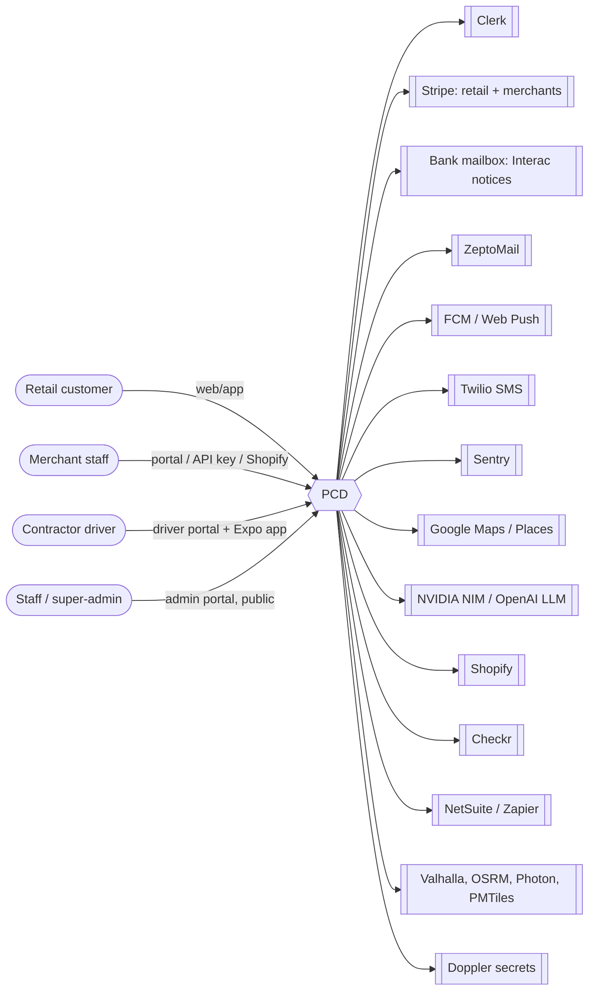
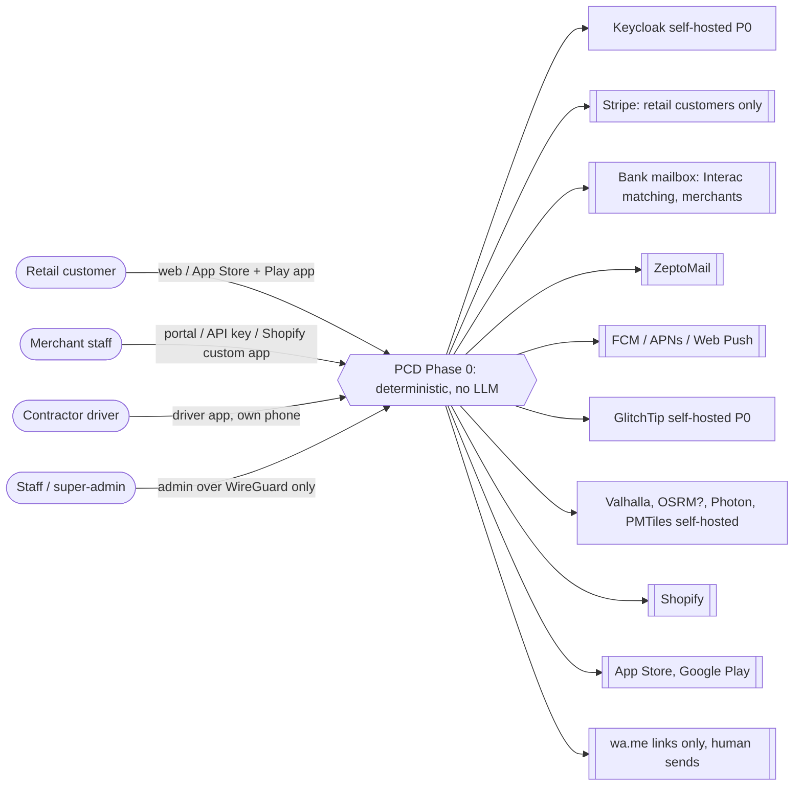
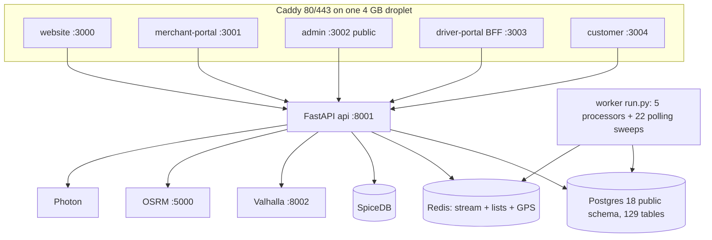
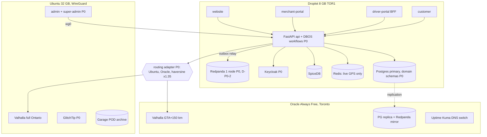

# 61 · Now vs Phase 0: system context and containers

Same diagrams as 01/02 (as-built) and 12 (planned), redrawn for the Phase 0 target (doc 60). Phase 0 has **no agentic mode**: no LLM, no agents. Tag **(P0)** = built in Phase 0. Unknowns are marked `?` and listed in 98.

## Context: now (from 01)

## Context: Phase 0 target

Removed in Phase 0: Clerk, Twilio, Sentry cloud, Google Maps/Places, Mapbox, OpenAI, NVIDIA NIM, Doppler, Stripe for merchants. Checkr is not called (L30 manual checks). NetSuite/Zapier adapters stay unused until Phase 2. `OSRM?` = kept only if it wins the matrix benchmark (D-P0-6).

## Containers: now (from 02)

## Containers: Phase 0 target

No worker polling loop: the 22 sweeps are DBOS scheduled workflows or Redpanda consumers inside the API process group (31). No LLM container exists in Phase 0.
