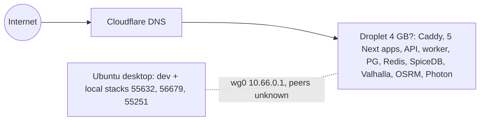
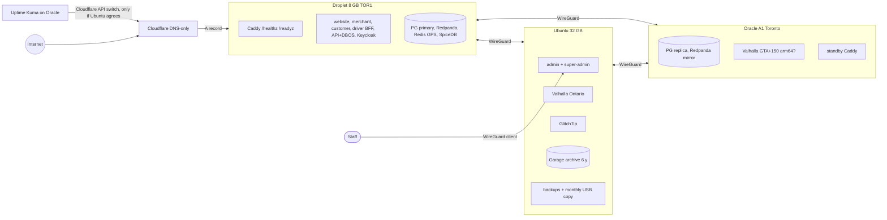

# 62 · Now vs Phase 0: deployment and network

## Now (02, 28 §1)

Admin is public on the droplet. Droplet size from `bootstrap-droplet.sh:34` comment only (U28-2).

## Phase 0 target (L28, Ravi D-* 28 Oct)

Phase 0 exit drill set (G15): Ubuntu off 24 h (business users unaffected; admin unavailable; routing falls back to Oracle then haversine "estimated"); Oracle off; droplet off (manual `promote.sh` on Oracle, customers see "please retry"); network split (no automatic promotion). Unknowns: wg0 peers (U28-1), Oracle A1 capacity (U28-3), Valhalla arm64 image (U28-4).
