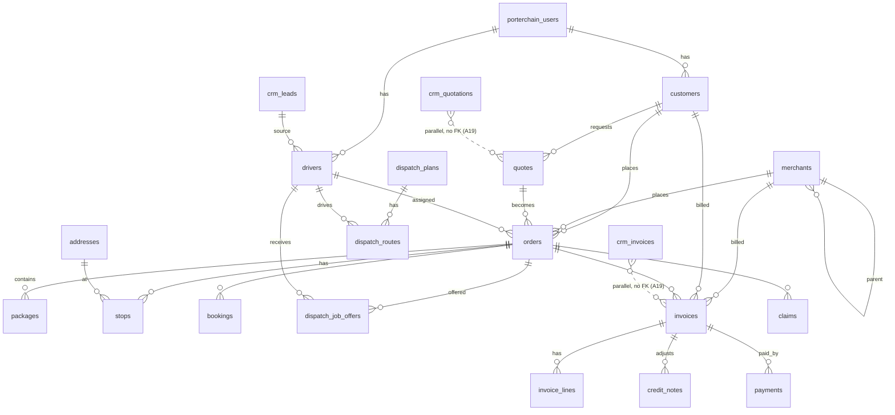
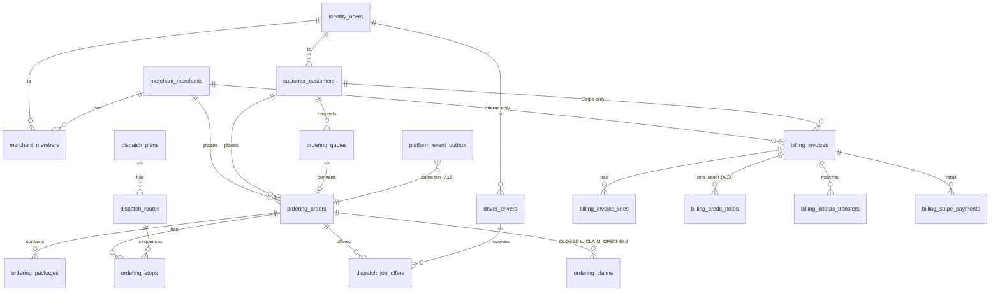

# 63 · Now vs Phase 0: ER (core entities)

Source: local DB 55632, read-only, 29 Oct (`pg_constraint` FKs). Full listing in 04. Only core entities drawn.

## Now (all in `public`)

32 tables have no FK in or out (e.g. `clerk_webhook_events`, `stripe_payouts`, `pricing_zones`, `tax_registrations`, `dispatch_stop_times`, `notification_*` ×7, `legacy_external_refs`, `fk_orphan_quarantine`). 51 `status` columns are free text. `interac_transfers` has no FK to `invoices` (not in the FK list above; verify U63-1).

## Phase 0 target (domain schemas, decided L32)

Names shown as `schema_table` because Mermaid ER has no dot syntax; real names are `schema.table` (e.g. `ordering.orders`). CRM invoice/quote become views (A19). `dispatch_routes → stops` FK is a Phase 0 addition (verify the current link via `dispatch_stop_events`, U63-2). Every status column is a Postgres enum or CHECK (A17).
