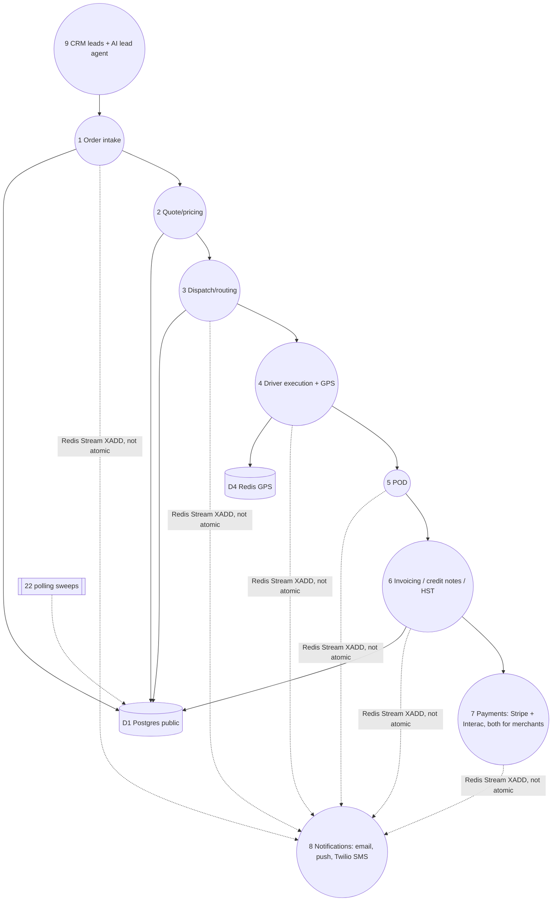
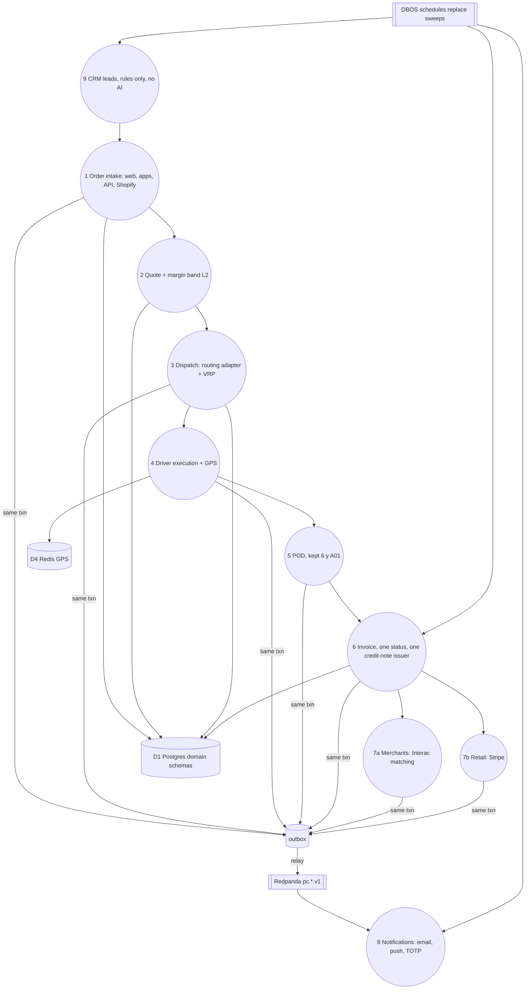
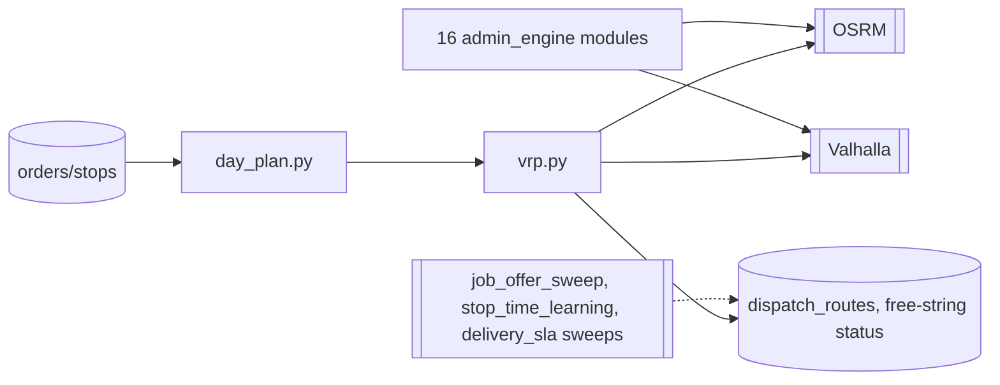
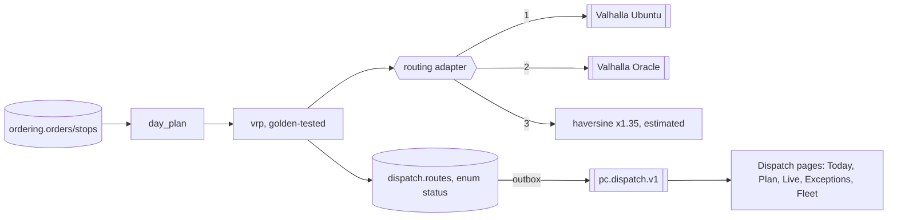
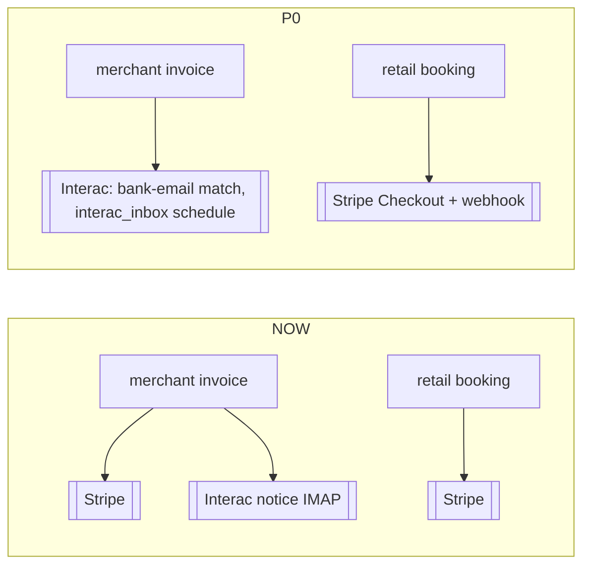

# 64 · Now vs Phase 0: data-flow diagrams L1 and L2

## L1: now (03)

## L1: Phase 0 target

## L2: 3 Dispatch/routing (now)

## L2: 3 Dispatch/routing (Phase 0)

## L2: 7 Payments (now vs Phase 0)

**L32 (29 Oct):** in 3 Dispatch/routing, the optimiser is VROOM on a Valhalla matrix (OSRM matrix only if it wins the benchmark), geometry from Valhalla truck costing, fallbacks Oracle then haversine ×1.35 flagged estimated (doc 60 §13).
