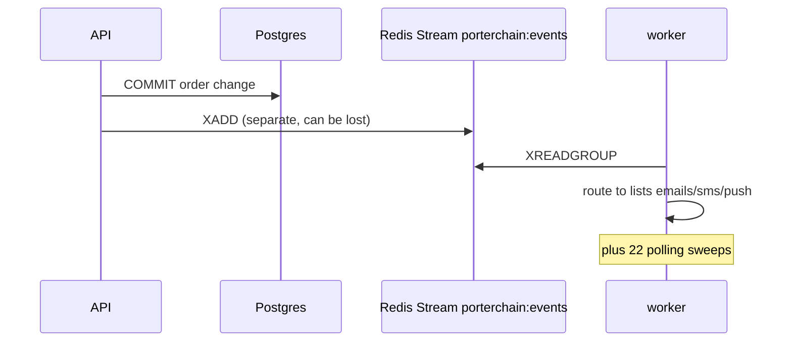
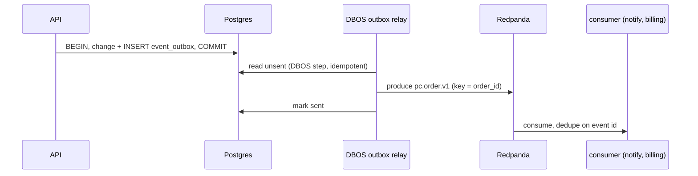
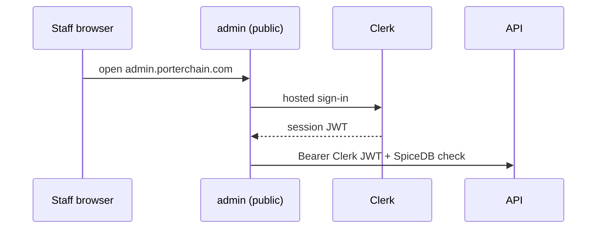
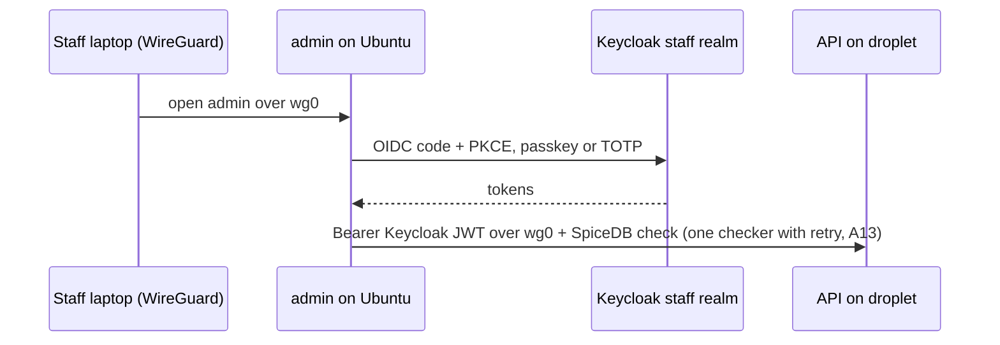
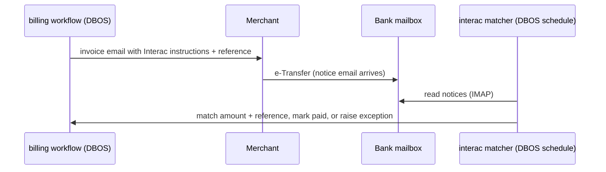
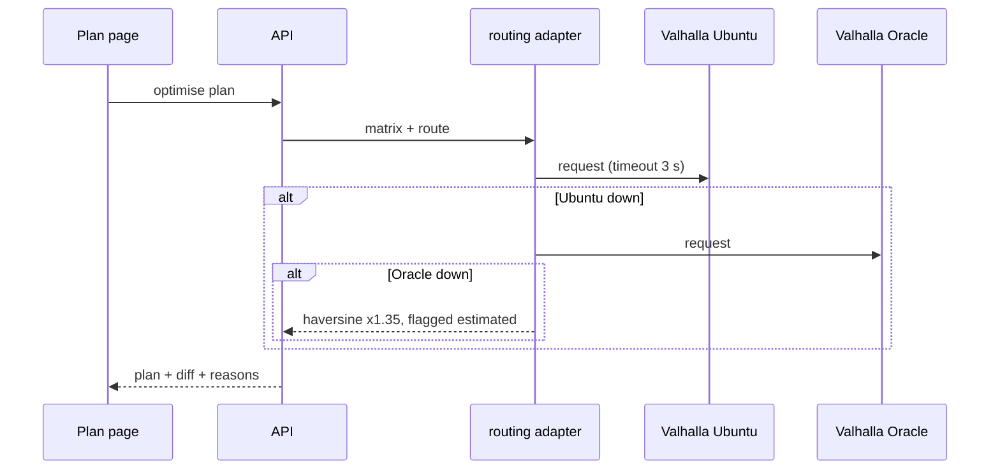

# 65 · Now vs Phase 0: key sequences

## Event emission: now (10)

## Event emission: Phase 0

## Staff sign-in: now vs Phase 0

## Merchant payment: Phase 0 (Interac only)

## Routing with failover: Phase 0

**L32 (29 Oct):** in "Routing with failover", the routing adapter calls VROOM after building the matrix; VROOM falls back to Oracle VROOM, then to the `vrp.py` heuristic on the estimated matrix (doc 60 §13.3).
