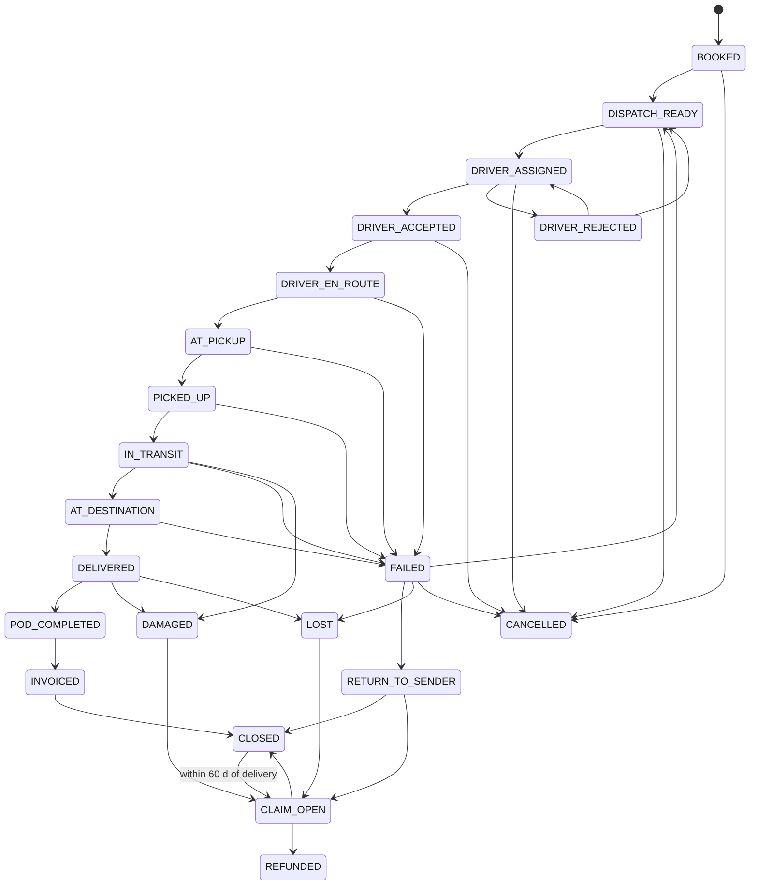
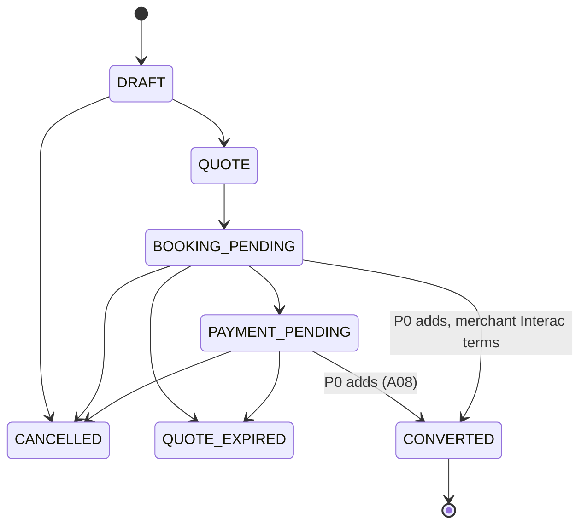
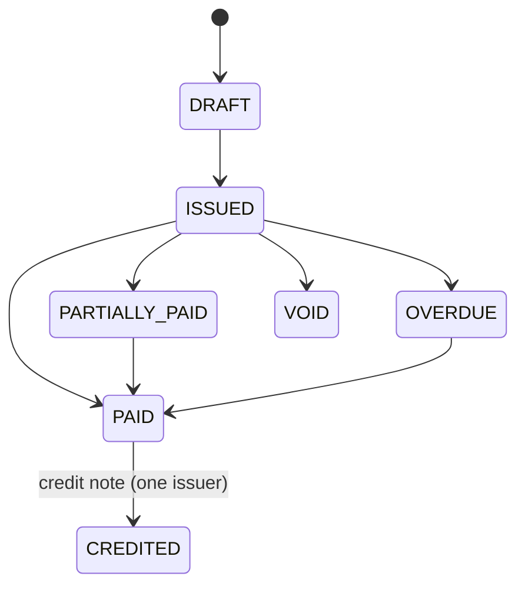
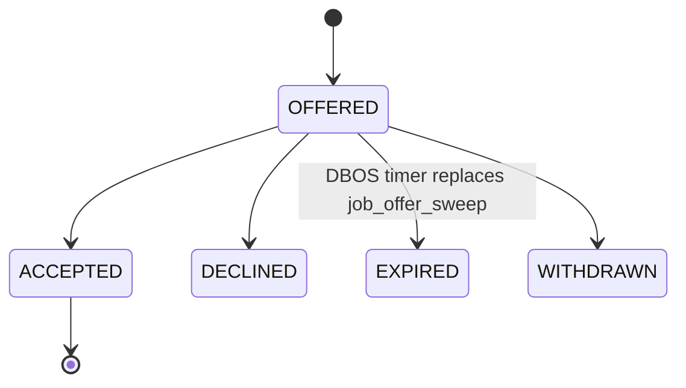
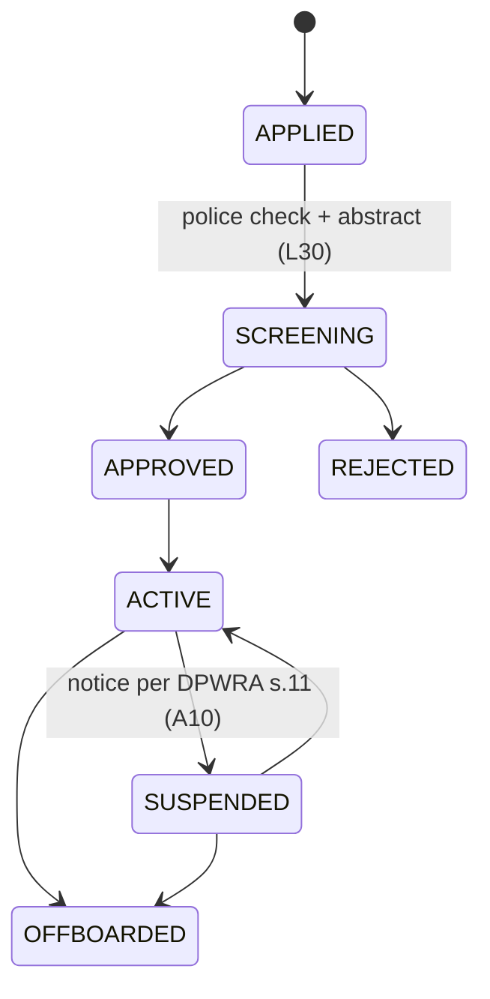

# 66 · Now vs Phase 0: state machines

## Order: now (08, `domain/states.py:105`)

Now has `DELIVERED --> FAILED` and no claim path after `CLOSED` (A18). Full diagram in 08.

## Order: Phase 0

Changes: removed `DELIVERED → FAILED`; added `IN_TRANSIT → DAMAGED`; added `CLOSED → CLAIM_OPEN` (O. Reg. 643/05 60-day notice). `IN_TRANSIT → DAMAGED` is a proposal (U66-1, Ravi/ops confirm).

## Quote: now vs Phase 0

## Invoice: now (two sources, A02) vs Phase 0

Phase 0: status is stored only as the enum above and written only by the billing workflow; `invoice_status()` computation becomes a CHECK-backed derivation test, not a second reader. State names are a proposal derived from 22; confirm against `billing_engine/models.py:140` during W3 (U66-2).

## Dispatch job offer: now vs Phase 0

Now: `DispatchJobOffer.status` String(16) default `"pending"` (`dispatch_engine/models.py:20`), no transition map.

## Driver: now vs Phase 0

Now: `domain/admin_states.py:40` `DriverStatus` with no transition table.

