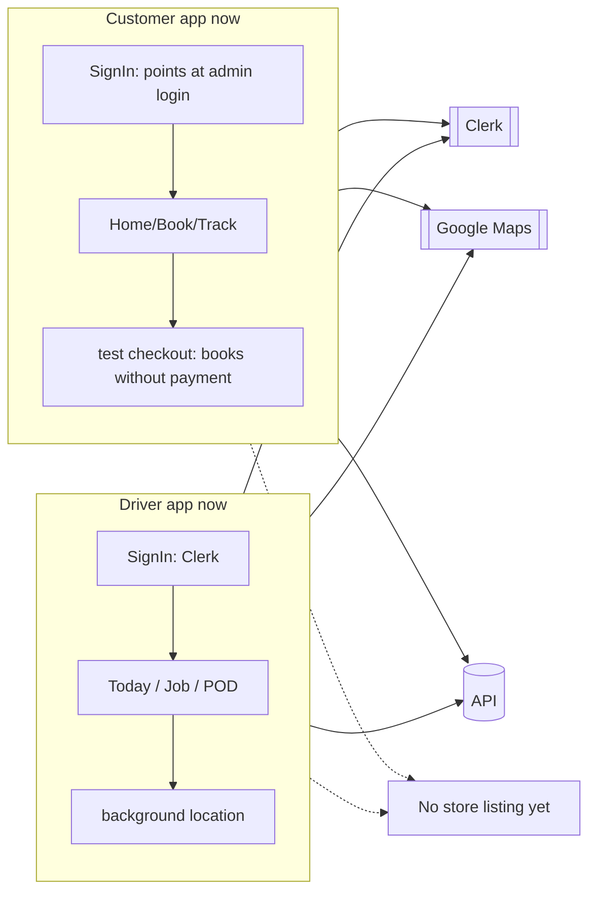
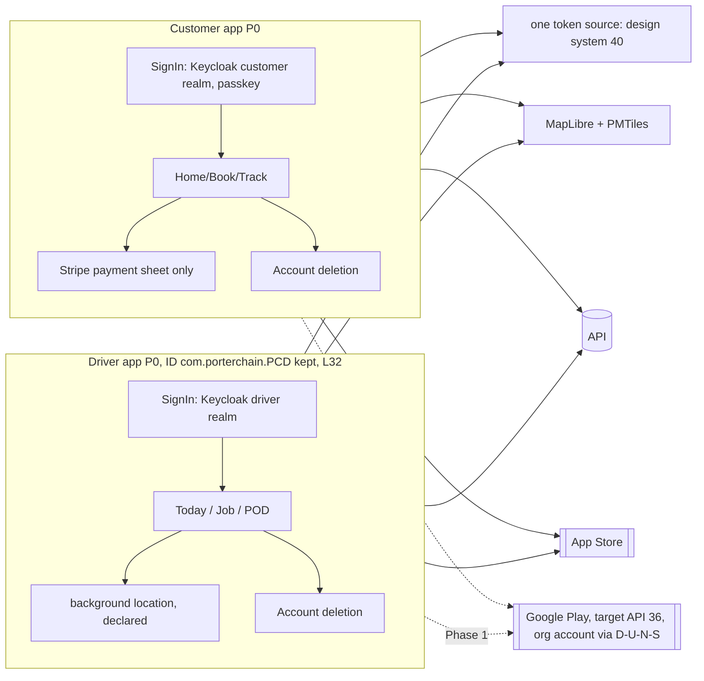
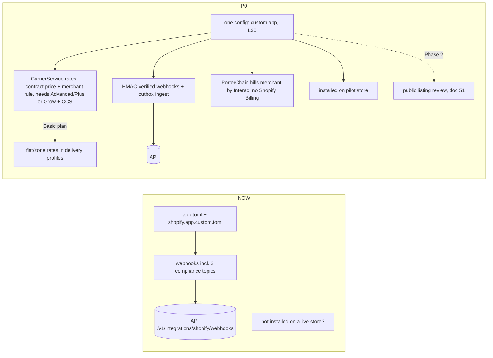
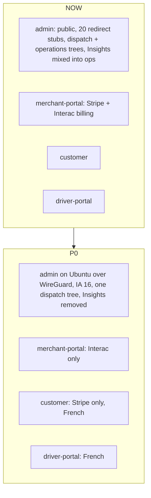

# 67 · Now vs Phase 0: the apps (mobile, Shopify, portals)

## Customer + driver Expo apps: now

Evidence: `apps/mobile-customer`, `apps/mobile-driver`, Expo `~57.0.27`, RN `0.86.3`, version `1.0.0`, IDs `com.porterchain.customer` and `com.porterchain.PCD`; 8 customer screens, 12 driver screens; theme `packages/mobile-theme/src/tokens.ts`.

## Expo apps: Phase 0

## Shopify app: now vs Phase 0

Two `.toml` files for one app are a clash: Phase 0 keeps one (`shopify.app.custom.toml` while unlisted) and documents the other as the public-listing config, or deletes it (U67-1).

## Web portals: now vs Phase 0

