# 68 · Trust & Help Centre (Phase 0 workstream W9, L33)

> **NOT LEGAL ADVICE. ALL POLICY TEXT IS DRAFT FOR LAWYER REVIEW.** This document is an engineering and content plan. Every legal rule below has a source URL and the date it was checked. Ravi's Ontario lawyer reviews it, with doc 49, by Phase 0 week 6 (L30-11). No policy goes live without a recorded lawyer sign-off (`policy_versions.legal_reviewed_by`).

Legal entity: **Porterchain Inc.**, GST/HST **743402620 RT0001**. Brand: PorterChain. Sources checked **29 Oct 2026** unless marked otherwise.

## 1. Goal

Everyone who deals with PorterChain (merchants, retail customers, drivers, and partners: couriers, logistics, supply-chain and warehouse partners) can find complete, current, reliable answers on every surface, under PorterChain branding, from **one source of truth**. Each answer shows the date it was last updated, links to the policy behind it, and uses the same words everywhere.

**Already in the code (reuse, don't duplicate):** website `[locale]/faq`, `privacy`, `terms`, `cookies`, `accessibility`, `trust`, `rates`, `service-areas`, `track`, `email-preferences`, `unsubscribe`, `developers`; merchant-portal `(portal)/help`; `docs/legal/` (privacy-policy, merchant-dpa, subprocessors, electronic-monitoring-policy, compliance-matrix); `notification_engine` CASL fields `marketing_consent_at/source`; `customer_consents`, planned `consent_records` (14). Phase 0 replaces the hard-coded page text with the content repo (§6).

## 2. Information architecture

```mermaid
flowchart TB
  HC{{"PorterChain Trust & Help Centre<br/>porterchain.com/(locale)/help"}}
  HC --> S1[Getting started]
  HC --> S2[Pricing & quotes]
  HC --> S3[Booking & delivery rules]
  HC --> S4[Prohibited & restricted items]
  HC --> S5[Payments, invoices & taxes]
  HC --> S6[Cancellations, refunds & claims]
  HC --> S7[Accounts, privacy & security]
  HC --> S8[Drivers]
  HC --> S9[Shopify app]
  HC --> S10[Partners]
  HC --> S11[Accessibility & languages]
  HC --> PL[[Policy library, versioned]]
  HC --> TR[Trust & security page]
  HC --> ST[Status page]
  HC --> CT[Contact & escalation]
  PL --> P1[Terms of Service: customers]
  PL --> P2[Merchant Services Agreement + rate card]
  PL --> P3[Driver Independent Contractor Agreement + DPWRA notices]
  PL --> P4[Partner Agreement]
  PL --> P5[Privacy Policy]
  PL --> P6[Cookie Notice]
  PL --> P7[Acceptable Use + API Terms]
  PL --> P8[Prohibited Items Policy]
  PL --> P9[Shipping & Delivery Policy]
  PL --> P10[Refunds & Claims Policy]
  PL --> P11[Data Processing Addendum + subprocessors]
  PL --> P12[Shopify App Privacy Policy]
  PL --> P13[Accessibility Statement + feedback]
  PL --> P14[Electronic Monitoring Policy]
```

### 2.1 Help sections and FAQ per persona (draft questions; answers come from the policy text)

| Section                         | Customer (retail)                                                                                                         | Merchant (portal/API)                                                                                                | Merchant (Shopify)                                                            | Driver                                                                                    | Partner                                               |
| ------------------------------- | ------------------------------------------------------------------------------------------------------------------------- | -------------------------------------------------------------------------------------------------------------------- | ----------------------------------------------------------------------------- | ----------------------------------------------------------------------------------------- | ----------------------------------------------------- |
| Getting started                 | How do I book? Do I need an account?                                                                                      | How do I onboard, add users, get API keys?                                                                           | How do I install, connect, set rates?                                         | How do I apply? What do I need (police check, abstract, insurance, vehicle)?              | How do we become a partner? What data do we exchange? |
| Pricing & quotes                | How is my price calculated? Is the price I see the price I pay? What surcharges exist and when?                           | Contract price, rate card, margin band, volume tiers, fuel/after-hours/wait/stairs surcharges, price change notice   | What my customers pay (my rule) vs what PorterChain bills me (contract price) | How is my pay per job calculated (DPWRA s.7)?                                             | Partner rates, settlement terms                       |
| Booking & delivery rules        | Service area (Toronto + 150 km), cut-offs, time windows, attempts, safe-drop, signature, ID, what "delivered" means (POD) | SLAs per service (same-day, scheduled), pickup windows, packaging and labelling, max weight and size, declared value | Same, plus how Shopify fulfillment and tracking sync                          | Job offer rules, accept/decline consequences, waiting time, POD photo + signature rules   | Hand-off rules, chain of custody, POD format          |
| Prohibited & restricted items   | What can't I send?                                                                                                        | Full list, Phase 1 exclusions, restricted goods approval                                                             | Same                                                                          | What to refuse at pickup                                                                  | Same                                                  |
| Payments, invoices & taxes      | Cards via Stripe; no cash on delivery; receipt with HST                                                                   | Interac e-Transfer only, invoice terms, reference matching, late fees, HST, statements                               | PorterChain bills you by Interac, not through Shopify                         | Pay period, pay day, pay statement, T4A                                                   | Settlement, invoices                                  |
| Cancellations, refunds & claims | Retail: no cancellation fees; B2B fees per contract; refunds to card, failed delivery                                     | Claims process, deadlines, liability per kg vs declared value, evidence                                              | Same                                                                          | Damage reporting at pickup/drop                                                           | Claims between carriers                               |
| Accounts, privacy & security    | What data you keep, how to delete my account, marketing emails                                                            | DPA, subprocessors, data retention, security, incident notice                                                        | Shopify data access scopes, GDPR webhooks, uninstall = data deletion          | GPS/monitoring, what is shared with merchants/customers, deletion                         | Data sharing terms                                    |
| Drivers                         | —                                                                                                                         | —                                                                                                                    | —                                                                             | Contractor terms, insurance, deactivation and appeal, ratings, safety, HTA rules, support | —                                                     |
| Accessibility & languages       | Accessible formats, feedback, French                                                                                      | Same                                                                                                                 | Same                                                                          | Same                                                                                      | Same                                                  |

## 3. Researched content and rules (with sources)

### 3.1 PorterChain service facts (our decisions; marked where Ravi must confirm)

| Topic                | Content to publish                                                                                                                                                                                                                         | Source                             |
| -------------------- | ------------------------------------------------------------------------------------------------------------------------------------------------------------------------------------------------------------------------------------------ | ---------------------------------- |
| Service area         | Toronto + 150 km (map from PMTiles + postal-code list; out-of-area quotes refused, not estimated)                                                                                                                                          | L-decisions, doc 20                |
| Pricing and quotes   | Quote = base + distance/time + vehicle + options; **all mandatory fees in the first price shown** (drip pricing rule, §3.3); quote valid for **3 days (72 h)** (Ravi, D-68-5); margin band internal only                                   | doc 20, L2                         |
| Surcharges           | Only optional or conditional ones that the customer triggers (waiting > X min, stairs, after-hours, extra stop), each with a fixed published price; fuel surcharge must be inside the shown price                                          | Competition Act s.74.01(1.1), §3.3 |
| Payment methods      | Merchants: Interac e-Transfer only (invoice + reference). Retail customers: cards through Stripe. No cash on delivery, no COD collection                                                                                                   | L-decisions, doc 60                |
| Invoices             | CRA content for invoices ≥ $500: Porterchain Inc., GST/HST 743402620 RT0001, date, buyer name, description of each supply, HST 13 % shown, total, payment terms                                                                            | CRA RC4022 (§3.4)                  |
| Phase 1 exclusions   | Controlled substances, **all** dangerous goods under the TDG Regulations including UN3373 (Biological substance, Category B, class 6.2), white-glove service, cash/valuables (**Ravi** to confirm the value cap)                           | doc 20, TDG Act                    |
| SLAs                 | Same-day and scheduled on-time targets (98 %, L-proven window), POD 100 %, max 1 mis-delivery per 10,000; publish as targets, not guarantees, until the proven window ends (**lawyer**)                                                    | strict plan                        |
| Claims               | Written notice within 60 days of delivery, then a final statement with proof within 9 months (mirrors Ontario uniform conditions; **lawyer to confirm** they apply to our vehicles); liability per §3.5 ($4.41/kg; no cargo insurance yet) | O. Reg. 643/05                     |
| Proof of delivery    | Photo + signature or recipient name + GPS + time; kept 6 years (A01)                                                                                                                                                                       | CRA records (§3.4)                 |
| Cancellation/refunds | Retail customers: no cancellation fees (D-68-5). Merchants/partners: fees only per signed contract; refund to the original card in 5–10 business days (Stripe); merchant credits by credit note (one issuer, A03)                          | doc 66, Stripe                     |

### 3.2 Platform rules (app stores, Shopify)

| Rule                                          | What it means for us                                                                                                                                                                                                                     | Source (checked 29 Oct 2026)                                                                                                                                                                   |
| --------------------------------------------- | ---------------------------------------------------------------------------------------------------------------------------------------------------------------------------------------------------------------------------------------- | ---------------------------------------------------------------------------------------------------------------------------------------------------------------------------------------------- |
| Apple 5.1.1(v): account deletion in app       | Both apps: "Delete account" in Settings, deletes the account and personal data (not deactivation); explain what is kept by law (invoices 6 y)                                                                                            | https://developer.apple.com/app-store/review/guidelines/ ; https://developer.apple.com/help/app-review/guideline-reference/5-1-1-account-deletion/                                             |
| Apple 4.8 login services                      | If a third-party/social login is offered, also offer an equivalent login limited to name + email with private email. Keycloak email/passkey login is our own account system, so 4.8 is not triggered unless we add Google/Facebook login | https://developer.apple.com/app-store/review/guidelines/                                                                                                                                       |
| Apple privacy labels                          | App Privacy "nutrition label" must match the Privacy Policy and actual SDKs (GlitchTip, push, location)                                                                                                                                  | https://developer.apple.com/app-store/app-privacy-details/                                                                                                                                     |
| Google Play account deletion                  | In-app path **and** a public web page to request deletion, named after the app/developer as listed; URL entered in the Data safety form                                                                                                  | https://support.google.com/googleplay/android-developer/answer/13327111                                                                                                                        |
| Google Play Data safety                       | Declare collection, sharing, encryption, deletion; must match Privacy Policy (Phase 1 release, L32)                                                                                                                                      | https://support.google.com/googleplay/android-developer/answer/10787469                                                                                                                        |
| Shopify protected customer data               | Name, address, phone, email = Level 2: encrypted backups, separate test/prod, access limits and logs, incident response, data minimisation                                                                                               | https://shopify.dev/docs/apps/launch/protected-customer-data                                                                                                                                   |
| Shopify mandatory compliance webhooks         | `customers/data_request`, `customers/redact`, `shop/redact` handled and logged                                                                                                                                                           | https://shopify.dev/docs/apps/build/compliance/privacy-law-compliance                                                                                                                          |
| Shopify App Store requirements                | Billing via Shopify for public apps (no exemptions since Mar 2026, see 60 §13.5); privacy policy URL in listing; embedded app onboarding clear about data use                                                                            | https://shopify.dev/docs/apps/launch/shopify-app-store/app-store-requirements                                                                                                                  |
| Shopify Partner Program Agreement + API terms | Binding on any app; data only used to provide the service; no resale                                                                                                                                                                     | https://www.shopify.com/partners/terms                                                                                                                                                         |
| Carrier-calculated rates                      | Needs Advanced/Plus or Grow with yearly billing or the add-on; no retry, backup rates on failure                                                                                                                                         | https://shopify.dev/docs/api/admin-graphql/latest/objects/DeliveryCarrierService ; https://help.shopify.com/en/manual/fulfillment/setup/shipping-rates/third-party-carrier-calculated-shipping |

### 3.3 Canada (federal)

| Rule                                                                                            | What it means for us                                                                                                                                                                                                                                     | Source                                                                                                                                                                                                                   |
| ----------------------------------------------------------------------------------------------- | -------------------------------------------------------------------------------------------------------------------------------------------------------------------------------------------------------------------------------------------------------- | ------------------------------------------------------------------------------------------------------------------------------------------------------------------------------------------------------------------------ |
| PIPEDA (in force)                                                                               | Privacy Policy: purposes, consent, retention, access requests within 30 days, breach records and reporting to OPC when real risk of significant harm                                                                                                     | https://www.priv.gc.ca/en/privacy-topics/privacy-laws-in-canada/the-personal-information-protection-and-electronic-documents-act-pipeda/                                                                                 |
| Bill C-36 (Protecting Privacy and Consumer Data Act), introduced 15 Jun 2026, at second reading | Not law. Watch; it would replace PIPEDA's private-sector part with new penalties. Review cadence: each stage                                                                                                                                             | https://www.parl.ca/legisinfo/en/bill/45-1/C-36                                                                                                                                                                          |
| CASL                                                                                            | Express consent (recorded: when, where, wording) for marketing email/SMS/WhatsApp; sender ID + working unsubscribe in every message; unsubscribe honoured within 10 business days. Transactional messages (receipts, delivery updates) are not marketing | https://laws-lois.justice.gc.ca/eng/acts/E-1.6/section-11.html ; https://crtc.gc.ca/eng/com500/faq500.htm                                                                                                                |
| Competition Act: drip pricing (s.74.01(1.1), s.52(1.3))                                         | The first price shown must include every mandatory fee except government-imposed taxes; variable mandatory fees are also risky                                                                                                                           | https://competition-bureau.canada.ca/en/deceptive-marketing-practices/drip-pricing ; https://competition-bureau.canada.ca/en/how-we-foster-competition/education-and-outreach/guide-june-2024-amendments-competition-act |
| TDG Act and Regulations                                                                         | We refuse all dangerous goods in Phase 1 (incl. UN3373 class 6.2); drivers trained to refuse; listed in Prohibited Items                                                                                                                                 | https://laws-lois.justice.gc.ca/eng/regulations/SOR-2001-286/                                                                                                                                                            |
| Criminal Code / CDSA                                                                            | Controlled substances refused (CDSA); report suspicious packages per runbook (doc 52)                                                                                                                                                                    | https://laws-lois.justice.gc.ca/eng/acts/c-38.8/                                                                                                                                                                         |
| Official Languages Act                                                                          | Applies to federal institutions, **not** to us. French is our choice (L30-5)                                                                                                                                                                             | https://laws-lois.justice.gc.ca/eng/acts/o-3.01/                                                                                                                                                                         |

### 3.4 CRA

| Rule                       | What it means for us                                                                                                                                                                                           | Source                                                                                                                                                                                                          |
| -------------------------- | -------------------------------------------------------------------------------------------------------------------------------------------------------------------------------------------------------------- | --------------------------------------------------------------------------------------------------------------------------------------------------------------------------------------------------------------- |
| GST/HST invoice content    | < $100: name, date, total. $100–499.99: + GST/HST number, tax amount or "HST included". ≥ $500: + buyer name, payment terms, description of each supply. Show the total HST rate, not federal/provincial parts | https://www.canada.ca/en/revenue-agency/services/forms-publications/publications/rc4022/general-information-gst-hst-registrants.html ; https://laws-lois.justice.gc.ca/eng/regulations/SOR-91-45/section-3.html |
| Records                    | Keep books and records (invoices, POD, pay statements) 6 years from the end of the tax year they relate to                                                                                                     | https://www.canada.ca/en/revenue-agency/services/tax/businesses/topics/keeping-records.html                                                                                                                     |
| T4A for contractor drivers | Courier services are not construction, so no T5018; report fees for services in T4A box 048 when > $500 in a year                                                                                              | https://www.canada.ca/en/revenue-agency/services/tax/businesses/topics/payroll/completing-filing-information-returns/t4a-information-payers/t4a-slip.html                                                       |
| Drivers' own HST           | Drivers above the $30,000 small-supplier threshold must register; driver FAQ links to CRA                                                                                                                      | https://www.canada.ca/en/revenue-agency/services/tax/businesses/topics/gst-hst-businesses.html (small-supplier page; deep link moved, re-check)                                                                 |

### 3.5 Ontario

| Rule                                              | What it means for us                                                                                                                                                                                                                                                                                                                           | Source                                                                                                                                                                  |
| ------------------------------------------------- | ---------------------------------------------------------------------------------------------------------------------------------------------------------------------------------------------------------------------------------------------------------------------------------------------------------------------------------------------- | ----------------------------------------------------------------------------------------------------------------------------------------------------------------------- |
| Consumer Protection Act, 2002 (in force)          | Retail customers: internet agreement disclosure before booking, an express chance to accept or decline, a copy within 30 days, refunds per Act; unfair practices banned                                                                                                                                                                        | https://www.ontario.ca/laws/statute/02c30                                                                                                                               |
| Consumer Protection Act, 2023                     | **Not in force** (proclamation pending). Draft to 2002, watch for proclamation                                                                                                                                                                                                                                                                 | https://www.ontario.ca/laws/statute/23c23                                                                                                                               |
| DPWRA 2022 + O. Reg. 344/24 (in force 1 Jul 2025) | Drivers: written pay info within 24 h of access; per-offer estimate and factors; post-job actual pay within 24 h; rating info; regular pay period/day; minimum wage for assignment time; written reasons for removal, plus 2 weeks' notice for removals ≥ 24 h (exceptions: wilful misconduct, public safety, legal requirement); keep records | https://www.ontario.ca/laws/statute/22d07 ; https://www.ontario.ca/page/rights-and-protections-digital-platform-workers ; https://www.ontario.ca/laws/regulation/240344 |
| ESA 2000                                          | Contractor status is a fact test; mislabelling risk (see §8 risks)                                                                                                                                                                                                                                                                             | https://www.ontario.ca/document/your-guide-employment-standards-act-0                                                                                                   |
| HTA + O. Reg. 643/05 (Carriage of Goods)          | Contract of carriage content (bill of lading) and uniform conditions; carrier liability is the lesser of value and **$4.41/kg** unless a value is declared **on the face of the contract**; claim notice deadlines. Applies to carriage by commercial motor vehicle                                                                            | https://www.ontario.ca/laws/regulation/050643 ; case law on declared value: 2016 ONCA 339                                                                               |
| CVOR                                              | Needed for trucks with registered or actual gross weight over 4,500 kg (a rented U-Haul 15'+ box truck; Porterchain Inc. as operator, doc 56); the 30-day rental exemption covers personal goods only                                                                                                                                          | https://www.ontario.ca/page/commercial-vehicle-operators-registration-cvor                                                                                              |
| AODA (IASR)                                       | Accessible customer service and feedback process for all; WCAG 2.0 AA websites for organisations with 50+ employees (we target WCAG 2.2 AA anyway, G8); compliance report due 31 Dec 2026 only for 20+ employees                                                                                                                               | https://www.ontario.ca/laws/statute/05a11 ; https://accessibilityreporting.ontario.ca/en-US/                                                                            |
| French Language Services Act                      | Applies to Ontario government agencies, **not** to us. French by choice (L30-5)                                                                                                                                                                                                                                                                | https://www.ontario.ca/laws/statute/90f32                                                                                                                               |

### 3.6 Driver rules (published in the Driver Help section and agreement)

Contractor terms (own vehicle, own schedule, right to decline, no exclusivity); insurance (commercial-use auto coverage for deliveries, no PorterChain cargo coverage yet (liability $4.41/kg); **Ravi to confirm** commercial insurance and what the insurer requires); manual police check + driver's abstract (L30); pay statement per DPWRA s.7(5) (job, distance, time, pay, tips, deductions, pay day); deactivation fairness: published reasons list, written reason, 2-week notice unless exception, appeal within 14 days reviewed by a human (Ravi) within 5 business days; electronic monitoring policy (GPS only while on a job; doc 49).

### 3.7 Industry norms (courier, logistics, supply chain, warehouse)

| Norm                          | Our position                                                                                                                                                                                                 | Source                                                 |
| ----------------------------- | ------------------------------------------------------------------------------------------------------------------------------------------------------------------------------------------------------------ | ------------------------------------------------------ |
| Bill of lading                | Generated when 70 §2.2 rule C1 fires (by law: over 45 kg and leaving the municipality, O. Reg. 643/05 s. 2 and s. 4(3)(e), 70 §2.3); every job gets a POD with the uniform-conditions statement in the terms | O. Reg. 643/05 s.4                                     |
| Declared value                | **Not offered** until a cargo policy exists (D-68-1); liability $4.41/kg                                                                                                                                     | O. Reg. 643/05 Sch. 1 ss.9–10                          |
| Proof of delivery             | Photo, name/signature, GPS, time; shared to merchant and customer                                                                                                                                            | doc 20                                                 |
| Incoterms 2020                | International trade terms; not used for our domestic last-mile. FAQ explains we deliver "door to door, duties not involved" and partners using Incoterms state the term on their documents                   | https://iccwbo.org/business-solutions/incoterms-rules/ |
| Chain of custody for partners | Scan at each hand-off, partner ID on the event, exceptions logged                                                                                                                                            | doc 23 events                                          |
| Claims windows                | 60 days notice / 9 months final, as §3.1                                                                                                                                                                     | O. Reg. 643/05                                         |

## 4. Policy library (each = one versioned document in the content repo)

| Policy                                                  | Audience                         | Status (doc 49)                                                       | Owner                  |
| ------------------------------------------------------- | -------------------------------- | --------------------------------------------------------------------- | ---------------------- |
| Terms of Service: customers                             | Retail                           | to draft                                                              | Ravi + lawyer          |
| Merchant Services Agreement + rate card                 | Merchants (portal, API, Shopify) | to draft                                                              | Ravi + lawyer          |
| Driver Independent Contractor Agreement + DPWRA notices | Drivers                          | to draft                                                              | Ravi + lawyer          |
| Partner Agreement                                       | Couriers, logistics, warehouses  | **new**                                                               | Ravi + lawyer          |
| Privacy Policy                                          | All                              | update                                                                | Privacy officer (Ravi) |
| Cookie Notice                                           | Web                              | review                                                                | Eng                    |
| Acceptable Use + API Terms                              | Merchants, partners              | to draft                                                              | Eng + lawyer           |
| Prohibited & Restricted Items                           | All                              | **new** (from doc 20)                                                 | Ops                    |
| Shipping & Delivery Policy                              | Customers, merchants             | **new**                                                               | Ops                    |
| Refunds & Claims Policy                                 | Customers, merchants             | to draft                                                              | Ops + lawyer           |
| Data Processing Addendum + subprocessors                | Merchants, partners              | update                                                                | Privacy officer        |
| Shopify App Privacy Policy                              | Shopify merchants                | to draft                                                              | Privacy officer        |
| Accessibility Statement + feedback form                 | All                              | update                                                                | Eng                    |
| Electronic Monitoring Policy                            | Drivers                          | review                                                                | Ravi                   |
| Trust & Security page                                   | All                              | update `/trust`                                                       | Eng                    |
| Status page                                             | All                              | **new** (Uptime Kuma status page on Oracle, `status.porterchain.com`) | Eng                    |

## 5. Placement on every surface

| Surface                        | Footer / menu                                                                                                                                                     | Onboarding consent                                                                                                                                                                                                   | Checkout / booking                                                                                                                                                        | Settings                                                                                                                                   | Listing / email                                                                                                  |
| ------------------------------ | ----------------------------------------------------------------------------------------------------------------------------------------------------------------- | -------------------------------------------------------------------------------------------------------------------------------------------------------------------------------------------------------------------- | ------------------------------------------------------------------------------------------------------------------------------------------------------------------------- | ------------------------------------------------------------------------------------------------------------------------------------------ | ---------------------------------------------------------------------------------------------------------------- |
| Website                        | Footer: Help, Pricing, Service area, Prohibited items, Terms, Privacy, Cookies, Accessibility, Trust, Status, Contact; cookie banner (reject = accept prominence) | Sign-up: unticked box "I agree to the Terms and Privacy Policy" (required) + separate unticked CASL marketing box (optional)                                                                                         | Quote page: all-in price + "What's included" link; booking review: summary of cancellation, claims, prohibited items with "I confirm no prohibited items" box; Terms link | `/email-preferences`                                                                                                                       | —                                                                                                                |
| Customer portal + customer app | Account menu: Help, Policies, Contact, Status                                                                                                                     | First login: same two boxes; app: same plus push permission explainer                                                                                                                                                | Booking review as website; Stripe sheet shows total incl. HST                                                                                                             | Settings → Privacy & data (download, **delete account** (Apple/Google)), Notifications, Language, Legal (all policies with version + date) | Receipt email: Porterchain Inc., HST no., itemised, cancellation and claims links, unsubscribe only on marketing |
| Merchant portal                | Help (in-app panel + full centre), Policies, API terms, Status                                                                                                    | Onboarding step "Agreements": MSA + DPA + AUP accept (named signer, title, timestamp, IP)                                                                                                                            | Rate card page shows contract price, surcharges, payment terms                                                                                                            | Settings → Legal & billing: signed versions, DPA download, subprocessors (subscribe to changes), Interac instructions                      | Invoice email: CRA ≥ $500 content, Interac reference, terms                                                      |
| Driver portal + driver app     | Help: Driver section, pay, safety, deactivation & appeal                                                                                                          | Onboarding: Contractor Agreement + Electronic Monitoring Policy + DPWRA pay info (s.7(1)) delivered in writing and acknowledged within 24 h of access                                                                | Job offer card: estimated pay + how calculated + factors (s.7(4))                                                                                                         | Settings → Agreements, Pay statements, Delete account, Language                                                                            | Pay statement email within 24 h of job (s.7(5)); deactivation notice email                                       |
| Shopify embedded app           | App nav: Help, Policies, Status                                                                                                                                   | Onboarding screen 1 "How PorterChain works": data we read (scopes), what we bill (contract price by Interac, not Shopify), rate rules, service area, prohibited items; accept MSA + DPA + Shopify App Privacy Policy | Rate rules screen: preview of customer price vs PorterChain price                                                                                                         | Settings: policies, data deletion on uninstall, support                                                                                    | App listing: privacy policy URL, support URL, FAQ URL (when public, Phase 2)                                     |
| Partner (API/portal)           | Developer docs: API terms, AUP, status                                                                                                                            | Partner Agreement + DPA accept                                                                                                                                                                                       | —                                                                                                                                                                         | Keys, webhooks, policy versions                                                                                                            | —                                                                                                                |
| App Store / Play listing       | Privacy policy URL, support URL, account-deletion URL (Play), privacy labels / Data safety                                                                        | —                                                                                                                                                                                                                    | —                                                                                                                                                                         | —                                                                                                                                          | —                                                                                                                |
| Emails/receipts                | Footer: Porterchain Inc., address, Help, Privacy, Terms; marketing only: unsubscribe                                                                              | —                                                                                                                                                                                                                    | —                                                                                                                                                                         | —                                                                                                                                          | —                                                                                                                |

## 6. Single source of truth (one content repo, rendered everywhere)

- `content/trust/` in the monorepo: `policies/<slug>/<version>/{en,fr}.md` and `help/<section>/<slug>.{en,fr}.md`, front-matter: `id, version, effective_date, audience[], surfaces[], rules[] (register IDs), legal_reviewed_by, reviewed_at, summary`.
- Build step (`packages/trust-content`) validates front-matter, links, readability, missing FR, and outputs: JSON for the API (`GET /v1/trust/policies`, `/v1/trust/help?persona=`), static pages for website/portals (Next), bundled JSON + web view fallback for Expo, Polaris pages for the Shopify app, MJML partials for emails.
- CI gate: a policy file change without a new `version` fails; a surface rendering a policy not at its `current` version fails; EN/FR pair check (FR required for every policy and help article in Phase 0, D-68-2).
- Changes publish only after `legal_reviewed_by` is set for policy docs (help articles need Ops review only).

## 7. Versioning and consent records (data design, `identity` / `platform` schemas)

| Table                       | Columns                                                                                                                                                                                                                                                                                                                                                                                                                                                                                                                                                                                                                                                                                                                                                               |
| --------------------------- | --------------------------------------------------------------------------------------------------------------------------------------------------------------------------------------------------------------------------------------------------------------------------------------------------------------------------------------------------------------------------------------------------------------------------------------------------------------------------------------------------------------------------------------------------------------------------------------------------------------------------------------------------------------------------------------------------------------------------------------------------------------------- |
| `platform.policy_documents` | `id`, `slug` (unique), `audience` enum, `owner`                                                                                                                                                                                                                                                                                                                                                                                                                                                                                                                                                                                                                                                                                                                       |
| `platform.policy_versions`  | `id`, `document_id` FK, `version` (semver), `effective_at`, `content_sha256`, `language` enum(en, fr), `summary_of_changes`, `legal_reviewed_by`, `legal_reviewed_at`, `published_at`, `material_change` bool, unique(document_id, version, language)                                                                                                                                                                                                                                                                                                                                                                                                                                                                                                                 |
| `identity.consent_records`  | `id`, `subject_type` enum(customer, merchant_member, driver, partner, shopify_shop), `subject_id`, `policy_version_id` FK (nullable for CASL), `consent_type` enum(terms_accept, privacy_ack, dpa_accept, contractor_agreement, monitoring_ack, dpwra_info_delivered, marketing_email, marketing_sms, marketing_whatsapp, cookies_analytics), `action` enum(granted, withdrawn), `method` enum(checkbox, signature, api, webhook, email_link), `surface` enum(website, customer_app, merchant_portal, driver_app, driver_portal, shopify_app, api, email), `wording_sha256`, `locale`, `ip`, `user_agent`, `signer_name`, `signer_title`, `created_at`. Append-only (no UPDATE/DELETE grants), retained 6 y after the relationship ends (CRA/CASL proof), then purged |
| `identity.consent_current`  | view: latest action per subject + type                                                                                                                                                                                                                                                                                                                                                                                                                                                                                                                                                                                                                                                                                                                                |

Rules: material change → re-consent prompt at next login (merchants and drivers: 30 days' notice by email, DPWRA s.7(2) for driver pay info changes "before the change takes effect"); non-material → banner + changelog. Replaces `marketing_consent_at/source` and `customer_consents`; migrate them in DB step 2 (doc 60 §8).

## 8. Bilingual, AODA, review cadence

- **Bilingual:** EN and FR side by side in the repo; language switch on every page; FR legal text needs its own lawyer review (D-68-2).
- **AODA (Ravi: 1–19 employees → small organisation, see §8.1). WCAG 2.2 AA (our own target, gate G8):** headings, plain language (grade ≤ 9 target for help, not legal text), accessible PDFs not used (HTML only), accessible feedback form (AODA customer service), alternate formats on request; part of gate G8.
- **Review cadence:** policies yearly and on any trigger (law change, new vendor, new service, incident); rules register monthly check of sources (owner gets a reminder); help articles every 6 months or on product change; subprocessor list on every vendor change with 30 days' notice to merchants (DPA).

### 8.1 AODA duties for an organisation with 1–19 employees (checked 29 Oct 2026)

Duties that apply to us (Integrated Accessibility Standards, O. Reg. 191/11, and the customer service standard in Part IV.2):

- Accessible customer service: provide goods and services with dignity, independence, integration and equal opportunity; allow assistive devices, service animals and support persons; give public notice when an accessible service is temporarily unavailable; an accessible **feedback process** (accessible formats on request); **train everyone** who serves the public or makes policy (keep a training log as good practice). Written, documented policies are required only for 50+ employees; we publish the Accessibility Statement anyway.
- General: accessible formats and communication supports on request, in a timely way and at no extra cost; accessible emergency information if we publish any; employment duties (recruitment accommodation notices, individual accommodation) when we hire.
- **Not required at our size:** WCAG 2.0 AA website duty (50+ employees), documented multi-year accessibility plan (50+), accessibility compliance report (20+ only, next due 31 Dec 2026). Contractors (drivers) are not employees for this count; recheck if staff reaches 20.
- Sources: https://www.ontario.ca/page/how-make-customer-service-accessible (page updated 21 Sep 2026); https://www.ontario.ca/laws/regulation/110191 ; https://www.ontario.ca/laws/statute/05a11 ; https://accessibilityreporting.ontario.ca/en-US/

## 9. Rules register

| ID   | Rule                                                            | Source                                                    | Owner                  | Surfaces                                              | Next review                    |
| ---- | --------------------------------------------------------------- | --------------------------------------------------------- | ---------------------- | ----------------------------------------------------- | ------------------------------ |
| R-01 | Drip pricing: all mandatory fees in first price                 | Competition Act s.74.01(1.1); Bureau guidance (URLs §3.3) | Ravi                   | Website quote, customer app, Shopify rates, rate card | 2027-01-29                     |
| R-02 | CASL consent, ID, unsubscribe ≤ 10 business days                | CASL; CRTC (§3.3)                                         | Eng                    | All sign-ups, emails, WhatsApp                        | 2027-01-29                     |
| R-03 | PIPEDA privacy policy, access, breach records                   | PIPEDA (§3.3)                                             | Ravi (privacy officer) | All                                                   | 2027-01-29                     |
| R-04 | Watch Bill C-36                                                 | LEGISinfo C-36                                            | Ravi                   | Privacy Policy                                        | each stage / 2026-12-29        |
| R-05 | GST/HST invoice content by amount                               | CRA RC4022; SOR/91-45 s.3                                 | Ravi                   | Invoices, receipts                                    | 2027-04-29                     |
| R-06 | 6-year records                                                  | CRA keeping records                                       | Eng                    | DB retention, POD archive                             | 2027-04-29                     |
| R-07 | T4A box 048 for drivers > $500                                  | CRA T4A                                                   | Ravi                   | Driver pay, year-end                                  | 2027-01-15                     |
| R-08 | CPA 2002 internet agreements                                    | ontario.ca 02c30                                          | Ravi + lawyer          | Customer booking, ToS                                 | 2027-01-29                     |
| R-09 | Watch CPA 2023 proclamation                                     | ontario.ca 23c23                                          | Ravi                   | ToS                                                   | monthly                        |
| R-10 | DPWRA info, pay, removal notice, records                        | DPWRA ss.7–11; O. Reg. 344/24                             | Ravi                   | Driver app/portal, emails                             | 2027-01-29                     |
| R-11 | Contract of carriage, $4.41/kg, declared value, claim deadlines | HTA s.191.0.1; O. Reg. 643/05                             | Ops + lawyer           | Booking, BOL, claims                                  | 2027-01-29                     |
| R-12 | CVOR for > 4,500 kg                                             | ontario.ca CVOR                                           | Ops                    | Box truck (P1)                                        | 2027-01-29                     |
| R-13 | AODA customer service + WCAG                                    | AODA, IASR                                                | Eng                    | All web/app                                           | 2027-01-29                     |
| R-14 | TDG: refuse dangerous goods incl. UN3373                        | TDG Regs                                                  | Ops                    | Prohibited Items, driver training                     | 2027-01-29                     |
| R-15 | Apple 5.1.1(v) account deletion; 4.8; privacy labels            | Apple guidelines                                          | Eng                    | iOS apps                                              | each Apple update / 2027-01-29 |
| R-16 | Play account deletion URL + Data safety                         | Play Console Help                                         | Eng                    | Android apps (P1), website deletion page              | 2027-01-29                     |
| R-17 | Shopify protected data L2, compliance webhooks                  | shopify.dev                                               | Eng                    | Shopify app                                           | 2027-01-29                     |
| R-18 | Shopify billing for public apps; custom app scope               | shopify.dev App Store requirements, distribution          | Ravi                   | Shopify app                                           | before Phase 2                 |
| R-19 | Shopify carrier-calculated rates plan requirement               | shopify.dev CarrierService                                | Eng                    | Shopify onboarding                                    | 2027-01-29                     |
| R-20 | Partner Program Agreement + API terms                           | shopify.com/partners/terms                                | Ravi                   | Shopify app                                           | 2027-01-29                     |
| R-21 | Electronic monitoring disclosure                                | doc 49 policy; DPWRA                                      | Ravi                   | Driver onboarding                                     | 2027-01-29                     |

## 10. Phase 0 schedule (W9; see 60 §4)

| Wk  | Work                                                                                                                                     | Done check                                    |
| --- | ---------------------------------------------------------------------------------------------------------------------------------------- | --------------------------------------------- |
| 1–2 | Content repo + build + front-matter schema; IA; FAQ inventory per persona; rules register in CI (URL check monthly)                      | repo builds; 0 broken source links            |
| 3–4 | Draft all 16 policy/page texts from doc 49 + this doc; prohibited items + shipping policy from doc 20                                    | drafts complete, marked DRAFT                 |
| 5–6 | **Lawyer review (L30-11)**; fixes                                                                                                        | `legal_reviewed_by` set on every policy       |
| 6–7 | `policy_versions`, `consent_records` (DB step 1/2), API `/v1/trust/*`                                                                    | consent written on every accept path in tests |
| 8   | Render on website, portals, Shopify embedded app, emails                                                                                 | each surface shows the same version and date  |
| 9   | Expo apps: Settings → Legal, delete account, deletion web page; status page                                                              | Apple 5.1.1(v) checklist green                |
| 10  | AODA/WCAG pass, plain-language pass, FR text live (D-68-2)                                                                               | axe 0 serious on all help pages               |
| 11  | App Store listing URLs, privacy labels; Shopify onboarding screen; pilot merchant walk-through                                           | App Store submission uses final URLs          |
| 12  | Gate **G18**: every surface links every required policy at the current version; consent recorded on every accept path; register reviewed | G18 green                                     |

## 11. Unknowns and decisions (also in 98)

- **D-68-1 DECIDED (updated 29 Oct)** **No cargo insurance exists yet.** Liability = the **$4.41/kg legal floor** (O. Reg. 643/05; U68-1 for cars/vans). **No declared value is offered** (field hidden) until a cargo policy exists; then liability follows the policy limits. No commercial insurance either (round 2, G-INS: all bound before the first paid delivery).
- **D-68-2 DECIDED** French Help Centre and all legal documents in Phase 0 for the pilot. For help and legal content this overrides L30-5 (other customer-facing French stays as L30). The lawyer (or a French-speaking lawyer they nominate) reviews the French legal text in weeks 7–8.
- **D-68-3 DECIDED** A full Partner Agreement for courier, logistics and warehouse partners is drafted in Phase 0 and goes to the lawyer with the rest (weeks 3–6).
- **D-68-4 DECIDED** Service levels are published as targets, not guarantees (no service credits).
- **D-68-5 DECIDED (Ravi, 29 Oct 2026)** Quote valid **3 days (72 hours)** from issue (price re-quoted after). **Retail customers: NO cancellation fees** of any kind (cancel at any time before pickup; after pickup only the leg actually driven may be charged if the customer asks for a return, as a new quote). **Merchants and partners** (couriers, logistics, supply-chain, warehouse, storage-unit operators) may be billed cancellation, no-show and failed-attempt fees **only as set in their signed contract** (MSA / Partner Agreement rate card); amounts per contract, ⚖ lawyer to review the fee clause (CPA 2002 does not apply B2B but unfair-term risk is checked).
- **D-68-6 DECIDED** Privacy officer: **Ravi Chauhan**, `privacy@porterchain.com` (mailbox exists, **done** 29 Oct 2026). Published in the Privacy Policy, DPA and Shopify app privacy policy.
- **D-68-7 DECIDED** Help on the website path `/[locale]/help` (no subdomain); `help.porterchain.com` not used.
- U68-1 Whether our cars and vans count as "commercial motor vehicles" under HTA, so O. Reg. 643/05 conditions and the $4.41/kg limit apply (lawyer).
- U68-2 **No cargo policy yet.** Ravi buys cargo insurance before the first paid delivery (G-INS); then set the per-shipment/per-kg limits and turn on declared value. Commercial auto / HNOA / CGL: none held (round 2); bound before the first paid delivery (G-INS).
- U68-3 **Resolved:** 1–19 employees → AODA small-organisation obligations (§8.1).

## Updates 29 Oct 2026 (Ravi, round 2)

- **D-68-5 decided:** no cancellation fees for retail customers; merchants and partners only per contract. Policy drafts to change: Shipping & Delivery, Refunds & Claims, ToS (retail: remove fee clause), MSA and Partner Agreement (add contract fee schedule). All drafts for lawyer review.
- **Insurance:** Porterchain holds no commercial auto, HNOA, cargo or CGL insurance. Hard gate **G-INS** (doc 56): all four bound before the first paid delivery, including the Kaylulu pilot. Help text must not claim any coverage until bound.
- **Broker model:** Partner Agreement gets the subcontracting, insurance-proof, trust-account and indemnity clauses (doc 56 "Broker model").
- **PCDC** is a test development store Ravi created in Shopify Partners; never shown in public help.
