# 70. Business model architecture: one Organisation model (Phase 0, L35)

Status: plan (docs only). D-70-1, D-70-2 and D-70-3 decided yes by Ravi on 29 Oct 2026. D-70-4 decided by Ravi on 29 Oct 2026 with a changed scope (all medicine types, §7a).
Order of design and build: Shopify merchant → warehouse/3PL/storage → small local shop → courier partner → logistics partner → supply chain → import/export / customs broker (CHA) → retail customer.

## 1. Problem (evidence, 29 Oct 2026)

- The code models two personas: `merchants` (+ 12 `merchant_*` tables: `merchant_users`, `merchant_api_keys`, `merchant_webhooks`, `merchant_webhook_deliveries`, `merchant_contracts`, `merchant_documents`, `merchant_recipients`, `merchant_booking_templates`, `merchant_merges`, `merchant_alerts`, `merchant_audit_logs`, `merchant_api_usage_logs`) and `customers` (+ `customer_addresses`, `customer_consents`, `customer_credits`, `customer_notes`). `merchant_models.py` alone has 242 column definitions.
- Warehouses, couriers, logistics, supply chain and CHA have nowhere to live except "merchant" with free-text notes, or a lead row. Per-business behaviour is hard-coded (e.g. `merchant_engine/kaylulu_template.py` is a one-merchant template in code).
- External keys are ad hoc: `external_ref` on stops (`schemas_merchant.py:364`), Shopify idempotency key `shopify:{shop}:{order_id}` (`shopify_payload_ops.py:290`), no per-org uniqueness rule.

## 2. Decision D-70-1 (recommended): one `organisation` + `business_type` + capability profile

Every party that is not a person is an **Organisation**. A retail customer is a **person** who may optionally belong to a personal org (auto-created, invisible). Behaviour is driven by **capabilities** (data, not code). Separate persona tables per business type were rejected: 8 types × the same 12 tables = schema explosion and duplicate code; a single `merchants` table with flags was rejected because partners (who _receive_ jobs) and shippers (who _send_ jobs) need different relations.

Two roles an org can play (both allowed at once, e.g. a 3PL that ships for clients and also takes our overflow):

- **Shipper** (sends us work): Shopify merchant, small shop, warehouse, supply chain, CHA, retail.
- **Partner** (does work for us, broker model doc 56): courier, logistics, warehouse (storage/cross-dock), CHA (clearance).

### 2.1 Business types and default capability profile

| business_type                                                                          | Role                | Default capabilities (on)                                                                      | Pickup mode default             | Label mode          | Tracking mode        | Price card               |
| -------------------------------------------------------------------------------------- | ------------------- | ---------------------------------------------------------------------------------------------- | ------------------------------- | ------------------- | -------------------- | ------------------------ |
| `shopify_merchant`                                                                     | shipper             | shopify_app, carrier_rates (plan-gated), parcel, invoicing_interac, webhooks                   | scheduled_daily (cut-off 14:00) | ours_4x6            | both (their order #) | contract or B2B standard |
| `warehouse_3pl`                                                                        | shipper + partner   | multi_location, dock_appointment, pallet, csv_import, api, their_label_accept, storage_partner | dock_appointment                | both + relabel rule | both                 | pallet/route card        |
| `small_shop` (subtype: pet_food, flowers, pharmacy, bakery_cake, gift, candles, other) | shipper             | on_demand, same_day, fragile/perishable handling, simple portal, email_to_order                | on_demand                       | ours_4x6            | ours                 | small-shop card          |
| `courier_partner`                                                                      | partner             | partner_portal, job_accept, pod_upload, rate_card_inbound, coi_required                        | n/a (they pick up)              | theirs or ours      | theirs primary       | partner card (cost)      |
| `logistics_partner`                                                                    | partner (+ shipper) | partner_portal, edi_lite, cvor_required, pallet, linehaul                                      | recurring_route                 | theirs              | both                 | partner card             |
| `supply_chain`                                                                         | shipper             | api, recurring_route, multi_location, sla_contract, edi_lite                                   | recurring_route                 | both                | both                 | contract                 |
| `import_export_cha`                                                                    | shipper + partner   | port/rail pickup, bonded_note, document_pack (CCI, B3 ref), edi_lite                           | dock_appointment                | theirs              | theirs primary       | contract                 |
| `retail_customer`                                                                      | shipper (person)    | stripe_card, web/app booking                                                                   | on_demand                       | ours                | ours                 | retail card              |

Subtype rules (small shops): `pharmacy` → `rx_delivery=true` with the `controlled_substance` handling profile (§7a). PorterChain is the official delivery agent for local pharmacies, covering all medicine types including prescriptions and controlled substances. The pharmacy stays the dispenser and stays responsible., `bakery_cake` → `food_handling=true` (clean insulated bag, upright, no stacking, ≤ 2 h door to door), `flowers` → `perishable`, `upright`, `pet_food` → heavy bag weight bands, `candles` → `heat_sensitive` advisory in summer.

## 3. Data model (schema `org`, doc 63 domain schemas)

```mermaid
erDiagram
  organisation ||--o{ org_capability : has
  business_type ||--o{ organisation : classifies
  business_type ||--o{ capability_default : seeds
  organisation ||--o{ location : has
  organisation ||--o{ contact : has
  organisation ||--o{ membership : has
  person ||--o{ membership : "is member"
  organisation ||--|| operating_profile : configures
  organisation ||--o{ integration : connects
  integration ||--o{ api_credential : issues
  integration ||--o{ webhook_endpoint : notifies
  organisation ||--o{ rate_card_assignment : priced_by
  rate_card ||--o{ rate_card_assignment : assigned
  rate_card ||--o{ rate_line : contains
  organisation ||--o{ contract : signs
  contract ||--o{ rate_card_assignment : governs
  organisation ||--o{ label_profile : prints
  organisation ||--o{ external_ref : owns
  order ||--o{ external_ref : "mapped by"
  organisation ||--o{ order : ships
  organisation ||--o{ partner_job : performs
  organisation ||--o{ ticket : raises
  organisation ||--o{ consent_record : accepts

  organisation { uuid id PK
    text public_id UK "ORG-XXXXXX"
    text legal_name
    text display_name
    text business_type FK
    text subtype
    text role_flags "shipper|partner"
    text status "enum: lead,trial,active,suspended,offboarded"
    text locale "en|fr"
    text gst_hst_number "asked at first invoice"
    uuid parent_org_id FK "group/brand"
    timestamptz created_at }
  business_type { text code PK
    text label_en
    text label_fr
    jsonb default_profile }
  org_capability { uuid org_id PK,FK
    text capability PK
    bool enabled
    jsonb params
    text source "default|ravi|contract" }
  location { uuid id PK
    uuid org_id FK
    text kind "pickup|dock|store|warehouse|billing"
    text address_json
    text fsa
    jsonb hours
    text dock_notes }
  contact { uuid id PK
    uuid org_id FK
    text role "ops|billing|tech|owner"
    text email
    text phone }
  person { uuid id PK
    text keycloak_sub UK
    text email UK
    text locale }
  membership { uuid org_id PK,FK
    uuid person_id PK,FK
    text role "owner|admin|ops|billing|developer|viewer" }
  operating_profile { uuid org_id PK,FK
    text pickup_mode
    jsonb pickup_params
    text tracking_mode "ours|theirs|both"
    text label_mode "ours|theirs|both"
    jsonb relabel_rule
    text_array barcode_formats
    jsonb ref_schema
    int version }
  integration { uuid id PK
    uuid org_id FK
    text kind "shopify|api|csv|email|portal|edi_lite"
    text status
    text external_account "shop domain etc"
    jsonb config }
  api_credential { uuid id PK
    uuid integration_id FK
    text key_prefix UK
    text secret_hash
    text_array scopes
    text env "sandbox|live"
    timestamptz revoked_at }
  webhook_endpoint { uuid id PK
    uuid integration_id FK
    text url
    text secret_hash
    text_array events }
  external_ref { uuid id PK
    uuid org_id FK
    text ref_type "order|shipment|sku|parcel|customer|po|container"
    text ref_value
    text entity_type
    uuid entity_id
    text source "shopify|api|csv|label_scan" }
  rate_card { uuid id PK
    text code UK
    text audience "retail|b2b|partner_cost"
    int version
    date valid_from }
  rate_line { uuid id PK
    uuid rate_card_id FK
    text kind "band|zone|addon|minimum"
    jsonb rule
    int cents }
  rate_card_assignment { uuid org_id FK
    uuid rate_card_id FK
    uuid contract_id FK
    date valid_from }
  contract { uuid id PK
    uuid org_id FK
    text kind "shipper|partner"
    jsonb terms "cancellation_fee, liability, payment_days"
    text doc_version
    date signed_at }
  label_profile { uuid id PK
    uuid org_id FK
    text format "zpl|pdf"
    text size "4x6"
    text barcode "code128|qr|gs1_128"
    jsonb fields }
```

Key rules:

- **Unique keys:** `external_ref (org_id, ref_type, ref_value)` UNIQUE. Their primary key is never ours; ours is `order.public_id` = `PC-YYMM-XXXXXX` (unique, Crockford base32, no O/I/L) and appears on every record, label, tracking page, email and webhook beside their ref.
- **Idempotent upsert:** every inbound create is `INSERT … ON CONFLICT (org_id, ref_type, ref_value) DO UPDATE` guarded by `Idempotency-Key`; replay returns the same `PC-` id (doc 74 §4).
- Status columns are Postgres enums (gate G13). Money is integer cents. All org-scoped tables carry `org_id` with row-level security keyed on the Keycloak token's org claim.

## 4. Operating profile (per org, configurable, no custom code)

Set by the onboarding wizard (doc 71 §5) with business-type defaults so most users only press **Looks right**.

| Field             | Options                                                                                                                                                                                                         | Effect                                                                                                          |
| ----------------- | --------------------------------------------------------------------------------------------------------------------------------------------------------------------------------------------------------------- | --------------------------------------------------------------------------------------------------------------- |
| `pickup_mode`     | `scheduled_daily` (days, window, cut-off), `on_demand`, `recurring_route` (RRULE, stops), `hub_dropoff` (our hub, hours), `dock_appointment` (slot length, booking lead), `multi_location` (per-location mode)  | Dispatch creates pickup tasks; cut-off decides same/next day; Today page groups by mode                         |
| `ref_schema`      | which of their keys we store: order, shipment, sku, parcel, po, container; label for each ("Order #", "BOL #")                                                                                                  | Shown in their language on our UI; searchable everywhere                                                        |
| `tracking_mode`   | `ours`, `theirs` (their ref as headline, ours small), `both`                                                                                                                                                    | Tracking page `/t/{ref}` accepts PC- id, their ref (scoped by org slug or email verify), or their label barcode |
| `label_mode`      | `ours` (we print ZPL/PDF 4x6), `theirs` (accept their label, driver scans its barcode, we bind it to PC- id), `both` + `relabel_rule` (e.g. relabel when their barcode is unreadable or not Code128/QR/GS1-128) | Label service + driver app scan step                                                                            |
| `barcode_formats` | `code128`, `qr`, `gs1_128` (SSCC-18 for pallets)                                                                                                                                                                | Scanner whitelist; parse rules                                                                                  |

Profile changes are versioned (`operating_profile.version`); orders store the profile version they were created with.

## 5. How capabilities drive the system

| Layer                 | Mechanism                                                                                                                                                                                                                                                                                                                                                                                                                                                                                                                                                                                                                                                                                         |
| --------------------- | ------------------------------------------------------------------------------------------------------------------------------------------------------------------------------------------------------------------------------------------------------------------------------------------------------------------------------------------------------------------------------------------------------------------------------------------------------------------------------------------------------------------------------------------------------------------------------------------------------------------------------------------------------------------------------------------------- |
| UI                    | Portal nav and fields render from `org_capability` (e.g. no "Dock appointments" tab unless `dock_appointment`). One portal, not one per type. Labels come from `ref_schema`.                                                                                                                                                                                                                                                                                                                                                                                                                                                                                                                      |
| Pricing               | Quote engine picks the org's `rate_card_assignment` (contract first, then business-type card, then retail) (doc 72). Add-ons offered only if capability allows (e.g. `pallet`).                                                                                                                                                                                                                                                                                                                                                                                                                                                                                                                   |
| Labels                | `label_profile` + `label_mode`.                                                                                                                                                                                                                                                                                                                                                                                                                                                                                                                                                                                                                                                                   |
| Workflows             | DBOS workflows read capabilities at start: `food_handling` adds an upright/insulated checklist step, `controlled_substance` profile adds seal/count scan, ID + patient-or-agent signature POD, no safe-drop, chain-of-custody scans and same-day return (§7a), `dock_appointment` adds a slot booking step, partner capabilities enable `partner_job` routing (doc 56).                                                                                                                                                                                                                                                                                                                           |
| Permissions (SpiceDB) | `definition organisation { relation owner, admin, ops, billing, developer, viewer: person; relation parent: organisation; permission manage = owner + admin; permission ship = manage + ops; permission see_invoices = manage + billing; permission manage_keys = manage + developer; permission view = ship + see_invoices + manage_keys + viewer + parent->view }`, `definition order { relation shipper: organisation; relation partner: organisation; permission view = shipper->view + partner->view_jobs; permission edit = shipper->ship }`, capability checks are a caveat `has_capability(name)` evaluated from the org's flags. Staff roles stay in the `platform` definition (doc 17). |

## 6. Migration from the merchants model (Phase 0 weeks 3–5, with rollback)

1. Create `org.*` tables (Alembic, additive). 2. Backfill: each `merchants` row → `organisation` (`business_type = shopify_merchant` if a Shopify integration exists else `small_shop`/`other` for Ravi to confirm in a one-page review), keeping `organisation.id = merchants.id` so FKs remain valid; `merchant_users` → `person` + `membership`; `merchant_api_keys`/`webhooks` → `integration` + `api_credential`/`webhook_endpoint`; `merchant_contracts` → `contract`; pricing_config JSON → `rate_card` + assignment (Kaylulu schedule `kaylulu-2026-09` becomes a contract rate card, no longer `kaylulu_template.py` code); stop `external_ref` and Shopify keys → `external_ref`. 3. Each customer → `person`; business customers flagged for review. 4. Compatibility views `merchants`, `merchant_users` over the new tables for one release; code moves module by module. 5. Drop the views and old tables when `git grep merchant_id` outside migrations = 0 (new sub-gate of G13). Rollback: views keep the old read path; backfill is reversible because ids are preserved. PCDC and Kaylulu are the first two migrated orgs and are compared field-by-field.

## 7. Decisions for Ravi

- **D-70-1 decided yes** (29 Oct 2026): one Organisation model with business types and capabilities.
- **D-70-2 decided yes** (29 Oct 2026): order id `PC-YYMM-XXXXXX` on everything.
- **D-70-3 decided yes** (29 Oct 2026): an org may be both shipper and partner.
- **D-70-4 decided, CHANGED by Ravi** (29 Oct 2026): pharmacy delivery covers ALL medicine types (OTC, Schedule I prescriptions, monitored drugs and controlled substances). PorterChain is the official delivery agent of local pharmacies; the pharmacy remains the dispenser and is responsible. Handling profile in §7a; pharmacy delivery agreement goes to the lawyer (98 U-70-1).

## 7a. Pharmacy delivery and the controlled-substance handling profile (D-70-4)

**Rules checked 29 Oct 2026:**

- **Ontario College of Pharmacists, Delivery of Prescriptions fact sheet** (https://ocpinfo.com/pharmacy-professionals/practice-topics/fact-sheets/delivery-of-prescriptions/). Dispensing is complete only when the patient or their agent takes custody; until then the drug is in the pharmacy's care and control. Schedule I delivery must be traceable and auditable, with the patient's or agent's signature (wet or electronic). No advance waiver for unattended drop-off is allowed. **A person delivering for the pharmacy cannot be the patient's agent.** Couriers' "no signature" preferences do not apply.
- **Drug and Pharmacies Regulation Act, s.152** (https://www.ontario.ca/laws/statute/90h04): Schedule I (the NAPRA schedule adopted in Ontario) must go by registered mail, or by a method that is traceable and auditable, with a receipt signed by the patient or their agent.
- **Health Canada CS-GD-022, Managing controlled substances** (https://www.canada.ca/en/health-canada/services/health-concerns/controlled-substances-precursor-chemicals/controlled-substances/compliance-monitoring/compliance-monitoring-controlled-substances/guidance-community-pharmacists-pharmacy-technicians/managing-controlled-substances.html):
  - A pharmacist may hire a person or transport company to deliver a prescribed controlled substance. The method must track the substance until the consignee receives it.
  - Health Canada recommends a chain of signatures (name or employee id of everyone handling it). The substance goes only to the patient or their designated person, with proof of delivery and never left unsecured.
  - The pharmacy records sender, recipient, address, dates sent and received, means of transport and product details.
  - **Loss or theft:** the agent must tell the pharmacist immediately. The pharmacist reports to the Office of Controlled Substances within 10 days, whatever the amount.
- **Health Canada CS-GD-005** (https://www.canada.ca/en/health-canada/services/publications/healthy-living/loss-theft-controlled-substances-precursors/reporting-guideline-process.html): the sender (the pharmacy) reports and investigates losses in transit.
- **Transportation of Controlled Substances in Canada** (https://www.canada.ca/en/health-canada/services/health-concerns/controlled-substances-precursor-chemicals/policy-regulations/policy-documents/transportation-of-controlled-substances-in-canada.html): NCR, FDR Part G and BOTSR let pharmacists supply and transport against a prescription. Packaging and labelling are done in the pharmacy.
- **Federal regulations:** the new Controlled Substances Regulations (SOR/2025-242, s.109) are published but marked **"not in force"** (Justice Laws, current to 30 Sep 2026). Until they come into force, the NCR, FDR Part G and BOTSR apply. The design meets both.
- Ontario's Narcotics Safety and Awareness Act, 2010 also applies to monitored drugs (named in the OCP fact sheet).

**`controlled_substance` handling profile** (also applied to monitored drugs; Schedule I Rx uses the same profile without the count and lockbox steps):

1. **Sealed package:** pharmacy-sealed, tamper-evident bag with a unique id and a logged package count, recorded at pickup. PorterChain never opens it and never sees its contents. The pharmacy keeps the product record (CS-GD-022).
2. **No unattended delivery:** no safe-drop, mailbox, concierge or neighbour drop. The app hides those options for this profile.
3. **At the door:** government photo ID check (name match only; no ID number or image stored) plus signature from the patient or the authorised agent named by the patient in advance. The driver can never act as the agent. Exceptions follow the OCP rules (e.g. an "x" witnessed, or an accommodation), and the pharmacy documents them.
4. **Chain of custody:** scan with driver id and timestamp at every handoff: pharmacy → driver → (hub/transfer if any) → recipient. Seal intact is confirmed at each scan.
5. **Failed delivery:** same-day return to the pharmacy, signed back in. Never held overnight by the driver.
6. **In the vehicle:** a locked, fixed lockbox, out of sight; no stops unrelated to the route while a controlled package is aboard.
7. **Cold chain** (insulin, vaccines, biologics): validated insulated container, 2–8 °C, logger reading recorded at pickup and delivery. An excursion is reported to the pharmacy.
8. **Incident or loss:** the driver alerts ops immediately and ops notifies the pharmacist immediately with the custody log. **The pharmacy reports to Health Canada** (10 days). PorterChain keeps its records for at least 2 years and cooperates.
9. **Driver training:** pharmacy-delivery module (privacy/PHIPA, ID and agent rules, seal checks, lockbox, cold chain, incident steps) with a yearly refresher. Only drivers with a clean background check and the training badge get these jobs.
10. **Privacy:** labels show only patient name, address and package id, with no drug names. Drivers see only what is needed (PHIPA agent-of-custodian rules apply via the agreement).

Contract: a **pharmacy delivery agreement** (lawyer list, 98 U-70-1) names PorterChain as the pharmacy's delivery agent and covers custody, records, loss reporting duties, PHIPA, insurance (cargo cover for high-value Rx under G-INS) and audit rights.
