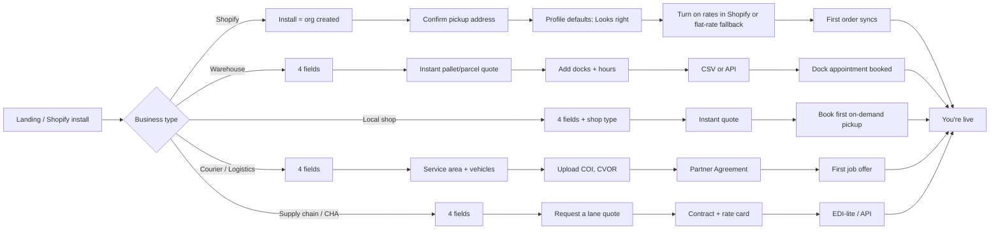

# 71. Progressive onboarding (Phase 0, L35)

Goal: any business is **quoting in under 2 minutes** from landing, and never sees a long form. Everything else is asked just in time.

## 1. Evidence

- Baymard Institute: about 18 % of US shoppers abandoned an order because the checkout was "too long / complicated"; the average checkout shows ~11 form fields while 8 is achievable (https://baymard.com/lists/cart-abandonment-rate, https://baymard.com/blog/checkout-flow-average-form-fields).
- NN/g: every field adds effort; remove or defer optional fields, ask only what is needed now (https://www.nngroup.com/articles/web-form-design/), and use progressive disclosure to defer secondary detail (https://www.nngroup.com/articles/progressive-disclosure/).
- Current code: the merchant sign-up path goes through Clerk hosted sign-up + email code, then the portal profile; Shopify unlinked stores are sent to the portal to "Link to my PorterChain account" (`apps/merchant-portal/src/lib/shopifyEmbed.ts:92`), the same step that blocked Shopify review (doc 74 §2).

## 2. The short sign-up (4 fields)

1. **What do you do?** tile picker: Online store (Shopify) · Warehouse / 3PL / storage · Local shop · Courier · Logistics / trucking · Supply chain · Import/export or customs broker · Just me (personal). (Sets `business_type`; local shop asks one follow-up chip: pet food, flowers, pharmacy, bakery/cake, gift, candles, other.)
2. **Business name** 3. **Work email** 4. **Pickup postal code** (FSA check: inside Toronto + 150 km → green tick; outside → "We'll quote it by hand within 1 business day").

Then: passkey or password (Keycloak), email verified by link in the background; **quoting works before verification** (quotes only, no booking until verified). Shopify merchants skip all four: the install itself creates the org (doc 74 §2).

## 3. Just-in-time asks (progressive profiling)

| Ask                                        | Trigger                             | Why                                |
| ------------------------------------------ | ----------------------------------- | ---------------------------------- |
| Legal name, GST/HST number, billing email  | First invoice draft                 | CRA invoice rules (doc 68 R-rules) |
| Pickup address detail, hours, dock notes   | First booking                       | Driver needs it                    |
| Operating profile wizard (§5)              | First booking (pre-filled defaults) | Pickup/labels/tracking             |
| Interac payment contact                    | First invoice                       | Payment                            |
| API key / webhook URL                      | Opens Developers tab                | Integration                        |
| COI (insurance), CVOR, WSIB clearance, HST | Partner accepts first job           | Broker model (doc 56)              |
| Food-handling / Rx acknowledgement         | First bakery/pharmacy order         | Handling rules                     |
| Contract signature                         | Before contract rates apply         | B2B fees, liability                |

Rule: never ask the same thing twice; anything we can infer (city from postal code, Shopify shop address, timezone) is pre-filled.

## 4. Flow per business type (in build order)

1. **Shopify merchant:** install from link → org auto-provisioned from shop data → confirm pickup (1 screen) → profile confirm → rates: plan check; if Advanced/Plus/Grow-annual show the 3 Shopify steps + deep link, else "Use flat rates" screen with our suggested rates → test order on PCDC-like sandbox → live.
2. **Warehouse/3PL/storage:** 4 fields → pallet & parcel quote → add docks (hours, appointment slot length) → choose CSV template or API → first dock appointment → (optional) "Offer your space/capacity to PorterChain" partner switch.
3. **Small shop:** 4 fields + shop chip → quote → book on-demand pickup; bakery/flowers see the handling promise; pharmacy sees "no controlled substances; ID + signature".
4. **Courier partner:** 4 fields → areas (FSA chips) + vehicles → COI + HST + WSIB upload → Partner Agreement e-sign → test job → live in job pool.
5. **Logistics partner:** as courier plus CVOR and linehaul lanes; EDI-lite CSV/SFTP option.
6. **Supply chain company:** 4 fields → lane quote request → Ravi call (booked from calendar link) → contract rate card → integration.
7. **Import/export / CHA:** 4 fields → port/rail/airport pickup lanes → document pack (commercial invoice, B3/transaction no. as external refs) → contract.

## 5. Operating-profile setup wizard (one screen per question, defaults pre-selected)

1. How do we pick up? (default by type, doc 70 §2.1) with cut-off time. 2. Which of your numbers should we show? (Order #, Shipment #, SKU, PO…) 3. Labels: we print / you print / both (+ relabel when unreadable). 4. Tracking: ours / yours / both. 5. Barcode type (auto-detected from a sample scan or upload). Each screen: "Most {type} businesses choose this. **Looks right**." Changeable later in Settings → Operating profile.

## 6. Email sequence (Keycloak/Listmonk transactional; CASL: transactional only, no marketing without consent)

| #   | Trigger                   | Subject EN / FR                                     | Body (draft, lawyer + Ravi review)                                                                                                                                                                                                                                      |
| --- | ------------------------- | --------------------------------------------------- | ----------------------------------------------------------------------------------------------------------------------------------------------------------------------------------------------------------------------------------------------------------------------- |
| E1  | Sign-up                   | Welcome to PorterChain / Bienvenue chez PorterChain | EN: "Hi {name}, you're set up. Get a price any time at {link}. Next: confirm your pickup address (1 minute)." FR: « Bonjour {name}, votre compte est prêt. Obtenez un prix à tout moment : {link}. Prochaine étape : confirmez votre adresse de ramassage (1 minute). » |
| E2  | Sign-up                   | Confirm your email / Confirmez votre courriel       | EN: "Tap to confirm {email}. You can already get quotes." FR: « Touchez pour confirmer {email}. Vous pouvez déjà obtenir des prix. »                                                                                                                                    |
| E3  | +1 h if checklist < 100 % | Your 3-step setup / Vos 3 étapes                    | EN: "1. Pickup address ✓/✗ 2. How we pick up ✓/✗ 3. Connect your store or upload orders ✓/✗" FR: « 1. Adresse de ramassage 2. Mode de ramassage 3. Connecter votre boutique ou téléverser vos commandes »                                                               |
| E4  | First order               | Order {PC-id} booked / Commande {PC-id} réservée    | EN: "We've got it. Your ref {their_ref}. Pickup {window}. Track: {link}." FR: « C'est noté. Votre réf. {their_ref}. Ramassage {window}. Suivi : {link}. »                                                                                                               |
| E5  | Integration done          | You're connected / Vous êtes connecté               | EN: "{Shopify/API/CSV} is connected. New orders arrive automatically; nothing else to do." FR: « {source} est connecté. Les nouvelles commandes arrivent automatiquement. »                                                                                             |
| E6  | Invoice issued            | Invoice {no} / Facture {no}                         | EN: "Total {amount} incl. HST, due {date}. Pay by Interac e-Transfer to {email}, message {no}." FR: « Total {amount} TVH incluse, payable le {date}. Virement Interac à {email}, message {no}. »                                                                        |
| E7  | Stuck 2 days              | Need a hand? / Besoin d'aide?                       | EN: "You're one step from your first delivery: {step}. Reply to this email or WhatsApp us; a person answers." FR: « Il ne reste qu'une étape : {step}. Répondez à ce courriel ou écrivez-nous sur WhatsApp; une personne vous répond. »                                 |
| E8  | Stuck 7 days              | Shall we set it up for you? / On s'en occupe?       | EN: "Book 15 minutes and we'll do the setup with you: {calendar}." FR: « Réservez 15 minutes et nous ferons la configuration avec vous : {calendar}. »                                                                                                                  |
| E9  | Partner docs missing      | One document left / Il manque un document           | EN: "Upload your {COI} to start receiving jobs." FR: « Téléversez votre {COI} pour recevoir des courses. »                                                                                                                                                              |

## 7. In-app checklist and confidence screens

Checklist card on portal home (dismissable at 100 %): pickup address · operating profile · connect (Shopify/CSV/API) · first order · billing contact. Each confidence screen states plainly what we already support, e.g. "**Your own labels? Yes.** Our driver scans your barcode (Code 128, QR or GS1). You don't need to print anything new." / "**Your order numbers? Yes.** Search and track by your number or ours." / "**Odd sizes and furniture? Yes.** Enter the size; we show the full price before you book." No jargon (no "webhook", "API", "FSA") outside the Developers tab.

## 8. Tests: doc 76 §2–§8 (A-ONB-*).
