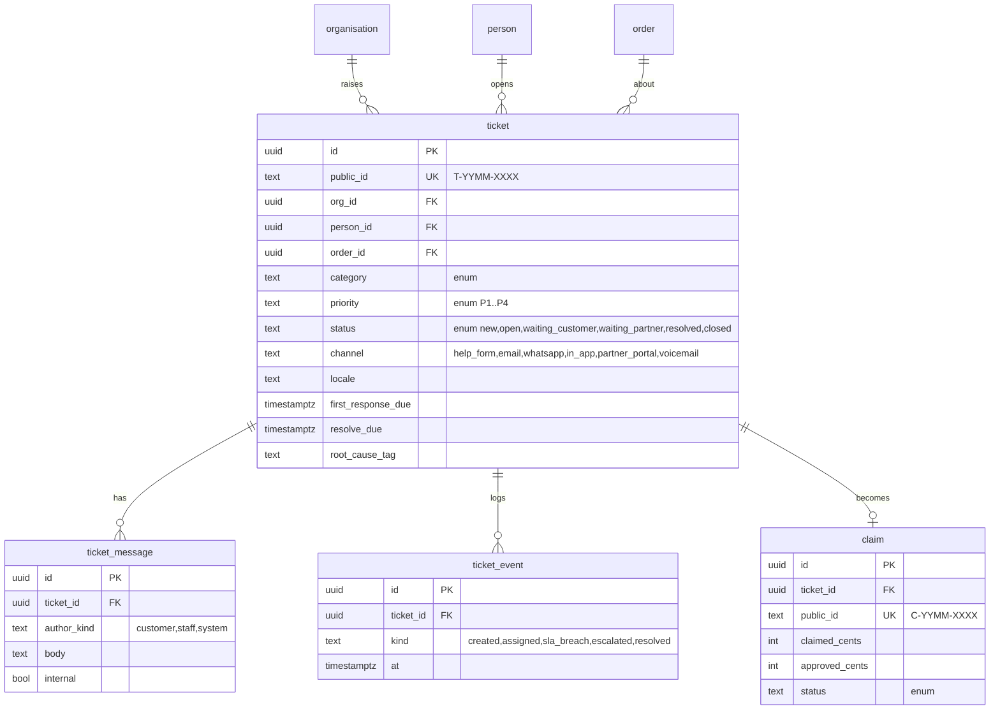

# 73. Support and issue playbook (Phase 0, L35)

Today: `support_tickets` (`admin_models.py:130-151`) has free-text `status`/`priority`/`category` strings, one of `customer_id`/`merchant_id`/`driver_id`, JSON `ticket_data`; `claims` is separate; admin `/support`, `/support/[id]`, `/claims`, `/inbox`. No SLA clocks, no auto-acknowledgement, no org link. Doc 54 holds SOPs; this doc makes them per business type and testable.

## 1. Contact channels (all free)

Help centre `porterchain.com/help` (doc 68) with search → "Still stuck?" ticket form (pre-filled org, order, page) · email `support@porterchain.com` (email-to-ticket) · WhatsApp click-to-chat +1 647 619 7951 (`wa.me/16476197951`) (free link, no API cost; Ravi replies from WhatsApp Business app, logs ticket with one tap from the ops console) · in-app "Get help" on every order (portal, iOS, Android, Shopify embed) · partner portal "Report a problem". Phone: voicemail-to-ticket only in Phase 0.

## 2. Categories, priorities, targets (published as **targets**, not guarantees, D-68-4)

| Category                           | Examples                                                      | Default priority            |
| ---------------------------------- | ------------------------------------------------------------- | --------------------------- |
| delivery_live                      | driver late, can't find address, recipient absent             | P1                          |
| delivery_damage_loss               | damaged, lost, missing item → claim                           | P2                          |
| billing                            | invoice question, Interac not matched                         | P3                          |
| account_access                     | can't sign in, invite                                         | P2                          |
| integration                        | Shopify not quoting, webhook failing, API error, CSV rejected | P2 (P1 if checkout blocked) |
| label_print                        | label won't print, barcode unreadable                         | P2                          |
| partner                            | job offer, payout, documents                                  | P3                          |
| general / feedback / accessibility | —                                                             | P4                          |

| Priority | First response target   | Resolution target | Pages Ravi? |
| -------- | ----------------------- | ----------------- | ----------- |
| P1       | 15 min (07:00–22:00 ET) | same day          | yes (ntfy)  |
| P2       | 2 business h            | 2 business days   | no          |
| P3       | 1 business day          | 5 business days   | no          |
| P4       | 2 business days         | best effort       | no          |

Quiet hours 22:00–07:00 Toronto: only P1 checkout-down or safety pages; backup on-call per doc 52 (name kept private).

## 3. Auto-acknowledgement (EN/FR)

EN: "We've got your message (ticket {T-no}). A person will reply by {target time}. For a live delivery, WhatsApp us at {link}. — PorterChain" FR: « Nous avons bien reçu votre message (billet {T-no}). Une personne vous répondra d'ici {target time}. Pour une livraison en cours, écrivez-nous sur WhatsApp : {link}. — PorterChain »

## 4. Delivery issue playbook (what the customer hears is in quotes)

| Issue          | Steps                                                                                                                | Customer wording                                                                          |
| -------------- | -------------------------------------------------------------------------------------------------------------------- | ----------------------------------------------------------------------------------------- |
| Late           | Check live location → call driver → new ETA → notify; > 60 min late on a time window → B2B credit per contract       | "Your delivery is running about {n} minutes late. New arrival: {time}. Sorry about this." |
| Damaged        | Photo from recipient + POD photo → open claim → hold invoice line                                                    | "We're sorry it arrived damaged. Please send 2 photos; we'll sort it within {target}."    |
| Lost           | Last scan → driver + depot search 24 h → claim; liability $4.41/kg floor (no cargo insurance yet, doc 56)            | "We're searching for it now and will update you by {time} tomorrow."                      |
| Wrong address  | Before pickup: edit free; after pickup: reroute quote shown upfront                                                  | "We can change it. The new price is {x}; tap to accept."                                  |
| Failed attempt | POD evidence (photo, GPS, time) → re-attempt slot → retail one free re-attempt, B2B per contract                     | "We missed you at {time}. Choose a new time here: {link}."                                |
| Claim          | Claim form → evidence → decision in 10 business days target → credit/refund (Stripe retail, Interac B2B credit note) | "Your claim {C-no} is open. You'll get a decision by {date}."                             |

## 5. Technical issue playbook (internal steps; customer never sees jargon)

| Issue                   | Check                                                                                                        | Fix                                                                                  | Customer wording                                                                                                 |
| ----------------------- | ------------------------------------------------------------------------------------------------------------ | ------------------------------------------------------------------------------------ | ---------------------------------------------------------------------------------------------------------------- |
| Shopify app not quoting | carrier service registered? store plan eligible? rate enabled in Markets? `/carrier_rates` 5xx in GlitchTip? | re-register; plan ineligible → switch to flat-rate fallback; enable rate (deep link) | "Your checkout is set to show our delivery price. One setting in Shopify needs switching on; here's the button." |
| Webhook failures        | `webhook_delivery` attempts, last status                                                                     | auto-retry (exp. backoff 24 h), endpoint disabled after 24 h fail → email E-TECH     | "Your system stopped accepting our updates since {time}. Nothing is lost; we'll resend when it's back."          |
| API errors              | request id, 4xx code                                                                                         | doc 74 error catalogue                                                               | "One of your orders was missing a postal code. Fix it here."                                                     |
| Label won't print       | printer DPI/format; PDF fallback                                                                             | send PDF 4x6; ZPL 203 dpi template                                                   | "Here's the label as a PDF you can print on any printer."                                                        |
| Login                   | Keycloak events; locked? passkey lost?                                                                       | reset link; staff never asks for passwords                                           | "We've sent you a new sign-in link."                                                                             |

## 6. Escalation

Ravi is sole on-call: P1 → ntfy push to Ravi; no ack in 30 min → backup on-call (private); safe mode rules in doc 52. P2 breach of target → daily digest. Every ticket closes with a root-cause tag; weekly top-5 tags feed the backlog.

## 7. Ticket data model (schema `support`)

Migration: `support_tickets` → `ticket` (status/category strings → enums, `merchant_id` → `org_id`); `claims` linked via `ticket_id`.
