# 75. Ops console reorganisation (Phase 0, L35)

## 1. Current state (from `apps/admin/src/lib/admin-nav.ts` and 54 `page.tsx` routes, 29 Oct 2026)

Nav groups: **Today** (/today, /dashboard) · **Dispatch** (/dispatch/today "Queue", /plan, /live, /exceptions, /orders, /dispatch/fleet) · **Accounts** (/merchants, /customers) · **Sales** (/booking-drafts, /leads "Inbox", /leads/pipeline, /leads/today "Call list"; hidden /leads/agent, /calendar, /attribution) · **Finance** (/finance/cash, invoices, payments, driver-pay, /pricing, reports; tabs-only analytics, tax-registration) · **Support** (/support "Tickets", /claims; hidden /inbox) · **Administration** (/blog, /blog/authors, /notifications, /notifications/delivery, /system, /settings; hidden /system-health, /system-tests, also /admin/system-health and /admin/system-tests duplicates). Not in nav: /operations (the "control tower", linked from dashboard cards with `?view=desk|orders|attention`), /drivers, /merchants/duplicates, /account/security.

Verdict: **works, but organised by how it was built, not by how Ravi works.** Problems: two homes (/today vs /dashboard vs /operations); Orders sits under Dispatch; drivers are not in the nav (only Fleet); merchants/customers split by persona (no place for warehouses, partners, CHA); "Leads Inbox" vs "Inbox (messages)" vs "Tickets" are three inboxes; Pricing sits in Finance; Blog/Notifications are in Administration next to System; duplicate system-health/system-tests routes; agent pages visible while agents are Phase 1.

## 2. New information architecture (D-75-1, decided yes by Ravi 29 Oct 2026)

```mermaid
flowchart TB
  Home[PorterChain Ops] --> T[Today]
  Home --> O[Orders]
  Home --> D[Dispatch]
  Home --> N[Network]
  Home --> C[Customers & Orgs]
  Home --> B[Billing]
  Home --> S[Support]
  Home --> I[Insights]
  Home --> G[Settings]
  T --> T1[Overview: pickups, live, exceptions, tickets due]
  O --> O1[All orders] & O2[Booking drafts] & O3[Order detail]
  D --> D1[Plan] & D2[Live map] & D3[Exceptions] & D4[Fleet & vehicles]
  N --> N1[Drivers] & N2[Partners: courier/logistics/warehouse/CHA] & N3[Partner jobs]
  C --> C1[Organisations by type] & C2[People/retail] & C3[Leads & pipeline] & C4[Duplicates/merge]
  B --> B1[Invoices] & B2[Payments & Interac matching] & B3[Driver & partner pay] & B4[Rate cards & pricing] & B5[Tax GST/HST] & B6[Cash]
  S --> S1[Unified inbox: tickets, email, WhatsApp, leads replies] & S2[Claims] & S3[Help centre content]
  I --> I1[Reports] & I2[Analytics] & I3[Attribution]
  G --> G1[Team & roles] & G2[Notifications] & G3[Integrations] & G4[System health & tests] & G5[Website/blog] & G6[My security]
```

Roles (SpiceDB `platform`): `owner` (Ravi, all), `dispatcher` (Today, Orders, Dispatch, Network read), `support` (Support, Orders read, Customers read), `finance` (Billing, Insights), `sales` (Customers & Orgs, Leads), `viewer`. Phase 1 agent pages stay hidden behind `FEATURE_AI`.

## 3. Mapping old → new

| Old route                                                                         | New place                                                                   |
| --------------------------------------------------------------------------------- | --------------------------------------------------------------------------- |
| /today, /dashboard, /operations (?view=desk/orders/attention)                     | **Today** (one page; /dashboard and /operations redirect, then removed)     |
| /orders, /orders/[id]                                                             | Orders                                                                      |
| /booking-drafts, /booking-drafts/[id]                                             | Orders → Booking drafts                                                     |
| /dispatch/today ("Queue")                                                         | Today (pickups lane) + Dispatch → Plan                                      |
| /dispatch/plan, /live, /exceptions                                                | Dispatch → Plan, Live map, Exceptions                                       |
| /dispatch/fleet                                                                   | Dispatch → Fleet & vehicles                                                 |
| /drivers, /drivers/[id]                                                           | Network → Drivers                                                           |
| (new) partners, partner jobs                                                      | Network → Partners, Partner jobs (doc 56)                                   |
| /merchants, /merchants/[id], /customers, /customers/[id]                          | Customers & Orgs → Organisations (filter by business type), People          |
| /merchants/duplicates                                                             | Customers & Orgs → Duplicates                                               |
| /leads, /leads/pipeline, /leads/today, /leads/[id], /leads/calendar               | Customers & Orgs → Leads & pipeline                                         |
| /leads/agent                                                                      | hidden (Phase 1)                                                            |
| /leads/attribution                                                                | Insights → Attribution                                                      |
| /finance/invoices(/[id]), /payments, /driver-pay, /cash, /tax-registration        | Billing → same names                                                        |
| /pricing                                                                          | Billing → Rate cards & pricing                                              |
| /finance/reports, /finance/analytics                                              | Insights                                                                    |
| /support, /support/[id], /inbox                                                   | Support → Unified inbox                                                     |
| /claims, /claims/[id]                                                             | Support → Claims                                                            |
| /blog, /blog/new, /blog/[id], /blog/authors                                       | Settings → Website & blog                                                   |
| /notifications, /notifications/delivery                                           | Settings → Notifications                                                    |
| /system, /system-health, /system-tests, /admin/system-health, /admin/system-tests | Settings → System health & tests (one route; `/admin/*` duplicates deleted) |
| /settings                                                                         | Settings                                                                    |
| /account/security                                                                 | Settings → My security                                                      |
| /activate-staff, /sign-in                                                         | unchanged (Keycloak)                                                        |

Build: Phase 0 weeks 8–9 with the doc 60 §9 dispatch redesign; old routes 308-redirect for one release; Playwright checks every old URL lands on its new place (76 §12).
