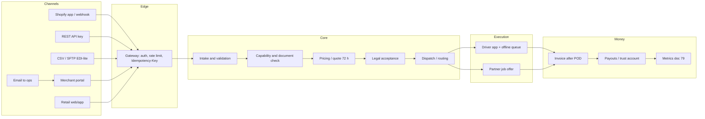
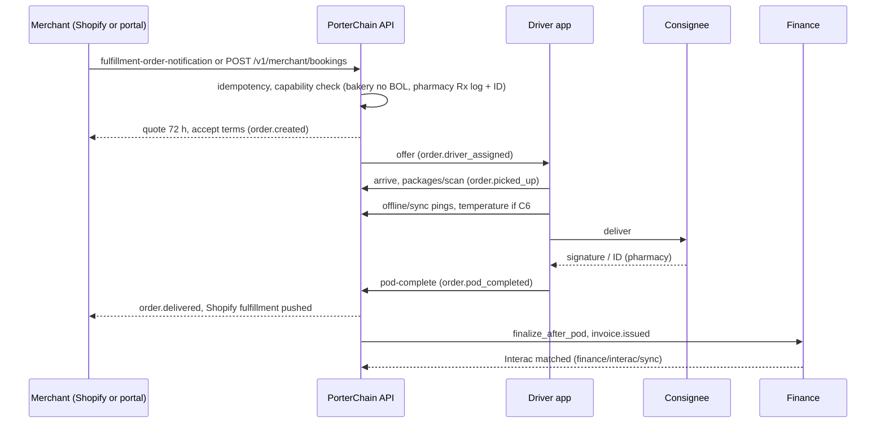
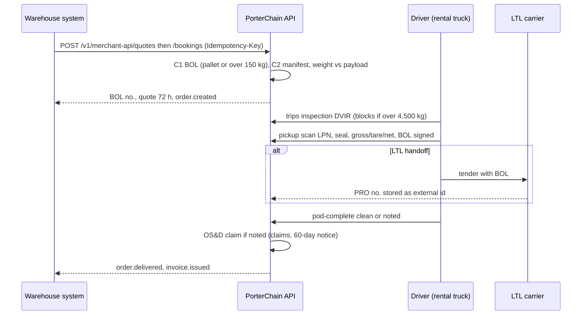
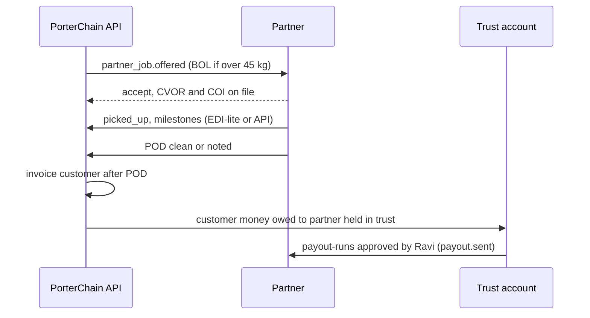
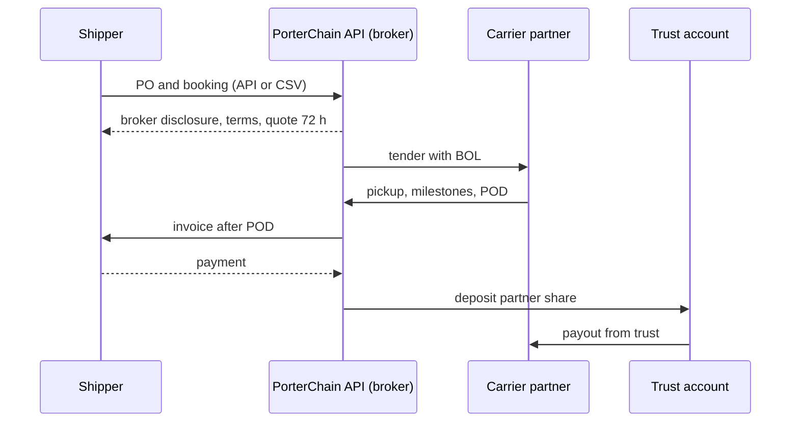
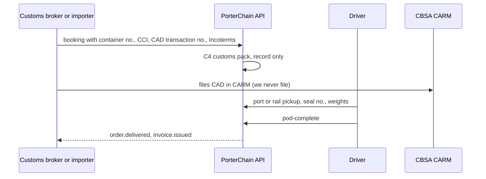

# 81. Order lifecycle by business type (Phase 0)

This doc covers one pipeline. The differences between business types are config: the 70 §2.2 documents, the 70 §2.3 identifiers and the 74 channels.

- **Endpoints** are the existing ones in `apps/api` (checked 29 Oct 2026). Ones marked _(new)_ are added in Phase 0 as described here.
- **Webhooks** (public, signed, doc 74 §4) are kept separate from internal events (`porterchain_api` event bus).
- **Filter:** we keep only what the law requires, what protects a claim or what saves money (Ravi 29 Oct 2026).

## 1. API layers

## 2. Stages (common to every type)

| #   | Stage                           | Owner                                | Data passed (fields, IDs)                                                                                                                        | Endpoint / internal event / webhook                                                                                                                                                                                                                                                                                                                                   | Documents (70 §2.2)                                                              | Legal checkpoint                                                                                                                              | Failure path                                                                                                                                             |
| --- | ------------------------------- | ------------------------------------ | ------------------------------------------------------------------------------------------------------------------------------------------------ | --------------------------------------------------------------------------------------------------------------------------------------------------------------------------------------------------------------------------------------------------------------------------------------------------------------------------------------------------------------------- | -------------------------------------------------------------------------------- | --------------------------------------------------------------------------------------------------------------------------------------------- | -------------------------------------------------------------------------------------------------------------------------------------------------------- |
| 1   | Post order                      | merchant / customer / partner system | org_id, external_refs[{type,value}], pickup, drop, parcels (band, kg, L×W×H), lines (sku, gtin, qty) if C8, declared value, flags (cold, Rx, DG) | Shopify `POST /v1/integrations/shopify/fulfillment-order-notification`; API `POST /v1/merchant-api/quotes` then `POST /v1/merchant-api/bookings`; portal `POST /v1/merchant/bookings`; CSV `POST /v1/merchant/bulk/upload` + `/bulk/{job_id}/confirm`; EDI-lite SFTP → `POST /v1/merchant/route-imports/{job_id}/confirm`; email → ops create `POST /v1/admin/orders` | —                                                                                | PIPEDA purpose notice (doc 49)                                                                                                                | Bad payload → 422 problem+json with `fix`. Shopify failures → ingress DLQ (`POST /v1/admin/merchants/{merchant_id}/shopify/ingress-dlq/{dlq_id}/replay`) |
| 2   | Intake, validation, idempotency | system                               | `Idempotency-Key` (24 h), natural key (org_id, ref_type, ref_value)                                                                              | gateway (doc 74 §4)                                                                                                                                                                                                                                                                                                                                                   | —                                                                                | —                                                                                                                                             | Duplicate → same response replayed, never two orders                                                                                                     |
| 3   | Capability and document check   | system                               | required_documents[], required_identifiers[]                                                                                                     | rule engine at quote time (70 §2.2–2.3)                                                                                                                                                                                                                                                                                                                               | decides BOL, manifest, customs pack, Rx, cold chain, TDG                         | TDG (C7), Rx (70 §7a)                                                                                                                         | Off capability → `422 capability_not_enabled`; DG without training → refused; overweight → `422 vehicle_overweight` (80 §2)                              |
| 4   | Quote (valid 72 h)              | system                               | quote_id, rate_card version, band, zone, add-ons, total, `expires_at = created + 72 h`                                                           | `POST /v1/merchant-api/quotes`, `GET /v1/quotes/{quote_id}`                                                                                                                                                                                                                                                                                                           | —                                                                                | Price shown incl. HST line (doc 72)                                                                                                           | Expired → re-quote at the current card, never silently honoured                                                                                          |
| 5   | Contract and legal acceptance   | customer/merchant + system           | terms_version, accepted_at, ip, signer; BOL no. when required; brokered: broker disclosure + trust flag                                          | part of booking; internal `order.booked`; webhook `order.created`                                                                                                                                                                                                                                                                                                     | BOL (C1) carries the s. 4(1) fields and the "uniform conditions apply" statement | **O. Reg. 643/05 s. 4** (BOL > 45 kg, inter-municipal); **HTA s. 191.0.1(3)** money owed to the partner held in trust when we broker (doc 56) | No acceptance → order stays `draft`, not dispatchable                                                                                                    |
| 6   | Dispatch / routing              | system → Ravi (ops)                  | route_id, stop_id, driver_id or partner org_id, trip (plate, VIN, rental, RGW, insurance evidence)                                               | `POST /driver-api/v1/jobs/optimize/runs/{run_id}/accept`; driver `POST /driver-api/v1/offers/{offer_id}/accept` / `orders/{order_id}/accept`; internal `order.driver_assigned`; webhook `partner_job.offered`                                                                                                                                                         | —                                                                                | CVOR if > 4,500 kg; HOS limits (80 §1)                                                                                                        | Trip vehicle data missing or HOS block → offer not sent; re-dispatch                                                                                     |
| 7   | Pre-trip                        | driver                               | DVIR (Schedule 1) / walk-around photos, HOS status                                                                                               | `POST /driver-api/v1/trips/{trip_id}/inspection` _(new)_, `POST /driver-api/v1/hos/events` _(new)_; via the offline queue                                                                                                                                                                                                                                             | DVIR report                                                                      | **O. Reg. 199/07** for rental trucks > 4,500 kg                                                                                               | Major defect → job blocked, ops swap the vehicle                                                                                                         |
| 8   | Pickup with identifier capture  | driver                               | parcel scans, their barcode → external_ref, seal no., PRO (LTL handoff only), LPN, pallet gross/tare/net, ATA/ATD                                | `POST /driver-api/v1/routes/{route_id}/stops/{stop_id}/arrive` / `start`, `POST /driver-api/v1/orders/{order_id}/packages/scan`, `POST /v1/merchant/orders/{order_id}/external-ids`; internal and webhook `order.picked_up`                                                                                                                                           | labels, packing slip (C8), pallet manifest (C2)                                  | BOL signed "apparent good order" (s. 4(1)(o)); weight shown (Sch. 1 art. 19)                                                                  | Missing package → `POST /driver-api/v1/orders/{order_id}/packages/{package_id}/missing`; seal mismatch → OS&D noted at pickup                            |
| 9   | In transit                      | system + driver                      | ETD/ETA, GPS pings, cold-chain readings                                                                                                          | `POST /driver-api/v1/offline/sync`, `POST /v1/admin/orders/{order_id}/temperature`; webhook `order.out_for_delivery`                                                                                                                                                                                                                                                  | cold-chain log (C6), Rx custody handoffs (C5)                                    | HOS (s. 5, 9)                                                                                                                                 | Phone offline → queued with client_id; temperature out of range → exception                                                                              |
| 10  | Delivery with POD               | driver + consignee                   | ATA/ATD, POD status clean/noted, osd_type, photos, signature, ID check (C10, Rx), barcode                                                        | `/driver-api/v1/routes/{route_id}/stops/{stop_id}/pod-photo`, `pod-signature`, `pod-id-check`, `pod-barcode`, `pod-complete`; internal `order.pod_completed`; webhook `order.delivered`                                                                                                                                                                               | POD (Always), Rx log signature                                                   | Claim notice 60 days runs from here (Sch. 1 art. 12)                                                                                          | Nobody home → `.../exception`, internal `order.delivery_failed`, webhook `order.failed`; re-attempt fee (doc 72)                                         |
| 11  | Exceptions, OS&D, claims        | Ravi (ops) + system                  | osd_claims (type, amount, notice_deadline, liability_cap)                                                                                        | `POST /v1/admin/claims`, `/claims/{claim_id}/evidence`, `/insurance`, `/compensation`; internal `order.exception`; webhook `claim.opened` _(new, added to 74 §4)_                                                                                                                                                                                                     | claim pack (POD, photos, BOL, seal, weights)                                     | $4.41/kg or declared value (Sch. 1 art. 9–10); 9-month final claim                                                                            | Past the deadline → red flag; partner fault → chargeback on the payout                                                                                   |
| 12  | Invoicing                       | system                               | invoice_id, lines, HST, terms                                                                                                                    | `InvoiceService.finalize_after_pod` on `order.pod_completed`; webhook `invoice.issued`; **merchants: Interac** (`POST /v1/admin/finance/interac/sync`, `.../{transfer_id}/approve`); **customers: Stripe** (`POST /webhooks/stripe`)                                                                                                                                  | invoice PDF (`/v1/merchant/billing/invoices/{invoice_id}/pdf`)                   | HST registrant fields (doc 72)                                                                                                                | Unpaid → `POST /v1/merchant/billing/invoices/{invoice_id}/remind`; Stripe failure → no dispatch of retail orders (prepaid)                               |
| 13  | Payout to partners and drivers  | Ravi (approves) + system             | payout_run_id, per-job amounts, chargebacks                                                                                                      | `POST /v1/admin/finance/payout-runs`, `/payout-runs/{run_id}/{action}`, `GET .../bank.csv`; webhook `payout.sent` _(new, added to 74 §4)_                                                                                                                                                                                                                             | statement                                                                        | **HTA s. 191.0.1(3)**: brokered partner money is paid **from the trust account** (doc 56)                                                     | Run rejected → stays draft; nothing leaves the trust account without approval                                                                            |
| 14  | Close and metrics               | system                               | contribution, OTIF, dwell, OS&D, E_c, L_oos                                                                                                      | nightly `metrics_refresh` (79 §7)                                                                                                                                                                                                                                                                                                                                     | —                                                                                | —                                                                                                                                             | View refresh failure → alert, last good values kept                                                                                                      |

## 3. Per business type (only the differences from §2)

| Type                                 | Channel (stage 1)                                 | Documents and identifiers (70 §2.2/2.3)                                                                                            | Legal checkpoints                                            | Payment                   |
| ------------------------------------ | ------------------------------------------------- | ---------------------------------------------------------------------------------------------------------------------------------- | ------------------------------------------------------------ | ------------------------- |
| Shopify merchant                     | Shopify fulfillment-order webhook; portal         | POD, labels (theirs/ours), packing slip C8; BOL only if C1                                                                         | 643/05 exempt for parcels ≤ 45 kg                            | Interac monthly (b2b-std) |
| Warehouse / 3PL                      | API, CSV, EDI-lite                                | BOL C1, pallet manifest C2, LPN, seal, PRO on LTL handoff, PO, weights                                                             | 643/05 s. 4; CVOR/DVIR if a rental truck > 4,500 kg          | Interac / contract        |
| Small shop: bakery                   | portal, CSV                                       | POD, cold-chain C6; **no BOL**, no pallets                                                                                         | 643/05 exempt (≤ 45 kg / same municipality)                  | Interac                   |
| Small shop: flowers                  | portal                                            | POD; no custody log                                                                                                                | same                                                         | Interac                   |
| Small shop: pet food                 | portal, CSV                                       | POD, 2-person C11 if > 50 kg                                                                                                       | same                                                         | Interac                   |
| Small shop: pharmacy                 | portal                                            | POD with ID + signature (Always), Rx custody log C5, cold chain C6                                                                 | 70 §7a (CDSA custody handling)                               | Interac                   |
| Small shop: gift/candles/other       | portal                                            | POD; TDG refused (C7)                                                                                                              | same                                                         | Interac                   |
| Retail customer                      | web/app                                           | POD                                                                                                                                | consumer terms (doc 49)                                      | **Stripe prepaid**        |
| Courier partner (as carrier)         | job offer (`partner_job.offered`), partner portal | their POD required by contract; BOL on handoffs > 45 kg                                                                            | their CVOR/HOS/ELD (Partner Agreement, doc 56)               | **payout from trust**     |
| Logistics partner                    | EDI-lite / API                                    | BOL, PRO, seal, LPN                                                                                                                | same + 643/05 connecting-carrier liability (Sch. 1 art. 2–3) | payout from trust         |
| Supply chain (broker mode, P1 live)  | API, CSV                                          | PO, BOL, LPN; customs refs only if cross-border                                                                                    | **broker disclosure + HTA s. 191.0.1(3) trust**; 643/05      | Interac in; trust out     |
| Import/export / customs broker (CHA) | API, CSV                                          | customs pack C4: CCI, CUSMA COO (if a preference is claimed and > CAD 3,300), **CAD (ex-B3)** refs, Incoterms, seal, container no. | CBSA CARM: **the importer/broker files, we record only**     | Interac / contract        |

## 4. Sequences per family

### 4.1 Shopify merchant and small shops (incl. pharmacy, bakery, flowers)

### 4.2 Warehouse / 3PL

### 4.3 Courier and logistics partners (we tender, they carry)

### 4.4 Supply chain broker mode (P1 live)

### 4.5 Import / export / customs broker (CHA)

## 5. Tests

Tests A-LC-01..07 are in 76 §17, inside G19.
