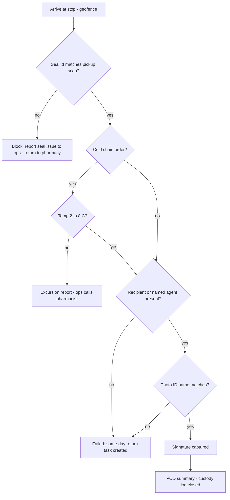

# 82. Guided job flows, one driver persona, data secrecy, merchant and customer guidance (Phase 0)

Docs only. No code changes in this doc; every "build" line is a Phase 0 work item gated by G19 (76 §18). Endpoints follow doc 74 and doc 81 (driver `/driver-api/v1`, merchant `/v1/merchant`, Shopify `/v1/integrations/shopify`).

## 0. Interim decisions (Ravi has not answered the card yet; the recommendations are used, marked **interim**)

| #     | Decision (interim)                                                                                                                                     | Effect on the docs                                                                 |
| ----- | ------------------------------------------------------------------------------------------------------------------------------------------------------ | ---------------------------------------------------------------------------------- |
| I82-1 | **Pilot = Shopify merchants + local shops** (Kaylulu first, PCDC test store)                                                                           | Phase 0 wizards ship for parcel, signature/ID, return/failed, scheduled, on-demand |
| I82-2 | **Pharmacy is the first Phase 1 niche.** The pharmacy pack (C5 custody, C10 ID, cold chain) is **designed and tested in Phase 0, live in Phase 1**     | Pharmacy wizard + A-GF tests in P0; `pharmacy` subtype flag off for live orders    |
| I82-3 | **No heavy trucks until CVOR** is issued (nothing over 4,500 kg RGW or actual)                                                                         | Doc 80 DVIR/HOS built and tested; the heavy-truck capability stays off             |
| I82-4 | **Customs, ports, rail, air = released goods only.** We pick up after CBSA release (CAD accounted by the importer or broker, 70 §2.3); no bonded moves | No customs filing, eManifest or bonded flow in our apps                            |
| I82-5 | **Partners (courier/logistics) in Phase 1**, onboarded only with insurance certificates on file (auto, cargo, CGL; expiry tracked)                     | Partner handoff wizard designed in P0, off until Phase 1                           |
| I82-6 | **Profile architecture = organisation + business type + operating profile + compliance packs + credentials** (70 §1–§2.2)                              | Wizards are generated from these five, never hard-coded per merchant               |

## 1. Driver guided flows

### 1.1 How a wizard is generated

The server builds a **flow spec** (JSON) per stop from five inputs: the order's `required_documents` list (70 §2.2), the org's capability packs, the operating profile (pickup mode, keys, labels), the vehicle (doc 80) and the driver's credentials (training modules done). The app only renders it.

```json
{
  "flow_id": "pharmacy_custody_drop",
  "version": 3,
  "locale_keys": true,
  "steps": [
    { "id": "arrive", "card": "arrive_geofence", "capture": [], "block_if": ["not_at_stop"] },
    {
      "id": "seal",
      "card": "seal_check",
      "capture": ["scan", "seal_no", "photo"],
      "block_if": ["seal_mismatch"]
    },
    {
      "id": "temp",
      "card": "temp_read",
      "capture": ["temp"],
      "block_if": ["temp_out_of_range"],
      "only_if": "cold_chain"
    },
    { "id": "id", "card": "id_check", "capture": ["id_name_match"], "block_if": ["id_fail"] },
    { "id": "sign", "card": "signature", "capture": ["signature"], "block_if": ["no_signature"] },
    { "id": "done", "card": "pod_summary", "capture": ["photo"], "block_if": [] }
  ]
}
```

Endpoint (existing job read, extended): `GET /driver-api/v1/jobs/{order_id}` returns `flow_spec`. Captures post to the existing POD/scan endpoints and go through the existing offline queue (doc 80 §3). Each spec is versioned; a job keeps the version it started with.

### 1.2 Card anatomy (same on web and mobile)

Each step is one **illustrated card**: a simple icon or line drawing (SVG, free set: Tabler/Lucide, MIT), one **photo example** of a good capture, a **Do / Don't** pair, one primary button, and a "Problem?" link to the existing ProblemSheet. Text comes from locale keys (EN + FR, 76 A-FR). Accessibility (AODA / WCAG 2.0 AA): 44 px targets, screen-reader labels on every icon, colour never the only signal, captions on the photo example, works in large text. Offline: the spec, cards and images are cached when the job is accepted; captures queue offline and blocking checks that need the server (e.g. seal id match) run locally against the cached expected values, then re-verify on sync.

### 1.3 Pickup modes

| Mode             | Steps (cards)                                                                                   | Required captures            | Blocking checks                                                      |
| ---------------- | ----------------------------------------------------------------------------------------------- | ---------------------------- | -------------------------------------------------------------------- |
| Scheduled        | pre-trip (doc 80 DVIR if truck) → navigate → arrive → scan each package → photo of load → leave | scan per package, load photo | DVIR missing (truck > 4,500 kg); package count ≠ manifest; HOS block |
| On-demand        | accept offer → navigate → arrive → scan → leave                                                 | scan                         | offer expired; not at pickup geofence                                |
| Drop-off / hub   | arrive hub → scan in → place in zone → photo                                                    | scan, zone photo             | unknown package; wrong zone                                          |
| Multi-stop route | route card (stop list, existing OrderStops) → per-stop pickup wizard as above → route summary   | as per stop                  | out-of-sequence scan warns (does not block); missed stop blocks end  |

### 1.4 Delivery types

| Type                                 | Steps (cards)                                                                                         | Required captures                               | Blocking checks                                                                   | Pack / rule          |
| ------------------------------------ | ----------------------------------------------------------------------------------------------------- | ----------------------------------------------- | --------------------------------------------------------------------------------- | -------------------- |
| Parcel                               | arrive → scan → place (door/mailroom/safe place per instructions) → photo                             | scan, photo                                     | scan ≠ order                                                                      | base                 |
| Signature / ID                       | arrive → scan → ID name match (no number or image stored) → signature                                 | scan, ID match, signature                       | no signature; ID name mismatch; recipient under 19 for age-restricted             | C10                  |
| Pharmacy custody                     | arrive → seal check → (temp) → ID or authorised agent → signature → done; failed = return same day    | scan, seal no., photo, ID, signature            | seal broken/mismatch; agent not named; cannot hold overnight (return task forced) | C5, C10, 70 §7a (P1) |
| Cold chain                           | pickup temp read → in-transit logger → drop temp read                                                 | temp (pickup + drop)                            | reading outside 2–8 °C (or the order's range) → excursion report, no silent drop  | cold pack            |
| Dolly (was 2-person, doc 84 §8.1 Q4) | dolly check → floor/elevator card → damage photos before → place → photos after → signature           | dolly confirmed, before/after photos, signature | dolly not confirmed; over one-driver safe limit; no before photos                 | Dolly add-on         |
| B2B dock with BOL                    | arrive dock → BOL shown → count handling units → seal no. if sealed → consignee signs BOL → OS&D note | scan per unit, seal no., BOL signature          | BOL missing when C1 fires; count short without OS&D note                          | C1, 70 §2.3          |
| Return / failed                      | reason card (no one home, refused, wrong address, unsafe) → photo of door → return or retry plan      | reason, photo, scan on return                   | pharmacy: must return same day; no reason = cannot close                          | base                 |

Generation rule (testable): **a capture appears only if the order's required documents or a pack asks for it**, and every required capture appears. A parcel never shows ID or seal cards; a pharmacy drop always does.

### 1.5 Example wizard: pharmacy custody drop



## 2. One driver persona on web and mobile

### 2.1 What the repo has today (verified 29 Oct 2026)

| Area               | Driver web (`apps/driver-portal`, Next.js PWA)                                                                          | Mobile (`apps/mobile-driver`, Expo)                                                               | Difference                                                    |
| ------------------ | ----------------------------------------------------------------------------------------------------------------------- | ------------------------------------------------------------------------------------------------- | ------------------------------------------------------------- |
| Home / today       | `dashboard`, `shift`                                                                                                    | `TodayScreen`, `AvailabilityPage`                                                                 | names differ                                                  |
| Jobs               | `jobs`, `jobs/[orderId]` (`Delivery360`, `JobCard`, `OrderStops`, `StopDocuments`)                                      | `JobScreen` with `StepRail`, `ProofSheets`, `ProblemSheet`, `OrderStopsCard`, `StopDocumentsCard` | mobile has a step rail; web has no step wizard                |
| Route / navigation | `route`, `stops`, `navigation` (`@porterchain/maps`)                                                                    | inside `JobScreen` (maps)                                                                         | web has 3 pages for one mobile area                           |
| Pay                | `earnings`, `wallet`, `timesheets`                                                                                      | `PayPage`                                                                                         | split vs one                                                  |
| Inbox / help       | `communications`, `support`, `emergency`                                                                                | `InboxPage`, `HelpPage`                                                                           | web has a separate emergency page                             |
| Profile / docs     | `profile`, `account`, `documents`, `insurance`, `vehicle`, `onboarding`, `training`, `performance`, `monitoring-policy` | `MeScreen`, `ProfilePage`, `DocumentsPage`, `SettingsPage`, `ConsentScreen`                       | vehicle, training, insurance, performance only on web         |
| Sign-in            | `login` (Clerk)                                                                                                         | `SignInScreen` (Clerk hosted)                                                                     | same provider; Keycloak review account per 74 applies to both |
| Language           | **English only** (no i18n found)                                                                                        | EN + FR (`src/i18n.ts`, Settings)                                                                 | web lacks French                                              |
| Offline queue      | `lib/offline-queue.ts` (95 lines)                                                                                       | `src/offline.ts` (320 lines, client_id UUIDv4, lock, encrypted)                                   | **two queues: clashing duplicate**                            |
| Shared packages    | `@porterchain/auth`, `ui`, `maps`, `web-push`                                                                           | `@porterchain/auth`, `mobile-theme`, `types`, `maps`                                              | no shared flow/copy package                                   |
| API path           | `/api/driver` BFF → `/driver-api/v1`                                                                                    | `/driver-api/v1` direct                                                                           | same backend                                                  |
| `impersonate`      | web only (ops support)                                                                                                  | –                                                                                                 | stays web-only, ops role only                                 |

### 2.2 Merge plan (no clashing duplicates)

1. **One flow spec** from the server (§1.1) renders on both; neither app hard-codes job steps.
2. New package **`@porterchain/driver-flows`**: step definitions types, the renderer state machine (pure TS), blocking-check evaluators, and the card copy as **one EN/FR locale file**. Both apps import it; `apps/mobile-driver/src/i18n.ts` job keys move into it; the web gains French from the same file.
3. **One offline queue:** move `apps/mobile-driver/src/offline.ts` semantics into `@porterchain/queue` (already exists) with a storage adapter (IndexedDB on web, encrypted storage on mobile); delete `driver-portal/src/lib/offline-queue.ts` after its tests are ported.
4. **One information architecture:** five areas on both: Today, Job, Pay, Inbox/Help, Me. Web keeps its sub-pages under those areas (route/stops/navigation under Job; earnings/wallet/timesheets under Pay; vehicle/training/insurance/performance under Me) and mobile gains Vehicle, Training and Insurance under Me (needed for doc 80 and the pharmacy module).
5. Card components: web uses `@porterchain/ui` (React DOM), mobile uses its kit; both render the same card props (icon id, photo id, do/don't keys). Visual parity is checked by snapshot of the props, not pixels.
6. Emergency stays a button on every screen in both apps (not a separate web-only page).

## 3. Business data secrecy for drivers

| Rule                                  | Design                                                                                                                                                                                                                                                                                                                                                                                      |
| ------------------------------------- | ------------------------------------------------------------------------------------------------------------------------------------------------------------------------------------------------------------------------------------------------------------------------------------------------------------------------------------------------------------------------------------------- |
| Need-to-know fields only              | Driver job payload = pickup/drop address, recipient first name, masked phone, handling notes, flow spec. **Never** merchant prices, rate card, contract, volumes, invoices, other customers, merchant staff direct contacts.                                                                                                                                                                |
| Contact                               | Today the code releases the stop phone per tap to the phone's own dialer while the job is open (`dispatch_route.py` `GET /dispatch/orders/{order_id}/contact`, masked in lists). **Free option kept:** in-app chat (existing communications) as the default, plus that release-per-tap with an audit row. A number-masking relay (Twilio Proxy etc.) is paid, so it is not used in Phase 0. |
| Expiry                                | Address and contact are visible from assignment until **completion + 2 h**; after that the driver's history shows city + order id only. Cached offline copies are purged on sync.                                                                                                                                                                                                           |
| No export                             | No CSV/print/share on driver surfaces; the web blocks copy on the contact field and sets `no-store` cache headers.                                                                                                                                                                                                                                                                          |
| Watermarking                          | Every driver screen showing customer data carries a faint driver id + date watermark (screenshots traceable).                                                                                                                                                                                                                                                                               |
| Audit log                             | Each address/contact view and phone release writes an audit row (driver, order, field, time), kept 1 year.                                                                                                                                                                                                                                                                                  |
| Field-level permissions (server-side) | SpiceDB (already the authorizer, `identity_models.py`): relations `order#assigned_driver`, permission `view_contact = assigned_driver & job_open`; the API serializer drops any field the check denies. UI hiding is never the control.                                                                                                                                                     |
| Contract                              | Non-solicitation / non-circumvention clause in the driver/contractor agreement (no direct dealing with merchants or recipients met through jobs, 12 months) — **lawyer list U82-1 (98)**.                                                                                                                                                                                                   |

## 4. Shopify app side

- **In-admin guided setup** (embedded, Polaris + App Bridge, session tokens and auto-provision per doc 74 §2; no login screen): 1) confirm pickup address and pickup mode (scheduled/on-demand/drop-off), 2) choose business type (pre-filled), 3) packaging and label choice (our 4x6 PDF or the phone-camera label), 4) see the demo rate, 5) done. Reviewer path unchanged (76 A-SHR-06, ≤ 4 clicks).
- **Per-order guidance by business type:** a Polaris card on the order page: how to pack (e.g. pharmacy: sealed tamper bag with id; furniture: protect corners; bakery: flat, upright box), how to label, which pickup mode fits, and which documents the order will need (from the same `required_documents` list, so a bakery never sees BOL).
- **Status timeline** on the order page from our webhooks (doc 74 §4): booked → picked up → out for delivery → delivered / failed → claim.
- **Help links** to the Trust & Help Centre (doc 68) in EN/FR.

## 5. Customer app side (iOS/Android)

- **Guided tracking:** the same timeline as §4, plus live driver location only while out for delivery.
- **What to prepare** card, generated from the order's flow spec: pharmacy → photo ID or a named agent, someone present; signature → someone present; furniture → elevator booked, path clear, parking; cold chain → be home in the window.
- **Delivery instructions:** door code, safe place, buzzer, notes; shown to the driver only for the job window (§3).
- **Reviewer demo account** per doc 74 §3 (Keycloak `review_account=true`, no OTP) opens a demo order with each prepare card (76 §11 A-APR-01).

## 6. Tests

In 76 §18 (A-GF, inside G19) and A-PAR (parity). Rows in 77 (69) and 60 (G19).

## 7. Open

- U82-1 non-solicitation / non-circumvention clause wording and enforceability for contractors (lawyer).
- The six interim decisions in §0 until Ravi answers the card.
