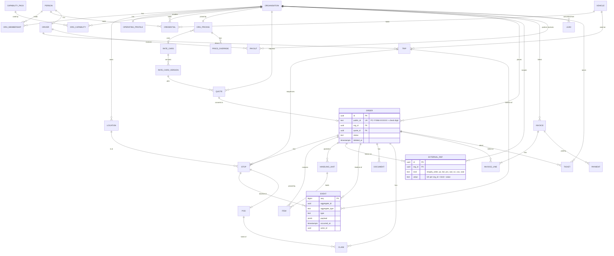

# 83. Core model and UX blueprint (master reconciliation, Phase 0)

Docs only. This doc is the **one canonical entity map** and the **one UX rule set**. Where another doc (04, 14, 43–45, 63, 70–82) uses a different name for the same thing, this doc wins and §1.4 lists the fix. Schemas follow the domain-schema decision (L32, doc 63).

## 1. Canonical entity map

### 1.1 Entities, keys and schema

| Entity                | Table (schema.table)                               | Key / identity                                          | Notes                                                                                                  |
| --------------------- | -------------------------------------------------- | ------------------------------------------------------- | ------------------------------------------------------------------------------------------------------ |
| Organisation          | `org.organisations`                                | uuid; `public_id` ORG-XXXXXX                            | business_type + subtype (70 §1); replaces `merchants`                                                  |
| OrgMembership / Role  | `org.memberships`                                  | (org_id, person_id) PK; role enum                       | SpiceDB holds the permission tuples; the table is the source the tuples are written from               |
| Person                | `identity.persons`                                 | uuid; Keycloak `sub` UK (L36)                           | one person can be a customer, a member of many orgs and a driver                                       |
| Location / Address    | `org.locations`                                    | uuid; per-org label UK                                  | geocode + FSA zone; stops point to a location or an ad-hoc address snapshot                            |
| OperatingProfile      | `org.operating_profiles`                           | org_id PK (1:1)                                         | pickup mode, keys, labels, windows (70 §4)                                                             |
| CapabilityPack        | `org.capability_packs` + `org.org_capabilities`    | pack code PK; (org_id, code) PK                         | C1–C10 and handling profiles (70 §2.2); config, not code                                               |
| Credential            | `org.credentials`                                  | uuid; owner (org / person / vehicle) + kind + number UK | licences, CVOR, insurance certificates, training modules; expiry tracked (80, 82 §0)                   |
| RateCard / Version    | `pricing.rate_cards`, `pricing.rate_card_versions` | code UK; (rate_card_id, version) UK                     | published versions immutable (72 §9)                                                                   |
| OrgPricing / Override | `pricing.org_pricing`, `pricing.price_overrides`   | org_id PK; uuid                                         | default Standard (72 §9.2)                                                                             |
| Quote                 | `ordering.quotes`                                  | uuid; `public_id` Q-YYMM-XXXXXX                         | pins `rate_card_version_id`; valid 72 h                                                                |
| Order                 | `ordering.orders`                                  | uuid; `public_id` **PC-YYMM-XXXXXX + check digit** UK   | one order, 1..n stops                                                                                  |
| Stop                  | `ordering.stops`                                   | uuid; (order_id, seq) UK                                | pickup / drop / return                                                                                 |
| Item / HandlingUnit   | `ordering.order_lines`, `ordering.handling_units`  | uuid; SSCC UK when present                              | replaces `ordering.packages`                                                                           |
| ExternalRef           | `platform.external_refs`                           | uuid; **(org_id, kind, value) UK**                      | Shopify order id, PO, BOL no., PRO, CAD, CCI, COO, seal; replaces `shipment_refs` + `org.external_ref` |
| Trip                  | `dispatch.trips`                                   | uuid; `public_id` T-YYMMDD-NNN                          | driver + vehicle + ordered stops; replaces `dispatch_routes` as the unit of work                       |
| Vehicle               | `dispatch.vehicles`                                | uuid; VIN UK; plate                                     | Civic, rentals per trip (80)                                                                           |
| Driver                | `dispatch.drivers`                                 | person_id PK (1:1 with Person)                          | invite-only (L36)                                                                                      |
| Event (append-only)   | `platform.events`                                  | bigint seq PK; (aggregate_id, version) UK               | **the single source** for timeline, POD, metrics and invoice (§1.3); the outbox relays it              |
| Document              | `platform.documents`                               | uuid; sha256 UK                                         | BOL, CCI, labels, contracts, certificates; object store                                                |
| POD                   | `ordering.pods`                                    | stop_id PK (1:1)                                        | projection of the capture events + hashes                                                              |
| Claim                 | `ordering.claims`                                  | uuid; `public_id` CL-YYMM-XXXX                          | one table for OS&D and other claims; deadlines 60 d / 9 months                                         |
| Invoice               | `billing.invoices`, `billing.invoice_lines`        | uuid; invoice number INV-YYYY-NNNNN UK                  | lines built from events + pinned quote price; never re-priced (72 §9.2)                                |
| Payment               | `billing.payments`                                 | uuid; (method, provider_ref) UK                         | method enum {interac, stripe}; replaces separate interac/stripe tables                                 |
| Payout                | `billing.payouts`, `billing.payout_runs`           | uuid; run id                                            | drivers and partners; Ravi approves the run                                                            |
| Lead                  | `crm.leads`                                        | uuid; (channel, external_id) UK                         | converts to an Organisation (78)                                                                       |
| Ticket                | `support.tickets`                                  | uuid; `public_id` TK-YYMM-XXXX                          | enums per 73                                                                                           |

### 1.2 ER diagram

Rendered to `rendered_l35/83_0.svg` (mermaid-cli 11.17.1, 0 errors).

Cardinalities in short:

- An Organisation has 1 OperatingProfile, 1 OrgPricing, and 0..n of each: memberships, locations, credentials, quotes, orders, invoices, external refs and tickets.
- An Order has 1..n stops and 0..n items, handling units, documents, claims and events. A Quote converts to 0..1 Order.
- A Stop has 0..1 POD. A Trip has 1 driver, 1 vehicle and 1..n stops.
- A Person is 0..1 Driver.

### 1.3 Event-sourced timeline (one source)

- Every state change appends one row to `platform.events`: `(seq, aggregate_type, aggregate_id, version, type, payload, actor_id, occurred_at)`, in the same transaction as the state write (outbox, A15).
- `version` gives optimistic concurrency. Rows are never updated or deleted.
- These read models are **projections of the event log**:
  - the order timeline (portal, Shopify, customer app, 82 §4–§5);
  - the POD and custody log (82 §1);
  - `dispatch.stop_events` (ETA/ATA/ATD, dwell, 70 §2.3);
  - metrics (OTIF, dwell, OS&D, route contribution, doc 79);
  - invoice lines (`order.pod_completed` → `finalize_after_pod`, with the price from the pinned quote).
- A projection can be rebuilt from the log; a rebuild test is A-CM-03.
- Outbound webhooks (74 §4) are delivered from the same events.

### 1.4 Soft delete, audit and privacy

- Business rows carry `created_at`, `created_by`, `updated_at`, `updated_by` and `deleted_at`. Soft delete hides a row; nothing financial or legal is hard-deleted inside its retention period (20 §retention: 6 y for tax and carriage records).
- PII erasure (PIPEDA, Shopify redact) replaces PII fields with tombstones and keeps the keys and amounts.
- `platform.audit_log` records admin actions: pricing (72 §9), contact views (82 §3), impersonation and role changes.

### 1.5 Duplicates and naming clashes found and fixed

| #   | Clash (where)                                                                                                               | Canonical (this doc)                                                                                                                 | Fix applied                   |
| --- | --------------------------------------------------------------------------------------------------------------------------- | ------------------------------------------------------------------------------------------------------------------------------------ | ----------------------------- |
| 1   | `merchant_merchants` / `merchant_members` (63) vs `organisation` / `membership` (70)                                        | `org.organisations`, `org.memberships`                                                                                               | note in 63 → 83               |
| 2   | `ordering_packages` (63) vs `order_lines` + `handling_units` (70 §2.3)                                                      | Item = `order_lines`, HandlingUnit = `handling_units`                                                                                | note in 63                    |
| 3   | `dispatch_routes` (63) vs `dispatch.trips` (70 §2.3, 80, 81)                                                                | Trip; a route is a trip's stop plan                                                                                                  | note in 63                    |
| 4   | `ordering_claims` (63) vs `ordering.osd_claims` (70 §2.3, 81)                                                               | one `ordering.claims` with `type` incl. over/short/damaged                                                                           | 70 §2.3, 81 point to `claims` |
| 5   | `rate_card` / `rate_line` / `rate_card_assignment` (70 §3) vs `rate_cards` / `rate_card_versions` / `org_pricing` (72 §9.5) | schema `pricing` per 72 §9.5; `rate_line` → `versions.lines`; assignment → `org_pricing`                                             | note in 70 §3                 |
| 6   | `ordering.shipment_refs` (70 §2.3) vs `external_ref` (70 §3)                                                                | one `platform.external_refs`, UK (org_id, kind, value)                                                                               | 70 §2.3 note                  |
| 7   | `dispatch.stop_events` (70 §2.3) and `event_outbox` (14, 44, 63) vs an append-only event store                              | `platform.events` (store) + outbox relay; stop_events is a projection                                                                | 70 §2.3 note                  |
| 8   | `identity_users`, `customer_customers` (63) and `person` / `contact` (70)                                                   | Person (`identity.persons`); a customer is a Person with orders; contact = Person without login                                      | 63 note                       |
| 9   | `billing_interac_transfers` + `billing_stripe_payments` (63)                                                                | `billing.payments` (method enum)                                                                                                     | 63 note                       |
| 10  | `crm.companies` / `crm.contacts` (78) vs Organisation / Person                                                              | crm links by FK; a company converts to an Organisation                                                                               | 78 note                       |
| 11  | credentials spread across 80 (vehicle docs), 82 §0 (partner insurance), 70 (`api_credential`)                               | Credential = licences/insurance/training; `api_credential` stays an integration secret (different thing, renamed `integration_keys`) | 70 note                       |

## 2. UX principles

1. **Defaults by business type.** Type + operating profile + packs pre-fill everything (70 §1–§2.2). A new merchant answers ≤ 5 questions.
2. **The system does, the human confirms.** Prices, documents, wizards and routes are generated. A human confirms only exceptions (red margin, seal break, failed delivery) and never re-types data.
3. **Exception-first task queues per role.** Each role lands on "what needs me now", sorted by deadline (§3).
4. **Progressive disclosure.** Advanced options are collapsed (Custom pricing advanced, 72 §9.2; BOL fields only when C1 fires).
5. **One design system and one step engine** across admin web, merchant portal, Shopify (Polaris skin), driver web + mobile (`@porterchain/driver-flows`, 82 §2) and the customer app. Tokens come from `@porterchain/ui` / `mobile-theme`, with the same copy keys.
6. **Targets:**
   - ≤ 3 taps for any driver step and ≤ 7 fields for any form;
   - a merchant books an order in ≤ 4 clicks;
   - Shopify setup takes ≤ 5 steps;
   - the customer finds tracking in ≤ 2 taps.
7. **Empty and error states:**
   - Every list has an empty state with the next action.
   - Errors say what happened, what to do, and keep the input. Offline is a state, not an error.
8. **EN/FR everywhere** (one locale source per surface family) and **AODA / WCAG 2.0 AA**: labels, contrast, 44 px targets, keyboard, screen reader.

## 3. Screen map per role (top 5 flows, taps/clicks from the role's home)

| Role (home)                          | Screens (75 §2 / 82)                                                                     | Top 5 flows (taps)                                                                                                                                              |
| ------------------------------------ | ---------------------------------------------------------------------------------------- | --------------------------------------------------------------------------------------------------------------------------------------------------------------- |
| Super admin (Today)                  | Today, Orders, Dispatch, Network, Customers & Orgs, Billing, Support, Insights, Settings | approve payout run (3) · resolve red-margin exception (3) · switch org to Custom + send quote (4) · publish rate card version (5) · answer escalated ticket (3) |
| Ops dispatcher (Today → Dispatch)    | Today, Orders, Dispatch, Network (read)                                                  | assign unassigned order (2) · re-route a failed stop (3) · adjust an order price within limit (4) · call/chat driver (2) · open OS&D (3)                        |
| Driver (current job)                 | Today, Job, Pay, Inbox/Help, Me (82 §2.2)                                                | accept offer (1) · complete pickup scan (2) · complete a drop wizard (≤ 3 per step) · report a problem (2) · start shift + DVIR (3)                             |
| Merchant (Orders, portal or Shopify) | Orders, New order, Invoices, Settings, Help                                              | book an order (4) · track an order (1) · download invoice (2) · request a quote (3) · change pickup mode (3)                                                    |
| Warehouse clerk (Orders → Dock)      | Orders (dock view), Appointments, Documents                                              | confirm dock appointment (2) · print BOL/labels (2) · record OS&D at receipt (3) · check in a carrier (2) · close a load (3)                                    |
| Accountant (Billing)                 | Billing: Invoices, Payments & Interac matching, Payouts, Exports                         | match an Interac payment (2) · issue a credit note (3) · export the month (2) · chase overdue (2) · approve a payout run (owner only; view 1)                   |
| Customer (tracking, mobile/web)      | Track, Prepare, Instructions, Help, Account                                              | open tracking (≤ 2) · add delivery instructions (3) · see what to prepare (1) · reschedule a failed delivery (3) · delete account (3)                           |

These match 75 §2 (the console menu) and 82 (driver areas, Shopify and customer guidance). The accountant role is the `finance` role in 75.

## 4. Tests

76 §20 (A-CM, A-UX, inside G19).
