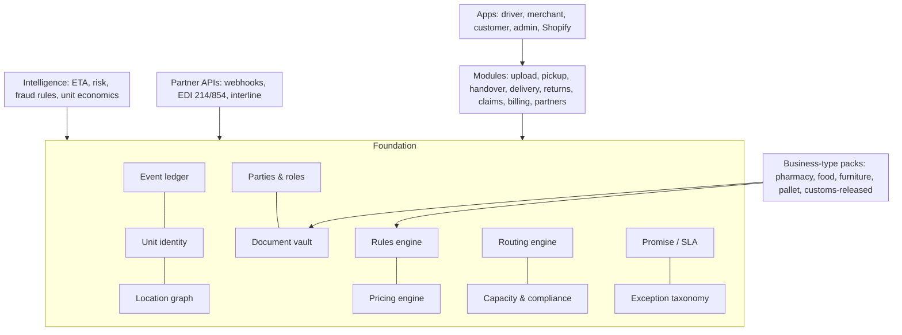

# 84 — First Principles, Foundation, Layers & Scenario Catalogue

Generated 2026-10-29. This doc changes nothing in the locked Phase 0 plan; where research differs, see section 8 (open questions for Ravi). Structure: (1) root primitives and flows, (2) PorterChain core foundation, (3) layers on top, (4) scenario catalogue, (5) PorterChain-way module designs, (6) differentiators, (7) gaps, (8) open questions vs Phase 0, (9) 150 km service area and zone fit. Every layer depends only on the foundation, never on another layer.

## 1. First principles

### 1.1 Root primitives

Everything in courier, last-mile and supply chain reduces to these 11 things.

| #   | Primitive              | Definition                                                                                         | Industry anchor                    |
| --- | ---------------------- | -------------------------------------------------------------------------------------------------- | ---------------------------------- |
| P1  | Shipment / consignment | A promise to move goods from a consignor to a consignee under one contract                         | BOL (VICS), EDI 204 tender         |
| P2  | Handling unit / parcel | A physical thing that can be counted, labelled and scanned; may contain children (pallet > carton) | GS1 SSCC, EDI 856 hierarchy        |
| P3  | Location / node        | A place goods sit or change hands: address, shop, warehouse, depot, vehicle, locker, partner hub   | GLN, address + geocode             |
| P4  | Party / role           | Who acts: shipper, consignee, carrier, driver, broker, partner, payer                              | EDI N1 qualifiers                  |
| P5  | Custody event          | A timestamped, located, evidenced fact that holder X has unit Y                                    | EDI 214 AT7, POD                   |
| P6  | Document               | Evidence attached to a shipment/unit/event: BOL, release, manifest, photo, signature               | BOL, CBSA release, TDG doc         |
| P7  | Movement leg           | One hop of a unit between two nodes by one asset                                                   | Linehaul / last-mile leg           |
| P8  | Capacity / asset       | What can move or hold goods: vehicle, driver hours, depot space, equipment                         | CVOR classes, HOS                  |
| P9  | Time window / promise  | When something must happen, and the SLA behind it                                                  | EDI 214 AB/AG appointment codes    |
| P10 | Price / charge         | Money attached to a shipment, leg or exception (base, accessorial, adjustment, credit)             | NMFC, accessorial schedules        |
| P11 | Exception              | Any deviation from plan: OS&D, refused, attempted, hold, damage                                    | EDI 854 OS/SH/DA, 214 reason codes |

### 1.2 Fundamental flows

| Flow                | Moves                                   | Ledger of truth                                                        |
| ------------------- | --------------------------------------- | ---------------------------------------------------------------------- |
| Goods               | Units across nodes via legs             | Custody events                                                         |
| Information         | Status, ETA, instructions               | Event stream derived from custody + plan                               |
| Money               | Charges, payments, credits, claims      | Charge ledger tied to shipment/leg/exception                           |
| Custody / liability | Who is responsible right now            | Last custody event (liability follows custody: O. Reg 643/05, Carmack) |
| Documents           | Evidence that makes each transfer valid | Document store linked to events                                        |

Rule: every real-world action is one custody event + zero or more documents + zero or more charges. If it is not an event, it did not happen.

## 2. PorterChain core foundation

| Foundation block           | What it is                                                                                                                 | Built on   | Existing code/docs                                                  | Status                                                                                                                         |
| -------------------------- | -------------------------------------------------------------------------------------------------------------------------- | ---------- | ------------------------------------------------------------------- | ------------------------------------------------------------------------------------------------------------------------------ |
| F1 Event ledger            | Append-only, immutable custody/event log (who, what unit, where, when, evidence, device); state = fold of events           | P5, P6     | Outbox/events in 10, 23, 61; audit in 11; custody in 81/82          | covered: `platform.events` append-only single timeline + outbox to Redpanda (00/60); custody-specific event types still to add |
| F2 Universal unit identity | One parcel ID with any number of aliases (PorterChain label, Shopify order, client barcode, SSCC), parent-child containers | P2         | Client-label linking in current driver build; parcel model in 63/83 | partial: aliases being built; no SSCC parent-child                                                                             |
| F3 Location graph          | Nodes (addresses, buildings with units, shops, depots, vehicles, partner hubs) with access notes, geofence, hours          | P3         | Photon geocoding; building grouping in batch build                  | gap: no first-class node/building entity with access notes                                                                     |
| F4 Party & role model      | Organisations, people, roles, permissions, visibility per field                                                            | P4         | Keycloak auth, 09/17 authz, organisation model                      | covered                                                                                                                        |
| F5 Document vault          | Typed documents with required-by rules, linked to events                                                                   | P6         | Doc checklist in current build                                      | partial                                                                                                                        |
| F6 Rules engine            | Deterministic, versioned rules: (business type, risk, unit flags, event) -> required steps, docs, notifications, blocks    | P11 + all  | Per-type rules in 81/82, guided flows definition                    | partial: rules exist per flow, not a single versioned engine                                                                   |
| F7 Pricing engine          | Rate card + custom pricing + accessorials + adjustments, all as charge events                                              | P10        | 72 pricing, unified pricing engine                                  | covered                                                                                                                        |
| F8 Routing engine          | Self-hosted VROOM + Valhalla (per plan): capacities, windows, waves, handovers, live re-plan                               | P7, P8, P9 | ROUTE_OPTIMIZATION tests, 61, current build                         | partial: in build                                                                                                              |
| F9 Capacity & compliance   | Vehicles, drivers, hours, equipment tags, expiry gates                                                                     | P8         | 80 vehicle compliance                                               | partial: equipment tags missing                                                                                                |
| F10 Promise / SLA          | Time windows, cut-offs, ETAs, SLA credits                                                                                  | P9         | Time windows in routing                                             | partial                                                                                                                        |
| F11 Exception taxonomy     | One code list mapped to EDI 214/854 + Amazon-style reason codes                                                            | P11        | Exceptions scattered by flow                                        | gap                                                                                                                            |

## 3. Layers on top (depend only on the foundation)

| Layer                            | Examples                                                                                       | Uses                          |
| -------------------------------- | ---------------------------------------------------------------------------------------------- | ----------------------------- |
| L1 Business-type packs           | Pharmacy, bakery/food, flowers, Shopify, furniture, warehouse/pallet, customs-released         | F6 rules + F5 docs + F2 flags |
| L2 Modules                       | Bulk upload, pickup, handover, delivery, returns, claims, billing, leads, partners, compliance | F1–F11                        |
| L3 Apps                          | Driver web + mobile, merchant, customer, admin console, Shopify app                            | L2 via APIs                   |
| L4 Partner APIs                  | Webhooks, EDI 214/854 export, carrier interline                                                | F1 events + F11 codes         |
| L5 Intelligence (no external AI) | ETA prediction, risk scoring, fraud rules, unit economics                                      | F1 history + F7 + F8          |

## 4. Scenario catalogue (layer: each rule = foundation rules-engine entry)

### Documents

| ID     | Scenario                                      | Trigger                                        | Who                       | Industry practice                                                              | Src  | PorterChain rule                                                                                | Notify                                                                                                                          | Driver UI                | Data                                            | Phase                                                                     | Status  |
| ------ | --------------------------------------------- | ---------------------------------------------- | ------------------------- | ------------------------------------------------------------------------------ | ---- | ----------------------------------------------------------------------------------------------- | ------------------------------------------------------------------------------------------------------------------------------- | ------------------------ | ----------------------------------------------- | ------------------------------------------------------------------------- | ------- |
| SC-001 | BOL missing at warehouse/pallet pickup        | Shipper has no bill of lading                  | Driver, shipper, dispatch | LTL carriers refuse or create carrier BOL; VICS BOL standard                   | vics | 643                                                                                             | No paper needed: PorterChain issues e-BOL from order; shipper signs on driver device; paper BOL photographed if shipper insists | Shipper, admin           | Pickup > Docs checklist > Generate e-BOL > Sign | Consignor, consignee, pieces, weight, NMFC class optional, declared value | P0      | partial |
| SC-002 | BOL piece count differs from freight          | Count on BOL != counted pieces                 | Driver, shipper           | Carrier notes exception on BOL before signing (OS&D)                           | osd  | 854                                                                                             | Driver records actual count; BOL auto-annotated "subject to count"; shipper must co-sign or pickup blocked                      | Shipper, admin, merchant | Count > mismatch > reason > co-sign             | Expected vs actual, photo                                                 | P0      | partial |
| SC-003 | Packing list/commercial invoice required      | Business type rule requires packing list       | Driver, shipper           | Carriers attach docs pouch to lead piece                                       | amzv | Doc checklist per business type; scan/photo stored on order; missing = block or admin waiver    | Admin                                                                                                                           | Docs checklist step      | Doc type, image, OCR-free fields typed          | P0                                                                        | partial |
| SC-004 | Customs release proof needed                  | Pickup of imported goods from broker/warehouse | Driver, broker, merchant  | Released only on CBSA release (CRL/B3-3/RMD); CLVS courier holds until release | clvs | cbsa                                                                                            | Only released goods: require release number/CCN + image before pickup unlock; else reject job                                   | Merchant, admin          | Docs > Customs release scan                     | CCN, transaction no., release date                                        | P0      | partial |
| SC-005 | Customs hold after pickup                     | CBSA intervention up to delivery               | Admin, merchant           | CBSA may intervene until delivery to addressee                                 | clvs | Freeze parcel (status HOLD-CUSTOMS), return to depot, no delivery until cleared                 | Merchant, admin, driver                                                                                                         | Scan shows STOP: hold    | Hold reason, officer ref                        | Later                                                                     | gap     |
| SC-006 | TDG shipping document required                | Fully regulated DG offered                     | Shipper, driver           | Carrier requires TDG shipping doc + trained driver                             | tdg  | tdgm                                                                                            | Phase 0 refuse fully regulated DG; accept limited quantity only with LQ mark photo and ≤30 kg                                   | Merchant, admin          | Pickup DG question + LQ mark photo              | UN no, LQ flag, gross kg                                                  | P0      | partial |
| SC-007 | Pharmacy custody/manifest form                | Pharmacy batch handover                        | Pharmacist, driver        | Pharmacies keep signed delivery logs; narcotics need tighter custody           | cdsa | ocp                                                                                             | Digital custody manifest signed by pharmacy staff at pickup and recipient at delivery; narcotic flag forces ID+signature        | Pharmacy, admin          | Manifest sign screen                            | Rx no. masked, patient initials, sig                                      | P0      | covered |
| SC-008 | Seal number on trailer/cage                   | Sealed cage or vehicle                         | Driver, shipper, receiver | Seal numbers on BOL; seal intact check at receipt                              | osd  | Seal no. captured at pickup and verified at delivery; mismatch = OS&D incident                  | Admin, shipper                                                                                                                  | Seal entry + photo       | Seal ID                                         | Later                                                                     | partial |
| SC-009 | Proof of delivery dispute needs document pack | Merchant asks for POD                          | Merchant, support         | Carriers provide POD letter with signature image                               | ups  | Self-serve POD PDF: photo, GPS, time, signer, scan trail generated on demand                    | Merchant                                                                                                                        | n/a                      | Event log                                       | P0                                                                        | partial |
| SC-010 | Lost/illegible paper docs                     | Paper damaged                                  | Driver                    | Carriers re-request copies                                                     | osd  | Zero-paper default; every doc captured as image at the step it is received                      | Admin                                                                                                                           | Auto                     | Images                                          | P0                                                                        | partial |
| SC-011 | Alcohol/age-restricted paperwork              | Order flagged age-restricted                   | Driver, customer          | Ontario AGCO: ID check, refuse intoxicated/minor, return product               | agco | Phase 0 accept only from licensed merchants; ID check DOB scan-free entry; refusal returns item | Merchant                                                                                                                        | ID check step            | DOB, ID type                                    | Later                                                                     | partial |
| SC-012 | Food business traceability                    | Food merchant shipments                        | Merchant                  | SFCR traceability one step forward/back                                        | sfcr | Keep shipment lot/ref and time-temp log on order for 2 years                                    | Merchant                                                                                                                        | n/a                      | Lot ref                                         | Later                                                                     | gap     |

### Orders

| ID     | Scenario                               | Trigger                            | Who                 | Industry practice                                 | Src  | PorterChain rule                                                                         | Notify                                                        | Driver UI             | Data                 | Phase  | Status  |
| ------ | -------------------------------------- | ---------------------------------- | ------------------- | ------------------------------------------------- | ---- | ---------------------------------------------------------------------------------------- | ------------------------------------------------------------- | --------------------- | -------------------- | ------ | ------- |
| SC-013 | Bulk CSV upload of 75-80 stops         | Merchant uploads list              | Merchant, ops       | Carriers accept manifests/EDI 204 or CSV batches  | 214  | Validate, geocode (Photon), dedupe, group same building, create batch + parcels + labels | Merchant                                                      | n/a                   | CSV rows             | P0     | covered |
| SC-014 | Bad/ungeocodable address               | Geocoder low confidence            | Merchant, customer  | Carriers use address correction and charge fee    | ups  | Block at upload; ask merchant or customer to confirm pin via link before dispatch        | Merchant, customer                                            | n/a                   | Confidence score     | P0     | partial |
| SC-015 | Duplicate order                        | Same address+ref twice             | Merchant            | Dedupe by reference                               | 214  | Soft-warn duplicates on upload; require confirm                                          | Merchant                                                      | n/a                   | Hash                 | P0     | gap     |
| SC-016 | Order cancelled after pickup           | Merchant cancels                   | Merchant, driver    | Carriers charge return (RTS) fee                  | 214  | Cancel converts to return-to-sender leg, priced at rate card                             | Driver, merchant                                              | Scan shows RETURN     | Reason               | P0     | partial |
| SC-017 | Order changed mid-route (address/time) | Customer edits                     | Customer, driver    | UPS My Choice/redirect for fee                    | ups  | Allowed until out-for-delivery; within radius re-route live, else fee or next day        | Driver, merchant                                              | Route refresh banner  | New addr             | P0     | gap     |
| SC-018 | Partial order ready                    | Not all parcels ready              | Shipper, driver     | Carriers split shipment, partial pickup           | 214  | Pick ready parcels; remainder auto-scheduled second pickup                               | Merchant, admin                                               | Partial pickup toggle | Ready count          | P0     | partial |
| SC-019 | Recurring route                        | Same stops weekly                  | Merchant            | Contract routes                                   | 214  | Template batch + schedule; reuse optimized sequence                                      | Merchant                                                      | n/a                   | Template             | Later  | gap     |
| SC-020 | Scheduled/appointment delivery         | Receiver requires appointment      | Receiver            | EDI 214 AB appointment codes; LTL appointment fee | 214  | 1651                                                                                     | Time-window constraints in VRP; appointment confirmation link | Customer              | Window shown on stop | Window | P0      | partial |
| SC-021 | Same-day cut-off missed                | Order after cut-off                | Merchant            | Past cut-off code AW                              | 1651 | Auto-roll to next slot with notice; express upcharge option                              | Merchant                                                      | n/a                   | Cut-off              | P0     | partial |
| SC-022 | COD / collect payment                  | Order requires payment             | Customer            | DSP PaymentNotReady code                          | dsp  | Phase 0: no cash; prepaid online only                                                    | Merchant                                                      | n/a                   | n/a                  | P0     | covered |
| SC-023 | Order from Shopify with wrong weight   | Declared weight low                | Merchant            | Carriers reweigh/redim and adjust bill            | nmfc | Driver flags size band on scan; auto price adjustment with photo evidence                | Merchant                                                      | Size check            | Photo, band          | P0     | partial |
| SC-024 | Multi-pickup single drop consolidation | Customer orders from several shops | Merchants, customer | Consolidation at hub                              | 214  | Allowed; each parcel keeps own handling; one delivery stop                               | Customer                                                      | Grouped stop          | Parcel set           | Later  | partial |

### Parcels & containers

| ID     | Scenario                                  | Trigger                     | Who              | Industry practice                             | Src  | PorterChain rule                                                                | Notify                                                                             | Driver UI           | Data           | Phase          | Status  |
| ------ | ----------------------------------------- | --------------------------- | ---------------- | --------------------------------------------- | ---- | ------------------------------------------------------------------------------- | ---------------------------------------------------------------------------------- | ------------------- | -------------- | -------------- | ------- |
| SC-025 | Unlabelled parcel                         | No label at pickup          | Driver           | Carrier refuses or labels at counter          | amzv | Print/attach PorterChain label from app (Bluetooth printer) or write short code | Admin                                                                              | Label now           | Parcel ID      | P0             | gap     |
| SC-026 | Client label only (Shopify/other barcode) | Client barcode              | Driver           | Carriers relabel                              | amzv | Scan any barcode; link to parcel via upload or first scan                       | Admin                                                                              | Scan > link         | External code  | P0             | covered |
| SC-027 | Duplicate label                           | Same barcode on two parcels | Driver           | Exception, hold                               | osd  | Exception; driver looks up by address; second parcel held                       | Admin                                                                              | Exception screen    | Codes          | P0             | covered |
| SC-028 | Unknown label                             | Barcode not in system       | Driver           | Overage handling                              | osd  | Treat as overage; photo; hold; admin matches                                    | Admin, merchant                                                                    | Exception           | Photo          | P0             | covered |
| SC-029 | Pallet/cage/tote with SSCC                | Containerised freight       | Shipper, driver  | GS1 SSCC per pallet/carton, ASN 856 hierarchy | gs1  | amzv                                                                            | Count containers, not boxes; SSCC parent-child known from upload; scan parent once | Admin               | Scan container | SSCC, children | Later   | partial |
| SC-030 | Oversize/overweight for Civic             | Exceeds vehicle capacity    | Dispatch         | Carriers reject or reassign to LTL            | nmfc | Capacity check at booking; auto reassign bigger vehicle or split                | Merchant, admin                                                                    | Blocked with reason | Dims, kg       | P0             | partial |
| SC-031 | Fragile/upright/keep cold                 | Handling flag               | Driver           | Handling labels                               | gdp  | Scan shows handling instruction; loading position                               | Driver                                                                             | Scan guidance       | Flags          | P0             | covered |
| SC-032 | Two-person carry/furniture                | Heavy item                  | Driver           | White-glove 2-man service                     | nmfc | Rule: >32 kg or flagged = 2 drivers or refuse in P0                             | Admin                                                                              | Blocked             | kg             | Later          | gap     |
| SC-033 | Damaged at pickup                         | Visible damage              | Driver, shipper  | Note on BOL, refuse or accept with exception  | osd  | Photo + accept-with-exception or refuse; shipper signs                          | Shipper, merchant                                                                  | Damage step         | Photos         | P0             | partial |
| SC-034 | Leaking/suspicious parcel                 | Leak, smell                 | Driver           | Isolate, refuse, DG protocol                  | tdgm | Stop, isolate, do not deliver, admin call; return                               | Admin, merchant                                                                    | Safety stop         | Photo          | P0             | gap     |
| SC-035 | Perishable expiry                         | Cake/flowers/food delay     | Driver           | Time-critical handling                        | sfcr | Priority in VRP; max time-in-vehicle; if exceeded call merchant                 | Merchant                                                                           | Timer               | Max mins       | P0             | partial |
| SC-036 | Cold chain excursion                      | Temp out of range           | Driver, pharmacy | GUI-0069: investigate, report excursions      | gdp  | Logger/cooler check; excursion = quarantine and return to pharmacy              | Pharmacy, admin                                                                    | Temp entry          | Temp log       | Later          | partial |
| SC-037 | Recall/quarantine                         | Merchant recalls item       | Merchant         | Hold shipments in network                     | gdp  | Bulk hold by SKU/batch; drivers see STOP on scan                                | Driver, admin                                                                      | Scan STOP           | Batch          | Later          | gap     |

### Pickup

| ID     | Scenario                                | Trigger                       | Who              | Industry practice                                          | Src  | PorterChain rule                                                     | Notify   | Driver UI           | Data             | Phase | Status  |
| ------ | --------------------------------------- | ----------------------------- | ---------------- | ---------------------------------------------------------- | ---- | -------------------------------------------------------------------- | -------- | ------------------- | ---------------- | ----- | ------- |
| SC-038 | Bulk pickup count-not-scan              | ≥10 low-risk parcels          | Driver, shipper  | Pickup scans by piece in parcel; LTL counts handling units | osd  | Count + one photo + 3-5 random scans; any miss = full scan           | Merchant | Count > random scan | Counts           | P0    | covered |
| SC-039 | High-risk pickup full scan              | Pharmacy, high value, customs | Driver           | Piece-level scan                                           | cdsa | Every parcel scanned                                                 | Admin    | Full scan           | Scans            | P0    | covered |
| SC-040 | Shipper closed/not ready                | Arrive, closed                | Driver, shipper  | Missed pickup (AY), attempt fee                            | 1651 | Wait 10 min with geofence proof; attempt fee; reschedule             | Merchant | Attempted pickup    | GPS, photo       | P0    | partial |
| SC-041 | Pickup from residence (C2C/returns)     | Home pickup                   | Customer, driver | Canada Post/UPS pickup                                     | cp   | OTP code from sender; photo                                          | Customer | OTP                 | OTP              | P0    | partial |
| SC-042 | Pickup from another driver              | Handover                      | Drivers A/B      | Hub transfer scans                                         | 214  | B locked until A confirms pickup; then unlock and re-plan            | Driver B | Locked job          | Custody log      | P0    | covered |
| SC-043 | Driver arrives without needed equipment | Cooler/dolly missing          | Driver           | Equipment requirements on tender                           | gdp  | Job requires equipment tags; dispatch filters drivers                | Admin    | Equipment check     | Tags             | P0    | gap     |
| SC-044 | Long wait/detention at shipper          | Wait > free time              | Driver, shipper  | Detention charges after free time                          | nmfc | 15 min free, then per-minute detention billed automatically          | Merchant | Timer               | Arrive/leave GPS | Later | gap     |
| SC-045 | Over-tender (more parcels than booked)  | Extra parcels                 | Driver, shipper  | Charge or refuse                                           | osd  | Accept within vehicle capacity, auto-bill extras; else second pickup | Merchant | Count > extra       | Count            | P0    | partial |

### Linehaul, cross-dock & handover

| ID     | Scenario                        | Trigger                  | Who          | Industry practice                      | Src | PorterChain rule                                                                                 | Notify            | Driver UI       | Data       | Phase | Status  |
| ------ | ------------------------------- | ------------------------ | ------------ | -------------------------------------- | --- | ------------------------------------------------------------------------------------------------ | ----------------- | --------------- | ---------- | ----- | ------- |
| SC-046 | Depot sort by zone              | Consolidated pickup      | Ops, drivers | Hub-and-spoke sort                     | 214 | Depot scan in/out per parcel; sort by route                                                      | Admin             | Depot mode      | Scans      | Later | partial |
| SC-047 | Driver-to-driver meet handover  | Transfer en route        | Drivers      | Transfer scans                         | 214 | Both confirm count/photo/location; custody moves                                                 | Both drivers      | Handover screen | Custody    | P0    | covered |
| SC-048 | Handover count mismatch         | B counts fewer           | Drivers      | OS&D                                   | 854 | Shortage incident; A route-trace; admin                                                          | Admin             | Exception       | Counts     | P0    | partial |
| SC-049 | Missort (parcel on wrong route) | Scan not on route        | Driver       | Missort recovery                       | osd | Scan says "not yours": hand to named driver or depot                                             | Admin             | Scan guidance   | Route      | P0    | covered |
| SC-050 | Partner/subcontractor linehaul  | Use partner              | Partner      | Interline with connecting carrier (J1) | 214 | Partner must accept terms, scans via partner portal; custody recorded                            | Partner, merchant | Partner portal  | Partner ID | Later | partial |
| SC-051 | Overnight hold in vehicle       | Undelivered at shift end | Driver       | Return to terminal                     | 214 | No overnight in car for pharmacy/cold; others return to depot or driver-hold with admin approval | Admin             | End-of-shift    | Location   | P0    | gap     |

### Routing & dispatch

| ID     | Scenario                       | Trigger             | Who      | Industry practice     | Src  | PorterChain rule                                                 | Notify                                                 | Driver UI     | Data         | Phase | Status  |
| ------ | ------------------------------ | ------------------- | -------- | --------------------- | ---- | ---------------------------------------------------------------- | ------------------------------------------------------ | ------------- | ------------ | ----- | ------- |
| SC-052 | Large batch splitting          | 78 stops > capacity | Dispatch | VRP with capacities   | 214  | VROOM + Valhalla (per plan) self-hosted split into waves/drivers | Drivers                                                | Route         | Weights      | P0    | covered |
| SC-053 | Driver late/behind             | ETA slips           | Dispatch | Live re-plan          | 214  | Re-plan, move stops to nearest driver, notify customers new ETA  | Customer, merchant                                     | Banner        | ETA          | P0    | covered |
| SC-054 | Driver no-show                 | Driver doesnt start | Dispatch | Backup pool           | 214  | Auto-offer to standby list after 10 min                          | Admin                                                  | n/a           | Status       | P0    | partial |
| SC-055 | Rush-hour/road closure         | Traffic             | Dispatch | Traffic-aware routing | 214  | Time-of-day speed profiles + closure feed (city open data)       | Driver                                                 | Reroute       | Closures     | Later | partial |
| SC-056 | Clashing time windows          | Infeasible          | Dispatch | Dispatcher decides    | 214  | Solver flags infeasible stops for admin decision                 | Admin                                                  | n/a           | Windows      | P0    | covered |
| SC-057 | New urgent order mid-route     | Insert              | Dispatch | Dynamic insertion     | 214  | Insert if capacity and windows allow                             | Driver                                                 | Insert banner | n/a          | P0    | covered |
| SC-058 | Driver hours limit             | Shift too long      | Dispatch | HOS (>4,500 kg) / ESA | hos  | esa                                                              | Shift caps + breaks enforced in dispatch even for cars | Driver        | Break prompt | Hours | P0      | covered |
| SC-059 | Vehicle capacity type mismatch | Van needed          | Dispatch | Equipment matching    | nmfc | Vehicle class check                                              | Admin                                                  | n/a           | Vehicle      | P0    | covered |

### Delivery

| ID     | Scenario                                 | Trigger         | Who                | Industry practice                     | Src  | PorterChain rule                                              | Notify                                                                                              | Driver UI          | Data                   | Phase         | Status  |
| ------ | ---------------------------------------- | --------------- | ------------------ | ------------------------------------- | ---- | ------------------------------------------------------------- | --------------------------------------------------------------------------------------------------- | ------------------ | ---------------------- | ------------- | ------- |
| SC-060 | Recipient not home                       | No answer       | Driver, customer   | Notice card, reattempt, hold at depot | cp   | dsp                                                           | Call/text in-app masked; safe-place if merchant allows; else reattempt same route later or next day | Customer, merchant | Attempt > reason codes | Reason, photo | P0      | partial |
| SC-061 | Building access/buzzer                   | No access       | Driver             | UnableToAccess code                   | dsp  | Access notes per address saved; call recipient; attempt       | Customer                                                                                            | Access info        | Notes                  | P0            | partial |
| SC-062 | Same building multi-unit                 | Several parcels | Driver             | Building stop grouping                | 214  | One stop, per-parcel scan, per-unit proof                     | Customers                                                                                           | Grouped stop       | Units                  | P0            | covered |
| SC-063 | Wrong address delivered                  | Misdelivery     | Driver, customer   | Carrier investigation                 | ups  | Geofence check at scan (warn if >150 m); retrieval task       | Admin, customer                                                                                     | Warn               | GPS                    | P0            | partial |
| SC-064 | Refused by consignee                     | Refused         | Customer           | A7 refused                            | 214  | Record reason, return to sender, fee                          | Merchant                                                                                            | Refused            | Reason                 | P0            | covered |
| SC-065 | Signature required, not available        | Sig needed      | Customer           | Reattempt                             | ups  | No safe drop; reattempt                                       | Customer                                                                                            | Block safe drop    | Flag                   | P0            | covered |
| SC-066 | ID check fail                            | Rx/alcohol      | Customer           | Return product                        | agco | cdsa                                                          | No release; return to pharmacy same day                                                             | Pharmacy           | ID step                | ID result     | P0      | covered |
| SC-067 | Delivered but customer says not received | Claim           | Customer, merchant | Carrier trace, POD                    | ups  | Auto-pack: photo, GPS, time; 48 h investigation; refund rules | Merchant                                                                                            | n/a                | POD                    | P0            | partial |
| SC-068 | Dangerous location (dog, threat)         | Unsafe          | Driver             | Driver refuses, note                  | ohsa | Driver may abort; address flagged                             | Admin                                                                                               | Unsafe button      | Flag                   | P0            | gap     |
| SC-069 | Deceased/vacant/business closed          | Cannot deliver  | Driver             | Carrier codes BusinessClosed etc      | dsp  | Standard reason codes; return                                 | Merchant                                                                                            | Reason             | Code                   | P0            | partial |
| SC-070 | Partial delivery                         | Some parcels    | Driver             | Actual vs expected pieces             | ups  | Record delivered count; remaining returned                    | Merchant                                                                                            | Count              | Pieces                 | P0            | partial |
| SC-071 | Delivery to locker/neighbour             | Alt location    | Driver             | Alternate delivery                    | cp   | Only if merchant/customer allows; record where                | Customer                                                                                            | Alt location       | Location               | Later         | partial |

### Failed, return & reverse

| ID     | Scenario                   | Trigger              | Who      | Industry practice             | Src  | PorterChain rule                                             | Notify   | Driver UI   | Data        | Phase | Status  |
| ------ | -------------------------- | -------------------- | -------- | ----------------------------- | ---- | ------------------------------------------------------------ | -------- | ----------- | ----------- | ----- | ------- |
| SC-072 | Return to sender (RTS)     | Failed max attempts  | Driver   | A3 returned to shipper        | 214  | After 2 attempts or customer refusal, RTS on next route; fee | Merchant | RTS list    | Attempts    | P0    | covered |
| SC-073 | Customer return pickup     | Return request       | Customer | Return labels/QR              | cp   | QR return code; pickup on existing route                     | Merchant | Return scan | QR          | P0    | partial |
| SC-074 | Exchange swap at door      | Swap                 | Customer | Exchange service              | ups  | Deliver new + collect old in one stop                        | Merchant | Swap step   | Two parcels | Later | gap     |
| SC-075 | Abandoned/unclaimed parcel | No instructions 30 d | Merchant | Disposal after holding period | cbsa | Hold 30 days, then notify and dispose/donate per terms       | Merchant | n/a         | Hold date   | Later | gap     |
| SC-076 | Pharmacy undelivered meds  | Rx fail              | Pharmacy | Return same day to pharmacy   | ocp  | Never held overnight; return                                 | Pharmacy | Return      | Custody     | P0    | partial |

### Payments & billing

| ID     | Scenario                        | Trigger               | Who               | Industry practice          | Src  | PorterChain rule                                                | Notify   | Driver UI | Data         | Phase | Status  |
| ------ | ------------------------------- | --------------------- | ----------------- | -------------------------- | ---- | --------------------------------------------------------------- | -------- | --------- | ------------ | ----- | ------- |
| SC-077 | Price adjustment after reweigh  | Size band wrong       | Merchant          | Carrier invoice adjustment | nmfc | Photo-backed auto adjustment; merchant can dispute in 14 days   | Merchant | n/a       | Evidence     | P0    | partial |
| SC-078 | Billing dispute                 | Merchant disputes     | Merchant, finance | Dispute window             | ups  | Self-serve dispute with evidence pack; SLA 5 business days      | Finance  | n/a       | Invoice line | P0    | partial |
| SC-079 | Card chargeback                 | Customer charges back | Finance           | Chargeback evidence        | ups  | Auto evidence pack (POD)                                        | Finance  | n/a       | POD          | P0    | partial |
| SC-080 | Failed payment / credit limit   | Merchant overdue      | Finance           | Account holds              | ups  | Auto suspend new bookings after limit; in-flight completes      | Merchant | n/a       | Balance      | P0    | partial |
| SC-081 | Accessorial fees                | Wait, attempts, RTS   | Merchant          | Accessorial schedule       | nmfc | Transparent accessorial list in rate card, shown before booking | Merchant | n/a       | Fees         | P0    | partial |
| SC-082 | Late delivery service guarantee | Missed SLA            | Merchant          | Money-back guarantee       | ups  | Auto credit when SLA missed for reasons in our control          | Merchant | n/a       | SLA          | Later | gap     |

### Claims

| ID     | Scenario                   | Trigger              | Who      | Industry practice                                            | Src | PorterChain rule                                                                                                                                            | Notify                                                                                  | Driver UI       | Data                  | Phase           | Status                    |
| ------ | -------------------------- | -------------------- | -------- | ------------------------------------------------------------ | --- | ----------------------------------------------------------------------------------------------------------------------------------------------------------- | --------------------------------------------------------------------------------------- | --------------- | --------------------- | --------------- | ------------------------- |
| SC-083 | Loss claim                 | Parcel lost          | Merchant | Carmack 9 months; O. Reg 643/05 notice 60 days, $4.41/kg cap | 370 | 643                                                                                                                                                         | Claim portal; liability = lesser of value or $4.41/kg unless declared value; ack 3 days | Merchant, admin | n/a                   | Value, evidence | P0                        | partial |
| SC-084 | Damage claim               | Damaged              | Merchant | OS&D, keep packaging                                         | osd | 370                                                                                                                                                         | Photos at each scan; keep packaging; decision in 10 business days                       | Merchant        | n/a                   | Photos          | P0                        | partial |
| SC-085 | Concealed damage           | Found after delivery | Customer | Concealed damage notice promptly                             | osd | Report within 5 days with photos                                                                                                                            | Merchant                                                                                | n/a             | Photos                | P0              | gap                       |
| SC-086 | Declared value / insurance | High value           | Merchant | Declared value surcharge                                     | 643 | Optional declared-value cover: 1.5% (min $3) per parcel, max $2,500, exclusions, proof of value; +HST; off until G-INS (super-admin `cargo_insurance` gate) | Merchant                                                                                | n/a             | Value, proof of value | P0              | partial (built, flag off) |
| SC-087 | Fraudulent claim           | Pattern              | Admin    | Fraud screening                                              | ups | Rule engine: claim rate per customer/address, photo trail                                                                                                   | Admin                                                                                   | n/a             | History               | Later           | gap                       |

### Safety & compliance

| ID     | Scenario                         | Trigger              | Who      | Industry practice        | Src  | PorterChain rule                                       | Notify                                                    | Driver UI     | Data       | Phase | Status  |
| ------ | -------------------------------- | -------------------- | -------- | ------------------------ | ---- | ------------------------------------------------------ | --------------------------------------------------------- | ------------- | ---------- | ----- | ------- |
| SC-088 | CVOR threshold                   | Vehicle >4,500 kg    | Admin    | CVOR required            | cvor | Block registration of vehicles >4,500 kg until CVOR    | Admin                                                     | Vehicle setup | RGW        | P0    | covered |
| SC-089 | Hours of service                 | Heavy vehicle        | Admin    | O. Reg 555/06, FMCSA     | hos  | fmcsa                                                  | Track hours all vehicles; enforce HOS for >4,500 kg later | Driver        | Hours      | Logs  | P0      | covered |
| SC-090 | Driver licence/insurance expiry  | Doc expiry           | Driver   | Carrier compliance files | cvor | Auto-suspend on expiry; 30-day reminders               | Driver, admin                                             | Banner        | Expiry     | P0    | covered |
| SC-091 | Controlled substances in transit | Narcotics            | Pharmacy | CDSA custody             | cdsa | Narcotics require trained driver, ID+sig, no safe drop | Pharmacy                                                  | Flags         | Flag       | P0    | covered |
| SC-092 | DG limited quantity              | LQ goods             | Merchant | TDG 1.17                 | tdg  | Accept ≤30 kg with mark                                | Admin                                                     | LQ check      | Mark photo | P0    | partial |
| SC-093 | Workplace injury                 | Driver hurt          | Driver   | OHSA/WSIB reporting      | ohsa | Incident form, admin alert, job reassignment           | Admin                                                     | SOS           | Report     | P0    | partial |
| SC-094 | Distracted driving               | App use while moving | Driver   | Hands-free laws          | ohsa | Lock interactive UI above 10 km/h                      | Driver                                                    | Locked UI     | Speed      | P0    | gap     |

### Data & privacy

| ID     | Scenario                         | Trigger          | Who      | Industry practice          | Src    | PorterChain rule                                                          | Notify   | Driver UI | Data     | Phase | Status  |
| ------ | -------------------------------- | ---------------- | -------- | -------------------------- | ------ | ------------------------------------------------------------------------- | -------- | --------- | -------- | ----- | ------- |
| SC-095 | Customer PII exposure to driver  | Driver sees data | Driver   | Masked contacts            | pipeda | Mask phone; show data only for active stop; purge after 30 days on device | n/a      | Masked    | n/a      | P0    | partial |
| SC-096 | Photo captures faces/inside home | POD photo        | Customer | Carrier photo policy       | pipeda | Photo guidance; blur check manual; retention 1 year                       | n/a      | Guide     | Photo    | P0    | partial |
| SC-097 | Privacy breach                   | Leak             | Admin    | PIPEDA breach report RROSH | breach | Breach runbook: report OPC + notify                                       | Admin    | n/a       | Log      | P0    | covered |
| SC-098 | Data access request              | Customer asks    | Customer | PIPEDA access 30 days      | pipeda | Self-serve export                                                         | Customer | n/a       | Data     | Later | partial |
| SC-099 | Rx data minimisation             | Pharmacy         | Pharmacy | PHIPA                      | ocp    | Only initials + masked Rx no.                                             | Pharmacy | n/a       | Min data | P0    | covered |

### Partners & subcontracting

| ID     | Scenario                              | Trigger     | Who             | Industry practice     | Src    | PorterChain rule                                      | Notify   | Driver UI    | Data             | Phase | Status  |
| ------ | ------------------------------------- | ----------- | --------------- | --------------------- | ------ | ----------------------------------------------------- | -------- | ------------ | ---------------- | ----- | ------- |
| SC-100 | Partner drivers capacity overflow     | Peak        | Partner         | Subcontract DSP model | dsp    | Partner onboarding with insurance + KPIs; same app    | Partner  | Same app     | Contract         | Later | partial |
| SC-101 | Partner breaches SLA                  | Missed      | Partner         | Scorecards            | dsp    | Auto scorecard; volume reduces                        | Partner  | n/a          | KPIs             | Later | gap     |
| SC-102 | Partner sees merchant pricing         | Data leak   | Partner         | Need-to-know          | pipeda | Role-based hide                                       | n/a      | n/a          | Roles            | P0    | covered |
| SC-103 | Interline handoff to national carrier | Outside GTA | Partner carrier | Connecting line J1    | 214    | Hand to carrier with their label; track via API later | Merchant | Handoff scan | Carrier tracking | Later | gap     |

### Weather, vehicle & driver incidents

| ID     | Scenario                  | Trigger         | Who    | Industry practice            | Src  | PorterChain rule                                  | Notify                                         | Driver UI        | Data     | Phase  | Status  |
| ------ | ------------------------- | --------------- | ------ | ---------------------------- | ---- | ------------------------------------------------- | ---------------------------------------------- | ---------------- | -------- | ------ | ------- |
| SC-104 | Snowstorm                 | Weather warning | All    | Weather delay codes          | 1651 | Auto delay notices; reduce capacity; safety pause | Customers                                      | Banner           | Alert    | P0     | partial |
| SC-105 | Vehicle breakdown         | Breakdown       | Driver | AI mechanical breakdown code | 1651 | Rescue driver handover; re-plan                   | Customers                                      | Breakdown button | Location | P0     | partial |
| SC-106 | Accident                  | Collision       | Driver | AF accident code; report     | 1651 | ohsa                                              | SOS, police if needed, parcels secured, rescue | Admin, insurer   | SOS      | Report | P0      | partial |
| SC-107 | Theft from vehicle        | Theft           | Driver | Police report, claim         | osd  | Lock rule; report; claims                         | Merchant                                       | Theft report     | Parcels  | P0     | gap     |
| SC-108 | Phone dead/offline        | No signal       | Driver | Offline scanning             | ups  | Offline queue syncs; paper fallback code          | Admin                                          | Offline mode     | Queue    | P0     | covered |
| SC-109 | Driver quits mid-route    | Abandon         | Driver | Rescue                       | 214  | Nearest driver rescue with handover               | Admin                                          | n/a              | Custody  | P0     | covered |
| SC-110 | Parking ticket/no parking | Downtown        | Driver | Carrier pays fines           | ohsa | Stop-time model includes parking; fines policy    | Driver                                         | n/a              | n/a      | Later  | gap     |

## 5. Legacy vs PorterChain way (per module)

| Module                 | Legacy practice & pain                          | PorterChain way                                                                           | Benefit                                  | Phase |
| ---------------------- | ----------------------------------------------- | ----------------------------------------------------------------------------------------- | ---------------------------------------- | ----- |
| Booking & quoting      | Phone/email quotes, rate tables, days to answer | Instant quote from rate card + custom pricing, 72 h hold, self-serve                      | Quote time days to seconds               | P0    |
| Bulk orders            | Manual manifests, EDI only for big shippers     | CSV/Shopify upload with validation, geocode, building grouping                            | Errors caught before dispatch            | P0    |
| Labels                 | Carrier label only, relabel client parcels      | Scan any label, link client codes, print only when missing                                | No relabel step                          | P0    |
| Documents              | Paper BOL, pouches, faxes                       | e-BOL, digital custody, photo docs at the step, checklist blocks                          | Zero lost paperwork                      | P0    |
| Pickup verification    | Scan every piece or nothing                     | Risk-based: count + random sample; full scan for high risk                                | Pickup time ~70% less on bulk (estimate) | P0    |
| Routing                | Static routes, dispatcher experience            | Self-hosted VRP (VROOM + Valhalla (per plan)) with capacity, windows, waves, live re-plan | Fewer km and hours per stop              | P0    |
| Handover/custody       | Hub scans, little driver-to-driver              | Locked-until-confirmed handover with custody chain                                        | Every parcel has an owner                | P0    |
| Driver guidance        | Training + paper SOPs                           | Scan tells next action (stop, load slot, handling, transfer)                              | Fewer errors, faster onboarding          | P0    |
| Exceptions             | Free-text notes, call centre                    | Standard reason codes mapped to EDI 214/854, rule engine actions                          | Faster resolution                        | P0    |
| Customer communication | Notice cards, generic emails                    | Live ETA, masked call, one-tap reschedule/safe place                                      | Fewer failed attempts                    | P0    |
| Proof of delivery      | Signature scans on request                      | Auto POD pack: photo, GPS, time, scan trail, self-serve PDF                               | Disputes closed in minutes               | P0    |
| Claims                 | Mail forms, weeks                               | Portal with pre-filled evidence, rules for auto-approve small claims                      | Days, not weeks                          | P0    |
| Billing                | Invoice adjustments surprise merchants          | Photo-backed adjustments, transparent accessorials, dispute window                        | Fewer disputes                           | P0    |
| Compliance             | Spreadsheets of expiries                        | Auto-suspend on expiry, vehicle class gates, hours tracking                               | No non-compliant dispatch                | P0    |
| Returns                | Separate return network                         | Returns collected on existing routes via QR                                               | Lower return cost                        | Later |
| Partners               | Opaque subcontracting                           | Same app, scorecards, role-based data                                                     | Quality consistent                       | Later |
| Analytics              | Monthly reports                                 | Live unit economics and margins per route                                                 | Pricing decisions same day               | P0    |

## 6. Signature differentiators

1. Instant self-serve quotes with custom pricing
2. Risk-based pickup (count + random scan)
3. Scan-anything labels (client barcodes work)
4. Scan tells the driver exactly what to do next
5. Locked-until-confirmed driver handovers
6. Self-hosted route optimisation with waves and live re-plan
7. Zero-paper e-BOL and digital custody manifests
8. Per-business-type checklists (pharmacy, food, furniture, customs-released)
9. Auto POD evidence pack for disputes and chargebacks
10. Standard exception codes mapped to EDI 214/854 for enterprise clients
11. Transparent accessorials shown before booking
12. Pharmacy-grade custody available to every merchant
13. Instructions from any party at order or parcel level
14. Live unit economics per route
15. No external AI vendors: deterministic rule engines
16. Bilingual EN/FR, accessible driver UI

## 7. Gaps to build

| ID     | Scenario                                | Phase |
| ------ | --------------------------------------- | ----- |
| SC-005 | Customs hold after pickup               | Later |
| SC-012 | Food business traceability              | Later |
| SC-015 | Duplicate order                         | P0    |
| SC-017 | Order changed mid-route (address/time)  | P0    |
| SC-019 | Recurring route                         | Later |
| SC-025 | Unlabelled parcel                       | P0    |
| SC-032 | Two-person carry/furniture              | Later |
| SC-034 | Leaking/suspicious parcel               | P0    |
| SC-037 | Recall/quarantine                       | Later |
| SC-043 | Driver arrives without needed equipment | P0    |
| SC-044 | Long wait/detention at shipper          | Later |
| SC-051 | Overnight hold in vehicle               | P0    |
| SC-068 | Dangerous location (dog, threat)        | P0    |
| SC-074 | Exchange swap at door                   | Later |
| SC-075 | Abandoned/unclaimed parcel              | Later |
| SC-082 | Late delivery service guarantee         | Later |
| SC-085 | Concealed damage                        | P0    |
| SC-087 | Fraudulent claim                        | Later |
| SC-094 | Distracted driving                      | P0    |
| SC-101 | Partner breaches SLA                    | Later |
| SC-103 | Interline handoff to national carrier   | Later |
| SC-107 | Theft from vehicle                      | P0    |
| SC-110 | Parking ticket/no parking               | Later |

## Sources

- `ups`: https://www.ups.com/assets/resources/media/CSV_File_Guide_V5.pdf
- `854`: https://www.ediverse.io/en/standards/x12/854/
- `osd`: https://cargopioneer.com/os-and-d-report/
- `214`: https://www.xpo.com/cdn/files/214_spec.pdf
- `1651`: https://www.stedi.com/edi/x12-005010/element/1651
- `tdg`: https://laws-lois.justice.gc.ca/eng/regulations/SOR-2001-286/section-1.17.html
- `tdgm`: https://tc.canada.ca/en/dangerous-goods/safety-awareness-materials-faq/industry/dangerous-goods-marks
- `clvs`: https://www.cbsa-asfc.gc.ca/publications/dm-md/d17/d17-4-0-eng.html
- `cbsa`: https://www.cbsa-asfc.gc.ca/import/guide-5-eng.html
- `cvor`: https://www.ontario.ca/page/commercial-vehicle-operators-registration-cvor
- `hos`: https://www.ontario.ca/document/official-ministry-transportation-mto-truck-handbook/hours-service
- `gdp`: https://www.canada.ca/en/health-canada/services/drugs-health-products/compliance-enforcement/good-manufacturing-practices/guidance-documents/guidelines-temperature-control-drug-products-storage-transportation-0069.html
- `643`: https://www.ontario.ca/laws/regulation/050643
- `370`: https://www.ecfr.gov/current/title-49/subtitle-B/chapter-III/subchapter-B/part-370
- `amzv`: https://images-na.ssl-images-amazon.com/images/I/A1CGEzPx85L.pdf
- `dsp`: https://cdn.jsdelivr.net/npm/@amazon-sp-api-release/amazon-sp-api-sdk-js@1.7.3/src/shipping_v2/model/DetailCodes.d.ts
- `gs1`: https://www.gs1.org/standards/id-keys/sscc
- `pipeda`: https://www.priv.gc.ca/en/privacy-topics/privacy-laws-in-canada/the-personal-information-protection-and-electronic-documents-act-pipeda/
- `breach`: https://www.priv.gc.ca/en/privacy-topics/business-privacy/breaches-and-safeguards/privacy-breaches-at-your-business/gd_pb_201810/
- `cdsa`: https://laws-lois.justice.gc.ca/eng/acts/c-38.8/
- `ocp`: https://www.ocpinfo.com/
- `nmfc`: https://nmfta.org/nmfc/
- `esa`: https://www.ontario.ca/document/your-guide-employment-standards-act-0
- `ohsa`: https://www.ontario.ca/document/guide-occupational-health-and-safety-act
- `agco`: https://www.agco.ca/en/alcohol/delivery
- `cp`: https://www.canadapost-postescanada.ca/cpc/en/support/kb/receiving/delivery-notices-pickup/what-to-do-if-you-get-a-delivery-notice-card
- `sfcr`: https://inspection.canada.ca/en/food-licences/food-business-activities
- `fmcsa`: https://www.fmcsa.dot.gov/regulations/hours-service/summary-hours-service-regulations
- `vics`: https://www.gs1us.org/industries-and-insights/by-topic/voluntary-interindustry-commerce-solutions

## 8. Consistency pass: open questions for Ravi (decided 2026-10-29, see 8.1; Q1 still open)

Where this catalogue differs from the locked Phase 0 plan, the plan stands until Ravi decides. Scenario rules below are proposals only.

| #   | Topic (scenarios)                                       | What Phase 0 says                                                                | What research suggests                                        | Pros                           | Cons                                | Recommendation                                                                   |
| --- | ------------------------------------------------------- | -------------------------------------------------------------------------------- | ------------------------------------------------------------- | ------------------------------ | ----------------------------------- | -------------------------------------------------------------------------------- |
| Q1  | Declared value (SC-086, SC-083)                         | D-68-1: liability $4.41/kg floor, no declared value until cargo insurance exists | Carriers sell declared value / excess coverage                | Wins high-value merchants      | Unbacked liability without a policy | Keep plan; offer declared value only after cargo policy is bound                 |
| Q2  | Masked call/text to recipient (SC-060, SC-095)          | Twilio removed; push, email, in-app only                                         | DSPs use masked calls/SMS to cut failed attempts              | Fewer failed deliveries        | Needs a telephony vendor, cost      | Keep plan; in-app chat + push; consider a self-hosted SIP option later           |
| Q3  | Dangerous goods limited quantity (SC-006, SC-092)       | L3: all dangerous goods excluded                                                 | TDG 1.17 lets LQ ≤30 kg move with a mark                      | Serves paint/aerosol merchants | Training, screening, risk           | Keep exclusion; add a DG screening question that refuses; LQ as later option     |
| Q4  | Two-person / furniture (SC-032)                         | White-glove excluded                                                             | Furniture needs 2-person carry                                | Furniture revenue              | Staffing, injury risk               | Keep plan; refuse items over a weight limit in P0                                |
| Q5  | Alcohol / age-restricted (SC-011)                       | Not in plan                                                                      | AGCO allows licensed delivery with ID checks                  | New vertical                   | Licensing, liability                | Later option only                                                                |
| Q6  | Label printing at pickup (SC-025)                       | No printer hardware in plan                                                      | Carriers label at pickup                                      | Handles unlabelled parcels     | Hardware per driver                 | P0: hand-written short code + photo link; printer later                          |
| Q7  | EDI 214/854 export (F11, L4)                            | Not in plan                                                                      | Enterprise shippers expect EDI                                | Enterprise sales               | Build effort                        | Keep internal codes mappable; export later                                       |
| Q8  | Claim and dispute SLAs (SC-078, SC-083, SC-084, SC-085) | Not set as numbers in plan                                                       | Carmack: acknowledge in 30 days; O. Reg 643/05 notice 60 days | Clear promises                 | Ops load for a solo team            | Ravi to set numbers; the 3/5/10-day figures here are proposals                   |
| Q9  | Cold chain (SC-031, SC-036)                             | Medical cooler in Phase 1                                                        | GUI-0069 qualified packaging + excursion logs                 | Pharmacy trust                 | Equipment cost                      | Keep plan: keep-cold flag only in P0, cooler in Phase 1                          |
| Q10 | Overnight holds (SC-051)                                | Not stated                                                                       | Carriers return to terminal                                   | Security                       | No depot yet                        | Ravi to decide: no overnight in vehicle for pharmacy; others need admin approval |

### 8.1 Ravi's decisions (2026-10-29), now part of the plan

| #   | Decision                                                                                                                                                                                                                                                                                                                                                                                                                                                                                                                                                                                        | Built                                                                                                     |
| --- | ----------------------------------------------------------------------------------------------------------------------------------------------------------------------------------------------------------------------------------------------------------------------------------------------------------------------------------------------------------------------------------------------------------------------------------------------------------------------------------------------------------------------------------------------------------------------------------------------- | --------------------------------------------------------------------------------------------------------- |
| Q1  | Declared value: **decided (Ravi 2026-10-29)**. Optional add-on, 1.5% of declared value, $3 min, $2,500 max per parcel; excludes cash, jewellery, medicines, perishables; proof of value needed to claim. Default liability stays $4.41/kg (D-68-1). Replaces B4 (confirmed by Ravi). HST applies to the cover fee. Flag `declared_value.enabled` stays **off** until cargo insurance is confirmed (G-INS); enforced in code: cover is on only when a super admin sets `cargo_insurance.confirmed` (insurer + policy ref), so `parcel_coverage` or a contract override can't switch it on alone. | Built behind the flag: pricing engine, Standard card, booking/Shopify block, simulator, claims cap, tests |
| Q2  | **No masked calls or SMS.** Recipient and driver contact by email (ZeptoMail) and in-app only.                                                                                                                                                                                                                                                                                                                                                                                                                                                                                                  | No telephony; contact stays email + in-app                                                                |
| Q3  | **Limited-quantity DG allowed: perfume (UN1266) and aerosols (UN1950) only**, under TDG Part 1.17: inner container within limit (perfume UN1266 ≤ 5 L; plain aerosol UN1950 ≤ 1 L, aerosols with class 6.1/8 or oxygen refused; checked 2026-10-29 against TDGR s. 1.17 and the Transport Canada Schedule 1 open data), mark ≥ 100 mm (≥ 50 mm on small packages); over 500 kg per consignor/destination triggers Part 8 reporting, package ≤ 30 kg gross, LQ mark checked by photo. All other DG stay excluded.                                                                                | `ops_rules.rules.lq_check`; booking `dg_limited_quantity`                                                 |
| Q4  | **No white-glove and no 2-person.** A **dolly** add-on (modular transport dolly) replaces 2-person: one driver handles heavy parcels alone within safe limits (dolly above 32 kg, refuse above 70 kg; both numbers assumed, Ravi to confirm). **Dolly add-on: fixed $20** (Ravi 2026-10-29). White-glove (+$25) is retired.                                                                                                                                                                                                                                                                     | `carry_check`, `dolly` add-on, dolly flow card                                                            |
| Q5  | **No alcohol.** Refused at booking.                                                                                                                                                                                                                                                                                                                                                                                                                                                                                                                                                             | `alcohol_problem` in booking validation                                                                   |
| Q6  | **No label printers.** Labels come from the merchant, our PDF, or the client's own labels; an unlabelled parcel gets a hand-written short code + photo.                                                                                                                                                                                                                                                                                                                                                                                                                                         | `unlabelled_parcel`                                                                                       |
| Q7  | **EDI export (X12 856 / 214 style) for enterprise.** Export only; no inbound EDI, no VAN.                                                                                                                                                                                                                                                                                                                                                                                                                                                                                                       | `ops_rules.edi`, `GET /v1/admin/ops-rules/edi/batches/{id}/{214\|856}`                                    |
| Q8  | **Claim and dispute deadlines as proposed:** loss claim acknowledged in 3 days (SC-083); damage decision in 10 business days (SC-084); concealed damage reported within 5 days with photos (SC-085); billing dispute SLA 5 business days (SC-078); reweigh dispute within 14 days (SC-077).                                                                                                                                                                                                                                                                                                     | `CLAIM_DEADLINES`                                                                                         |
| Q9  | **Cooler is Phase 1.** P0 keeps the keep-cold flag only.                                                                                                                                                                                                                                                                                                                                                                                                                                                                                                                                        | Cooler removed from P0 equipment                                                                          |
| Q10 | **No overnight holding and no depot storage.** A failed delivery is re-attempted the same day or returned to the sender the same day; nothing is kept overnight in a vehicle or depot. The depot cross-dock scenario becomes a **same-day vehicle-to-vehicle transfer** only.                                                                                                                                                                                                                                                                                                                   | `failed_disposition`, `end_of_shift`, `cross_dock`                                                        |

## 9. Service area: 150 km of Toronto, and zone fit

Scope: GTA (Toronto, Peel, York, Durham, Halton), Hamilton, Niagara, Kitchener-Waterloo/Cambridge, Guelph, Barrie, Orillia edge, Peterborough, Oshawa/Clarington, Brantford. Ontario and federal rules only; US rules above (Carmack, FMCSA) are reference practice, not obligations. Cross-border is out of scope.

Rules that apply in this area: O. Reg 643/05 (carriage of goods, $4.41/kg), CVOR + O. Reg 555/06 hours over 4,500 kg, HTA distracted-driving rules, TDG Act (federal), CDSA + OCP (pharmacy), GUI-0069 (drug temperature), SFCR (food), PIPEDA (privacy), AGCO (alcohol, out of scope), ESA/OHSA/WSIB (workers), CBSA release for imported goods already cleared.

Plan zones (doc 72): Z1 GTA, Z2 Regional (+$15), Z3 Extended to 150 km (+$30), beyond = manual quote, zone derived from postal code.

Approximate road distance from downtown Toronto (estimates, to verify): Oshawa ~60 km, Hamilton ~70 km, Barrie ~90 km, Guelph ~95 km, Kitchener ~105 km, Brantford ~105 km, Peterborough ~140 km, Niagara Falls ~130 km, Fort Erie ~150 km, Orillia ~135 km.

### Zone open questions for Ravi (plan unchanged)

| #    | Question                                                       | Phase 0 says                                                                  | Issue found                                                                                       | Options                                                                                            | Recommendation                                        |
| ---- | -------------------------------------------------------------- | ----------------------------------------------------------------------------- | ------------------------------------------------------------------------------------------------- | -------------------------------------------------------------------------------------------------- | ----------------------------------------------------- |
| Z-Q1 | How exactly is a postal code assigned to Z1/Z2/Z3?             | "From postal code"; legacy contract has FSA tiers T1 187 / T2 97 / T3 37 FSAs | No published FSA list per zone in doc 72; legacy tiers may not equal Z1–Z3                        | (a) FSA list per zone, (b) road distance from depot via Valhalla, (c) FSA list with distance check | (c): FSA list for speed, distance check for edge FSAs |
| Z-Q2 | Measure 150 km from where?                                     | "Extended to 150 km"                                                          | Straight-line vs road distance differ by 15–30%; Fort Erie, Peterborough, Orillia sit on the edge | Straight-line from downtown; road from depot                                                       | Ravi to choose origin point and method                |
| Z-Q3 | Large rural FSAs cross the boundary                            | Postal-code based                                                             | One rural FSA (e.g. K0L, L0R type) spans inside and outside 150 km                                | Use full postal code (6-char) geocode for rural `0` FSAs                                           | Geocode rural codes with Photon                       |
| Z-Q4 | Which zone applies for pickup in one zone and drop in another? | Not stated                                                                    | Hamilton pickup to Barrie drop crosses GTA                                                        | Max of the two; drop zone only; distance-based                                                     | Ravi to decide; suggest higher of the two             |
| Z-Q5 | Tolls (407 ETR) on regional legs                               | Not in rate card                                                              | Hamilton/Durham legs may use 407                                                                  | Absorb; pass through as accessorial                                                                | Absorb in Z2/Z3 surcharge for now                     |
| Z-Q6 | Civic doing Z3 round trips                                     | Civic now                                                                     | Peterborough/Niagara round trip ~3 h; route minimum $120 Z3                                       | Same-day only with route minimum; batch regional days                                              | Keep plan; consider scheduled regional days later     |
